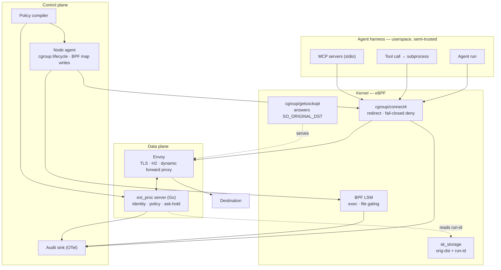
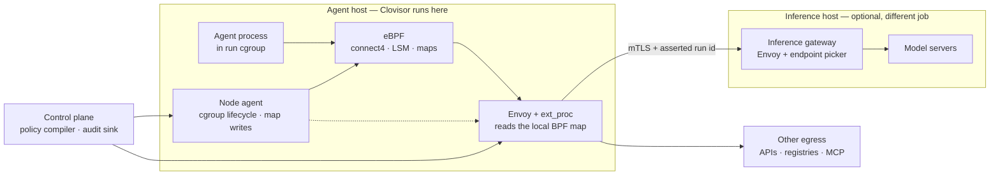
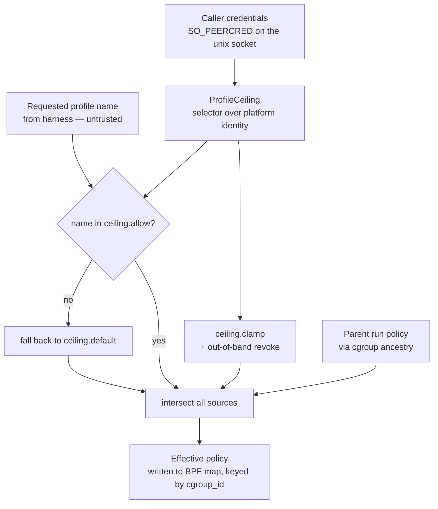
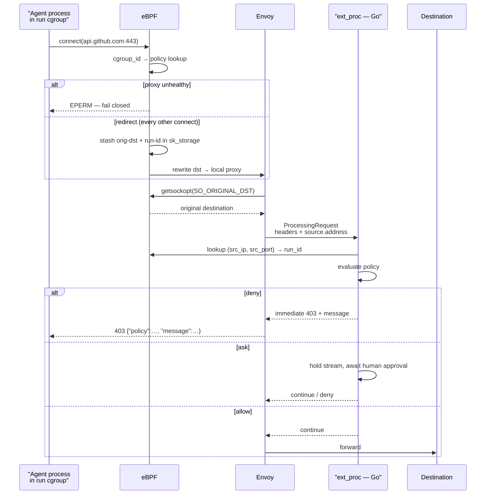
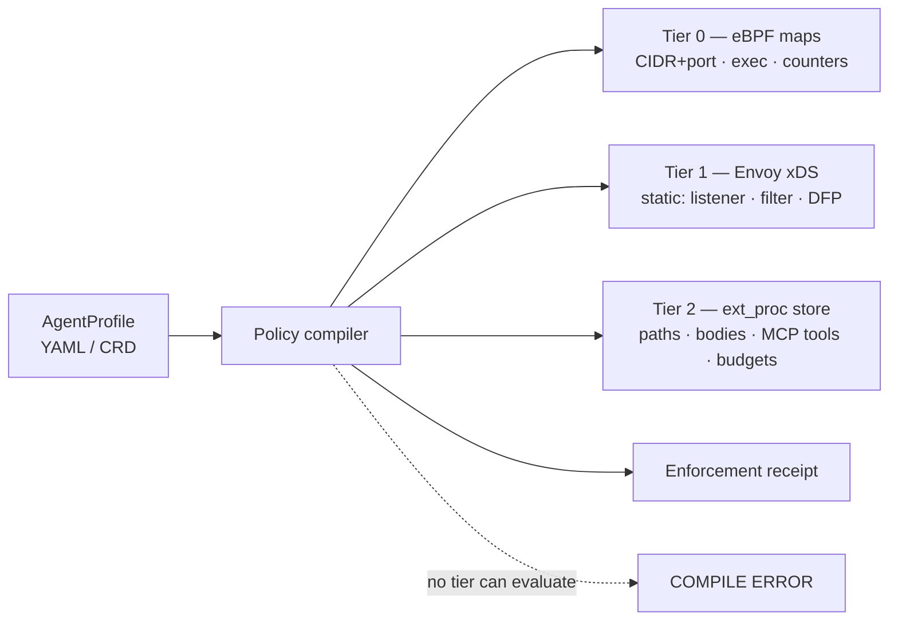
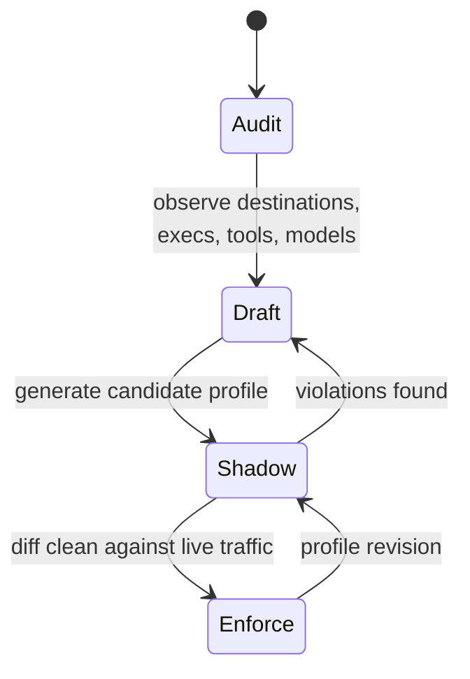
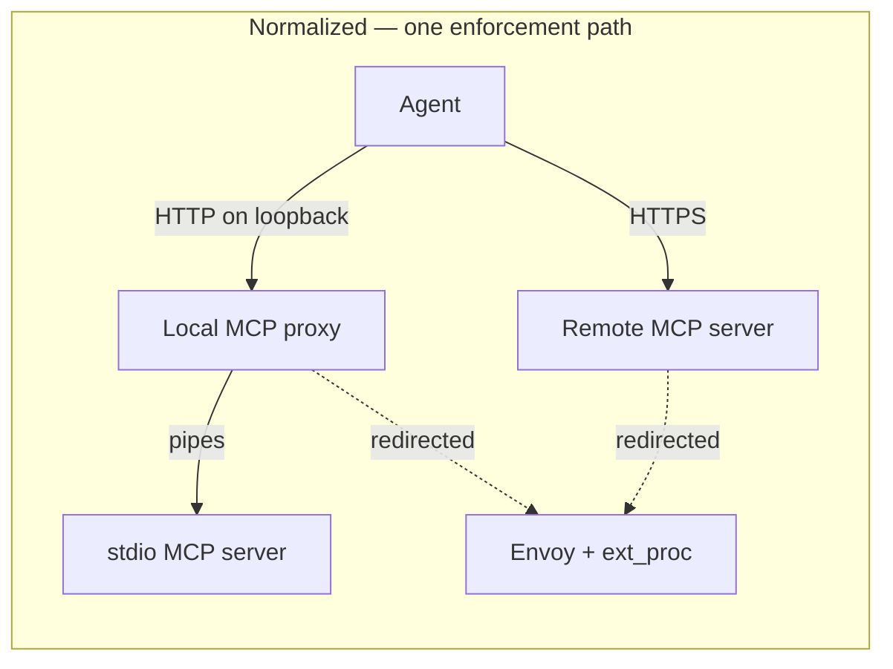
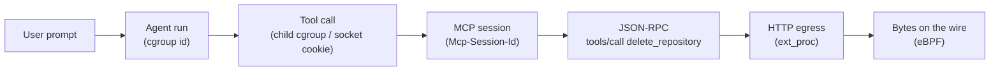

# Clovisor II — An Agent Egress Control & Audit Engine

**Status:** design exploration; Phase 1 audit path partly implemented ·
**Date:** 2026-11-14, revised 2026-11-19 · **Repo:** `clovisor`

> A design study on repointing Clovisor's architecture from Istio service-mesh
> observability toward egress control and audit for AI agents. Phase 1's audit
> path is partly implemented ([§10](#10-build-order)). Open questions are
> collected in [§12](#12-open-questions). The 2026-11-19 design review and what
> it changed are summarized under [Revision history](#revision-history).

---

## Table of contents

1. [Provenance: what Clovisor was](#1-provenance-what-clovisor-was)
2. [The gap this addresses](#2-the-gap-this-addresses)
3. [Why this direction over the alternatives](#3-why-this-direction-over-the-alternatives)
4. [Architecture overview](#4-architecture-overview)
5. [Identity model](#5-identity-model)
6. [Data path](#6-data-path)
7. [Policy language](#7-policy-language)
8. [MCP](#8-mcp)
9. [What maps from the existing codebase](#9-what-maps-from-the-existing-codebase)
10. [Build order](#10-build-order)
11. [Non-goals and honest limits](#11-non-goals-and-honest-limits)
12. [Open questions](#12-open-questions)

---

## Revision history

### 2026-11-19 — design review

Changes to the design, each marked *Revised 2026-11-19* or *New 2026-11-19* in
place:

| Change | Where |
|---|---|
| Enforcement granularity stated as it is: the process tree, not the logical run. Many runs in one process get per-process enforcement only. | [§2](#2-the-gap-this-addresses), [§5.8](#58-enforcement-granularity-is-the-process-tree) |
| Positioning against the strongest alternative — a network namespace per run — and existing kernel enforcement tools. | [§3.1](#31-prior-art-and-positioning) |
| A portable explicit-proxy mode with no eBPF, for platforms where agents actually run (including macOS). | [§4.3](#43-two-deployment-modes) |
| Tier 0 becomes **redirect-or-deny**: every TCP connect from a run goes to the proxy or fails. The DNS-learned IP allowlist backstop is dropped except for protocols with no hostname on the wire. | [§6.5](#65-three-rules-that-must-not-be-gotten-wrong), [§7.5](#75-one-rule-one-enforcement-point-no-bypass) |
| Egress channels `connect4` cannot see: unconnected UDP, DNS (and DNS tunnelling), QUIC, raw sockets. | [§6.8](#68-channels-connect4-does-not-see) |
| QUIC: denied by default, with opt-in SNI forwarding, plus a UDP packet backstop. Encrypted Client Hello defeated at the local resolver. | [§6.6](#66-tls-posture), [§6.8](#68-channels-connect4-does-not-see) |
| Build order: the proxy and MCP layer moves to Phase 2, ahead of kernel enforcement. | [§10](#10-build-order) |
| Exfiltration through *allowed* destinations stated as an explicit limit. | [§11](#11-non-goals-and-honest-limits) |
| Code-reuse table corrected to what actually carries over. | [§9](#9-what-maps-from-the-existing-codebase) |

---

## 1. Provenance: what Clovisor was

Clovisor (2018) was a sidecar-less, per-node eBPF agent that mapped Istio
application networking policy onto low-level kernel constructs. It had three
layers:

| Layer | Implementation | Verdict |
|---|---|---|
| **Control architecture** | k8s informer + label discovery → identity → compile policy into BPF maps → attach per-workload → stream events → correlate into traces | **Keep.** Still the right skeleton. |
| **Data path** | TC clsact on pod veth, parse eth/ip/tcp inline, `dports2proto` classification, 5-tuple session table, `perf_submit_skb` whole packet to userspace, HTTP parsed by a Go `.so` plugin, OpenTracing spans | **Rewrite.** Not a port. |
| **Steering** | `redirect_lookup_table` → MAC/IP rewrite + `bpf_clone_redirect`, driven by `POST /redirect/` | **Repoint.** Becomes proxy redirect. |

### Why the data path doesn't survive

The original L7 story — copy the full skb to userspace, `strncmp` for
`GET`/`POST`, reassemble — fails three ways against modern traffic:

- **TLS.** Everything is encrypted. Packet-level parsing is dead without uprobes
  on `SSL_read`/`SSL_write` and Go's `crypto/tls`, a completely different
  attachment model from TC.
- **HTTP/2 multiplexing.** A 5-tuple session keyed on `req_time`/`resp_time` and
  closed on FIN/RST cannot express per-stream events. Many requests share one
  connection.
- **Non-network transports.** A large share of agent traffic (MCP over stdio) is
  pipes between processes. TC sees nothing.

### Mechanical modernization (orthogonal to the redesign)

- `iovisor/gobpf` → `cilium/ebpf` + CO-RE (`vmlinux.h`, `bpf2go`). Kills runtime
  LLVM in the DaemonSet, the kernel-header dependency, and most of the image size.
- `BPF_PERF_OUTPUT` → ring buffer.
- `clsact` qdisc → `tcx`. The current attach clobbers Cilium/Calico on the same
  node; `tcx` solves multi-attach.
- Go plugin `.so` parsers → compiled in. Go plugins require exact toolchain match
  and were never worth it.
- OpenTracing / `jaeger-client-go` → OpenTelemetry.
- Redis-as-config-bus → CRDs + informers (already half-built in `k8s-ctlr/`).

---

## 2. The gap this addresses

An AI agent executes tool calls. What it calls is decided by a model at runtime
and is not statically knowable. Every existing control sits at the wrong
granularity:

| Control | Thinks in | Fails because |
|---|---|---|
| Harness allowlist | tool calls | In-process and advisory. `curl` inside a bash tool call never touches your HTTP client wrapper. Neither does an npm postinstall script. |
| NetworkPolicy / egress proxy | pods | 50 concurrent agent runs in one worker process = one identity. |
| Sidecar proxy | connections | Sees the host, not *which run* caused it. |
| Per-run sandbox (netns or microVM) + egress proxy | sandboxes | Doesn't fail. It is the strongest alternative ([§3.1](#31-prior-art-and-positioning)). It costs a sandbox and network plumbing per run, the harness has to adopt it, and it sees no exec tree. |

**The enforcement point does not know which logical agent run caused the
syscall.** That is structurally the same problem Clovisor already solved once —
Istio thinks in `VirtualService`, the kernel thinks in 5-tuples, and the job was
the bridge. Same shape, new nouns.

*Revised 2026-11-19.* The NetworkPolicy row's "50 runs in one worker process"
is not solved by this design either. A cgroup holds processes, so 50 runs in one
process are one cgroup, and nothing in the kernel can split them unforgeably
([§5.8](#58-enforcement-granularity-is-the-process-tree)). What this design adds
is per-run identity for runs that are separate process trees (which agent tool
calls overwhelmingly are) with no per-run network plumbing, plus an exec-level
audit trail.

The threat model is not malicious code. It is **an agent being manipulated** —
prompt injection via a poisoned web page, issue tracker, or file, leading to
exfiltration or destructive tool use. Network egress is the chokepoint for that
threat.

---

## 3. Why this direction over the alternatives

Three candidate directions were considered for repointing the project:

| Direction | Assessment |
|---|---|
| **A. Inference fabric observability** — NCCL/collective traffic, disaggregated prefill→decode KV transfers, straggler and ECMP-collision detection | Technically the most interesting. **Structural blocker:** GPUDirect RDMA bypasses the kernel networking stack entirely, so TC/XDP sees nothing. Limited to TCP-mode NCCL unless you move to rdma-core uprobes and switch telemetry. Partially covered by DCGM, NCCL profilers, and switch telemetry. |
| **B. Agent egress control + audit** *(this document)* | No structural blocker. Reuses the most of the existing control architecture. The gap — kernel-level identity at *agent-run* granularity — is owned by nobody. |
| **C. Inference-aware routing** — routing on KV-cache locality and queue depth | Skip. Gateway API Inference Extension / llm-d already own this, the signal lives in the model server, and eBPF adds almost nothing. |

The transferable insight from Clovisor is not "map Istio to eBPF" — Cilium L7
policy and Istio ambient have absorbed that. It is **knowing how to attach a
control-plane identity to a kernel object.** The unfilled gap is that no kernel
plane today knows what an *agent run* or a *tool call* is.

### 3.1 Prior art and positioning

*New 2026-11-19.* Three adjacent categories each cover part of this problem:

| Category | Covers | Does not cover |
|---|---|---|
| **Per-run sandboxes**: a network namespace or microVM per run, whose only route is an egress proxy | Unforgeable per-run identity (by the interface or proxy socket traffic arrives on), host-level egress allowlisting | The exec tree; L7 and MCP policy beyond what its proxy does. The harness has to create and own the run's network setup. |
| **Kernel runtime enforcement** (Tetragon-class tools, Falco) | exec and network observation and enforcement scoped by cgroup, pod or namespace | Agent runs, tool calls, MCP, request bodies. No concept of a run. |
| **AI and MCP gateways** | Model routing, token budgets, MCP tool allowlists | Anything that does not route through them; which run is calling |

**Network namespace per run is the one to beat.** Once a run is its own process
tree, which per-run enforcement requires anyway
([§5.8](#58-enforcement-granularity-is-the-process-tree)), it can also have its
own namespace. The proxy then knows the run from where its traffic arrives, with
no BPF at all. This design is better where:

- **exec matters.** A namespace sees packets, not processes. The audit chain
  ([§8.6](#86-the-audit-chain-closes)) needs exec events tied to the run, and
  exec gating ([§7.6](#76-exec-matching-path-hash-or-provenance)) needs a hook
  in the exec path.
- **The harness can't be changed.** `agentctl run -- python agent.py` works
  without the harness creating namespaces, veth pairs or routes, and it
  coexists with whatever CNI is on the node.
- **Density.** A cgroup and a map entry per run, not a namespace, veth pair and
  route set per run.
- **One install covers every agent on the host**, whichever harness launched it.

The two compose rather than compete. A namespace-per-run sandbox can use this
design's proxy, compiler and MCP layer in explicit-proxy mode
([§4.3](#43-two-deployment-modes)), with the sandbox supplying identity and
enforcement.

**Where the novelty is.** The kernel half is the least novel part; Tetragon-class
tools already enforce exec and connect per cgroup. What nobody ships is the
combination of:

- an identity model with runs and tool calls as first-class objects;
- a policy compiler that states honestly where each rule is enforced;
- an L7 and MCP layer: tool-level policy, tool-definition pinning, denial
  narration;
- an audit chain joined end to end.

Build effort should follow the novelty ([§10](#10-build-order)).

---

## 4. Architecture overview



### 4.1 Division of labor

| Layer | Owns |
|---|---|
| **eBPF** | Identity (cgroup), unbypassable capture, fail-closed deny, original-dst + run-id stash, exec gating |
| **Envoy** | Connections, TLS, HTTP/2, dynamic forward proxy, retries, access logs |
| **ext_proc (Go)** | Identity resolution via BPF map, policy decision, body inspection, ask-hold, denial narration |
| **Control plane** | Policy → ext_proc store + BPF maps; cgroup lifecycle; xDS kept static |

### 4.2 Deployment topology

**Clovisor runs on the agent host.** The identity primitive is the agent's
cgroup, and no machine can observe another machine's cgroups — so every
enforcement component is bound to the host where agent processes execute. This
is not a preference; eBPF makes it structural.



| Component | Placement | Why |
|---|---|---|
| `cgroup/connect4`, BPF LSM, maps | **Agent host — required** | Hooks the agent's own syscalls |
| Node agent | **Agent host — required** | Owns cgroup lifecycle; the unix socket to the harness ([§5.4](#54-the-injection-channel)) needs co-location |
| Envoy + `ext_proc` | **Agent host — required as designed** | `ext_proc` resolves identity by reading the local BPF map ([§6.4](#64-identity-handoff-to-envoy)) |
| Policy compiler, audit sink | Anywhere | Control plane; no kernel coupling |
| Inference gateway | Inference host — **optional** | Routing and endpoint selection; a different job, below |

#### The inference side consumes identity, it does not derive it

[§6.1](#61-why-envoy) argues for Envoy partly on a shared dataplane with
inference routing. That sharing is of *software and the `ext_proc` contract* —
not of a deployment. The two installations know different things:

| | Agent host | Inference host |
|---|---|---|
| Knows | cgroup → run, unforgeable | whatever identity arrived in-band |
| Enforces | egress, exec, MCP tools, content, budgets | model routing, endpoint selection |

Per-run token budgets are the one policy spanning both, since tokens are counted
where the model responds while run identity lives where the agent runs. Two
resolutions:

- **Agent-side (the default).** The agent-host Envoy terminates the model call,
  reads response usage, decrements the budget. Self-contained, no cross-machine
  trust, and [§6.6](#66-tls-posture) derives the needed termination
  automatically because `budget:` is a body rule.
- **Inference-side.** Needs the run id to travel in-band. The only component
  entitled to mint that header is the agent-side proxy — the one holding
  cgroup-derived identity.

> **The agent-side proxy is the identity authority. The inference gateway is a
> consumer of asserted identity.** That assertion is worth exactly as much as
> the mTLS between them.

Which follows from [§5.5](#55-the-forgeability-rule): cgroup-derived identity is
enforcement-grade at its point of origin and becomes a *claim* the moment it
crosses a machine boundary.

#### The centralized-gateway fork

A shared egress gateway — one Envoy fleet serving many agent hosts — is a
reasonable architecture that **this design forecloses**, because `ext_proc`
resolves identity from a local BPF map. Going centralized would require either
an RPC back to the originating node agent on every connection, or minting a
signed per-run credential (PROXY protocol, or a per-run client certificate) so
identity travels in-band. Both are viable, neither is free, and the second is
the same mechanism as the inference-side case above. Recorded so the choice is
made deliberately rather than discovered.

#### Packing and distribution

Colocation changes nothing architecturally: an agent and a model server on one
bare-metal box is one node agent with two filter chains — a packing decision.

The consequential case is the reverse. **Agents running outside your
infrastructure** — on a laptop, in a customer's cluster — mean the whole
enforcement half ships to them while only the inference gateway stays yours.
That decides whether this is a system you operate or one you distribute, and it
is worth settling before the control-plane interfaces harden.

### 4.3 Two deployment modes

*New 2026-11-19.*

| | Transparent (Linux) | Explicit proxy (portable) |
|---|---|---|
| How traffic reaches the proxy | `connect4` redirect-or-deny ([§6.5](#65-three-rules-that-must-not-be-gotten-wrong)) | `HTTPS_PROXY` or harness configuration, or an OS sandbox whose only route is the proxy |
| Run identity at the proxy | cgroup id via BPF map, enforcement-grade | A per-run listener (a unix socket or loopback port exposed only inside the run's sandbox) is enforcement-grade when the sandbox stops the run reaching any other listener. Otherwise a per-run proxy credential, which is a claim ([§5.5](#55-the-forgeability-rule)). |
| Bypass | none for TCP and UDP from the run ([§6.8](#68-channels-connect4-does-not-see) covers the rest) | anything that ignores the proxy setting, unless a sandbox blocks other egress |
| Exec gating and exec audit | yes | no |
| Platforms | Linux with cgroup v2; exec gating needs `lsm=bpf` | anywhere Envoy runs, including macOS |

Explicit-proxy mode alone is advisory: `curl --noproxy '*'` walks past it. It is
enforcement-grade only when paired with something that forbids other egress: a
namespace sandbox, an OS sandbox profile, or transparent mode.

It exists for two reasons:

- **Most interactive coding agents run on developer laptops**, where eBPF does
  not exist.
- **It lets the L7 and MCP layer ship first** ([§10](#10-build-order)), without
  waiting on kernel work.

Policy, compiler and audit format are identical in both modes. Only the identity
source changes, and with it the bypass column of the receipt
([§7.4](#74-compilation-and-the-enforcement-receipt)).

---

## 5. Identity model

### 5.1 Two granularities, two mechanisms

The single most important framing. Conflating these is what makes the problem
look intractable.

- **Enforcement identity** = the agent run. Must be unforgeable, must survive
  fork/exec, must need no cooperation from the governed code.
- **Attribution identity** = the tool call. May be self-reported, needs to be
  fine-grained, only has to be good enough for forensics.

### 5.2 Enforcement identity: cgroup v2

```
/sys/fs/cgroup/agents/                 ← BPF programs attached ONCE here
└── run-7f3a9c/                        ← enforcement identity (the agent run)
    ├── call-0012/                     ← tool call: bash -c "git clone ..."
    │   └── (git, ssh, ...)            ← inherited, no extra work
    ├── mcp-github/                     ← MCP server, attenuated profile
    └── subagent-2b/                    ← sub-agent, policy ⊆ parent
```

Mechanics that matter:

**Attach once, not per run.** Attaching a program per run cgroup costs an
attach/detach syscall pair per run plus churn. Attach once at the subtree root
with `BPF_F_ALLOW_MULTI`, then call `bpf_get_current_cgroup_id()` inside the
program and look up policy in a hash. One attach, N runs; run creation becomes a
single map update.

**Spawn into the cgroup atomically.** The naive path — fork, then write the pid
to `cgroup.procs` — leaves a window where the child executes under the parent's
policy. An agent that spawns and immediately connects wins that race. Use
`clone3(CLONE_INTO_CGROUP)` (Linux 5.7+); recent Go exposes it as
`SysProcAttr.CgroupFD`. **This is the single most important implementation
detail on this path.**

**Who creates the cgroup.** A containerized harness running non-root cannot
write host cgroupfs. Do not solve this with delegation. The node agent owns all
cgroup manipulation from the host namespace and exposes a small local API
("give me a cgroup for run X") returning an fd the harness passes to `CgroupFD`.
Note `bpf_get_current_cgroup_id()` returns the host kernfs id regardless of
cgroup namespacing, so the BPF side is unaffected; only userspace path
construction cares, and that now lives in one place.

**Deferred cleanup.** Kernfs ids are not practically reused, but rapid
create/delete cycles plus in-flight events will eventually deliver an event for
an id just reassigned. Remove the policy map entry **first** (so late syscalls
fail closed), drain, then delete the cgroup on a grace timer.

### 5.3 Attribution identity: the async problem

Within one run cgroup there are many tool calls. The obvious mechanism — a BPF
hash keyed by `tid`, written by the harness at tool-call entry — works for
exactly one execution model:

| Runtime | tid tagging |
|---|---|
| Python, thread-per-call | **Works.** `os.gettid()`, write at entry, overwrite on pool reuse. |
| Python asyncio | **Breaks.** One thread, interleaved calls. |
| Node.js | **Breaks.** Single event loop, async by default. |
| Go | **Breaks.** Goroutines migrate across OS threads mid-call. `LockOSThread` per call "fixes" it and wrecks the scheduler. |

That is most modern harnesses. Do not fight it in the kernel. Resolve in three
pieces:

1. **Subprocesses → child cgroups.** A tool call that shells out spawns into
   `run-<id>/call-<n>`. Tool-call identity becomes a cgroup id again with full
   inheritance. `bpf_get_current_ancestor_cgroup_id()` gives the run, the leaf
   gives the call. The happy accident: *the case where attribution matters most —
   arbitrary code execution — is exactly where cgroups work perfectly.*

2. **In-process HTTP → socket cookies.** For async runtimes the stable handle is
   the socket, not the thread. Userspace reads `getsockopt(SO_COOKIE)` on its own
   fd; BPF reads `bpf_get_socket_cookie()`. Both see the same u64. Connection
   pooling makes it many-to-one over time — treat it as an append-only timeline
   (`cookie, timestamp → call`) and join by window, or disable keepalive for
   agent egress, which is a defensible isolation choice anyway.

3. **Everything else → join in correlation.** Let the harness emit ordinary
   userspace spans and stitch them to kernel events by
   `(cgroup_id, time window, socket cookie)`. This is precisely what the existing
   `sessionMap` correlation does for a different pairing.

Residual risk is small: in-process async HTTP goes through *your own* HTTP
client, which can be instrumented at the application layer. What you cannot
instrument forks, and forks are covered by cgroups.

### 5.4 The injection channel

Three ways for userspace to write identity into the kernel, in increasing order
of correctness:

1. Harness opens pinned maps directly — needs `CAP_BPF`. **No.** This hands
   arbitrary BPF access to the thing being contained.
2. Node agent passes a single map fd over `SCM_RIGHTS`. Workable.
3. **Harness talks to the node agent over a unix socket; the node agent is the
   only BPF writer.** One trusted writer, full validation, one IPC round trip per
   tool call — free at agent rates. **Take this one.**

### 5.5 The forgeability rule

> **Enforcement identity must come from the cgroup. Self-reported identity is
> audit-grade only, never enforcement-grade.**

If an agent can execute arbitrary code in the harness process, it can write
anything into any tid or cookie map the harness can write. Those are *claims*,
not facts. Cgroup membership is different: you cannot move yourself out of a
cgroup without write access to the parent's `cgroup.procs`, which is denied, and
you cannot escape by forking. `cgroup_id → policy` is the only binding a
`connect4` hook may consult for an allow/deny decision. Everything else enriches
the log.

### 5.6 Profile binding: names with a trusted ceiling

Which profile applies to a run must be a **recorded fact, not a computed
property.** Two candidate mechanisms: *by selector* over run metadata (the
Kubernetes/Istio model), or *by name*, stated when the run is created.

Selector binding is disqualified by [§5.5](#55-the-forgeability-rule). If
profile selection depends on run metadata, then whoever sets the metadata
chooses the policy — and run metadata is set by the harness, the semi-trusted
component being contained. **Selector binding makes enforcement identity
self-reported by construction.**

Three further problems compound it:

- Determining effective policy becomes a selector evaluation with merge and
  precedence rules rather than a lookup — the failure mode that makes
  NetworkPolicy and mesh config hard to debug.
- It puts control-plane work on the run-start critical path, where policy must
  land in the BPF map *before* `clone3` or the
  [§5.2](#52-enforcement-identity-cgroup-v2) race reopens.
- It makes attenuation incoherent: a sub-agent whose metadata matches a broader
  profile yields an upper bound that is then silently clipped, so a profile's
  stated scope is never its real one.

But naive name binding has the same hole wearing a different hat — if the
harness names its own profile, the harness chooses its own policy. Name binding
is only better when **the name is constrained by something the agent cannot
influence.**

#### Resolution chain

The harness *requests* a profile by name. The node agent *validates* that
request against a ceiling derived from the caller's own identity, then
intersects:



The ceiling comes from a different place depending on depth, but the rule is
identical:

| Run kind | Ceiling source |
|---|---|
| **Root run** | Platform identity — service account, namespace, pod identity. Set by the platform, never by the agent. |
| **Sub-agent run** | The parent run's effective policy, via cgroup ancestry. |

So [§7.8](#78-sub-agent-delegation-monotonic-attenuation) attenuation is not a
special rule for sub-agents. It is *the* general rule, and a root run is simply
the case where the parent is the workload rather than another run. One concept
covers the whole tree.

Critically, the node agent resolves the ceiling from the **caller's credentials
on the unix socket** (`SO_PEERCRED`), never from anything in the request body.
The harness may choose among profiles it has been granted; it cannot name one it
has not.

#### Where selectors remain legitimate

The ceiling lookup — "which ceiling applies to this workload" — *is* a selector.
What differs is the thing it binds to:

> **Selectors at the platform boundary: trusted, slow-changing, few.
> Names at the run boundary: fast, ephemeral, many.**

That also serves the use case selectors exist for. "Apply a baseline to
everything" needs no run-metadata matching — it is a cluster-wide `clamp`
intersected into every ceiling. One object edited, every run constrained, no
selector ever evaluated against a run. See
[§7.3](#73-surface-syntax) for the `ProfileCeiling` object.

#### Versioned binding

A run binds to a *resolved version* (`research-agent@v7`), not a bare name. A
policy edit then cannot retroactively change what a running agent may do, and
the audit log states exactly which policy was in force — so an incident can be
replayed against the real thing.

The cost is that you cannot tighten policy on a run already in flight, which is
precisely what an incident calls for. That is served by an explicit out-of-band
**clamp/revoke**, deliberately one-directional: it can only remove permissions,
never add. Routine edits never silently mutate live runs, emergencies still have
a lever, and because clamping only subtracts it composes with attenuation rather
than fighting it.

#### Debuggability

"Why was this blocked?" resolves to two lookups of recorded facts — the profile
version bound at creation, and the ceiling that clamped it. No selector
evaluation, no precedence rules, no reconstructing control-plane state at some
past instant. For a system whose value proposition is the audit trail, that is
worth more than the flexibility given up.

### 5.7 No-cooperation mode is the default

`agentctl run -- python agent.py` creates the cgroup, `clone3`s into it, and
yields full enforcement with **zero harness changes**. Tool-call attribution
degrades to "inferred from the exec tree plus timing," which is decent. Harness
integration buys precision, not function.

This is the right shape for adoption: nobody installs a security tool that
requires rewriting their agent first.

### 5.8 Enforcement granularity is the process tree

*New 2026-11-19.* A cgroup contains processes. Threads can technically sit in
separate threaded cgroups, but code in one address space can act through any of
its threads, so that is not an identity boundary.

> **Enforcement identity is per process tree. A run gets enforcement-grade
> identity only if it is its own process tree.**

This corrects the motivating example in [§2](#2-the-gap-this-addresses).
Fifty runs inside one worker process are one cgroup:

- tier 0 enforces one policy for all fifty;
- telling them apart relies on socket cookies and harness spans, which
  [§5.5](#55-the-forgeability-rule) rules audit-grade only.

No kernel mechanism fixes that case, and a namespace can't split a process
either. Code in the same address space can forge whatever the runtime uses to
tell runs apart.

| Harness shape | Enforcement unit | Attribution |
|---|---|---|
| One process per run (`agentctl run`, a worker per run, most CLI agents) | the run | per tool call, via child cgroups ([§5.3](#53-attribution-identity-the-async-problem)) |
| Tool calls that shell out | the run, and the tool call with child cgroups | exact |
| Many runs in one process (async worker pools) | the process: a profile common to all its runs | audit-grade, via socket cookies and spans |

For the third shape, the recommendation is to move to a process per run: a pool
of worker processes, not of coroutines. That is also the isolation boundary those
harnesses lack today. When the enforcement unit is the process, the receipt says
so, so nobody reads a per-run guarantee that isn't there.

---

## 6. Data path

### 6.1 Why Envoy

The proxy was initially scoped as a small Go program (direct BPF map reads, no
callout). **Envoy wins** on two arguments:

- **`ext_proc` gives body access, not just a verdict.** `ext_authz` returns
  allow/deny; `ext_proc` streams request and response through an external gRPC
  service that can observe and mutate headers, body, and trailers at every
  phase. For agent egress that is the difference between "run X connected to
  `api.openai.com`" and "run X sent *this payload* containing *this secret*."
  Every interesting rule is a body rule.
- **Shared dataplane with inference routing.** If Envoy is already in the
  inference path (Gateway API Inference Extension's endpoint picker is itself an
  `ext_proc` server), egress control and inference routing become the same
  software with different filter chains. One `ext_proc` server can know both
  *which agent run* and *which model* — which unlocks **per-run token budgets
  enforced at the dataplane**, expressible nowhere else today.

Go does not disappear, it relocates: the `ext_proc` server is Go, reads the BPF
maps, evaluates policy. Hundreds of lines, not thousands.

### 6.2 Transparent redirect and original-destination recovery

The enabler that lets an off-the-shelf proxy work unmodified:

After `cgroup/connect4` rewrites the destination, stash the original in
`bpf_sk_storage` keyed by socket cookie, then attach a `cgroup/getsockopt`
program that answers `SO_ORIGINAL_DST` from that map. Cilium does exactly this.
The effect: **any proxy that already speaks `SO_ORIGINAL_DST` — which is all of
them, since that is the netfilter REDIRECT convention — works with BPF redirect,
no conntrack, no iptables.**

### 6.3 Connection flow



### 6.4 Identity handoff to Envoy

Envoy cannot read BPF maps, so identity resolution lives in `ext_proc`. The BPF
`connect4` program stashes `(src_ip, src_port) → run_id` at connect time
alongside the original-destination stash. Configure `ext_proc` to forward
`source.address` as a request attribute; the server does the map lookup.

Port reuse is the race, bounded by connection lifetime — include the socket
cookie in the stash and verify, or accept the window.

The §5.5 invariant still holds and matters more here: the lookup resolves to a
cgroup-derived run id, which is unforgeable. **Nothing the agent puts in a
header is enforcement-grade.**

### 6.5 Three rules that must not be gotten wrong

**1. Tier 0 is redirect-or-deny.** *Revised 2026-11-19.* Every TCP connect from
a run cgroup is either redirected to the local proxy or refused with `EPERM`.
There is no third outcome where a connection silently goes direct.

- **Proxy healthy:** redirect, and stash the original destination.
- **Proxy unhealthy or unconfigured:** deny. **Fail closed.**
- **Static exceptions compiled from policy:** allow direct. These cover loopback
  to the local MCP proxy, the node agent's socket, and little else.

Envoy governs only what reaches it, and this rule makes that everything. That
removes the bypass the original design spent tier 0 on (a DNS-learned IP
allowlist catching traffic that avoided the proxy), because nothing can avoid
it. See [§7.5](#75-one-rule-one-enforcement-point-no-bypass). The wrong default
here turns the whole control into a no-op exactly when it matters.

**2. Keep xDS static.** Agent runs are ephemeral — seconds to minutes,
potentially hundreds concurrent. An xDS push per run will melt the control
plane. **xDS carries policy *shape*, not policy *instances*.** One listener, one
`ext_proc` filter, a dynamic forward proxy cluster, pushed once. All per-run
dynamism lives in BPF maps and the `ext_proc` store.

**3. Use `dynamic_forward_proxy`.** Agents egress to arbitrary hostnames.
Without the dynamic forward proxy cluster and its DNS cache filter you need a
cluster per destination — the xDS explosion from another direction.

### 6.6 TLS posture

| Mode | Gives you | Costs |
|---|---|---|
| **SNI only** (no termination) | Hostname | Nothing breaks, no CA management. No path or body rules. |
| **Terminate (MITM)** | Paths, bodies, MCP tool calls, content policy | CA in every agent image (tractable — you build them), breaks cert-pinned clients, and **creates a box holding plaintext of everything sensitive**. |
| **TLS uprobes** | Plaintext for audit | Offset chasing, Go version churn, dead on stripped static binaries. |

Clean split: **uprobes for visibility, proxy for enforcement.**

#### Posture is a property of the destination, not the profile

There is no `tls:` field on a profile. Posture is **derived per destination by
the compiler** from the rules attached to it:

| Rules attached to a destination | Required posture |
|---|---|
| FQDN, port, CIDR only | SNI — no termination |
| Loopback (normalized stdio MCP, [§8.3](#83-normalize-the-transport)) | plaintext already; nothing to terminate |
| Paths, methods, content patterns | terminate |
| MCP tools / resources / sampling | terminate |
| `model:` allow-lists, token and cost budgets | terminate |

This is [§7.1](#71-organizing-principle) applied one level down. Tier placement
minimizes *where* enforcement happens; posture inference minimizes *how deeply*
traffic is intercepted. Both say: use the least invasive mechanism that can
enforce what was actually stated.

The payoff is on the objection above. Per-destination inference shrinks the
plaintext box from everything the agent does to only the endpoints carrying body
rules — terminating `mcp.github.internal` does not put model API calls or
package downloads in plaintext — and it confines cert-pinning breakage to
destinations that were opted into explicitly, which the receipt names.

#### `no_terminate`

A per-destination assertion — *"I may not hold plaintext for this endpoint"* — a
routine compliance constraint. The compiler then hard-fails any body rule for
that destination and names it, so the constraint surfaces as a rejected rule
rather than a rule that silently does nothing.

#### Termination is node-wide per destination

Envoy selects a filter chain per connection, matching on SNI and original
destination — at which point it does not yet know the run, since identity
resolution happens in `ext_proc` afterward
([§6.4](#64-identity-handoff-to-envoy)). **Termination therefore cannot vary by
profile for the same destination on the same node**: it is the union of all
active profiles.

Adding one body rule to one profile extends plaintext custody for every run on
that node talking to that destination. That is non-obvious enough that the
receipt must say so rather than hide it
([§7.4](#74-compilation-and-the-enforcement-receipt)).

Partial mitigation: terminate the connection, but have `ext_proc` discard bodies
for runs whose profile carries no body rule for that destination. The
interception still happens; the retention does not.

Mechanically this stays consistent with [§6.5](#65-three-rules-that-must-not-be-gotten-wrong):
one terminating filter chain matching the SNI set derived from policy, one
passthrough TCP chain for everything else. That set changes when policy changes,
never per run, so xDS stays effectively static.

#### Encrypted Client Hello

*New 2026-11-19.* SNI-only posture assumes the SNI names the real destination.
Encrypted Client Hello (ECH) breaks that assumption for TLS over TCP and QUIC
alike:

- the visible ("outer") SNI becomes the hosting provider's public name;
- the real one is encrypted to a key the client gets from the destination's DNS
  `HTTPS`/`SVCB` record.

Left alone, growing ECH adoption silently degrades every SNI-only rule to "some
site behind this provider." That is the shared-CDN problem from
[§7.5](#75-one-rule-one-enforcement-point-no-bypass) again.

The forced local resolver ([§6.8](#68-channels-connect4-does-not-see)) closes it.
It strips the `ech` parameter from `HTTPS` and `SVCB` answers, so clients never
attempt ECH and connections carry a cleartext SNI.

Residuals:

- **ECH configs from outside DNS.** A client with a hardcoded or previously
  cached ECH config can still use it. The ECH extension is visible in the outer
  ClientHello, so a TLS listener filter can detect it and deny the connection.
- **Explicit-proxy mode.** [§4.3](#43-two-deployment-modes) gets this protection
  only if the harness uses the local resolver.

### 6.7 ext_proc specifics

- **Denial narration.** `ext_proc` can return an immediate response with a custom
  body — a 403 with structured JSON (policy name, what was blocked, why, what is
  allowed instead) instead of an incomprehensible `EPERM`. See
  [§7.7](#77-denial-as-a-teaching-signal).
- **Ask-mode is nearly free.** `ext_proc` is a streaming RPC; the server can
  withhold its response while a human approves and Envoy waits. Set
  `message_timeout` / `max_message_timeout` deliberately and bound concurrent
  held streams so pending approvals cannot exhaust workers.
- **Watch `processing_mode` on streams.** Subscribing to response bodies on a
  token stream means one `ext_proc` message per chunk. Skip response-body phases
  unless specifically needed — with the exception of MCP sampling
  ([§8.4](#84-two-mcp-specific-threats)).

### 6.8 Channels `connect4` does not see

*New 2026-11-19.* Redirect-or-deny covers `connect()`, including `io_uring`
connects, because the cgroup hooks sit in the socket layer rather than at the
syscall. Several egress paths never call `connect()`:

| Channel | Why `connect4` misses it | Handling |
|---|---|---|
| Unconnected UDP (`sendto`, `sendmsg`) | no connect | `cgroup/sendmsg4` and `sendmsg6`: deny, except DNS to the local resolver |
| DNS | usually unconnected UDP; also the classic tunnelling channel | Force all DNS to a node-local resolver (below) |
| QUIC / HTTP/3 | UDP 443. Connected sockets (most QUIC clients) hit `connect4`/`connect6`; unconnected ones hit `sendmsg4`/`sendmsg6`. Both see the address only. | deny by default with `EPERM`; opt-in SNI forwarding. See [QUIC](#quic) below. |
| Raw and packet sockets | bypass the inet hooks | drop `CAP_NET_RAW` for run cgroups; deny `SOCK_RAW` and `AF_PACKET` in the LSM `socket_create` hook (Phase 4) |
| Unix sockets to host daemons | not inet | a run reaching the Docker socket or an SSH agent can egress through it; the LSM phase gates `AF_UNIX` connects by path |

**Forced local DNS.** Rewrite port-53 traffic from run cgroups to a node-local
resolver. The resolver answers only names that some active rule could allow for
that run, and returns `NXDOMAIN` for everything else. That closes DNS
tunnelling as a side effect: arbitrary subdomains never resolve, so they never
leave the host. Wildcard rules reopen it for the zones they name, which is one
more reason to keep wildcards narrow.

The resolver also produces the per-run DNS events the audit timeline needs,
which is simpler than parsing DNS in BPF. It is also where Encrypted Client Hello
is defeated ([§6.6](#66-tls-posture)).

**UDP backstop.** A `cgroup_skb/egress` program, attached to `agents/` like the
socket-address hooks, sees every packet leaving a run's sockets and can drop it.
It drops any UDP whose destination is not the local resolver or the QUIC
forwarder (below). That catches whatever the address hooks miss, for one map
lookup per packet.

#### QUIC

The address hooks can deny QUIC, but they cannot police it by name. That needs
the SNI, which sits in the TLS ClientHello inside QUIC Initial packets. Initial
packets are encrypted, but with keys anyone can derive from the client's
destination connection ID and a salt published in RFC 9001. So the SNI is
recoverable on-path, without terminating anything.

Recovering it in BPF is impractical:

- **Crypto.** It needs AES-ECB for header protection and AES-GCM for the
  payload. As of this writing, the BPF crypto kfuncs (Linux 6.10+) offer
  symmetric skciphers to TC and XDP programs. That covers header protection, but
  not the AEAD payload.
- **Reassembly.** With post-quantum key shares, the ClientHello often spans more
  than one Initial packet. Parsing it would mean reassembling CRYPTO frames
  across packets in the kernel.

So QUIC gets two postures, chosen per destination by the compiler, like TLS
posture ([§6.6](#66-tls-posture)):

| Posture | Mechanism | Used for |
|---|---|---|
| **Deny** (default) | `EPERM` on UDP 443 at `connect` and `sendmsg`. The failure is immediate, so HTTP/3 clients (browsers, curl) fall back to TCP without waiting for a timeout. | Every destination not opted into QUIC. Also every destination with body rules: those need termination, which exists on the TCP path. |
| **SNI-forwarded** (opt-in) | `connect4`/`sendmsg4` rewrite UDP 443 to a node-local QUIC forwarder. `recvmsg4`/`recvmsg6` rewrite reply sources, so the application sees its original peer. The forwarder decrypts Initial packets in userspace, extracts the SNI, applies the same host policy as TCP, then relays datagrams unmodified. | A workload that needs QUIC, for a destination with host-level rules only. |

SNI-forwarded QUIC has the same posture as SNI-only TLS over TCP: hostname
granularity, no termination, no plaintext.

Denying by default breaks little that should keep working. What it does break is
mostly QUIC-only tunnels (MASQUE, VPN-like transports) and DNS-over-QUIC. Both
route around the proxy or the resolver and should be blocked anyway.

Visibility without enforcement is also possible: uprobes on QUIC libraries give
plaintext for audit. But every application bundles its own QUIC stack, so
coverage means chasing each library and version. That is the same trade-off as
TLS uprobes (Phase 6).

---

## 7. Policy language

### 7.1 Organizing principle

> **Every rule declares what information it needs. The compiler places it at the
> lowest tier that can evaluate it — and refuses to compile if no tier can.**

Silent non-enforcement is the cardinal sin. A profile that looks like it blocks
something but does not is worse than no profile at all.

### 7.2 What each tier can know

| Tier | Sees | Cannot see | Bypassable |
|---|---|---|---|
| **0 — eBPF** | cgroup→run, dst IP:port, exec'd binary, counters | names, paths, bodies | No |
| **1 — Envoy static** | SNI, original dst | bodies, run identity | No in transparent mode (tier 0 redirects everything); yes in explicit-proxy mode alone |
| **2 — ext_proc** | everything above + run identity, headers, path, body, external state | — | Same as tier 1 |
| **3 — async** | history, cross-run patterns | cannot block inline | n/a |

That table *is* the language design. *Revised 2026-11-19:* the original
tension was that IP-and-port rules are unbypassable while path and body rules
depend on traffic reaching Envoy. Redirect-or-deny
([§6.5](#65-three-rules-that-must-not-be-gotten-wrong)) resolves it by making
reaching Envoy mandatory, so precise rules are unbypassable too
([§7.5](#75-one-rule-one-enforcement-point-no-bypass)).

### 7.3 Surface syntax

Typed declarative, **not** CEL or Rego as the primary surface. The reason is
analyzability: with typed match fields the compiler determines tier placement by
static inspection. With arbitrary CEL it cannot, so every rule lands at tier 2
by default. Keep CEL as an escape hatch *explicitly declared* tier-2-only.

```yaml
kind: AgentProfile
metadata: { name: research-agent }
spec:
  mode: enforce           # audit | enforce | ask
                          # no tls: field — posture is derived per destination,
                          # see 6.6

  egress:
    default: deny
    rules:
      - name: github-api
        to: { fqdn: ["api.github.com"], ports: [443] }
        http: { methods: [GET], paths: ["/repos/*"] }
        action: allow

      - name: model-endpoints
        to: { fqdn: ["*.inference.internal"] }
        model: { allow: ["claude-opus-5", "claude-sonnet-5-5"] }
        budget: { tokens: 500000, cost_usd: 25 }
        action: allow

      - name: package-registries
        to: { fqdn: ["pypi.org", "registry.npmjs.org"] }
        action: ask
        ask: { timeout: 5m, on_timeout: deny }

      - name: payments-api
        to: { fqdn: ["billing.internal"] }
        no_terminate: true           # compliance: never hold plaintext here
        action: allow                # so no body rule may target this host

      - name: no-external-llm
        to: { fqdn: ["api.openai.com", "api.anthropic.com"] }
        action: deny
        message: "External LLM APIs aren't permitted here. Use models.internal instead."

  exec:
    default: deny
    require_readonly_origin: true     # see 7.6
    allow:
      - path: /usr/bin/git
      - path: /usr/bin/python3
        note: "interpreter — confinement comes from egress policy, not here"
      - path: /usr/local/bin/custom-tool
        hash: sha256:ab12…            # verified via IMA where available

  content:
    - { name: aws-keys,   regex: "AKIA[0-9A-Z]{16}", action: deny }
    - { name: corp-hosts, regex: "\\.corp\\.internal", action: redact }

  limits:
    connections_per_min: 120
    egress_bytes: 100Mi
    duration: 30m
```

Actions: `allow` · `deny` · `redirect` · `tag-and-log` · `rate-limit` · `ask` ·
`redact`.

A separate `ProfileCeiling` governs which profiles a workload may request, and
is the only object that uses a selector — over platform identity, never over run
metadata ([§5.6](#56-profile-binding-names-with-a-trusted-ceiling)):

```yaml
kind: ProfileCeiling
metadata: { name: agent-workers }
spec:
  appliesTo:                     # selector over PLATFORM identity
    namespace: agents
    serviceAccount: agent-worker
  allow:   [research-agent, light-agent]
  default: light-agent           # used when the request names nothing permitted
  clamp:   baseline-sandbox      # intersected into every grant here
```

### 7.4 Compilation and the enforcement receipt



The receipt is the feature that makes the system honest. `policyctl explain`
emits, per rule, where it lands and what its bypass exposure is:

```text
rule                tier   enforced by                      bypass
(all egress)         0     connect4 redirect-or-deny        none for TCP; UDP/raw see §6.8
github-api           2     ext_proc (path match)            none (redirected)
model-endpoints      2     ext_proc (body: model field)     terminate — see posture
package-registries   2     ext_proc ask-hold
no-external-llm      1     Envoy SNI match                  fronting-exposed (not terminated)
exec/git             0     LSM bprm_check (path+ro-origin)  path-only
exec/python3         0     LSM bprm_check (path+ro-origin)  interpreter — see §7.6
exec/custom-tool     0     LSM bprm_check (IMA hash)        content-verified
content/*            2     ext_proc body scan               terminate — see posture
limits/connections   0     BPF counter                      none
```

When the enforcement unit is a process rather than a run
([§5.8](#58-enforcement-granularity-is-the-process-tree)), the receipt's header
says so.

It also reports the derived TLS posture per destination, including the node-wide
consequence from [§6.6](#66-tls-posture):

```text
destination           posture     why
api.github.com        sni         no body rule in any active profile
mcp.github.internal   terminate   research-agent (mcp.tools)
                                  node-wide: also applies to 3 other profiles
models.internal       terminate   research-agent (budget.tokens)
billing.internal      sni         no_terminate asserted — body rules rejected
127.0.0.1:7700        plaintext   local MCP proxy; nothing to terminate
```

The compiler **hard-fails** on a body rule against a destination marked
`no_terminate`, or a `paths:` match against a non-HTTP destination. Never
degrade quietly.

### 7.5 One rule, one enforcement point, no bypass

*Revised 2026-11-19.* The original design compiled every FQDN rule twice:

- an `ext_proc` predicate, for precision;
- a tier-0 IP allowlist entry populated by DNS learning, as a backstop for
  traffic that avoided the proxy.

With redirect-or-deny ([§6.5](#65-three-rules-that-must-not-be-gotten-wrong)) no
traffic avoids the proxy. And the backstop was weaker than it looked:

- **Shared CDN addresses.** Large SaaS APIs sit behind CDN anycast ranges.
  Admitting `api.github.com` by IP admits whatever else shares those addresses.
  That is an exfiltration path, and the receipt's "IP granularity only" did not
  convey how coarse it is.
- **Per-identity DNS state.** A global name→IP cache is a confused-deputy
  hazard: run A resolves a name and widens the allowed set for run B. Per-run
  caches fix that, but add state on the hot path.

So FQDN rules now compile to a single enforcement point, the proxy, where
hostnames are real:

| Traffic | Identified by | Enforced at |
|---|---|---|
| TLS | SNI, plus `Host` when terminating | Envoy filter chain / `ext_proc` |
| Plain HTTP | `Host` | `ext_proc` |
| Other TCP (e.g. `ssh` to a git host) | original destination IP:port | Envoy TCP proxy, against a per-run DNS-learned set |

DNS-learned IP matching survives only for the last row, protocols with no
hostname on the wire. There it is the best available, and the receipt says so.

**Domain fronting.** Without termination, SNI is the only name. A client can send
SNI `allowed.example` to a CDN with an inner `Host` for something else. Catching
that requires termination plus an SNI-equals-`Host` check. The compiler marks
allowed destinations on shared CDNs as *fronting-exposed* when they are not
terminated, and the receipt shows it.

### 7.6 Exec matching: path, hash, or provenance

At enforcement time BPF LSM `bprm_check_security` receives a
`struct linux_binprm` — filename, interpreter, and the resolved `struct file`.
The design question is which of those keys the allowlist.

**Path matching.** Resolve with `bpf_d_path()` and compare. Two constraints:
match *absolute paths, never basenames* (an entry of `git` is satisfied by
`/tmp/evil/git`), and note that PATH manipulation is not the threat — the hook
sees the file the kernel resolved and opened, not what the caller typed. So path
matching's security reduces entirely to **can the agent write to that path?** On
a read-only rootfs without `CAP_SYS_ADMIN` (hence no bind-mounting over it), it
cannot, and the path is a sound content identifier.

**Hash matching.** Stronger in principle, with a hard constraint: **a BPF LSM
hook cannot hash a file.** Hashing means reading the whole file; BPF has bounded
execution, no loops over arbitrary content, and no blocking reads. Two
workarounds:

- **IMA.** The kernel's Integrity Measurement Architecture computes the hash at
  open/exec, and `bpf_ima_inode_hash()` / `bpf_ima_file_hash()` expose it to the
  LSM program. The correct mechanism — but it requires IMA enabled with a
  policy, a boot/kernel-config burden frequently unavailable in managed
  Kubernetes.
- **Userspace cache** keyed by `(device, inode, mtime)` → verified hash.
  Practical and widely used, but weaker: mtime is coarse and settable.

Then the operational cost: `apt upgrade git` changes the hash, policy fails
closed, the agent breaks. Surviving that needs a provisioning pipeline —
build-time manifests, or signature verification rather than exact-hash
comparison, so vendor updates validate without a policy change.

**Provenance matching — the better default.** Rather than "which binary is
this," ask **"which filesystem did it come from."** One rule: executables may
only originate from read-only mounts, never from `/tmp`, the workspace, or any
writable layer. In the LSM hook that is a superblock flag check or a device
allowlist. It is update-proof, needs no allowlist maintenance at all, and
eliminates the entire "downloaded a binary and ran it" class in one predicate.

The classic non-eBPF equivalent is mounting writable directories `noexec`, worth
doing regardless. The LSM version adds per-run policy and a per-run audit trail.

#### Exec policy is a supply-chain control, not a behavior control

This applies to all three variants and deserves stating plainly, because
`allow: [python3]` reads like a meaningful restriction and is not:

- Allowing an interpreter allows arbitrary code. `python3 -c "..."` satisfies any
  exec policy that permits `python3`.
- `python3 /tmp/evil.py` produces **no exec of `evil.py` at all** — Python is
  exec'd, then *reads* the script. Invisible to `bprm_check`. `noexec` on `/tmp`
  does not catch it either, since nothing is being executed from that mount in
  the kernel's sense.

So exec gating catches unknown *binaries*, not unknown *behavior*. That is still
worth having, and it is consistent with the layering: exec gating catches "ran a
strange binary," egress policy catches "that process phoned home," and the
latter applies in full to whatever the interpreter then decides to do.

#### Resolution

Path matching plus a read-only-origin requirement as the default, with hash
verification as an opt-in high-assurance mode — the `exec` block in
[§7.3](#73-surface-syntax). Per [§7.1](#71-organizing-principle) the receipt
must distinguish the three cases so the weaker rules are visible rather than
implied; see the `exec/*` lines in
[§7.4](#74-compilation-and-the-enforcement-receipt).

### 7.7 Denial as a teaching signal

`message:` is not documentation. It is what `ext_proc` returns in the 403 body,
what the harness surfaces to the model, and what the model acts on. Writing
`"Use models.internal instead"` means the agent retries correctly instead of
flailing. Policy authors are effectively writing prompts for the failure path.

No conventional firewall can do this, because nothing downstream of it reads
English.

**`message` should be required on every `deny` rule, enforced by the compiler.**

### 7.8 Sub-agent delegation: monotonic attenuation

Agent harnesses spawn sub-agents constantly. This needs something NetworkPolicy
has no concept of: **a sub-agent's effective policy is the intersection of its
requested profile and its parent's.** A child can only ever have fewer
permissions than its parent, transitively.

This falls out of the cgroup design for free. The sub-agent gets a child cgroup
under the parent run; BPF walks ancestors with
`bpf_get_current_ancestor_cgroup_id()` and intersects up the chain. **The
structure enforces the property** — an escalating delegation is not expressible,
because the cgroup hierarchy will not carry it.

The same intersection governs root runs, where the ceiling derives from platform
identity instead of a parent run, so attenuation is the general binding rule
rather than a sub-agent special case. See
[§5.6](#56-profile-binding-names-with-a-trusted-ceiling).

This matters more than it sounds. The prompt-injection path everyone worries
about is "main agent gets poisoned, spawns a sub-agent with a crafted task."
Attenuation bounds the blast radius by the parent's profile regardless of what
the model decides.

### 7.9 Budgets are the stateful exception

Everything else compiles to stateless predicates. Token and cost budgets are
per-run counters that must survive `ext_proc` restarts and be shared across
Envoy replicas. That is real state infrastructure — the one place this design
needs a datastore rather than maps and config.

Key the counters by run id with the cgroup lifecycle. Decide early between
strict enforcement (synchronous, slow) and eventually-consistent (fast, slight
overrun). For cost control, eventual is almost always fine.

### 7.10 Authoring lifecycle — the adoption problem

Nobody can write a correct allowlist upfront for something that decides at
runtime what to call. If hand-authoring is the only path, this does not get
adopted.



Learn mode must be first-class, and the tooling should make that progression a
one-command sequence. It also gives you something to sell: the first run of any
agent produces a profile automatically, and the security team reviews a concrete
artifact instead of imagining threat models.

---

## 8. MCP

MCP is the best fit in the design, because it is the first protocol in the stack
that is *semantically* about what the agent is doing. It splits by transport.

### 8.1 Remote MCP (streamable HTTP) — already covered, and richer

Flows through `connect4` → Envoy → `ext_proc` like any other egress. The win is
that the body is JSON-RPC, so `ext_proc` sees structure instead of opaque bytes:

| JSON-RPC method | Policy surface |
|---|---|
| `tools/call` | `params.name` = the tool; `params.arguments` = the args |
| `resources/read` | `params.uri` = what is being read |
| `tools/list` | the server's advertised capabilities (see [§8.4](#84-two-mcp-specific-threats)) |
| `sampling/createMessage` | server-initiated model call (see [§8.4](#84-two-mcp-specific-threats)) |

`Mcp-Session-Id` becomes a correlation key alongside run id and socket cookie.

This moves policy from "may this run reach `mcp.github.internal`" to "may this
run call `search_repositories` but not `delete_repository`" — the granularity
people actually want and cannot express today.

### 8.2 stdio MCP — two thirds is already free

This is where the cgroup decision pays off.

- **Server launch is already governed.** A stdio MCP server starts with an exec
  (`npx -y @someone/mcp-server`, `uvx`, `python -m`). That is tier-0 LSM
  `bprm_check`, already covered by the `exec` policy. The supply-chain risk of
  `npx -y <random thing>` *is* an exec-policy question, and the fetch `npx -y`
  performs is itself governed egress.
- **Server egress is already governed.** A stdio MCP server is a child process of
  the agent run, so it inherits the cgroup. Every connection it makes carries the
  run's identity and hits the same policy path. No new mechanism.
- **Better:** spawn each server into its own child cgroup under the run and
  [§7.8](#78-sub-agent-delegation-monotonic-attenuation) attenuation applies
  automatically. The GitHub MCP server gets `github.com` and nothing else, even
  though the parent agent's profile is broader.

**Not covered:** the JSON-RPC on the pipes — i.e. tool-level policy for local
servers. [§8.3](#83-normalize-the-transport) closes that, and note what it costs:
nothing. The normalized hop is loopback plaintext, so local MCP servers get full
`tools/call` and `tools/list` visibility with **no termination, no CA
distribution, and no MITM liability** ([§6.6](#66-tls-posture)). Since most MCP
servers people actually run are stdio, the strongest MCP controls land exactly
where the cost is lowest.

### 8.3 Normalize the transport



Three ways to see stdio JSON-RPC:

1. **kprobe `read`/`write` on the pipe fds.** Works, but means reassembling a
   stream from syscall fragments with partial writes and no framing. Real work
   for one transport.
2. **Shim the transport** in the harness. Clean, needs cooperation, bypassable.
3. **Run a local MCP proxy exposing stdio servers over streamable HTTP on
   loopback**, and point the harness at it. Loopback is redirected by `connect4`
   like anything else. ← **recommended**

(3) collapses MCP into one enforcement path: tool-level policy works identically
for local and remote servers, and no pipe-reassembly code is ever written.

The bypass is obvious — the agent spawns a stdio server directly instead of
going through the proxy. Pipes are not network traffic, so redirect-or-deny
([§7.5](#75-one-rule-one-enforcement-point-no-bypass)) does not help with the
pipe itself. The layers underneath still apply: exec policy catches "launched an
unapproved binary," and anything that server connects to goes through the proxy
like all other egress. The normalized HTTP path is what catches "called a
disallowed tool." Precision where traffic cooperates, unbypassable coarse
enforcement underneath.

### 8.4 Two MCP-specific threats

**The sampling inversion.** `sampling/createMessage` lets an MCP *server* ask the
client to run a model completion. A remote server driving your model is a
control-flow inversion no network policy framework anticipates. It arrives on
the server→client stream, so catching it requires response-body processing in
`ext_proc` — expensive on token streams, worth it here. `ask` is the right
default; most legitimate servers never use it.

**Tool poisoning / rug pull.** Tool descriptions from `tools/list` are injected
into the model's context, and a server can change them between calls — benign
during review, malicious later. `ext_proc` sees every `tools/list` response, so
hash and pin tool definitions per server and alert or block on drift. This is a
known attack class with essentially no deployed defense, and this engine sits in
exactly the right place to catch it. **Treat it as a headline capability, not a
footnote.**

### 8.5 Policy additions

```yaml
  mcp:
    default: deny
    servers:
      - name: github
        match: { fqdn: "mcp.github.internal" }
        tools:
          allow: ["search_repositories", "get_file_contents"]
          deny:  ["create_*", "delete_*", "merge_*"]
        resources:
          allow_uri: ["repo://approved-org/*"]
        pin_tool_definitions: true

      - name: filesystem
        match: { stdio: "@modelcontextprotocol/server-filesystem" }
        tools:
          allow: ["read_file", "list_directory"]
          deny:  ["write_file"]

    sampling:
      action: ask          # server-initiated model calls
      message: "An MCP server requested a model completion. Approve?"
```

### 8.6 The audit chain closes



Every hop has a stable key and they join. Today you can get fragments from
harness logs, fragments from an egress proxy, and nothing connects them. That
complete chain is the thing a security team cannot currently buy — and it is a
direct descendant of what Clovisor already did: stitching kernel-observed
sessions to userspace-parsed L7, now with far better identity at both ends.

**Posture consequence.** Every interesting MCP rule is a body rule, so MCP
policy needs plaintext — but *not* necessarily termination, and there is no
"MCP profile class." Local servers normalized to loopback are plaintext already;
only remote MCP servers need terminating, and only those destinations.
Termination is derived per destination from the rules attached to it
([§6.6](#66-tls-posture)), which is not MCP-specific in the first place —
`model:` allow-lists and token budgets are body rules too.

---

## 9. What maps from the existing codebase

*Revised 2026-11-19.* Conceptually, three of four subsystems map across. In code,
very little does. The legacy tree is bcc/gobpf-era and Istio-shaped, and the
Phase 1 implementation replaced its data path wholesale. What carries over is
the architecture, and the experience of attaching control-plane identity to
kernel objects. Treat this as a new codebase in Clovisor's lineage, not a port.

| Existing | Becomes | Notes |
|---|---|---|
| `libclovisor/clovisor_k8s.go` — pod discovery, informer | Run/workload discovery | Same shape, new objects |
| `k8s-ctlr/` — informer + workqueue skeleton | Profile CRD controller | Right pattern; the code does not build against current client-go and needs rewriting |
| `clovisor_cfg.go` — `get_egress_match_list`, policy fetch | Policy compiler front end | Redis → CRD |
| `session_tracking.c` — `egress_lookup_table` with exact → ip-wildcard → port-wildcard fallback | Tier-0 exception table | Pattern only. Its key is a TC 5-tuple, while `connect4` keys on (cgroup, destination). With redirect-or-deny, tier 0 needs only a small exception table. |
| `clovisor_bcc.go` — `sessionMap`, trace correlation, span emit | Event correlation layer | Re-keyed to `(cgroup, window, cookie)`; OpenTracing → OTel |
| `redirect_lookup_table`, `setRedirectSession` | Proxy redirect | Repointed from WAN steering to local proxy — a far more defensible use of the same machinery |
| `clovisor_http_server.go` — live control API | Node agent local API | Same role |
| `libclovisor/libproto/*` — Go plugin HTTP parsers | **Deleted** | Replaced by `ext_proc` body inspection |
| TC/clsact packet path | **Deleted** | Replaced by cgroup hooks + LSM |

---

## 10. Build order

*Revised 2026-11-19.*

| Phase | Deliverable | Blast radius |
|---|---|---|
| **1** | Audit only. cgroup-per-run via `agentctl`; exec, connect and DNS events; correlated timeline; learn mode drafting a candidate profile. | Zero |
| **2** | Proxy and MCP layer in explicit-proxy mode ([§4.3](#43-two-deployment-modes)): Envoy + `ext_proc`, host/path policy, denial narration, the policy compiler and receipt, MCP transport normalization, tool-level policy, `tools/list` pinning. Runs anywhere, macOS included. | Low; opt-in per harness |
| **3** | Transparent mode on Linux: `connect4` redirect-or-deny, `SO_ORIGINAL_DST` via `cgroup/getsockopt`, identity handoff, `sendmsg4/6`, forced local DNS with ECH stripping, the UDP backstop and QUIC deny ([§6.8](#68-channels-connect4-does-not-see)). Fail closed. | Medium |
| **4** | Exec gating via BPF LSM; raw-socket and `AF_UNIX` gating. Child cgroups per tool call. Sub-agent attenuation. | Medium |
| **5** | Budgets (stateful), content policy, ask-mode with a human approval UI, MCP sampling control, opt-in SNI-forwarded QUIC. | Higher |
| **6** | TLS uprobes for visibility without termination. | Low |

**Why this order.** The original order put the proxy at Phase 3 and MCP at
Phase 5, behind kernel enforcement. That front-loaded the least novel part
([§3.1](#31-prior-art-and-positioning)), and also the most platform-constrained
one: Linux, root, recent kernels. It also delayed the features nobody else
offers: tool-level MCP policy, tool-definition pinning, denial narration and the
receipt.

- **Phase 2** now ships those in a form that works wherever agents run.
- **Phase 3** makes them unbypassable on Linux.
- The separate DNS-learned-allowlist phase is gone, absorbed into
  redirect-or-deny ([§7.5](#75-one-rule-one-enforcement-point-no-bypass)).

Phase 1 stays first because it needs nothing from the user, and its learn-mode
output is what makes Phase 2 profiles authorable.

**Scope discipline.** Each phase must be useful on its own if the next one never
ships. Phase 2 is the minimum product; everything after it hardens or extends it.

### Phase 1 status (2026-11-19)

Implemented:

- `agentctl run` spawns into a fresh `agents/run-<id>` cgroup with
  `clone3(CLONE_INTO_CGROUP)`. On exit it kills stragglers via `cgroup.kill` and
  removes the cgroup tree.
- The node agent captures exec via `tp_btf/sched_process_exec`, and connect via
  `cgroup/connect4` and `connect6` attached once to `agents/`. Both are audit
  only: the hooks always allow.
- Events go through a single ring buffer. Each carries both the run cgroup id and
  the leaf cgroup id, so child cgroups roll up to their run.

Not yet done:

- DNS events;
- correlation into a timeline, and export;
- learn mode;
- the node-agent-owned cgroup API ([§5.4](#54-the-injection-channel)).
  `agentctl` still creates cgroups directly, as root.

Implementation note: BPF programs attached to `syscalls/sys_enter_*` tracepoints
through perf events fired only on the CPU the perf event was opened on, on the
development kernel. Use `tp_btf` or cgroup hooks instead.

---

## 11. Non-goals and honest limits

- **Not a sandbox boundary against genuinely malicious code.** Use gVisor or a
  microVM for that. This is a boundary against an agent being manipulated or
  careless, which is the real threat model. eBPF enforcement is not a defense
  against an in-kernel attacker.
- **Exfiltration through allowed destinations is not prevented.** An agent
  allowed to write to `api.github.com` can exfiltrate through a gist or an issue
  comment. The model API is itself a channel, since the prompt is the payload.
  Egress policy narrows *where* data can go. Three things narrow *what* leaves,
  and all of them need termination: method and path rules (`GET` only), `ask` on
  write-capable destinations, and content rules. Content rules are pattern
  matching, not a guarantee.
- **Per-run enforcement needs a process per run.** Many runs in one process
  share one enforcement identity. See
  [§5.8](#58-enforcement-granularity-is-the-process-tree).
- **Explicit-proxy mode alone is advisory.** It needs a sandbox or transparent
  mode underneath to be enforcement-grade. See
  [§4.3](#43-two-deployment-modes).
- **Non-HTTP destinations are IP-granular.** `ssh` and other protocols with no
  hostname on the wire are matched by DNS-learned IP, which inherits DNS's and
  shared hosting's weaknesses. See
  [§7.5](#75-one-rule-one-enforcement-point-no-bypass).
- **BPF LSM requires `lsm=bpf` at boot.** The `connect4`-only subset works
  without it, at reduced coverage (no exec gating).
- **Exec policy does not confine behavior.** Allowing an interpreter allows
  arbitrary code, and scripts run via an allowed interpreter are invisible to
  `bprm_check` entirely. See
  [§7.6](#76-exec-matching-path-hash-or-provenance).
- **Sees nothing inside in-process plugin calls** — a tool implemented as a
  Python function call in the harness makes no syscall worth gating.
- **A run is assumed to live on one host.** Cgroup ancestry is per-machine, so
  [§7.8](#78-sub-agent-delegation-monotonic-attenuation) attenuation does not
  survive a run spawning work elsewhere (remote execution, a sub-agent scheduled
  on another node). Re-establishing the chain needs the signed-assertion
  mechanism from [§4.2](#42-deployment-topology).
- **Does not see RDMA or kernel-bypass networking.** Relevant if direction A is
  ever revisited.
- **Terminating TLS creates a new liability** — a box holding plaintext of
  everything sensitive. It is never a default. It is a per-destination
  consequence of body rules, named in the receipt
  ([§6.6](#66-tls-posture)).

---

## 12. Open questions

1. **Budget consistency model** — strict vs eventually-consistent, and what backs
   the counters across Envoy replicas. See [§7.9](#79-budgets-are-the-stateful-exception).
2. **Connection pooling for agent egress** — disable it for clean socket→tool-call
   attribution, or keep it and join by time window? See
   [§5.3](#53-attribution-identity-the-async-problem).
3. **`ext_proc` ask-hold concurrency bound** — how many held streams before
   Envoy workers are at risk, and what is the right shed behavior.
4. **Reconcile loop for orphaned runs** — node agent restarts, harness crashes,
   cgroups outliving their policy entries. Standard controller reconcile, but the
   fail-closed ordering needs care.
5. **Explicit-proxy identity** — per-run listener or per-run credential, and how
   a laptop harness obtains either without a privileged helper. See
   [§4.3](#43-two-deployment-modes).
6. **Allowed-channel exfiltration** — how far to go beyond method/path rules and
   `ask` for write-capable destinations. See
   [§11](#11-non-goals-and-honest-limits).
7. **Repository** — keep growing in `clovisor`, or start a fresh repository in its
   lineage. The legacy bcc tree no longer shares code with the new path. See
   [§9](#9-what-maps-from-the-existing-codebase).
