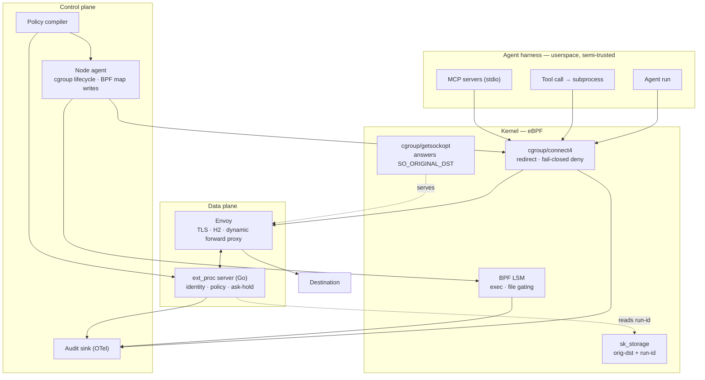
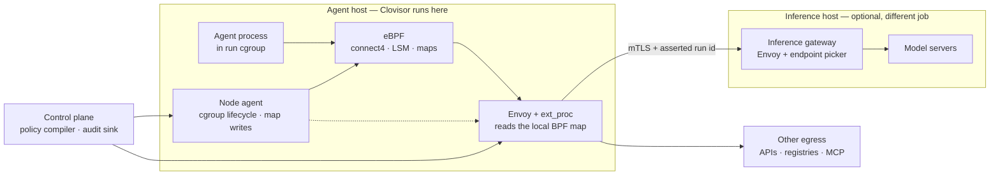
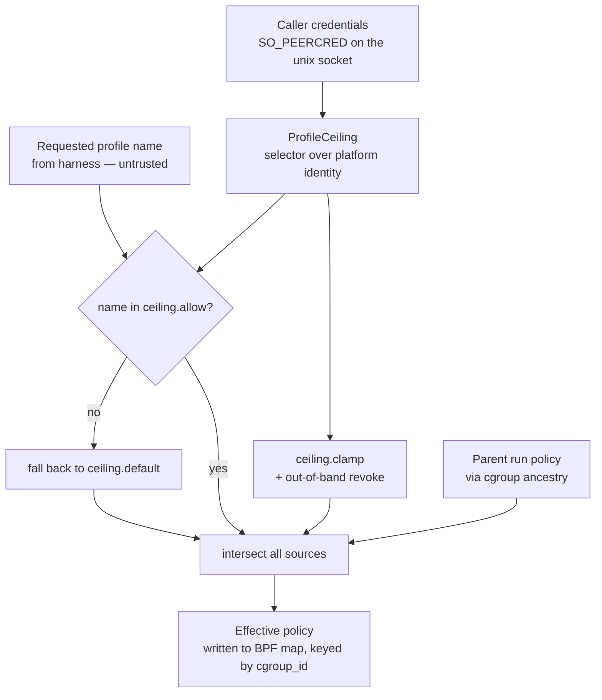
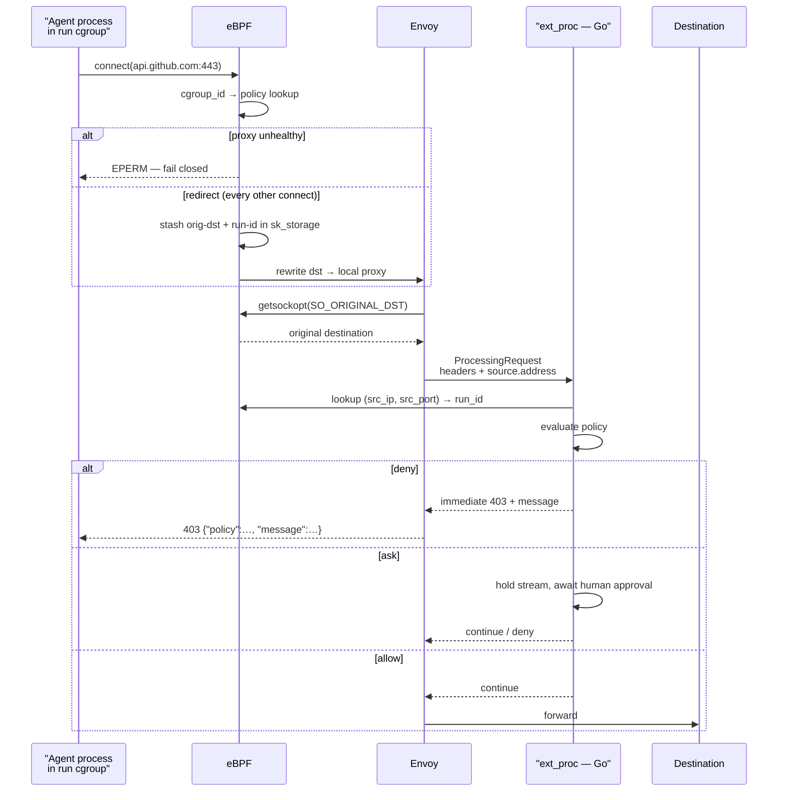
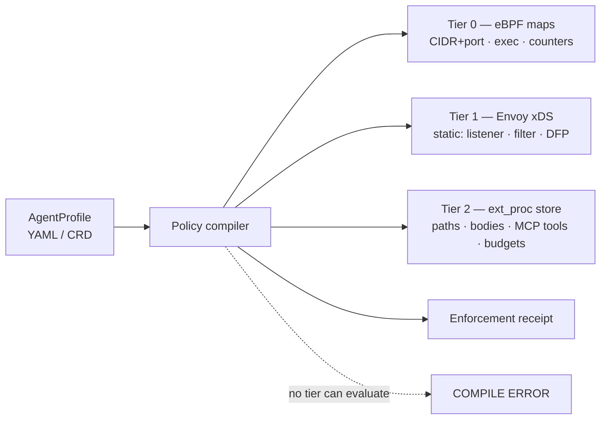
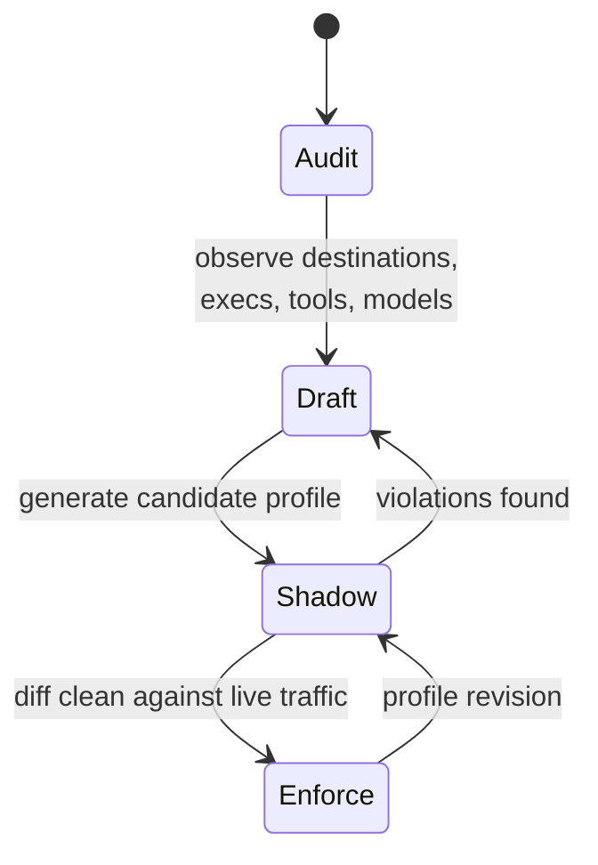
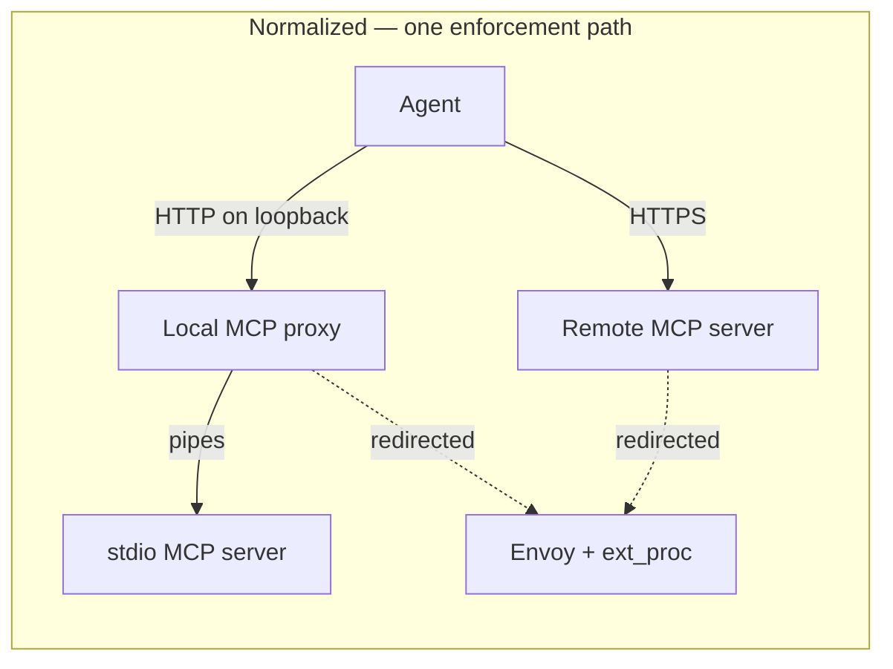
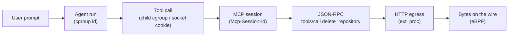

# Clovisor II — An Agent Egress Control & Audit Engine

**Status:** Phases 1 (audit), 2 (explicit proxy and MCP), 3 (transparent
mode on Linux), 4 (kernel enforcement) and 5 (content, limits, budgets and
approvals) implemented ·
**Date:** 2026-11-14, revised 2026-11-24 · **Repo:** `clovisor` ·
**Operating it:** [operator guide](operator-guide.md)

> A design study on repointing Clovisor's architecture from Istio service-mesh
> observability toward egress control and audit for AI agents. Phases 1 to 5
> are implemented ([§10](#10-build-order)). Open questions are
> collected in [§12](#12-open-questions). The 2026-11-19 design review and what
> it changed are summarized under [Revision history](#revision-history).

---

## Table of contents

1. [Provenance: what Clovisor was](#1-provenance-what-clovisor-was)
2. [The gap this addresses](#2-the-gap-this-addresses)
3. [Why this direction over the alternatives](#3-why-this-direction-over-the-alternatives)
4. [Architecture overview](#4-architecture-overview)
5. [Identity model](#5-identity-model)
6. [Data path](#6-data-path)
7. [Policy language](#7-policy-language)
8. [MCP](#8-mcp)
9. [What maps from the existing codebase](#9-what-maps-from-the-existing-codebase)
10. [Build order](#10-build-order)
11. [Non-goals and honest limits](#11-non-goals-and-honest-limits)
12. [Open questions](#12-open-questions)

---

## Revision history

### 2026-11-19 — design review

Changes to the design, each marked *Revised 2026-11-19* or *New 2026-11-19* in
place:

| Change | Where |
|---|---|
| Enforcement granularity stated as it is: the process tree, not the logical run. Many runs in one process get per-process enforcement only. | [§2](#2-the-gap-this-addresses), [§5.8](#58-enforcement-granularity-is-the-process-tree) |
| Positioning against the strongest alternative — a network namespace per run — and existing kernel enforcement tools. | [§3.1](#31-prior-art-and-positioning) |
| A portable explicit-proxy mode with no eBPF, for platforms where agents actually run (including macOS). | [§4.3](#43-two-deployment-modes) |
| Tier 0 becomes **redirect-or-deny**: every TCP connect from a run goes to the proxy or fails. The DNS-learned IP allowlist backstop is dropped except for protocols with no hostname on the wire. | [§6.5](#65-three-rules-that-must-not-be-gotten-wrong), [§7.5](#75-one-rule-one-enforcement-point-no-bypass) |
| Egress channels `connect4` cannot see: unconnected UDP, DNS (and DNS tunnelling), QUIC, raw sockets. | [§6.8](#68-channels-connect4-does-not-see) |
| QUIC: denied by default, with opt-in SNI forwarding, plus a UDP packet backstop. Encrypted Client Hello defeated at the local resolver. | [§6.6](#66-tls-posture), [§6.8](#68-channels-connect4-does-not-see) |
| Build order: the proxy and MCP layer moves to Phase 2, ahead of kernel enforcement. | [§10](#10-build-order) |
| Exfiltration through *allowed* destinations stated as an explicit limit. | [§11](#11-non-goals-and-honest-limits) |
| Code-reuse table corrected to what actually carries over. | [§9](#9-what-maps-from-the-existing-codebase) |

### 2026-11-20 — Phase 1 implementation

| Change | Where |
|---|---|
| `clone3(CLONE_INTO_CGROUP)` needs root, so the run API moves a parked child by pidfd instead of handing out a cgroup fd. | [§5.2](#52-enforcement-identity-cgroup-v2), [Phase 1 status](#phase-1-status-2026-11-20) |
| Phase 1 complete; Phase 2 broken into milestones, with explicit-proxy identity from socket diagnostics on Linux. | [Phase 2 plan](#phase-2-plan-2026-11-20) |

### 2026-11-21 — Phase 2 learn and audit

| Change | Where |
|---|---|
| Learn mode drafts exact method and path rules for hosts seen in full, and `mcp` server rules from the calls let through. `check` replays paths and MCP calls. Tool pins get a review and approve command. | [2.6 status](#26-status-learn-and-audit-2026-11-21) |
| Credential identity implemented: the portable mode runs on macOS and unprivileged, with a per-run secret in the proxy URL. Docker integration tests and an operator guide. Phase 2 complete. | [2.7 status](#27-status-portability-and-tests-2026-11-21), [operator guide](operator-guide.md) |

### 2026-11-22 — Phase 3 plan

| Change | Where |
|---|---|
| Phase 3 broken into milestones. Redirected connections become a `CONNECT` into the Phase 2 pipeline, routed by SNI; identity reuses socket diagnostics; same-run loopback allowed; fail closed by heartbeat. | [Phase 3 plan](#phase-3-plan-2026-11-22) |
| 3.0 spikes: original-destination recovery, the Envoy transparent listener, forced DNS with ECH stripping, UDP deny and fail closed all work. Sockets made before joining a run bypass the hooks; a direct connect to the transparent port loops. | [3.0 spike results](#30-spike-results-2026-11-22) |
| Redirect-or-deny and the transparent data plane implemented (`-transparent audit\|enforce`): pinned hooks that fail closed, same-run loopback, SNI routing into the CONNECT pipeline, clean-start check at attach. | [3.1 and 3.2 status](#31-and-32-status-2026-11-22) |
| Forced local DNS: every run query to the node's resolver, which answers only names the profile could allow (NXDOMAIN with an EDE reason otherwise) and strips ECH. | [3.4 status](#34-status-2026-11-22) |
| UDP refused except DNS, node-wide exceptions and same-run loopback, QUIC included; a packet backstop drops what gets past the socket hooks. | [3.3 status](#33-status-2026-11-22) |
| Heartbeat tied to Envoy's health; the proxy's own connects gated in the kernel (closing DNS rebinding); lost kernel events counted per run; `agentctl status`; overhead measured. | [3.5 status](#35-status-2026-11-22) |
| Learn, check and receipt for transparent deployments: `check --transparent` replays DNS, UDP and by-address TCP as enforce decides; learn notes for each; `explain --transparent`. | [3.6 status](#36-status-2026-11-22) |
| Raw TCP tunnels known only by address are decided by a name the node's resolver answered with that address for the run, when no rule names the address. | [Resolved-name matching](#resolved-name-matching-2026-11-22) |

### 2026-11-23 — Phase 3 complete

| Change | Where |
|---|---|
| Transparent mode tested end to end in a privileged container; kernel floor revised to 5.12; operator guide gains requirements and the test. Phase 3 complete. | [3.7 status](#37-status-2026-11-23), [operator guide](operator-guide.md) |
| Phase 4 broken into milestones. Found: where glibc resolves through systemd-resolved's Unix socket, forced DNS is bypassed until Unix-socket gating. | [Phase 4 plan](#phase-4-plan-2026-11-23) |
| 4.0 spikes: global BPF LSM hooks gate exec (trusted path, IMA hash without policy), raw and packet sockets, Unix sockets with the peer's cgroup, and foreign sockets; `lsm_cgroup` works in the kernel but not through cilium/ebpf. Exec gating conflicts with coding agents running what they build. | [4.0 spike results](#40-spike-results-2026-11-23) |
| Socket families limited and sockets made outside the run refused, through BPF LSM, pinned to fail closed. | [4.1 and 4.3 status](#41-and-43-status-2026-11-23) |
| Unix sockets outside the run refused unless `unix.allow` names them; root-equivalent sockets need the ceiling's consent; closes the nss-resolve bypass. | [4.2 status](#42-status-2026-11-23) |
| Exec gating by resolved path through BPF LSM, with the trusted-path test as a per-profile option (`require_trusted_path`) and `dir/*` entries for build output. | [4.4 status](#44-status-2026-11-23) |
| Tool calls in cgroups of their own (`agentctl call`), with events, proxy decisions and DNS attributed per call; MCP servers recorded as calls. | [4.5 status](#45-status-2026-11-23) |
| Sub-agents: a run started inside a run is nested below it, with its parent's layers plus its own, in the proxy, the resolver and the kernel; clamps cascade; each nested run has its own timeline, linked to its parent. | [4.6 status](#46-status-2026-11-23) |
| Per-run UDP and ICMP echo, asked for by the profile and bounded by the ceiling, in a per-run kernel map that needs no BPF LSM. | [4.7 status](#47-status-2026-11-23) |

### 2026-11-23 — Phase 4 complete

| Change | Where |
|---|---|
| Host daemons (Docker, a live ssh-agent, systemd-resolved's varlink socket) refused in the privileged test; operator guide gains enabling BPF LSM, a block reference and the new limits. Phase 4 complete. | [4.8 status](#48-status-2026-11-23), [operator guide](operator-guide.md) |
| Phase 5 broken into milestones. Found: body reading generalizes the MCP mode override; counters can be node-local; ask holds `ext_proc` streams; nested runs charge their ancestors. | [Phase 5 plan](#phase-5-plan-2026-11-23) |
| 5.0 spikes: request bodies must be streamed with `ext_proc`'s own cap (buffered stalls past 1 MiB, partial is fail-open); Envoy's default circuit breaker fails every request past 1,024 `ext_proc` streams; held asks work with a per-stream timeout override; QUIC names read in userspace; a BPF exec hash cache was never stale on ext4 and tmpfs. | [5.0 spike results](#50-spike-results-2026-11-23) |
| Content rules: deny, redact (keeping the length) or record matches in request bodies and query strings, on every host the profile names unless scoped; bodies held and checked whole, with limits that fail closed; remote MCP bodies moved off buffered mode; Envoy's `ext_proc` circuit breaker raised. | [5.1 status](#51-status-2026-11-23) |
| Limits: duration ends a run, `connections_per_min` and `rate-limit` rules answer 429, and `egress_bytes` is counted and capped in the kernel, then revoked; nested runs charge their parents; byte counts persisted. | [5.2 status](#52-status-2026-11-23) |
| Model allow-lists: a rule's `model` list checked against the JSON body's top-level `model` and a `model` query parameter; bodies naming none, or naming it twice, refused; models recorded per request, drafted by learn from runs observed under `"*"`, replayed by check. | [5.3 status](#53-status-2026-11-24) |
| Budgets: a rule's `budget` of tokens and dollars, charged from the usage in each response, streamed or not, at prices from a node `ModelPrices` document; `include_usage` set on OpenAI streams and its chunk removed again; refused once spent, and for unpriced models under a cost budget; nested runs charge their parents; spend persisted and reported. | [5.4 status](#54-status-2026-11-24) |
| Ask: `action: ask`, `mode: ask` and `sampling: ask` hold a request in the node agent's queue until a person decides over the run API, or its timeout; decisions refused from inside a run, and needing root with credential identity; remembered decisions; held requests capped; open question 3 answered for host deployments. | [5.5 status](#55-status-2026-11-24) |
| QUIC by name (opt-in, `-quic`): UDP 443 from runs sent by the connect hooks to a relay in the node agent, which reads the server name from the Initial packets and decides it as a CONNECT; refused, with a narrated `CONNECTION_REFUSED`, for hosts needing termination or a person, ECH and unnamed connections. | [5.6 status](#56-status-2026-11-24) |
| Exec hashes: `exec.allow[].hash` pins a path's content, checked by `bpf_ima_file_hash` in a sleepable exec hook and cached per inode while its validators hold; other content refused whatever the default; a path-only hook loaded where the kernel cannot hash, and enforcing profiles with hashes refused there. Found: exact `exec.allow` paths had never matched in the kernel (fixed). | [5.7 status](#57-status-2026-11-24) |

### 2026-11-24 — Phase 5 complete

| Change | Where |
|---|---|
| Integration tests for the gaps: content rules and `connections_per_min` under transparent mode, and `sampling: ask` on a remote MCP server's event stream; operator guide gains Phase 5 records, incident response for held requests, and security notes. Phase 5 complete. | [5.8 status](#58-status-2026-11-24), [operator guide](operator-guide.md) |
| Phase 6 broken into milestones: restart recovery first, since a restarted node agent forgets what runs were granted; then TLS uprobes for visibility only, per library (libssl, Go, Node and Bun), capturing request lines and headers, not bodies. | [Phase 6 plan](#phase-6-plan-2026-11-24) |
| 6.0 spikes: a node agent restart lifts every rule from runs in progress, revocations included; uprobes read requests from libssl, GnuTLS and Go 1.25 and 1.26 but tax every process using the library unless attached per process, which needs each exec held until attached; the Bun-built `claude` binary cannot be hooked; about 5 µs per TLS call in a VM. | [6.0 spike results](#60-spike-results-2026-11-24) |
| Restart recovery: live runs' grants kept in a root-owned file at each change and restored, bound version and kernel state included, before the first heartbeat; old LSM links kept until then; unrestorable runs revoked; `agentctl run` reconnects to report the exit code. Found: status said healthy before the first heartbeat. | [6.1 status](#61-status-2026-11-24) |
| TLS plaintext (opt-in: node `-uprobes`, profile `observe.tls_plaintext`): probes on OpenSSL, BoringSSL and GnuTLS attached per process, each exec held until they are; HTTP/1.1 and HTTP/2 requests and MCP calls recorded, never decided; learn drafts commented path rules, check replays them. Found: the 6.1 heartbeat beat before restore. | [6.2 status](#62-status-2026-11-24) |

### 2026-11-25 — Go crypto/tls

| Change | Where |
|---|---|
| Go `crypto/tls` probed in each Go binary a capturing run executes, go1.21 to go1.26, arm64 and amd64: functions found by symbol or by Go's function table, so stripped builds too; return probes on decoded return instructions; offsets checked against Go's prologue. Every exec in a capturing run is now reported, so a process that execs another binary gets it probed. Go binaries listed per run, probed or not visible and why. Found: stripped Go is visible after all; the function table's text address is not `.text`'s in an external link. | [6.3 status](#63-status-2026-11-25) |
| Bundled stacks: OpenSSL linked into a binary and exported (official Node builds) probed in the binary itself, labelled by its banner; Bun's BoringSSL and rustls listed as not visible, with the reason. The Bun-built `claude` binary was not examined, but an app compiled with Bun was. Found: detaching one link per probe held the next exec up to 1.6 s, so all TLS probes are now uprobe-multi links (Linux 6.6 for `-uprobes`). | [6.4 status](#64-status-2026-11-25) |
| Visibility report: per run and destination, the best level anything saw it at (requests, plaintext, name, address) and why not better, in the timeline and `agentctl events`; the receipt's TLS posture gains what audit will see. | [6.5 status](#65-status-2026-11-25) |
| Runs' requests inside terminated tunnels could be taken as another run's while that run had a tunnel to the same host open: Envoy pooled the connections to the terminating listener without the client's identity in the key. Fixed by carrying it in the hashed upstream server name; restart Envoy after upgrading. Restored capturing runs get their running processes probed again; Debian's Node in the tests. Phase 6 complete. | [6.6 status](#66-status-2026-11-25) |
| Phase 7 planned: validation against the agents people run (Claude Code, Codex, Gemini CLI, OpenCode, a LangGraph server, the OpenAI Agents SDK) and hardening; then Kubernetes through Agent Substrate, with Actor identity and Clovisor as its egress policy point. Kernel constructs for identity beyond cgroups weighed; sandboxes (gVisor has no eBPF; microVMs do, inside the guest) set what the kernel layer can see. | [Phase 7 plan](#phase-7-plan-2026-11-25) |
| 7.0 spikes: Codex, Gemini CLI, OpenCode and Claude Code work under Clovisor in both modes, termination included, and each reaches hosts besides its model; LangGraph sessions share one run, and credential identity splits but does not nest them; gVisor Runtime Monitoring is a feasible audit source, unable to refuse; Agent Substrate runs, keys tunnels with `envoy.hashable_string`, keeps Actors' UIDs across moves, and has no hook for a second policy point. 7.1 to 7.5 revised. | [7.0 spike results](#70-spike-results-2026-11-26) |
| 7.1 agent validation: four agents pinned by a lockfile and installed by `npm ci` into a cached volume; asserted audit, learn and check, enforce and narration checks in both suites; operator guide on coding agents. Found: check replayed TLS plaintext on 443 whatever its port. | [7.1 status](#71-status-2026-11-26) |

---

## 1. Provenance: what Clovisor was

Clovisor (2018) was a sidecar-less, per-node eBPF agent that mapped Istio
application networking policy onto low-level kernel constructs. It had three
layers:

| Layer | Implementation | Verdict |
|---|---|---|
| **Control architecture** | k8s informer + label discovery → identity → compile policy into BPF maps → attach per-workload → stream events → correlate into traces | **Keep.** Still the right skeleton. |
| **Data path** | TC clsact on pod veth, parse eth/ip/tcp inline, `dports2proto` classification, 5-tuple session table, `perf_submit_skb` whole packet to userspace, HTTP parsed by a Go `.so` plugin, OpenTracing spans | **Rewrite.** Not a port. |
| **Steering** | `redirect_lookup_table` → MAC/IP rewrite + `bpf_clone_redirect`, driven by `POST /redirect/` | **Repoint.** Becomes proxy redirect. |

### Why the data path doesn't survive

The original L7 story — copy the full skb to userspace, `strncmp` for
`GET`/`POST`, reassemble — fails three ways against modern traffic:

- **TLS.** Everything is encrypted. Packet-level parsing is dead without uprobes
  on `SSL_read`/`SSL_write` and Go's `crypto/tls`, a completely different
  attachment model from TC.
- **HTTP/2 multiplexing.** A 5-tuple session keyed on `req_time`/`resp_time` and
  closed on FIN/RST cannot express per-stream events. Many requests share one
  connection.
- **Non-network transports.** A large share of agent traffic (MCP over stdio) is
  pipes between processes. TC sees nothing.

### Mechanical modernization (orthogonal to the redesign)

- `iovisor/gobpf` → `cilium/ebpf` + CO-RE (`vmlinux.h`, `bpf2go`). Kills runtime
  LLVM in the DaemonSet, the kernel-header dependency, and most of the image size.
- `BPF_PERF_OUTPUT` → ring buffer.
- `clsact` qdisc → `tcx`. The current attach clobbers Cilium/Calico on the same
  node; `tcx` solves multi-attach.
- Go plugin `.so` parsers → compiled in. Go plugins require exact toolchain match
  and were never worth it.
- OpenTracing / `jaeger-client-go` → OpenTelemetry.
- Redis-as-config-bus → CRDs + informers (already half-built in `k8s-ctlr/`).

---

## 2. The gap this addresses

An AI agent executes tool calls. What it calls is decided by a model at runtime
and is not statically knowable. Every existing control sits at the wrong
granularity:

| Control | Thinks in | Fails because |
|---|---|---|
| Harness allowlist | tool calls | In-process and advisory. `curl` inside a bash tool call never touches your HTTP client wrapper. Neither does an npm postinstall script. |
| NetworkPolicy / egress proxy | pods | 50 concurrent agent runs in one worker process = one identity. |
| Sidecar proxy | connections | Sees the host, not *which run* caused it. |
| Per-run sandbox (netns or microVM) + egress proxy | sandboxes | Doesn't fail. It is the strongest alternative ([§3.1](#31-prior-art-and-positioning)). It costs a sandbox and network plumbing per run, the harness has to adopt it, and it sees no exec tree. |

**The enforcement point does not know which logical agent run caused the
syscall.** That is structurally the same problem Clovisor already solved once —
Istio thinks in `VirtualService`, the kernel thinks in 5-tuples, and the job was
the bridge. Same shape, new nouns.

*Revised 2026-11-19.* The NetworkPolicy row's "50 runs in one worker process"
is not solved by this design either. A cgroup holds processes, so 50 runs in one
process are one cgroup, and nothing in the kernel can split them unforgeably
([§5.8](#58-enforcement-granularity-is-the-process-tree)). What this design adds
is per-run identity for runs that are separate process trees (which agent tool
calls overwhelmingly are) with no per-run network plumbing, plus an exec-level
audit trail.

The threat model is not malicious code. It is **an agent being manipulated** —
prompt injection via a poisoned web page, issue tracker, or file, leading to
exfiltration or destructive tool use. Network egress is the chokepoint for that
threat.

---

## 3. Why this direction over the alternatives

Three candidate directions were considered for repointing the project:

| Direction | Assessment |
|---|---|
| **A. Inference fabric observability** — NCCL/collective traffic, disaggregated prefill→decode KV transfers, straggler and ECMP-collision detection | Technically the most interesting. **Structural blocker:** GPUDirect RDMA bypasses the kernel networking stack entirely, so TC/XDP sees nothing. Limited to TCP-mode NCCL unless you move to rdma-core uprobes and switch telemetry. Partially covered by DCGM, NCCL profilers, and switch telemetry. |
| **B. Agent egress control + audit** *(this document)* | No structural blocker. Reuses the most of the existing control architecture. The gap — kernel-level identity at *agent-run* granularity — is owned by nobody. |
| **C. Inference-aware routing** — routing on KV-cache locality and queue depth | Skip. Gateway API Inference Extension / llm-d already own this, the signal lives in the model server, and eBPF adds almost nothing. |

The transferable insight from Clovisor is not "map Istio to eBPF" — Cilium L7
policy and Istio ambient have absorbed that. It is **knowing how to attach a
control-plane identity to a kernel object.** The unfilled gap is that no kernel
plane today knows what an *agent run* or a *tool call* is.

### 3.1 Prior art and positioning

*New 2026-11-19.* Three adjacent categories each cover part of this problem:

| Category | Covers | Does not cover |
|---|---|---|
| **Per-run sandboxes**: a network namespace or microVM per run, whose only route is an egress proxy | Unforgeable per-run identity (by the interface or proxy socket traffic arrives on), host-level egress allowlisting | The exec tree; L7 and MCP policy beyond what its proxy does. The harness has to create and own the run's network setup. |
| **Kernel runtime enforcement** (Tetragon-class tools, Falco) | exec and network observation and enforcement scoped by cgroup, pod or namespace | Agent runs, tool calls, MCP, request bodies. No concept of a run. |
| **AI and MCP gateways** | Model routing, token budgets, MCP tool allowlists | Anything that does not route through them; which run is calling |

**Network namespace per run is the one to beat.** Once a run is its own process
tree, which per-run enforcement requires anyway
([§5.8](#58-enforcement-granularity-is-the-process-tree)), it can also have its
own namespace. The proxy then knows the run from where its traffic arrives, with
no BPF at all. This design is better where:

- **exec matters.** A namespace sees packets, not processes. The audit chain
  ([§8.6](#86-the-audit-chain-closes)) needs exec events tied to the run, and
  exec gating ([§7.6](#76-exec-matching-path-hash-or-provenance)) needs a hook
  in the exec path.
- **The harness can't be changed.** `agentctl run -- python agent.py` works
  without the harness creating namespaces, veth pairs or routes, and it
  coexists with whatever CNI is on the node.
- **Density.** A cgroup and a map entry per run, not a namespace, veth pair and
  route set per run.
- **One install covers every agent on the host**, whichever harness launched it.

The two compose rather than compete. A namespace-per-run sandbox can use this
design's proxy, compiler and MCP layer in explicit-proxy mode
([§4.3](#43-two-deployment-modes)), with the sandbox supplying identity and
enforcement.

**Where the novelty is.** The kernel half is the least novel part; Tetragon-class
tools already enforce exec and connect per cgroup. What nobody ships is the
combination of:

- an identity model with runs and tool calls as first-class objects;
- a policy compiler that states honestly where each rule is enforced;
- an L7 and MCP layer: tool-level policy, tool-definition pinning, denial
  narration;
- an audit chain joined end to end.

Build effort should follow the novelty ([§10](#10-build-order)).

---

## 4. Architecture overview



### 4.1 Division of labor

| Layer | Owns |
|---|---|
| **eBPF** | Identity (cgroup), unbypassable capture, fail-closed deny, original-dst + run-id stash, exec gating |
| **Envoy** | Connections, TLS, HTTP/2, dynamic forward proxy, retries, access logs |
| **ext_proc (Go)** | Identity resolution via BPF map, policy decision, body inspection, ask-hold, denial narration |
| **Control plane** | Policy → ext_proc store + BPF maps; cgroup lifecycle; xDS kept static |

### 4.2 Deployment topology

**Clovisor runs on the agent host.** The identity primitive is the agent's
cgroup, and no machine can observe another machine's cgroups — so every
enforcement component is bound to the host where agent processes execute. This
is not a preference; eBPF makes it structural.



| Component | Placement | Why |
|---|---|---|
| `cgroup/connect4`, BPF LSM, maps | **Agent host — required** | Hooks the agent's own syscalls |
| Node agent | **Agent host — required** | Owns cgroup lifecycle; the unix socket to the harness ([§5.4](#54-the-injection-channel)) needs co-location |
| Envoy + `ext_proc` | **Agent host — required as designed** | `ext_proc` resolves identity by reading the local BPF map ([§6.4](#64-identity-handoff-to-envoy)) |
| Policy compiler, audit sink | Anywhere | Control plane; no kernel coupling |
| Inference gateway | Inference host — **optional** | Routing and endpoint selection; a different job, below |

#### The inference side consumes identity, it does not derive it

[§6.1](#61-why-envoy) argues for Envoy partly on a shared dataplane with
inference routing. That sharing is of *software and the `ext_proc` contract* —
not of a deployment. The two installations know different things:

| | Agent host | Inference host |
|---|---|---|
| Knows | cgroup → run, unforgeable | whatever identity arrived in-band |
| Enforces | egress, exec, MCP tools, content, budgets | model routing, endpoint selection |

Per-run token budgets are the one policy spanning both, since tokens are counted
where the model responds while run identity lives where the agent runs. Two
resolutions:

- **Agent-side (the default).** The agent-host Envoy terminates the model call,
  reads response usage, decrements the budget. Self-contained, no cross-machine
  trust, and [§6.6](#66-tls-posture) derives the needed termination
  automatically because `budget:` is a body rule.
- **Inference-side.** Needs the run id to travel in-band. The only component
  entitled to mint that header is the agent-side proxy — the one holding
  cgroup-derived identity.

> **The agent-side proxy is the identity authority. The inference gateway is a
> consumer of asserted identity.** That assertion is worth exactly as much as
> the mTLS between them.

Which follows from [§5.5](#55-the-forgeability-rule): cgroup-derived identity is
enforcement-grade at its point of origin and becomes a *claim* the moment it
crosses a machine boundary.

#### The centralized-gateway fork

A shared egress gateway — one Envoy fleet serving many agent hosts — is a
reasonable architecture that **this design forecloses**, because `ext_proc`
resolves identity from a local BPF map. Going centralized would require either
an RPC back to the originating node agent on every connection, or minting a
signed per-run credential (PROXY protocol, or a per-run client certificate) so
identity travels in-band. Both are viable, neither is free, and the second is
the same mechanism as the inference-side case above. Recorded so the choice is
made deliberately rather than discovered.

#### Packing and distribution

Colocation changes nothing architecturally: an agent and a model server on one
bare-metal box is one node agent with two filter chains — a packing decision.

The consequential case is the reverse. **Agents running outside your
infrastructure** — on a laptop, in a customer's cluster — mean the whole
enforcement half ships to them while only the inference gateway stays yours.
That decides whether this is a system you operate or one you distribute, and it
is worth settling before the control-plane interfaces harden.

### 4.3 Two deployment modes

*New 2026-11-19.*

| | Transparent (Linux) | Explicit proxy (portable) |
|---|---|---|
| How traffic reaches the proxy | `connect4` redirect-or-deny ([§6.5](#65-three-rules-that-must-not-be-gotten-wrong)) | `HTTPS_PROXY` or harness configuration, or an OS sandbox whose only route is the proxy |
| Run identity at the proxy | cgroup id via BPF map, enforcement-grade | A per-run listener (a unix socket or loopback port exposed only inside the run's sandbox) is enforcement-grade when the sandbox stops the run reaching any other listener. Otherwise a per-run proxy credential, which is a claim ([§5.5](#55-the-forgeability-rule)). |
| Bypass | none for TCP and UDP from the run ([§6.8](#68-channels-connect4-does-not-see) covers the rest) | anything that ignores the proxy setting, unless a sandbox blocks other egress |
| Exec gating and exec audit | yes | no |
| Platforms | Linux with cgroup v2; exec gating needs `lsm=bpf` | anywhere Envoy runs, including macOS |

Explicit-proxy mode alone is advisory: `curl --noproxy '*'` walks past it. It is
enforcement-grade only when paired with something that forbids other egress: a
namespace sandbox, an OS sandbox profile, or transparent mode.

It exists for two reasons:

- **Most interactive coding agents run on developer laptops**, where eBPF does
  not exist.
- **It lets the L7 and MCP layer ship first** ([§10](#10-build-order)), without
  waiting on kernel work.

Policy, compiler and audit format are identical in both modes. Only the identity
source changes, and with it the bypass column of the receipt
([§7.4](#74-compilation-and-the-enforcement-receipt)).

---

## 5. Identity model

### 5.1 Two granularities, two mechanisms

The single most important framing. Conflating these is what makes the problem
look intractable.

- **Enforcement identity** = the agent run. Must be unforgeable, must survive
  fork/exec, must need no cooperation from the governed code.
- **Attribution identity** = the tool call. May be self-reported, needs to be
  fine-grained, only has to be good enough for forensics.

### 5.2 Enforcement identity: cgroup v2

```
/sys/fs/cgroup/agents/                 ← BPF programs attached ONCE here
└── run-7f3a9c/                        ← enforcement identity (the agent run)
    ├── call-0012/                     ← tool call: bash -c "git clone ..."
    │   └── (git, ssh, ...)            ← inherited, no extra work
    ├── mcp-github/                     ← MCP server, attenuated profile
    └── subagent-2b/                    ← sub-agent, policy ⊆ parent
```

Mechanics that matter:

**Attach once, not per run.** Attaching a program per run cgroup costs an
attach/detach syscall pair per run plus churn. Attach once at the subtree root
with `BPF_F_ALLOW_MULTI`, then call `bpf_get_current_cgroup_id()` inside the
program and look up policy in a hash. One attach, N runs; run creation becomes a
single map update.

**Spawn into the cgroup atomically.** The naive path — fork, then write the pid
to `cgroup.procs` — leaves a window where the child executes under the parent's
policy. An agent that spawns and immediately connects wins that race. Use
`clone3(CLONE_INTO_CGROUP)` (Linux 5.7+); recent Go exposes it as
`SysProcAttr.CgroupFD`. **This is the single most important implementation
detail on this path.**

**Who creates the cgroup.** A containerized harness running non-root cannot
write host cgroupfs. Do not solve this with delegation. The node agent owns all
cgroup manipulation from the host namespace and exposes a small local API
("give me a cgroup for run X").

*Revised 2026-11-20.* The API cannot simply return an fd for the harness to pass
to `CgroupFD`:
- `clone3(CLONE_INTO_CGROUP)` applies the same permission check as writing
  `cgroup.procs`.
- That check includes write access to the `cgroup.procs` of the common ancestor
  of the source and target cgroups. For `agents/` the common ancestor is the
  root cgroup.
- Verified on the development kernel: a non-root caller gets `EPERM` even when
  it owns the target cgroup and its `cgroup.procs`.

So the node agent moves the process itself, and the harness parks the child
until the move is done:
1. The harness starts its child as a shim: its own code, blocked on a pipe.
2. It sends the node agent a pidfd for that child over `SCM_RIGHTS`.
3. The node agent checks, against `SO_PEERCRED`, that the target is a direct
   child of the caller with the caller's uid, and that neither is already in a
   run. It then writes the pid into the run's `cgroup.procs`.
4. The shim is released and `exec`s the command in the same process.

The guarantee is the same as `clone3`: no governed code ever runs outside the
run. A caller can only ever confine its own children.
Note `bpf_get_current_cgroup_id()` returns the host kernfs id regardless of
cgroup namespacing, so the BPF side is unaffected; only userspace path
construction cares, and that now lives in one place.

**Deferred cleanup.** Kernfs ids are not practically reused, but rapid
create/delete cycles plus in-flight events will eventually deliver an event for
an id just reassigned. Remove the policy map entry **first** (so late syscalls
fail closed), drain, then delete the cgroup on a grace timer.

### 5.3 Attribution identity: the async problem

Within one run cgroup there are many tool calls. The obvious mechanism — a BPF
hash keyed by `tid`, written by the harness at tool-call entry — works for
exactly one execution model:

| Runtime | tid tagging |
|---|---|
| Python, thread-per-call | **Works.** `os.gettid()`, write at entry, overwrite on pool reuse. |
| Python asyncio | **Breaks.** One thread, interleaved calls. |
| Node.js | **Breaks.** Single event loop, async by default. |
| Go | **Breaks.** Goroutines migrate across OS threads mid-call. `LockOSThread` per call "fixes" it and wrecks the scheduler. |

That is most modern harnesses. Do not fight it in the kernel. Resolve in three
pieces:

1. **Subprocesses → child cgroups.** A tool call that shells out spawns into
   `run-<id>/call-<n>`. Tool-call identity becomes a cgroup id again with full
   inheritance. `bpf_get_current_ancestor_cgroup_id()` gives the run, the leaf
   gives the call. The happy accident: *the case where attribution matters most —
   arbitrary code execution — is exactly where cgroups work perfectly.*

2. **In-process HTTP → socket cookies.** For async runtimes the stable handle is
   the socket, not the thread. Userspace reads `getsockopt(SO_COOKIE)` on its own
   fd; BPF reads `bpf_get_socket_cookie()`. Both see the same u64. Connection
   pooling makes it many-to-one over time — treat it as an append-only timeline
   (`cookie, timestamp → call`) and join by window, or disable keepalive for
   agent egress, which is a defensible isolation choice anyway.

3. **Everything else → join in correlation.** Let the harness emit ordinary
   userspace spans and stitch them to kernel events by
   `(cgroup_id, time window, socket cookie)`. This is precisely what the existing
   `sessionMap` correlation does for a different pairing.

Residual risk is small: in-process async HTTP goes through *your own* HTTP
client, which can be instrumented at the application layer. What you cannot
instrument forks, and forks are covered by cgroups.

### 5.4 The injection channel

Three ways for userspace to write identity into the kernel, in increasing order
of correctness:

1. Harness opens pinned maps directly — needs `CAP_BPF`. **No.** This hands
   arbitrary BPF access to the thing being contained.
2. Node agent passes a single map fd over `SCM_RIGHTS`. Workable.
3. **Harness talks to the node agent over a unix socket; the node agent is the
   only BPF writer.** One trusted writer, full validation, one IPC round trip per
   tool call — free at agent rates. **Take this one.**

### 5.5 The forgeability rule

> **Enforcement identity must come from the cgroup. Self-reported identity is
> audit-grade only, never enforcement-grade.**

If an agent can execute arbitrary code in the harness process, it can write
anything into any tid or cookie map the harness can write. Those are *claims*,
not facts. Cgroup membership is different: you cannot move yourself out of a
cgroup without write access to the parent's `cgroup.procs`, which is denied, and
you cannot escape by forking. `cgroup_id → policy` is the only binding a
`connect4` hook may consult for an allow/deny decision. Everything else enriches
the log.

### 5.6 Profile binding: names with a trusted ceiling

Which profile applies to a run must be a **recorded fact, not a computed
property.** Two candidate mechanisms: *by selector* over run metadata (the
Kubernetes/Istio model), or *by name*, stated when the run is created.

Selector binding is disqualified by [§5.5](#55-the-forgeability-rule). If
profile selection depends on run metadata, then whoever sets the metadata
chooses the policy — and run metadata is set by the harness, the semi-trusted
component being contained. **Selector binding makes enforcement identity
self-reported by construction.**

Three further problems compound it:

- Determining effective policy becomes a selector evaluation with merge and
  precedence rules rather than a lookup — the failure mode that makes
  NetworkPolicy and mesh config hard to debug.
- It puts control-plane work on the run-start critical path, where policy must
  land in the BPF map *before* `clone3` or the
  [§5.2](#52-enforcement-identity-cgroup-v2) race reopens.
- It makes attenuation incoherent: a sub-agent whose metadata matches a broader
  profile yields an upper bound that is then silently clipped, so a profile's
  stated scope is never its real one.

But naive name binding has the same hole wearing a different hat — if the
harness names its own profile, the harness chooses its own policy. Name binding
is only better when **the name is constrained by something the agent cannot
influence.**

#### Resolution chain

The harness *requests* a profile by name. The node agent *validates* that
request against a ceiling derived from the caller's own identity, then
intersects:



The ceiling comes from a different place depending on depth, but the rule is
identical:

| Run kind | Ceiling source |
|---|---|
| **Root run** | Platform identity — service account, namespace, pod identity. Set by the platform, never by the agent. |
| **Sub-agent run** | The parent run's effective policy, via cgroup ancestry. |

So [§7.8](#78-sub-agent-delegation-monotonic-attenuation) attenuation is not a
special rule for sub-agents. It is *the* general rule, and a root run is simply
the case where the parent is the workload rather than another run. One concept
covers the whole tree.

Critically, the node agent resolves the ceiling from the **caller's credentials
on the unix socket** (`SO_PEERCRED`), never from anything in the request body.
The harness may choose among profiles it has been granted; it cannot name one it
has not.

#### Where selectors remain legitimate

The ceiling lookup — "which ceiling applies to this workload" — *is* a selector.
What differs is the thing it binds to:

> **Selectors at the platform boundary: trusted, slow-changing, few.
> Names at the run boundary: fast, ephemeral, many.**

That also serves the use case selectors exist for. "Apply a baseline to
everything" needs no run-metadata matching — it is a cluster-wide `clamp`
intersected into every ceiling. One object edited, every run constrained, no
selector ever evaluated against a run. See
[§7.3](#73-surface-syntax) for the `ProfileCeiling` object.

#### Versioned binding

A run binds to a *resolved version* (`research-agent@v7`), not a bare name. A
policy edit then cannot retroactively change what a running agent may do, and
the audit log states exactly which policy was in force — so an incident can be
replayed against the real thing.

The cost is that you cannot tighten policy on a run already in flight, which is
precisely what an incident calls for. That is served by an explicit out-of-band
**clamp/revoke**, deliberately one-directional: it can only remove permissions,
never add. Routine edits never silently mutate live runs, emergencies still have
a lever, and because clamping only subtracts it composes with attenuation rather
than fighting it.

#### Debuggability

"Why was this blocked?" resolves to two lookups of recorded facts — the profile
version bound at creation, and the ceiling that clamped it. No selector
evaluation, no precedence rules, no reconstructing control-plane state at some
past instant. For a system whose value proposition is the audit trail, that is
worth more than the flexibility given up.

### 5.7 No-cooperation mode is the default

`agentctl run -- python agent.py` creates the cgroup, `clone3`s into it, and
yields full enforcement with **zero harness changes**. Tool-call attribution
degrades to "inferred from the exec tree plus timing," which is decent. Harness
integration buys precision, not function.

This is the right shape for adoption: nobody installs a security tool that
requires rewriting their agent first.

### 5.8 Enforcement granularity is the process tree

*New 2026-11-19.* A cgroup contains processes. Threads can technically sit in
separate threaded cgroups, but code in one address space can act through any of
its threads, so that is not an identity boundary.

> **Enforcement identity is per process tree. A run gets enforcement-grade
> identity only if it is its own process tree.**

This corrects the motivating example in [§2](#2-the-gap-this-addresses).
Fifty runs inside one worker process are one cgroup:

- tier 0 enforces one policy for all fifty;
- telling them apart relies on socket cookies and harness spans, which
  [§5.5](#55-the-forgeability-rule) rules audit-grade only.

No kernel mechanism fixes that case, and a namespace can't split a process
either. Code in the same address space can forge whatever the runtime uses to
tell runs apart.

| Harness shape | Enforcement unit | Attribution |
|---|---|---|
| One process per run (`agentctl run`, a worker per run, most CLI agents) | the run | per tool call, via child cgroups ([§5.3](#53-attribution-identity-the-async-problem)) |
| Tool calls that shell out | the run, and the tool call with child cgroups | exact |
| Many runs in one process (async worker pools) | the process: a profile common to all its runs | audit-grade, via socket cookies and spans |

For the third shape, the recommendation is to move to a process per run: a pool
of worker processes, not of coroutines. That is also the isolation boundary those
harnesses lack today. When the enforcement unit is the process, the receipt says
so, so nobody reads a per-run guarantee that isn't there.

---

## 6. Data path

### 6.1 Why Envoy

The proxy was initially scoped as a small Go program (direct BPF map reads, no
callout). **Envoy wins** on two arguments:

- **`ext_proc` gives body access, not just a verdict.** `ext_authz` returns
  allow/deny; `ext_proc` streams request and response through an external gRPC
  service that can observe and mutate headers, body, and trailers at every
  phase. For agent egress that is the difference between "run X connected to
  `api.openai.com`" and "run X sent *this payload* containing *this secret*."
  Every interesting rule is a body rule.
- **Shared dataplane with inference routing.** If Envoy is already in the
  inference path (Gateway API Inference Extension's endpoint picker is itself an
  `ext_proc` server), egress control and inference routing become the same
  software with different filter chains. One `ext_proc` server can know both
  *which agent run* and *which model* — which unlocks **per-run token budgets
  enforced at the dataplane**, expressible nowhere else today.

Go does not disappear, it relocates: the `ext_proc` server is Go, reads the BPF
maps, evaluates policy. Hundreds of lines, not thousands.

### 6.2 Transparent redirect and original-destination recovery

The enabler that lets an off-the-shelf proxy work unmodified:

After `cgroup/connect4` rewrites the destination, stash the original in
`bpf_sk_storage` keyed by socket cookie, then attach a `cgroup/getsockopt`
program that answers `SO_ORIGINAL_DST` from that map. Cilium does exactly this.
The effect: **any proxy that already speaks `SO_ORIGINAL_DST` — which is all of
them, since that is the netfilter REDIRECT convention — works with BPF redirect,
no conntrack, no iptables.**

### 6.3 Connection flow



### 6.4 Identity handoff to Envoy

Envoy cannot read BPF maps, so identity resolution lives in `ext_proc`. The BPF
`connect4` program stashes `(src_ip, src_port) → run_id` at connect time
alongside the original-destination stash. Configure `ext_proc` to forward
`source.address` as a request attribute; the server does the map lookup.

Port reuse is the race, bounded by connection lifetime — include the socket
cookie in the stash and verify, or accept the window.

The §5.5 invariant still holds and matters more here: the lookup resolves to a
cgroup-derived run id, which is unforgeable. **Nothing the agent puts in a
header is enforcement-grade.**

### 6.5 Three rules that must not be gotten wrong

**1. Tier 0 is redirect-or-deny.** *Revised 2026-11-19.* Every TCP connect from
a run cgroup is either redirected to the local proxy or refused with `EPERM`.
There is no third outcome where a connection silently goes direct.

- **Proxy healthy:** redirect, and stash the original destination.
- **Proxy unhealthy or unconfigured:** deny. **Fail closed.**
- **Static exceptions compiled from policy:** allow direct. These cover loopback
  to the local MCP proxy, the node agent's socket, and little else.

Envoy governs only what reaches it, and this rule makes that everything. That
removes the bypass the original design spent tier 0 on (a DNS-learned IP
allowlist catching traffic that avoided the proxy), because nothing can avoid
it. See [§7.5](#75-one-rule-one-enforcement-point-no-bypass). The wrong default
here turns the whole control into a no-op exactly when it matters.

**2. Keep xDS static.** Agent runs are ephemeral — seconds to minutes,
potentially hundreds concurrent. An xDS push per run will melt the control
plane. **xDS carries policy *shape*, not policy *instances*.** One listener, one
`ext_proc` filter, a dynamic forward proxy cluster, pushed once. All per-run
dynamism lives in BPF maps and the `ext_proc` store.

**3. Use `dynamic_forward_proxy`.** Agents egress to arbitrary hostnames.
Without the dynamic forward proxy cluster and its DNS cache filter you need a
cluster per destination — the xDS explosion from another direction.

### 6.6 TLS posture

| Mode | Gives you | Costs |
|---|---|---|
| **SNI only** (no termination) | Hostname | Nothing breaks, no CA management. No path or body rules. |
| **Terminate (MITM)** | Paths, bodies, MCP tool calls, content policy | CA in every agent image (tractable — you build them), breaks cert-pinned clients, and **creates a box holding plaintext of everything sensitive**. |
| **TLS uprobes** | Plaintext for audit | Offset chasing, Go version churn, dead on stripped static binaries. |

Clean split: **uprobes for visibility, proxy for enforcement.**

#### Posture is a property of the destination, not the profile

There is no `tls:` field on a profile. Posture is **derived per destination by
the compiler** from the rules attached to it:

| Rules attached to a destination | Required posture |
|---|---|
| FQDN, port, CIDR only | SNI — no termination |
| Loopback (normalized stdio MCP, [§8.3](#83-normalize-the-transport)) | plaintext already; nothing to terminate |
| Paths, methods, content patterns | terminate |
| MCP tools / resources / sampling | terminate |
| `model:` allow-lists, token and cost budgets | terminate |

This is [§7.1](#71-organizing-principle) applied one level down. Tier placement
minimizes *where* enforcement happens; posture inference minimizes *how deeply*
traffic is intercepted. Both say: use the least invasive mechanism that can
enforce what was actually stated.

The payoff is on the objection above. Per-destination inference shrinks the
plaintext box from everything the agent does to only the endpoints carrying body
rules — terminating `mcp.github.internal` does not put model API calls or
package downloads in plaintext — and it confines cert-pinning breakage to
destinations that were opted into explicitly, which the receipt names.

#### `no_terminate`

A per-destination assertion — *"I may not hold plaintext for this endpoint"* — a
routine compliance constraint. The compiler then hard-fails any body rule for
that destination and names it, so the constraint surfaces as a rejected rule
rather than a rule that silently does nothing.

#### Termination is node-wide per destination

Envoy selects a filter chain per connection, matching on SNI and original
destination — at which point it does not yet know the run, since identity
resolution happens in `ext_proc` afterward
([§6.4](#64-identity-handoff-to-envoy)). **Termination therefore cannot vary by
profile for the same destination on the same node**: it is the union of all
active profiles.

Adding one body rule to one profile extends plaintext custody for every run on
that node talking to that destination. That is non-obvious enough that the
receipt must say so rather than hide it
([§7.4](#74-compilation-and-the-enforcement-receipt)).

Partial mitigation: terminate the connection, but have `ext_proc` discard bodies
for runs whose profile carries no body rule for that destination. The
interception still happens; the retention does not.

Mechanically this stays consistent with [§6.5](#65-three-rules-that-must-not-be-gotten-wrong):
one terminating filter chain matching the SNI set derived from policy, one
passthrough TCP chain for everything else. That set changes when policy changes,
never per run, so xDS stays effectively static.

#### Encrypted Client Hello

*New 2026-11-19.* SNI-only posture assumes the SNI names the real destination.
Encrypted Client Hello (ECH) breaks that assumption for TLS over TCP and QUIC
alike:

- the visible ("outer") SNI becomes the hosting provider's public name;
- the real one is encrypted to a key the client gets from the destination's DNS
  `HTTPS`/`SVCB` record.

Left alone, growing ECH adoption silently degrades every SNI-only rule to "some
site behind this provider." That is the shared-CDN problem from
[§7.5](#75-one-rule-one-enforcement-point-no-bypass) again.

The forced local resolver ([§6.8](#68-channels-connect4-does-not-see)) closes it.
It strips the `ech` parameter from `HTTPS` and `SVCB` answers, so clients never
attempt ECH and connections carry a cleartext SNI.

Residuals:

- **ECH configs from outside DNS.** A client with a hardcoded or previously
  cached ECH config can still use it. The ECH extension is visible in the outer
  ClientHello, so a TLS listener filter can detect it and deny the connection.
- **Explicit-proxy mode.** [§4.3](#43-two-deployment-modes) gets this protection
  only if the harness uses the local resolver.

### 6.7 ext_proc specifics

- **Denial narration.** `ext_proc` can return an immediate response with a custom
  body — a 403 with structured JSON (policy name, what was blocked, why, what is
  allowed instead) instead of an incomprehensible `EPERM`. See
  [§7.7](#77-denial-as-a-teaching-signal).
- **Ask-mode is nearly free.** `ext_proc` is a streaming RPC; the server can
  withhold its response while a human approves and Envoy waits. Set
  `message_timeout` / `max_message_timeout` deliberately and bound concurrent
  held streams so pending approvals cannot exhaust workers.
- **Watch `processing_mode` on streams.** Subscribing to response bodies on a
  token stream means one `ext_proc` message per chunk. Skip response-body phases
  unless specifically needed — with the exception of MCP sampling
  ([§8.4](#84-two-mcp-specific-threats)).

### 6.8 Channels `connect4` does not see

*New 2026-11-19.* Redirect-or-deny covers `connect()`, including `io_uring`
connects, because the cgroup hooks sit in the socket layer rather than at the
syscall. Several egress paths never call `connect()`:

| Channel | Why `connect4` misses it | Handling |
|---|---|---|
| Unconnected UDP (`sendto`, `sendmsg`) | no connect | `cgroup/sendmsg4` and `sendmsg6`: deny, except DNS to the local resolver |
| DNS | usually unconnected UDP; also the classic tunnelling channel | Force all DNS to a node-local resolver (below) |
| QUIC / HTTP/3 | UDP 443. Connected sockets (most QUIC clients) hit `connect4`/`connect6`; unconnected ones hit `sendmsg4`/`sendmsg6`. Both see the address only. | deny by default with `EPERM`; opt-in SNI forwarding. See [QUIC](#quic) below. |
| Raw and packet sockets | bypass the inet hooks | drop `CAP_NET_RAW` for run cgroups; deny `SOCK_RAW` and `AF_PACKET` in the LSM `socket_create` hook (Phase 4) |
| Unix sockets to host daemons | not inet | a run reaching the Docker socket or an SSH agent can egress through it; the LSM phase gates `AF_UNIX` connects by path |

**Forced local DNS.** Rewrite port-53 traffic from run cgroups to a node-local
resolver. The resolver answers only names that some active rule could allow for
that run, and returns `NXDOMAIN` for everything else. That closes DNS
tunnelling as a side effect: arbitrary subdomains never resolve, so they never
leave the host. Wildcard rules reopen it for the zones they name, which is one
more reason to keep wildcards narrow.

The resolver also produces the per-run DNS events the audit timeline needs,
which is simpler than parsing DNS in BPF. It is also where Encrypted Client Hello
is defeated ([§6.6](#66-tls-posture)).

**UDP backstop.** A `cgroup_skb/egress` program, attached to `agents/` like the
socket-address hooks, sees every packet leaving a run's sockets and can drop it.
It drops any UDP whose destination is not the local resolver or the QUIC
forwarder (below). That catches whatever the address hooks miss, for one map
lookup per packet.

#### QUIC

The address hooks can deny QUIC, but they cannot police it by name. That needs
the SNI, which sits in the TLS ClientHello inside QUIC Initial packets. Initial
packets are encrypted, but with keys anyone can derive from the client's
destination connection ID and a salt published in RFC 9001. So the SNI is
recoverable on-path, without terminating anything.

Recovering it in BPF is impractical:

- **Crypto.** It needs AES-ECB for header protection and AES-GCM for the
  payload. As of this writing, the BPF crypto kfuncs (Linux 6.10+) offer
  symmetric skciphers to TC and XDP programs. That covers header protection, but
  not the AEAD payload.
- **Reassembly.** With post-quantum key shares, the ClientHello often spans more
  than one Initial packet. Parsing it would mean reassembling CRYPTO frames
  across packets in the kernel.

So QUIC gets two postures, chosen per destination by the compiler, like TLS
posture ([§6.6](#66-tls-posture)):

| Posture | Mechanism | Used for |
|---|---|---|
| **Deny** (default) | `EPERM` on UDP 443 at `connect` and `sendmsg`. The failure is immediate, so HTTP/3 clients (browsers, curl) fall back to TCP without waiting for a timeout. | Every destination not opted into QUIC. Also every destination with body rules: those need termination, which exists on the TCP path. |
| **SNI-forwarded** (opt-in) | `connect4`/`sendmsg4` rewrite UDP 443 to a node-local QUIC forwarder. `recvmsg4`/`recvmsg6` rewrite reply sources, so the application sees its original peer. The forwarder decrypts Initial packets in userspace, extracts the SNI, applies the same host policy as TCP, then relays datagrams unmodified. | A workload that needs QUIC, for a destination with host-level rules only. |

SNI-forwarded QUIC has the same posture as SNI-only TLS over TCP: hostname
granularity, no termination, no plaintext.

Denying by default breaks little that should keep working. What it does break is
mostly QUIC-only tunnels (MASQUE, VPN-like transports) and DNS-over-QUIC. Both
route around the proxy or the resolver and should be blocked anyway.

Visibility without enforcement is also possible: uprobes on QUIC libraries give
plaintext for audit. But every application bundles its own QUIC stack, so
coverage means chasing each library and version. That is the same trade-off as
TLS uprobes (Phase 6).

---

## 7. Policy language

### 7.1 Organizing principle

> **Every rule declares what information it needs. The compiler places it at the
> lowest tier that can evaluate it — and refuses to compile if no tier can.**

Silent non-enforcement is the cardinal sin. A profile that looks like it blocks
something but does not is worse than no profile at all.

### 7.2 What each tier can know

| Tier | Sees | Cannot see | Bypassable |
|---|---|---|---|
| **0 — eBPF** | cgroup→run, dst IP:port, exec'd binary, counters | names, paths, bodies | No |
| **1 — Envoy static** | SNI, original dst | bodies, run identity | No in transparent mode (tier 0 redirects everything); yes in explicit-proxy mode alone |
| **2 — ext_proc** | everything above + run identity, headers, path, body, external state | — | Same as tier 1 |
| **3 — async** | history, cross-run patterns | cannot block inline | n/a |

That table *is* the language design. *Revised 2026-11-19:* the original
tension was that IP-and-port rules are unbypassable while path and body rules
depend on traffic reaching Envoy. Redirect-or-deny
([§6.5](#65-three-rules-that-must-not-be-gotten-wrong)) resolves it by making
reaching Envoy mandatory, so precise rules are unbypassable too
([§7.5](#75-one-rule-one-enforcement-point-no-bypass)).

### 7.3 Surface syntax

Typed declarative, **not** CEL or Rego as the primary surface. The reason is
analyzability: with typed match fields the compiler determines tier placement by
static inspection. With arbitrary CEL it cannot, so every rule lands at tier 2
by default. Keep CEL as an escape hatch *explicitly declared* tier-2-only.

```yaml
kind: AgentProfile
metadata: { name: research-agent }
spec:
  mode: enforce           # audit | enforce | ask
                          # no tls: field — posture is derived per destination,
                          # see 6.6

  egress:
    default: deny
    rules:
      - name: github-api
        to: { fqdn: ["api.github.com"], ports: [443] }
        http: { methods: [GET], paths: ["/repos/*"] }
        action: allow

      - name: model-endpoints
        to: { fqdn: ["*.inference.internal"] }
        model: { allow: ["claude-opus-5", "claude-sonnet-5-5"] }
        budget: { tokens: 500000, cost_usd: 25 }
        action: allow

      - name: package-registries
        to: { fqdn: ["pypi.org", "registry.npmjs.org"] }
        action: ask
        ask: { timeout: 5m, on_timeout: deny }

      - name: payments-api
        to: { fqdn: ["billing.internal"] }
        no_terminate: true           # compliance: never hold plaintext here
        action: allow                # so no body rule may target this host

      - name: no-external-llm
        to: { fqdn: ["api.openai.com", "api.anthropic.com"] }
        action: deny
        message: "External LLM APIs aren't permitted here. Use models.internal instead."

  exec:
    default: deny
    require_readonly_origin: true     # see 7.6
    allow:
      - path: /usr/bin/git
      - path: /usr/bin/python3
        note: "interpreter — confinement comes from egress policy, not here"
      - path: /usr/local/bin/custom-tool
        hash: sha256:ab12…            # verified via IMA where available

  content:
    - { name: aws-keys,   regex: "AKIA[0-9A-Z]{16}", action: deny }
    - { name: corp-hosts, regex: "\\.corp\\.internal", action: redact }

  limits:
    connections_per_min: 120
    egress_bytes: 100Mi
    duration: 30m
```

Actions: `allow` · `deny` · `redirect` · `tag-and-log` · `rate-limit` · `ask` ·
`redact`.

A separate `ProfileCeiling` governs which profiles a workload may request, and
is the only object that uses a selector — over platform identity, never over run
metadata ([§5.6](#56-profile-binding-names-with-a-trusted-ceiling)):

```yaml
kind: ProfileCeiling
metadata: { name: agent-workers }
spec:
  appliesTo:                     # selector over PLATFORM identity
    namespace: agents
    serviceAccount: agent-worker
  allow:   [research-agent, light-agent]
  default: light-agent           # used when the request names nothing permitted
  clamp:   baseline-sandbox      # intersected into every grant here
```

### 7.4 Compilation and the enforcement receipt



The receipt is the feature that makes the system honest. `policyctl explain`
emits, per rule, where it lands and what its bypass exposure is:

```text
rule                tier   enforced by                      bypass
(all egress)         0     connect4 redirect-or-deny        none for TCP; UDP/raw see §6.8
github-api           2     ext_proc (path match)            none (redirected)
model-endpoints      2     ext_proc (body: model field)     terminate — see posture
package-registries   2     ext_proc ask-hold
no-external-llm      1     Envoy SNI match                  fronting-exposed (not terminated)
exec/git             0     LSM bprm_check (path+ro-origin)  path-only
exec/python3         0     LSM bprm_check (path+ro-origin)  interpreter — see §7.6
exec/custom-tool     0     LSM bprm_check (IMA hash)        content-verified
content/*            2     ext_proc body scan               terminate — see posture
limits/connections   0     BPF counter                      none
```

When the enforcement unit is a process rather than a run
([§5.8](#58-enforcement-granularity-is-the-process-tree)), the receipt's header
says so.

It also reports the derived TLS posture per destination, including the node-wide
consequence from [§6.6](#66-tls-posture):

```text
destination           posture     why
api.github.com        sni         no body rule in any active profile
mcp.github.internal   terminate   research-agent (mcp.tools)
                                  node-wide: also applies to 3 other profiles
models.internal       terminate   research-agent (budget.tokens)
billing.internal      sni         no_terminate asserted — body rules rejected
127.0.0.1:7700        plaintext   local MCP proxy; nothing to terminate
```

The compiler **hard-fails** on a body rule against a destination marked
`no_terminate`, or a `paths:` match against a non-HTTP destination. Never
degrade quietly.

### 7.5 One rule, one enforcement point, no bypass

*Revised 2026-11-19.* The original design compiled every FQDN rule twice:

- an `ext_proc` predicate, for precision;
- a tier-0 IP allowlist entry populated by DNS learning, as a backstop for
  traffic that avoided the proxy.

With redirect-or-deny ([§6.5](#65-three-rules-that-must-not-be-gotten-wrong)) no
traffic avoids the proxy. And the backstop was weaker than it looked:

- **Shared CDN addresses.** Large SaaS APIs sit behind CDN anycast ranges.
  Admitting `api.github.com` by IP admits whatever else shares those addresses.
  That is an exfiltration path, and the receipt's "IP granularity only" did not
  convey how coarse it is.
- **Per-identity DNS state.** A global name→IP cache is a confused-deputy
  hazard: run A resolves a name and widens the allowed set for run B. Per-run
  caches fix that, but add state on the hot path.

So FQDN rules now compile to a single enforcement point, the proxy, where
hostnames are real:

| Traffic | Identified by | Enforced at |
|---|---|---|
| TLS | SNI, plus `Host` when terminating | Envoy filter chain / `ext_proc` |
| Plain HTTP | `Host` | `ext_proc` |
| Other TCP (e.g. `ssh` to a git host) | original destination IP:port | Envoy TCP proxy, against a per-run DNS-learned set |

DNS-learned IP matching survives only for the last row, protocols with no
hostname on the wire. There it is the best available, and the receipt says so.

**Domain fronting.** Without termination, SNI is the only name. A client can send
SNI `allowed.example` to a CDN with an inner `Host` for something else. Catching
that requires termination plus an SNI-equals-`Host` check. The compiler marks
allowed destinations on shared CDNs as *fronting-exposed* when they are not
terminated, and the receipt shows it.

### 7.6 Exec matching: path, hash, or provenance

At enforcement time BPF LSM `bprm_check_security` receives a
`struct linux_binprm` — filename, interpreter, and the resolved `struct file`.
The design question is which of those keys the allowlist.

**Path matching.** Resolve with `bpf_d_path()` and compare. Two constraints:
match *absolute paths, never basenames* (an entry of `git` is satisfied by
`/tmp/evil/git`), and note that PATH manipulation is not the threat — the hook
sees the file the kernel resolved and opened, not what the caller typed. So path
matching's security reduces entirely to **can the agent write to that path?** On
a read-only rootfs without `CAP_SYS_ADMIN` (hence no bind-mounting over it), it
cannot, and the path is a sound content identifier.

**Hash matching.** Stronger in principle, with a hard constraint: **a BPF LSM
hook cannot hash a file.** Hashing means reading the whole file; BPF has bounded
execution, no loops over arbitrary content, and no blocking reads. Two
workarounds:

- **IMA.** The kernel's Integrity Measurement Architecture computes the hash at
  open/exec, and `bpf_ima_inode_hash()` / `bpf_ima_file_hash()` expose it to the
  LSM program. The correct mechanism — but it requires IMA enabled with a
  policy, a boot/kernel-config burden frequently unavailable in managed
  Kubernetes.
- **Userspace cache** keyed by `(device, inode, mtime)` → verified hash.
  Practical and widely used, but weaker: mtime is coarse and settable.

Then the operational cost: `apt upgrade git` changes the hash, policy fails
closed, the agent breaks. Surviving that needs a provisioning pipeline —
build-time manifests, or signature verification rather than exact-hash
comparison, so vendor updates validate without a policy change.

**Provenance matching — the better default.** Rather than "which binary is
this," ask **"which filesystem did it come from."** One rule: executables may
only originate from read-only mounts, never from `/tmp`, the workspace, or any
writable layer. In the LSM hook that is a superblock flag check or a device
allowlist. It is update-proof, needs no allowlist maintenance at all, and
eliminates the entire "downloaded a binary and ran it" class in one predicate.

The classic non-eBPF equivalent is mounting writable directories `noexec`, worth
doing regardless. The LSM version adds per-run policy and a per-run audit trail.

#### Exec policy is a supply-chain control, not a behavior control

This applies to all three variants and deserves stating plainly, because
`allow: [python3]` reads like a meaningful restriction and is not:

- Allowing an interpreter allows arbitrary code. `python3 -c "..."` satisfies any
  exec policy that permits `python3`.
- `python3 /tmp/evil.py` produces **no exec of `evil.py` at all** — Python is
  exec'd, then *reads* the script. Invisible to `bprm_check`. `noexec` on `/tmp`
  does not catch it either, since nothing is being executed from that mount in
  the kernel's sense.

So exec gating catches unknown *binaries*, not unknown *behavior*. That is still
worth having, and it is consistent with the layering: exec gating catches "ran a
strange binary," egress policy catches "that process phoned home," and the
latter applies in full to whatever the interpreter then decides to do.

#### Resolution

Path matching plus a read-only-origin requirement as the default, with hash
verification as an opt-in high-assurance mode — the `exec` block in
[§7.3](#73-surface-syntax). Path matching and the trusted-path test shipped
in 4.4; hashes in 5.7, through `bpf_ima_file_hash` with a kernel-side cache
([5.7 status](#57-status-2026-11-24)). Per [§7.1](#71-organizing-principle) the receipt
must distinguish the three cases so the weaker rules are visible rather than
implied; see the `exec/*` lines in
[§7.4](#74-compilation-and-the-enforcement-receipt).

### 7.7 Denial as a teaching signal

`message:` is not documentation. It is what `ext_proc` returns in the 403 body,
what the harness surfaces to the model, and what the model acts on. Writing
`"Use models.internal instead"` means the agent retries correctly instead of
flailing. Policy authors are effectively writing prompts for the failure path.

No conventional firewall can do this, because nothing downstream of it reads
English.

**`message` should be required on every `deny` rule, enforced by the compiler.**

### 7.8 Sub-agent delegation: monotonic attenuation

Agent harnesses spawn sub-agents constantly. This needs something NetworkPolicy
has no concept of: **a sub-agent's effective policy is the intersection of its
requested profile and its parent's.** A child can only ever have fewer
permissions than its parent, transitively.

This falls out of the cgroup design for free. The sub-agent gets a child cgroup
under the parent run; BPF walks ancestors with
`bpf_get_current_ancestor_cgroup_id()` and intersects up the chain. **The
structure enforces the property** — an escalating delegation is not expressible,
because the cgroup hierarchy will not carry it.

The same intersection governs root runs, where the ceiling derives from platform
identity instead of a parent run, so attenuation is the general binding rule
rather than a sub-agent special case. See
[§5.6](#56-profile-binding-names-with-a-trusted-ceiling).

This matters more than it sounds. The prompt-injection path everyone worries
about is "main agent gets poisoned, spawns a sub-agent with a crafted task."
Attenuation bounds the blast radius by the parent's profile regardless of what
the model decides.

### 7.9 Budgets are the stateful exception

Everything else compiles to stateless predicates. Token and cost budgets are
per-run counters that must survive `ext_proc` restarts and be shared across
Envoy replicas. That is real state infrastructure — the one place this design
needs a datastore rather than maps and config.

Key the counters by run id with the cgroup lifecycle. Decide early between
strict enforcement (synchronous, slow) and eventually-consistent (fast, slight
overrun). For cost control, eventual is almost always fine.

### 7.10 Authoring lifecycle — the adoption problem

Nobody can write a correct allowlist upfront for something that decides at
runtime what to call. If hand-authoring is the only path, this does not get
adopted.



Learn mode must be first-class, and the tooling should make that progression a
one-command sequence. It also gives you something to sell: the first run of any
agent produces a profile automatically, and the security team reviews a concrete
artifact instead of imagining threat models.

---

## 8. MCP

MCP is the best fit in the design, because it is the first protocol in the stack
that is *semantically* about what the agent is doing. It splits by transport.

### 8.1 Remote MCP (streamable HTTP) — already covered, and richer

Flows through `connect4` → Envoy → `ext_proc` like any other egress. The win is
that the body is JSON-RPC, so `ext_proc` sees structure instead of opaque bytes:

| JSON-RPC method | Policy surface |
|---|---|
| `tools/call` | `params.name` = the tool; `params.arguments` = the args |
| `resources/read` | `params.uri` = what is being read |
| `tools/list` | the server's advertised capabilities (see [§8.4](#84-two-mcp-specific-threats)) |
| `sampling/createMessage` | server-initiated model call (see [§8.4](#84-two-mcp-specific-threats)) |

`Mcp-Session-Id` becomes a correlation key alongside run id and socket cookie.

This moves policy from "may this run reach `mcp.github.internal`" to "may this
run call `search_repositories` but not `delete_repository`" — the granularity
people actually want and cannot express today.

### 8.2 stdio MCP — two thirds is already free

This is where the cgroup decision pays off.

- **Server launch is already governed.** A stdio MCP server starts with an exec
  (`npx -y @someone/mcp-server`, `uvx`, `python -m`). That is tier-0 LSM
  `bprm_check`, already covered by the `exec` policy. The supply-chain risk of
  `npx -y <random thing>` *is* an exec-policy question, and the fetch `npx -y`
  performs is itself governed egress.
- **Server egress is already governed.** A stdio MCP server is a child process of
  the agent run, so it inherits the cgroup. Every connection it makes carries the
  run's identity and hits the same policy path. No new mechanism.
- **Better:** spawn each server into its own child cgroup under the run and
  [§7.8](#78-sub-agent-delegation-monotonic-attenuation) attenuation applies
  automatically. The GitHub MCP server gets `github.com` and nothing else, even
  though the parent agent's profile is broader.

**Not covered:** the JSON-RPC on the pipes — i.e. tool-level policy for local
servers. [§8.3](#83-normalize-the-transport) closes that, and note what it costs:
nothing. The normalized hop is loopback plaintext, so local MCP servers get full
`tools/call` and `tools/list` visibility with **no termination, no CA
distribution, and no MITM liability** ([§6.6](#66-tls-posture)). Since most MCP
servers people actually run are stdio, the strongest MCP controls land exactly
where the cost is lowest.

### 8.3 Normalize the transport



Three ways to see stdio JSON-RPC:

1. **kprobe `read`/`write` on the pipe fds.** Works, but means reassembling a
   stream from syscall fragments with partial writes and no framing. Real work
   for one transport.
2. **Shim the transport** in the harness. Clean, needs cooperation, bypassable.
3. **Run a local MCP proxy exposing stdio servers over streamable HTTP on
   loopback**, and point the harness at it. Loopback is redirected by `connect4`
   like anything else. ← **recommended**

(3) collapses MCP into one enforcement path: tool-level policy works identically
for local and remote servers, and no pipe-reassembly code is ever written.

The bypass is obvious — the agent spawns a stdio server directly instead of
going through the proxy. Pipes are not network traffic, so redirect-or-deny
([§7.5](#75-one-rule-one-enforcement-point-no-bypass)) does not help with the
pipe itself. The layers underneath still apply: exec policy catches "launched an
unapproved binary," and anything that server connects to goes through the proxy
like all other egress. The normalized HTTP path is what catches "called a
disallowed tool." Precision where traffic cooperates, unbypassable coarse
enforcement underneath.

### 8.4 Two MCP-specific threats

**The sampling inversion.** `sampling/createMessage` lets an MCP *server* ask the
client to run a model completion. A remote server driving your model is a
control-flow inversion no network policy framework anticipates. It arrives on
the server→client stream, so catching it requires response-body processing in
`ext_proc` — expensive on token streams, worth it here. `ask` is the right
default; most legitimate servers never use it.

**Tool poisoning / rug pull.** Tool descriptions from `tools/list` are injected
into the model's context, and a server can change them between calls — benign
during review, malicious later. `ext_proc` sees every `tools/list` response, so
hash and pin tool definitions per server and alert or block on drift. This is a
known attack class with essentially no deployed defense, and this engine sits in
exactly the right place to catch it. **Treat it as a headline capability, not a
footnote.**

### 8.5 Policy additions

```yaml
  mcp:
    default: deny
    servers:
      - name: github
        match: { fqdn: "mcp.github.internal" }
        tools:
          allow: ["search_repositories", "get_file_contents"]
          deny:  ["create_*", "delete_*", "merge_*"]
        resources:
          allow_uri: ["repo://approved-org/*"]
        pin_tool_definitions: true

      - name: filesystem
        match: { stdio: "@modelcontextprotocol/server-filesystem" }
        tools:
          allow: ["read_file", "list_directory"]
          deny:  ["write_file"]

    sampling:
      action: ask          # server-initiated model calls
      message: "An MCP server requested a model completion. Approve?"
```

### 8.6 The audit chain closes



Every hop has a stable key and they join. Today you can get fragments from
harness logs, fragments from an egress proxy, and nothing connects them. That
complete chain is the thing a security team cannot currently buy — and it is a
direct descendant of what Clovisor already did: stitching kernel-observed
sessions to userspace-parsed L7, now with far better identity at both ends.

**Posture consequence.** Every interesting MCP rule is a body rule, so MCP
policy needs plaintext — but *not* necessarily termination, and there is no
"MCP profile class." Local servers normalized to loopback are plaintext already;
only remote MCP servers need terminating, and only those destinations.
Termination is derived per destination from the rules attached to it
([§6.6](#66-tls-posture)), which is not MCP-specific in the first place —
`model:` allow-lists and token budgets are body rules too.

---

## 9. What maps from the existing codebase

*Revised 2026-11-19.* Conceptually, three of four subsystems map across. In code,
very little does. The legacy tree is bcc/gobpf-era and Istio-shaped, and the
Phase 1 implementation replaced its data path wholesale. What carries over is
the architecture, and the experience of attaching control-plane identity to
kernel objects. Treat this as a new codebase in Clovisor's lineage, not a port.

*Revised 2026-11-26 (7.2):* the legacy tree is removed from the repository.
The table is history. The legacy code is in commit `6e4a215` and earlier.

| Existing | Becomes | Notes |
|---|---|---|
| `libclovisor/clovisor_k8s.go` — pod discovery, informer | Run/workload discovery | Same shape, new objects |
| `k8s-ctlr/` — informer + workqueue skeleton | Profile CRD controller | Right pattern; the code does not build against current client-go and needs rewriting |
| `clovisor_cfg.go` — `get_egress_match_list`, policy fetch | Policy compiler front end | Redis → CRD |
| `session_tracking.c` — `egress_lookup_table` with exact → ip-wildcard → port-wildcard fallback | Tier-0 exception table | Pattern only. Its key is a TC 5-tuple, while `connect4` keys on (cgroup, destination). With redirect-or-deny, tier 0 needs only a small exception table. |
| `clovisor_bcc.go` — `sessionMap`, trace correlation, span emit | Event correlation layer | Re-keyed to `(cgroup, window, cookie)`; OpenTracing → OTel |
| `redirect_lookup_table`, `setRedirectSession` | Proxy redirect | Repointed from WAN steering to local proxy — a far more defensible use of the same machinery |
| `clovisor_http_server.go` — live control API | Node agent local API | Same role |
| `libclovisor/libproto/*` — Go plugin HTTP parsers | **Deleted** | Replaced by `ext_proc` body inspection |
| TC/clsact packet path | **Deleted** | Replaced by cgroup hooks + LSM |

---

## 10. Build order

*Revised 2026-11-19.*

| Phase | Deliverable | Blast radius |
|---|---|---|
| **1** | Audit only. cgroup-per-run via `agentctl`; exec, connect and DNS events; correlated timeline; learn mode drafting a candidate profile. | Zero |
| **2** | Proxy and MCP layer in explicit-proxy mode ([§4.3](#43-two-deployment-modes)): Envoy + `ext_proc`, host/path policy, denial narration, the policy compiler and receipt, MCP transport normalization, tool-level policy, `tools/list` pinning. Runs anywhere, macOS included. | Low; opt-in per harness |
| **3** | Transparent mode on Linux: `connect4` redirect-or-deny, `SO_ORIGINAL_DST` via `cgroup/getsockopt`, identity handoff, `sendmsg4/6`, forced local DNS with ECH stripping, the UDP backstop and QUIC deny ([§6.8](#68-channels-connect4-does-not-see)). Fail closed. | Medium |
| **4** | Exec gating via BPF LSM; raw-socket and `AF_UNIX` gating. Child cgroups per tool call. Sub-agent attenuation. | Medium |
| **5** | Budgets (stateful), content policy, ask-mode with a human approval UI, MCP sampling control, opt-in SNI-forwarded QUIC. | Higher |
| **6** | Restart recovery, then TLS uprobes for visibility without termination. *Revised 2026-11-24: restart recovery added* ([Phase 6 plan](#phase-6-plan-2026-11-24)). | Low |
| **7** | Validation against real agents and hardening; then Kubernetes: Actor identity and Clovisor as Agent Substrate's egress policy point. *New 2026-11-25* ([Phase 7 plan](#phase-7-plan-2026-11-25)). | Low on nodes; new on Kubernetes |

**Why this order.** The original order put the proxy at Phase 3 and MCP at
Phase 5, behind kernel enforcement. That front-loaded the least novel part
([§3.1](#31-prior-art-and-positioning)), and also the most platform-constrained
one: Linux, root, recent kernels. It also delayed the features nobody else
offers: tool-level MCP policy, tool-definition pinning, denial narration and the
receipt.

- **Phase 2** now ships those in a form that works wherever agents run.
- **Phase 3** makes them unbypassable on Linux.
- The separate DNS-learned-allowlist phase is gone, absorbed into
  redirect-or-deny ([§7.5](#75-one-rule-one-enforcement-point-no-bypass)).

Phase 1 stays first because it needs nothing from the user, and its learn-mode
output is what makes Phase 2 profiles authorable.

**Scope discipline.** Each phase must be useful on its own if the next one never
ships. Phase 2 is the minimum product; everything after it hardens or extends it.

### Phase 1 status (2026-11-20)

Implemented:

- `agentctl run` spawns into a fresh `agents/run-<id>` cgroup with
  `clone3(CLONE_INTO_CGROUP)`. On exit it kills stragglers via `cgroup.kill` and
  removes the cgroup tree.
- The node agent captures exec via `tp_btf/sched_process_exec`, and connect via
  `cgroup/connect4` and `connect6` attached once to `agents/`. Both are audit
  only: the hooks always allow.
- Events go through a single ring buffer. Each carries both the run cgroup id and
  the leaf cgroup id, so child cgroups roll up to their run.
- *Added 2026-11-20.* Per-run timelines.
  - Exec events carry the ppid and argv (first 512 bytes).
  - `tp_btf/cgroup_mkdir` and `cgroup_rmdir` mark run start and end. Because of
    the single ring buffer, the rmdir event is always the run's last event.
  - At run end the node agent writes `/var/lib/clovisor/runs/run-<id>.json`:
    metadata, a summary (distinct binaries, and destinations with counts) and
    the ordered events.
  - `agentctl` contributes the command line, uid and exit code; since the run
    API, over the socket.
  - Runs in progress at node-agent shutdown are written as partial timelines.
    A restarted agent resumes them, marks the gap, and flags the run
    `complete: false`.
  - `agentctl events` lists runs; `agentctl events <id>` shows one timeline.
- *Added 2026-11-20.* DNS events.
  - A `cgroup_skb/ingress` program on `agents/` copies UDP replies from port 53
    (first 1 KiB) to the node agent, which parses them in Go.
  - A reply is attributed to the receiving socket's run cgroup, so it carries no
    pid.
  - Within a run, each connect is labelled with the looked-up name whose answer
    returned that IP. The summary lists the names looked up, and the names
    behind each destination.
  - The labels are what learn mode will turn into host rules.
  - Blind spots are expected until forced local DNS ([§6.8](#68-channels-connect4-does-not-see))
    makes the resolver the only path:
    - DNS over TCP, DoT and DoH;
    - lookups that leave no packet in the run's sockets, such as
      `nss-resolve` talking to systemd-resolved over varlink, or `nscd`;
    - IPv6 replies with extension headers.

- *Added 2026-11-20.* Learn mode: `agentctl learn (--all | <run-id>...)` drafts
  an `AgentProfile` (§7.3) from finished runs. The draft allows exactly what was
  observed and nothing more:
  - **Egress.** Default deny, plus one `allow` rule per hostname that a run
    looked up and then reached over TCP, with the ports it used.
  - **Exec.** Default deny with `require_readonly_origin`, and an allow entry per
    absolute binary path. Interpreters carry a note that allowing them allows
    arbitrary code (§7.6).
  - **`mode: audit`.** The draft is the input to the shadow step of §7.10, not
    an enforcing profile.
  - **Comments instead of rules** for what cannot be expressed precisely:
    - TCP to IPs with no looked-up name, as disabled `cidr` rules (§7.5);
    - UDP and QUIC;
    - loopback;
    - the resolver;
    - names looked up but never connected to;
    - incomplete source runs.
  - `to.cidr` is not in the §7.3 example. Learn mode introduces it for the
    "other TCP" row of §7.5, and the Phase 2 compiler must accept it.

- *Added 2026-11-20.* Run API ([§5.2](#52-enforcement-identity-cgroup-v2),
  [§5.4](#54-the-injection-channel)). The node agent serves
  `/run/clovisor/agent.sock` (`SOCK_SEQPACKET`, JSON) and is the only process
  that creates, joins or removes run cgroups. `agentctl` needs no privileges.
  - **Operations.** `create`, then `attach` (with a pidfd, as above), then
    `end` (with the exit code).
  - **Rules.** A run cannot create a run: the caller must not be inside
    `agents/`. Nesting belongs to §7.8 attenuation.
  - **A run lives as long as its connection.** If the client dies, the node
    agent kills the run's processes and removes the cgroup.
  - **Node-agent shutdown leaves runs running.** A reaper in the next node agent
    removes run cgroups no client owns once they are empty, which finalizes
    their timelines. Such runs lose their exit code, and their end time is when
    the reaper ran, up to 5 s late. Watching `cgroup.events` would make that
    exact.
  - **Timeline files** are owned by, and readable only by, the user who started
    the run.

Phase 1 is complete. Known gaps carried forward: a lost-event counter for ring
buffer overflow, and DNS outside UDP/53 (fixed by Phase 3's forced local DNS).

### Phase 2 plan (2026-11-20)

Goal, from the table above: the proxy and MCP layer in explicit-proxy mode
([§4.3](#43-two-deployment-modes)), needing no root and no kernel features, so
it also runs on macOS. Each milestone must be useful if the later ones never
ship.

#### Findings that shape the plan

1. **On Linux, explicit-proxy identity can be the cgroup.** Socket diagnostics
   (`NETLINK_SOCK_DIAG` with `INET_DIAG_CGROUP_ID`, Linux 5.7+) report a
   socket's cgroup id. `ext_proc` can map a client connection's source port to
   the client socket, then to the cgroup, then to the run. That identity is
   unforgeable; only routing stays advisory until Phase 3. Elsewhere, the
   fallback is a per-run proxy credential, a claim
   ([§5.5](#55-the-forgeability-rule)). The receipt states which one applies.
   This answers open question 5 for Linux ([§12](#12-open-questions)).
2. **Explicit-proxy HTTPS arrives as `CONNECT host:443`.** Host rules need no
   termination and no SNI parsing: the CONNECT authority names the
   destination. Path, method and body rules need Envoy to end the CONNECT and
   terminate TLS inside it, by chaining to an internal listener. That is the
   riskiest Envoy configuration in this phase, so it gets a spike.
3. **Denial narration ([§7.7](#77-denial-as-a-teaching-signal)) does not survive
   a CONNECT.** Clients report a 403 on CONNECT as a failed tunnel and drop the
   body. Narration reaches the model on plain HTTP, on terminated connections,
   and on the MCP error path. For CONNECT it is carried in a response header
   for harnesses to surface, and the receipt says so.

#### Milestones

| # | Milestone | Delivers | Useful alone because |
|---|---|---|---|
| **2.0** | Spikes | Envoy CONNECT host decisions; CONNECT termination via an internal listener; dynamic forward proxy with both. A minimal Go `ext_proc` (headers, immediate 403, body buffering). Cgroup lookup by source port via sock_diag. | Settles the Envoy question before product code depends on it. |
| **2.1** | Policy package and receipt | `AgentProfile` types moved out of learn mode, covering the §7.3 fields Phase 2 enforces and the §8.5 `mcp` block. Strict parsing. Compile errors: `deny` without `message`, body rule on `no_terminate`, `paths:` on non-HTTP, anything no tier can enforce. Tier placement, per-destination posture with the node-wide note. `agentctl explain` prints the receipt. `agentctl check --runs` replays Phase 1 timelines against a profile, which is the shadow step of [§7.10](#710-authoring-lifecycle--the-adoption-problem) without a proxy. | Lint, receipt and offline shadowing of learned profiles. |
| **2.2** | Profile binding | `agentctl run --profile`. The run API resolves the name against a ceiling chosen by `SO_PEERCRED` (uid/gid on a host), never the request ([§5.6](#56-profile-binding-names-with-a-trusted-ceiling)). Runs bind to `name@sha256`, recorded in the timeline. Out-of-band clamp, remove-only. | Audit records which policy governed each run. |
| **2.3** | Data plane, host level | Compiler emits a static Envoy bootstrap: one listener, `ext_proc`, dynamic forward proxy, CONNECT and plain HTTP. Go `ext_proc` server runs the 2.1 engine on the CONNECT authority or `Host`, resolves identity (sock_diag, or credential), returns narrated 403s. `mode: audit` logs would-deny and allows: live shadowing. `agentctl run` sets the proxy variables. Decisions return to the node agent as `http` timeline events. | Host-level egress policy for any harness that honours a proxy. |
| **2.4** | Termination | Terminating chain for exactly the destinations whose rules need it. A node CA whose key only the proxy can read; `agentctl` injects trust (`SSL_CERT_FILE`, `REQUESTS_CA_BUNDLE`, `NODE_EXTRA_CA_CERTS`, `GIT_SSL_CAINFO`). Method and path rules. Body discard for runs with no body rule on that destination ([§6.6](#66-tls-posture)). Content rules stay in Phase 5. | Path and method policy. |
| **2.5** | MCP | Remote: JSON-RPC parsing in `ext_proc` (`tools/call`, `resources/read`, `tools/list`), tool allow and deny globs, `Mcp-Session-Id` in the timeline. Tool-definition pinning with drift alert or block, including SSE response streams ([§8.4](#84-two-mcp-specific-threats)). Local gateway `clovisor-mcp`: stdio servers, each in a child cgroup on Linux, exposed over streamable HTTP on loopback, enforced by the same engine library. Sampling denied with a message until `ask` exists (Phase 5). | Tool-level MCP policy, the headline capability. |
| **2.6** | Learn and audit | Learn mode drafts methods, paths and MCP tool lists from `http` events, still allowing only what was observed. `agentctl events` shows L7 decisions. | Profiles stay authorable as rules get finer. |
| **2.7** | Portability and tests | Build tags so `agentctl`, the compiler, `ext_proc` and the MCP gateway build without BPF, including macOS. Docker integration tests against a pinned Envoy (curl, Python requests, git over HTTPS, an MCP client). Operator guide. | Phase 2 ships. |

Order: 2.0, 2.1, 2.2, 2.3, then 2.5's local gateway, 2.4, the rest of 2.5,
2.6, 2.7. Doing 2.1 first gives `explain` and offline shadowing before any
proxy exists.

#### 2.0 spike results (2026-11-20)

Envoy 1.34.14, a Go `ext_proc` server on go-control-plane, and the Phase 1
node agent, on kernel 7.0 (aarch64). Code and configs in `spikes/phase2/`.

| Question | Result |
|---|---|
| Cgroup from the client's source port | Works. `NETLINK_SOCK_DIAG` exact lookup returns `INET_DIAG_CGROUP_ID` for the client socket. Unprivileged, about 3 µs. Every request resolved to the correct run, including two connections from one process. A request from outside any run resolved to a non-run cgroup. |
| Host decisions on CONNECT | Works. `ext_proc` sees `:method CONNECT` and `:authority host:port`, plus `source.address` and `destination.address` as request attributes. Lookup plus decision took 70–200 µs, most of it the spike's directory walk from cgroup id to run; production keeps that map in the node agent. |
| Plain HTTP | Works, as absolute-form requests through the same listener. |
| Denial narration | As predicted. On CONNECT, curl and Python report only "tunnel failed: 403" and drop the body; the `x-clovisor-denial` header is visible to anything that reads the CONNECT response. On plain HTTP and on terminated connections, the JSON body reaches the client intact. |
| CONNECT termination | Works. A route matching `connect_matcher` plus exact `:authority` sends that CONNECT, ended (`connect_config: {}`), to an internal listener that terminates TLS (ALPN h2 and http/1.1) and runs `ext_proc` with buffered bodies. The termination set lives in route config, so it changes with policy, never per run ([§6.5](#65-three-rules-that-must-not-be-gotten-wrong)). Other hosts stay plain tunnels with the origin's certificate. |
| Identity across the internal hop | Works. `set_filter_state` records the outer connection's addresses with `shared_with_upstream: TRANSITIVE`. On the inner hop `header_mutation`, placed before `ext_proc`, writes them into `x-clovisor-client` with `OVERWRITE_IF_EXISTS_OR_ADD`. A client-supplied value was overwritten. Route-level `request_headers_to_add` would not work: the router applies it after `ext_proc` has run. |
| Dynamic forward proxy | Works on both paths: plain DFP for tunnels and HTTP, DFP with upstream TLS (`auto_sni`, `auto_san_validation`) behind termination. |
| `ext_proc` unavailable | Fails closed: CONNECT gets a 500 with `failure_mode_allow: false`. |

Two findings for later milestones:

- **curl ignores upper-case `HTTP_PROXY`** (the httpoxy mitigation), and
  plain HTTP then goes direct. `agentctl run` must set both spellings of
  `http_proxy` and `https_proxy` (2.3).
- **Python 3.13+ verifies certificates strictly by default** and rejects a CA
  without critical `basicConstraints` and `keyUsage`, or a leaf without
  `authorityKeyIdentifier`. The node CA must be generated to RFC 5280 profile
  (2.4).

#### 2.1 status (2026-11-20)

Done: `libclovisor/policy`, `agentctl explain`, `agentctl check`.

- **Schema.** The §7.3 and §8.5 fields, parsed strictly with yaml.v3: an
  unknown or misspelt field is an error. A profile's version is the sha256 of
  its parsed content, so comments and formatting do not change it.
- **Matching.**
  - Rules are evaluated in order and the first match wins; the receipt lists
    them in that order.
  - `*.suffix` covers exactly one label, like a wildcard certificate, so a
    terminated wildcard is always servable. `*` matches any host.
  - Paths are globs where `*` spans `/`. `cidr` matches only connections
    addressed to an IP literal, never a name that resolves into the range
    (§7.5).
- **Compile errors.** All of them are reported, not just the first:
  - `deny` without `message`;
  - `http:` on a `cidr` destination;
  - an `http:` rule, or an MCP server, on a destination with `no_terminate`,
    including across a wildcard;
  - basename exec paths.
- **Not enforceable yet.** Features no deployment can enforce are compile
  errors naming the phase that delivers them: `mode`/`action ask`, `redirect`,
  `rate-limit`, `redact`, `model`, `budget`, `content`, `limits`, exec
  `hash`, and sampling `ask`.
- **Exec.** Exec rules need `exec.audit_only: true` in `mode: enforce`, so
  their non-enforcement until Phase 4 is declared rather than silent (§7.1).
  This field is new to the §7.3 schema.
- **Receipt.** States the deployment, the identity source (enforcement-grade
  cgroup on Linux, claim elsewhere), that routing is advisory in
  explicit-proxy mode, and the CONNECT narration limit. Per rule it gives the
  tier, the enforcer and the exposure. Per destination it gives the posture,
  including runs under other profiles that get terminated anyway.
- **`agentctl check`.** Replays Phase 1 timelines against a profile. It lists
  what would be denied, with the narration the agent would get, and exits 1 on
  any violation, so it can gate CI. Two more sections:
  - outcomes that depend on paths, which audit data lacks;
  - traffic an explicit proxy never sees (loopback, DNS, UDP).

  A learned profile checked against its own runs has no violations.
- **Learn-mode fix.** A run's command line, binary paths and DNS names are
  untrusted. Written raw into comments, a newline could inject YAML into the
  draft. They are now escaped. Names that are not valid fqdn entries are
  reported instead of becoming rules, so a draft always compiles.

Limitation carried to 2.3: runs that already use a proxy show only the
loopback connection to it in Phase 1 timelines. The proxy's `http` events
supply the real destinations.

#### 2.2 status (2026-11-20)

Done: profile binding ([§5.6](#56-profile-binding-names-with-a-trusted-ceiling)).

- **Policy directory.** The node agent loads AgentProfiles and
  ProfileCeilings from `/etc/clovisor/policy` (`-policy-dir`), compiled
  together because posture is node-wide. Every file and the directory must be
  root-owned, not group- or world-writable, and not symlinks: anyone who can
  write a ceiling can grant themselves any profile.
  - A policy that does not load is fatal at start, before BPF or the socket
    is touched.
  - `SIGHUP` reloads. A failed reload keeps the policy in force.
  - Without the directory, runs are unprofiled, as in Phase 1.
- **Ceilings on a host.** `appliesTo` takes `user`, `uid`, `group`, `gid` or
  `any`. The caller is identified from `SO_PEERCRED` plus the kernel's group
  list for the requesting process, never from the request.
  - The most specific ceiling wins: uid, then group, then `any`. Two group
    ceilings covering one caller are refused as ambiguous.
  - `namespace` and `serviceAccount` are rejected until there is a Kubernetes
    identity source.
- **Resolution.** `agentctl run --profile p`.
  - A profile the ceiling allows is granted.
  - Otherwise the ceiling's `default` is granted, and `agentctl` prints a
    warning with the reason.
  - The ceiling's `clamp` is layered on.
  - A caller no ceiling covers runs unprofiled. To make profiles mandatory,
    add an `any` ceiling.
- **Intersection.** A run's effective policy is its layers. An enforce-mode
  deny in any layer blocks; an audit-mode deny is recorded as would-deny;
  `tag-and-log` survives. This is the same rule §7.8 needs for sub-agents.
- **Versioned binding.** Each layer is recorded as `name@sha256:…` with its
  mode, source and time, in the run's timeline and `agentctl events`. Runs
  keep the versions they were bound to across reloads.
- **Out-of-band clamp.** `agentctl clamp <run> <profile>` and
  `agentctl revoke <run>` (deny all egress, enforced, with its own narration)
  add a layer to a live run. Adding a layer can only remove permissions, so the
  run's owner may do it as well as root; other users are refused.
- **For 2.3.** `RunAPIServer.EffectiveFor(cgroupID)` gives `ext_proc` a run's
  current effective policy from the cgroup id it resolves via sock_diag.

#### 2.3 status (2026-11-20)

Done: the host-level data plane in explicit-proxy mode. Enable it with
`node-agent -proxy-listen 127.0.0.1:18000`, then run Envoy from the bootstrap
it writes (`make envoy`).

- **Envoy.**
  - The node agent generates a static bootstrap: one listener for CONNECT and
    absolute-form HTTP, `ext_proc` on request headers with
    `failure_mode_allow: false`, and the dynamic forward proxy.
  - It carries no per-run state, so it changes only with node configuration
    (§6.5 rule 2). It validates with Envoy 1.34.
  - With `ext_proc` unavailable, requests fail closed. After a node-agent
    restart, Envoy reconnects to the new `ext_proc` unchanged.
- **`ext_proc`** is served in-process by the node agent, so a run's layers are
  a map lookup. For each request:
  - It identifies the run by the client socket's cgroup (sock_diag).
  - It applies the run's effective policy: CONNECT authority at connect
    phase, `Host`, method and path for plain HTTP.
  - It answers denials with the narrated 403: a JSON body plus
    `x-clovisor-denial` and `x-clovisor-run`. Verified with curl and Python:
    on plain HTTP the JSON body arrives; on CONNECT only the header does.
  - Audit-mode layers allow and record would-deny, which is live shadowing.
  - Unprofiled runs are allowed and recorded.
  - A CONNECT whose deciding rule needs method or path is refused until
    termination exists (2.4), rather than tunnelled with the rule unenforced.
  - Clamps and revokes take effect on the next request.
- **Security decisions found while building it.**
  - **`ext_proc` only talks to Envoy.** Whoever can call `ext_proc` can name
    any client 4-tuple, which reads another run's decisions and writes into
    its timeline. So `ext_proc` listens on a unix socket and admits only peers
    whose `SO_PEERCRED` uid is root or Envoy's (`-envoy-uids`, default 101).
  - **Envoy admin is a unix socket** in a directory only Envoy's uid can use.
    A TCP admin port would be reachable through the proxy itself.
  - **Node-local guard.** Whatever the policy, the proxy refuses loopback,
    link-local (including 169.254.169.254), unspecified and multicast
    destinations, `localhost` names, and names that resolve to any of those.
    This stops a run using the proxy, which sits on the host, to reach node
    services. Residual: a name that rebinds between the check and Envoy's own
    resolution. Closing it needs the proxy's own connects gated in the kernel,
    which Phase 3's hooks can do. *Closed in [3.5](#35-status-2026-11-22).*
  - **Clients outside any run are refused** (`-proxy-non-run` to allow), with a
    message saying to use `agentctl run`.
  - Client-supplied `x-clovisor-*` headers are stripped.
- **`agentctl run`.**
  - When the node agent advertises a proxy, it sets both spellings of
    `http_proxy` and `https_proxy` and `NO_PROXY=localhost,127.0.0.1,::1`.
  - It replaces inherited values and drops `ALL_PROXY`, so an inherited
    setting cannot route around the proxy. `--no-proxy` opts out.
- **Audit.**
  - Every decision is an `http` timeline event: method, destination, path
    without query, decision, rule, deciding layer, would-deny layers, reason.
  - The summary gains `proxied`: requests, denied and would-deny per
    destination. Connections to the proxy are counted separately, not
    reported as loopback destinations. This closes the 2.1 limitation.
  - `agentctl check` replays proxied requests. Learn mode drafts rules only
    from requests the proxy let through, so blocked attempts never widen a
    draft.
  - The recorder no longer recreates a run whose timeline is finished. A late
    event used to start a phantom run whose partial timeline would overwrite
    the complete one at shutdown.
- **Dependencies.** go-control-plane v1.32.4 and gRPC v1.70.0, the newest that
  keep the module at Go 1.23.

#### 2.4 status (2026-11-20)

Done: termination for exactly the destinations whose rules need it
([§6.6](#66-tls-posture)), with method and path rules enforced inside.

- **Node CA.** The node agent creates a P-256 CA in `/var/lib/clovisor/ca`
  (key root-only) and issues 30-day leaves to the RFC 5280 profile: critical
  `basicConstraints` and `keyUsage`, SKI and AKI. Python 3.14's strict
  verification accepts them. Envoy only ever holds leaves, in a directory
  owned by its uid.
- **Termination set.** It is the compiled node-wide posture: every
  destination with `http:` rules (or a remote MCP server) in any profile.
  Each pattern gets a CONNECT route matching `:authority` by regex (a
  wildcard covers one label, like its certificate) to its own internal
  listener with its own leaf. The inner hop goes to a dynamic forward proxy
  cluster that verifies origins (`auto_sni`, `auto_san_validation`).
  Everything else stays a plain tunnel with the origin's certificate.
- **`ext_proc` follows Envoy, not a list.** A CONNECT whose deciding rule
  needs method or path is let through only on a route named
  `clovisor-terminate-N`, read from `xds.route_name`. So if policy gains a
  terminated host and Envoy has not restarted, the CONNECT is refused with a
  message saying so, rather than tunnelled with the rule unenforced. On
  `SIGHUP` the node agent rewrites certificates and the bootstrap and reports
  that Envoy needs a restart.
- **Inner-hop identity.** Spike B's mechanism: filter state crosses the
  internal hop, and `header_mutation` writes it into `x-clovisor-client`
  before `ext_proc`. `ext_proc` trusts the header only when the request's
  source attribute is an Envoy internal address, which no client can set. The
  outer hop strips client copies before `ext_proc` anyway.
- **Smuggling check.** Inside a terminated tunnel the request's `Host` must
  name the CONNECT destination, port included. Otherwise a client could
  CONNECT to an allowed host and send `Host: anything`, which the dynamic
  forward proxy would route.
- **Runs trust the node CA.** `agentctl run` sets `SSL_CERT_FILE`,
  `REQUESTS_CA_BUNDLE`, `CURL_CA_BUNDLE` and `GIT_SSL_CAINFO` to
  `/run/clovisor/ca-bundle.pem` (system roots plus the node CA, since these
  variables replace a client's store), and `NODE_EXTRA_CA_CERTS` to the node
  CA alone. MCP servers get the same.
- **Verified live** through Envoy 1.34 with curl, Python 3.14 and git:
  - allowed and denied paths and methods on two terminated hosts, with full
    JSON narration on denials;
  - a smuggled `Host` refused;
  - passthrough hosts keeping their real certificates;
  - the reload sequence: refused before the Envoy restart, enforced after.
- **Not yet.**
  - Body discard for runs with no body rule on a terminated destination: there
    are no body rules before Phase 5, so `ext_proc` never receives bodies.
  - Cert-pinned clients fail on terminated destinations, as §6.6 says. The
    receipt names those destinations.
  - Leaves are reissued when the node agent starts or reloads, not by a
    timer; one running continuously for 30 days needs a reload.

#### 2.5 status, part 1: local MCP gateway (2026-11-20)

Done: the local MCP gateway of [§8.3](#83-normalize-the-transport). Enable it
with `node-agent -mcp-listen 127.0.0.1:18100`.

- **Where it runs.** In the node agent, not in the run. A gateway the agent
  controls could be bypassed from the inside, not just around.
- **Registration.** `agentctl run --mcp-config file` reads the common
  `{"mcpServers": {...}}` format and registers each stdio server on the run's
  own connection. The gateway refuses servers the run's `mcp` policy refuses:
  `match.stdio` is matched against the command line (an argument, the same
  with `@version` as `npx` and `uvx` specs use, an executable's basename, or a
  glob).
  - `agentctl` writes a copy of the config with accepted servers pointing at
    `http://127.0.0.1:18100/mcp/<name>`, refused and unresolvable ones left
    out, and remote entries unchanged. Its path is passed to the run as
    `CLOVISOR_MCP_CONFIG`.
- **Server processes.** Started on `initialize`, one per run and server, as
  the run's uid and groups. Each is spawned with `clone3` directly into a
  child cgroup `agents/run-<id>/mcp-<name>`. That cgroup is registered with the
  run, so the server's own egress is attributed to the run: it gets the proxy
  variables, the proxy applies the run's policy, and its decisions land in the
  run's timeline. The servers end with the run.
- **Identity.** Each HTTP request is attributed by the client socket's cgroup,
  as in `ext_proc`. Only the run that registered a server can use it; clients
  outside any run are refused.
- **Transport.** Streamable HTTP: POST of single messages or batches,
  `Mcp-Session-Id`, 404 for an unknown session so clients re-initialize, 202
  for notifications and responses. GET opens an SSE stream for
  server-initiated messages, and DELETE ends the session.
- **Enforcement on the JSON-RPC.**
  - `tools/call` for a denied tool never reaches the server. The answer is a
    tool result with `isError: true` and the policy's message, which is what a
    model reads (§7.7).
  - `resources/read` is checked against `allow_uri`.
  - `tools/list` is filtered, so the model is never offered a tool it cannot
    call.
  - Server-initiated `sampling/createMessage` is refused with the policy's
    message unless `sampling.action: allow`.
  - Layers combine as for egress. A layer with no `mcp` block abstains, so an
    egress-only clamp does not switch MCP off.
- **Tool pinning** ([§8.4](#84-two-mcp-specific-threats)). With
  `pin_tool_definitions`, each tool's definition is hashed (canonical JSON) on
  first sight, per profile and server rule, in
  `/var/lib/clovisor/mcp-pins.json`. When a later `tools/list` shows a changed
  definition:
  - in enforce mode, the tool is dropped from the list and calls to it are
    refused until an operator re-approves it, by deleting its pin;
  - in audit mode, it is recorded as would-deny.
- **Audit.** Registrations, calls, resource reads, sampling requests and
  drift are `mcp` timeline events, with a per-tool summary. The §8.6 chain is
  visible in one timeline: tool call, the egress it caused, and the decision
  on that egress.
- **Bug found.** Proxy decisions for clients in a run's child cgroup were filed
  under the child cgroup id, and so under a phantom run. Enforcement points now
  file events under the run's own cgroup id.
- **Not yet.**
  - Per-server attenuation ([§7.8](#78-sub-agent-delegation-monotonic-attenuation)):
    servers inherit the run's effective policy rather than a narrower profile
    of their own.
  - A command to review and re-approve pins (done in 2.6).
  - Learning tool lists (done in 2.6).
  - The bypass of §8.3 stands: an agent can spawn a stdio server itself, and
    exec policy is the backstop (Phase 4).

#### 2.5 status, part 2: remote MCP (2026-11-20)

Done: tool-level policy for remote MCP servers ([§8.1](#81-remote-mcp-streamable-http--already-covered-and-richer)),
with the same rules, narration and pinning as local ones.

- **Matching.** A server rule with `match.fqdn` governs requests to that
  host. A host no rule names is not MCP to the profile: egress rules alone
  apply, and the MCP layer abstains. The host must also be allowed by an
  egress rule. Termination is derived as before, since MCP rules are body
  rules.
- **Body processing only where needed.** Envoy sends `ext_proc` headers only.
  When a terminated request goes to a host the run's own layers name as an MCP
  server, `ext_proc` answers its headers with a `mode_override`: buffered
  request body, response headers, and streamed response body, for that stream
  alone. Runs whose policy has no body rule for a destination never have its
  bodies sent (§6.6), even though termination is node-wide.
- **Requests.** `tools/call` and `resources/read` are decided from the
  buffered JSON-RPC. A denied call is answered in place, HTTP 200 with an
  `isError` tool result carrying the narration, and never reaches the server.
  In a batch with a denied member, the other members are refused too, with a
  reason, because part of a POST cannot be forwarded.
- **Responses** are rewritten as they stream: `content-length` is dropped, and
  JSON is held until complete.
  - SSE passes event by event, reassembled across chunk boundaries.
  - `tools/list` results are filtered and pinned exactly as for local servers;
    the code is shared.
  - A server-initiated `sampling/createMessage` is cut out of the stream, so
    the client never runs it (§8.4). The server is not told: it waits for a
    reply that never comes, which is the cost of enforcing at a proxy that
    cannot originate requests.
- **Pins** are shared with the gateway, keyed by profile and server rule, so
  a drift seen in one run blocks the tool in every later run until it is
  re-approved.
- **Verified live** through Envoy 1.34 against a TLS MCP server answering
  `tools/list` over SSE with a sampling request first:
  - the sampling request was removed and `delete_repo` was filtered;
  - a direct `delete_repo` call was answered by the proxy;
  - after the server changed its tool descriptions, a new run saw no tools,
    and its calls were refused with the drift message.
- **Not yet.** Per-server attenuation (§7.8). (Pin review came in 2.6.)

#### 2.6 status: learn and audit (2026-11-21)

Done: learn mode drafts rules below the host, from what the proxy and the MCP
gateway recorded, and `check` replays them. The invariant of Phase 1 holds:
a draft allows exactly what was let through, never more.

- **Timeline.** Each proxied destination in the run summary now records:
  - requests by method and path, for plain HTTP and requests inside
    terminated tunnels, capped at 256 distinct pairs per destination and
    counted past the cap;
  - CONNECTs, and the *opaque tunnels* among them: CONNECTs let through
    without termination, whose contents the proxy never saw.

  A CONNECT is marked terminated from Envoy's route alone, whatever the
  run's profile, so an unprofiled run on a node that terminates a host is
  recorded by path too. `agentctl events` lists the paths under each
  destination.
- **HTTP rules.** A host gets `http` rules only when every use of it was seen
  by method and path: no opaque tunnel, and no direct connect.
  - Paths are exact, grouped into one rule per method set and port set. For
    example, `GET` and `POST /repos/a/b/issues` together, and `GET`-only paths
    in a second rule.
  - Paths containing `*` (the glob character) or `?` cannot be written as an
    exact rule, so they are reported, not allowed.
  - Globs are only *suggested*, in comments, where several paths differ in
    id-like segments (digits, hex, UUIDs). Each one widens the rule, since
    `*` also matches `/`.
  - Any other host keeps a host-level rule. If it was used through an opaque
    tunnel, a comment says how to learn its paths: run once under an audit
    profile whose rule for it has `http: { paths: ["*"] }`, which terminates
    it.
- **MCP.** The draft gets an `mcp` block with `default: deny` and one server
  rule per server used:
  - `match.stdio` for a server registered with the gateway, taken from its
    command line: the package or script a launcher (`npx`, `uvx`, an
    interpreter) starts, less any `@version`, else the executable's name.
    `match.fqdn` for a remote host.
  - `tools.allow` lists the tools called and let through; with none, it is
    `deny: ["*"]`, because an empty allow list allows every tool.
  - `resources.allow_uri` lists the URIs read, possibly none, since an absent
    `resources` block allows every resource.
  - `pin_tool_definitions: true`.
  - Comments record calls that were blocked during learning, drifted tools,
    and sampling requests. Sampling stays denied. A server whose every
    registration was refused is left out.
- **Check.** `agentctl check` replays the recorded requests by method and
  path, and the MCP calls, against the profile. Requests that were seen by
  path are no longer "unverifiable". Only opaque tunnels remain decided at
  host level, as before. A draft checked against its own runs reports only
  what was blocked during learning.
- **Pin review.** `agentctl pins` lists tools whose definitions changed since
  pinned.
  - `pins show <server> <tool>` prints the pinned and changed definitions and
    names the fields that differ.
  - `pins approve <server> <tool> <hash>` accepts the change. The hash must
    prefix the pending definition's hash, so only the reviewed definition is
    approved; if the server changed it again, approval is refused. `--all`
    approves every pending tool of a server.
  - The pin store now keeps definitions, and a changed one as *pending*, so
    review survives restarts. It still reads the first format, which kept
    hashes only.
  - The run API ops `pins` and `pin_approve` are root-only, and refused from
    inside a run, since pins govern every run on the node.
  - A run that already saw a tool change keeps it blocked; runs offered the
    tool after approval can call it.
- **Verified live** through Envoy 1.34:
  1. A learning run under an audit profile that terminates `api.github.com`
     and the remote MCP host: curl to four GitHub API paths and to
     github.com, then the MCP client.
  2. `agentctl learn` drafted a `GET` rule with the four paths, with a glob
     suggestion for the two issue paths. It drafted a host rule for
     `github.com` with the opaque-tunnel note, `POST /mcp` for the MCP host,
     and the three tools called. `check` reported only the sampling request.
  3. With `delete_repo` removed and `mode: enforce`, a path not learned got a
     narrated 403, and `delete_repo` was filtered and refused.
  4. After the server changed its tool descriptions, `pins show` showed the
     changed description. Approving `get_file` with a stale hash was refused;
     with the reviewed hash it worked. The next run was offered `get_file`
     and could call it, while `search_code` stayed blocked.
- **Bug found.** `PinEntry` embedded `Pin`, whose custom `UnmarshalJSON` was
  promoted, so clients decoded entries with no server or tool. `Pin` is now a
  named field, with a round-trip test.

#### 2.7 status: portability and tests (2026-11-21)

Done. Phase 2 is complete.

- **Builds.** `agentctl`, the node agent, `ext_proc` and the MCP gateway
  build for Linux and macOS, amd64 and arm64. `make check` cross-builds for
  macOS.
  - Kernel-backed pieces live in `*_linux.go` files: BPF audit, cgroups,
    socket diagnostics, `SO_PEERCRED`, the pidfd attach, and the MCP server
    cgroup spawn.
  - Elsewhere there are stubs, and peer credentials come from
    `LOCAL_PEERCRED`/`LOCAL_PEERPID`.
  - macOS has no `SOCK_SEQPACKET`, so the run API there is a stream socket
    with one JSON message per line.
- **Credential identity** ([§4.3](#43-two-deployment-modes)), the default off
  Linux, or `node-agent -identity credential`. It is recorded as a claim in
  the receipt.
  - `create` returns a proxy URL `http://run-<id>:<token>@…`. `agentctl`
    starts the command directly, with no shim and no cgroup.
  - `ext_proc` reads `Proxy-Authorization`. Envoy carries it across the
    internal hop of a terminated tunnel in filter state, written to
    `x-clovisor-cred` on that hop only, the same way it carries the client
    address.
  - A missing or wrong credential gets `407` with a Basic challenge.
  - The MCP gateway's URLs carry the token in the path.
  - The run API reports run start and end to the recorder, under a virtual
    agents directory, since no cgroup mkdir or rmdir does.
  - Limits, stated in the receipt and the guide:
    - any holder of the secret speaks for the run;
    - a run can start another run within its user's ceiling;
    - nothing below the proxy is observed;
    - secrets do not survive a node agent restart.
- **Unprivileged node agent.** Run as a user, it uses per-user directories
  (XDG on Linux, `~/Library/Application Support` on macOS). It accepts a
  policy directory the user owns, and says at start that its policy is
  advisory. `agentctl` finds a user-level agent's socket before the
  system's.
- **Integration tests** (`make integration`, `integration/`). They use
  Docker, credential identity, and Envoy pinned at 1.34.14.
  - Three containers: a local TLS origin for `origin.test`, `mcp.test` and
    `other.test`; a Debian client with curl, Python requests and git; and
    Envoy in the client's network namespace.
  - They cover path rules and narrated denials, what headers reach the
    origin, the 407 challenge, a git clone through termination, remote MCP
    filtering and denials, timelines, `learn` and `check`, and pin drift with
    approval.
  - About 3 s once the images are built; nothing leaves the Docker network.
- **Bugs the integration tests found,** which live tests on a newer host had
  missed:
  - **Python before 3.12 sends `CONNECT … HTTP/1.0`.** Envoy refuses it with
    426 by default, so Python's requests and urllib on Debian 12 could not
    use the proxy. The listener now accepts HTTP/1.0.
  - **git sends proxy credentials only after a 407 challenge.** libcurl uses
    `CURLAUTH_ANY` there. The fix is the challenge above.
- **Bug found by reading the bootstrap.** On terminated connections, the
  inner-hop annotations (`x-clovisor-client`, `x-clovisor-connect`) were
  forwarded to origins, which leaked the client's address and port. Both hops' route
  configs now strip every `x-clovisor-*` header and `Proxy-Authorization`
  after `ext_proc` has read them. The integration test asserts the origin
  sees neither.
- **Operator guide.** [operator-guide.md](operator-guide.md) covers:
  - choosing an identity mode, directories and flags;
  - running Envoy, and restarting it when the termination set changes;
  - policy layout and ceilings;
  - the path from observation to enforcement;
  - MCP and pin review, TLS termination, incident response and audit data;
  - limits and troubleshooting.
- **Verified live.**
  - A node agent run as uid 1000 with credential identity, with Envoy as
    uid 1000 in Docker: path rules on terminated hosts, remote MCP filtering
    through the carried credential, and the local gateway with the token in
    the URL. The gateway's server egress was attributed to the run. Origins
    saw no Clovisor headers.
  - Cgroup identity as root, rerun after the refactor: pidfd attach over the
    new transport, BPF exec events, and path decisions.
- **Not in Phase 2.** Per-server MCP attenuation (§7.8); `ask` (Phase 5);
  transparent redirect (Phase 3); exec gating (Phase 4).

#### Decisions

- **Envoy, or a Go proxy for explicit mode.** *Settled by 2.0:* Envoy. CONNECT
  termination works with stock filters, so no Go proxy is needed.
- **One engine.** A Go library called by both `ext_proc` and the MCP gateway:
  two enforcement points, one definition of each rule.
- **macOS identity.** The per-run credential, labelled a claim in the receipt,
  rather than declaring macOS audit-only. *Implemented in 2.7*, also
  available on Linux for unprivileged and containerized use.
- **Repository** ([§12](#12-open-questions) item 7). *Decided 2026-11-20:* Phase 2
  stays in the `clovisor` repository.

Implementation note: BPF programs attached to `syscalls/sys_enter_*` tracepoints
through perf events fired only on the CPU the perf event was opened on, on the
development kernel. Use `tp_btf` or cgroup hooks instead.

### Phase 3 plan (2026-11-22)

Goal, from the table above: on Linux, every TCP and UDP packet a run sends
reaches the proxy or the node's resolver, or is refused. Phase 3 changes only
how traffic reaches the proxy. The policy engine, termination, MCP inspection,
timelines and receipt are Phase 2's, unchanged. Each milestone must be useful if
the later ones never ship.

#### Findings that shape the plan

1. **Identity handoff is already solved.** [§6.4](#64-identity-handoff-to-envoy)
   planned a BPF map from client source port to run. Phase 2's socket-diagnostics
   lookup does that job. It works unchanged on redirected connections, because
   the client socket stays in the run's cgroup.
2. **One decision engine.** `ext_proc` sees only HTTP. Redirected connections
   are therefore turned into a `CONNECT` into the existing proxy pipeline,
   rather than judged by a second engine for raw TLS and TCP. Host rules,
   termination, path rules and MCP all then apply as they are.
3. **Route by name, not by address.** A redirected TLS connection is tunnelled
   as `CONNECT <SNI>:<port>`. The proxy resolves the name, so a client that
   pairs an allowed SNI with a different IP reaches the name's address, not its
   own. Connections with no SNI, and non-HTTP TCP, are tunnelled by original
   IP, which only `cidr` rules match. SNI and IP mismatches are recorded.
4. **Original-destination recovery needs care.** `connect4` runs before the
   kernel picks the source port, and Envoy calls `getsockopt` on its own
   accepted socket, outside any run cgroup. The candidate
   ([§6.2](#62-transparent-redirect-and-original-destination-recovery)): stash
   the original destination by socket cookie at `connect4`, re-key it by the
   client's address and port from a `sockops` established callback, and answer
   `SO_ORIGINAL_DST` from a `cgroup/getsockopt` program on Envoy's cgroup. The
   3.0 spike settles it.
5. **Loopback inside a run is real work.** Coding agents start local dev servers
   and connect to them. Loopback to the same run is allowed. Loopback to a
   listener outside the run (a host Redis, the Docker TCP socket) is redirected
   or refused like any other destination.
6. **Fail closed means a heartbeat.** A health flag would go stale. The node
   agent writes a timestamp to a BPF map, and `connect4` compares it with the
   kernel clock. If the node agent or Envoy dies, connects get `EPERM` within a
   few seconds.
7. **Out of reach in Phase 3:** a host daemon egressing on a run's behalf (the
   Docker daemon pulling an image), raw sockets and `AF_UNIX` (Phase 4). ICMP
   datagram sockets do not reach the UDP hooks; the packet-level backstop
   catches them.

#### Milestones

| # | Milestone | Delivers | Useful alone because |
|---|---|---|---|
| **3.0** | Spikes | Original-destination recovery (finding 4). An Envoy transparent listener (original destination, TLS and HTTP inspection) tunnelling into a `CONNECT` with identity intact. Same-run loopback detection. A UDP 53 redirect whose replies appear to come from the original resolver. The `getpeername` rewrite. IPv6 and IPv4-mapped addresses. `io_uring` connects. Kernel-version floor. | Settles the kernel and Envoy questions before product code depends on them. |
| **3.1** | Redirect-or-deny, audit first | Node agent flag `-transparent off\|audit\|enforce`. Audit records each connect as "would redirect" or "would deny" and lets it go direct. Enforce redirects every run TCP connect, or refuses it with `EPERM` when the proxy is unhealthy. Exceptions compiled from policy: the explicit proxy port, the MCP gateway, same-run loopback. The receipt reports routing as enforced. | An operator sees what transparent mode would break before turning it on. |
| **3.2** | Transparent data plane | Envoy transparent listener. TLS goes by SNI into the `CONNECT` pipeline. Plain HTTP goes to the HTTP connection manager with path rules. Other TCP goes by original IP and port. `getpeername` returns the original peer. Timeline events marked transparent; SNI and IP mismatches recorded. Termination as in Phase 2. | Tools that ignore `HTTPS_PROXY` are governed: Node `fetch`, `curl --noproxy`, a Go binary with its own dialer. |
| **3.3** | UDP and QUIC | `sendmsg4/6` and UDP `connect` deny everything except DNS to the local resolver. QUIC refused at once, so clients fall back to TCP. A `cgroup_skb` egress backstop: a run's packets go only to the proxy, the resolver or compiled exceptions. UDP denials become timeline events. | UDP exfiltration and QUIC bypass are closed. |
| **3.4** | Forced local DNS | A resolver in the node agent. All port-53 traffic from runs, UDP and TCP, goes to it. The run is identified by socket diagnostics, UDP included. It answers only names some rule in the run's profile could allow, `NXDOMAIN` otherwise; audit mode answers everything and records would-deny. `ech` is stripped from HTTPS and SVCB answers. The resolver produces the DNS timeline events. | Closes DNS tunnelling and Encrypted Client Hello, and Phase 1's DNS-outside-UDP/53 gap. |
| **3.5** | Fail closed and operations | Heartbeat health covering the node agent and Envoy (admin readiness). Start-up order: hooks attached before runs are accepted, as now. Restart: runs keep their cgroup, egress refused while down. A BPF lost-event counter (Phase 1 carry-over). The proxy's own connects gated so it cannot reach node-local services on a run's behalf (the 2.3 rebind residual). Overhead measured on large downloads (pip, npm, git). | Safe to leave on. |
| **3.6** | Learn, check and receipt | Learn drafts from transparent events: SNI hosts, mismatch notes, UDP attempts. `check` replays them. The receipt states routing is enforced for TCP and UDP and lists what remains: raw sockets, Unix sockets, host daemons. | Profiles stay authorable once enforcement covers everything. |
| **3.7** | Tests and docs | Integration tests in a privileged container with BPF: `curl --noproxy`, a raw-IP connect, a UDP send, `curl --http3`, a DNS tunnelling attempt (random subdomains), same-run loopback versus a host service, killing the node agent (must fail closed). Operator guide: transparent mode, kernel requirements, rollout (off, audit, enforce). | Phase 3 ships. |

Order: 3.0, then 3.1 and 3.2 together (redirecting is useless with nowhere to
send it), 3.4, 3.3, 3.5, 3.6, 3.7. DNS comes before the UDP lockdown because
3.3 must exempt a resolver that already exists.

#### 3.0 spike results (2026-11-22)

Kernel 7.0 (aarch64), Envoy 1.34.14 in Docker on the host network, and a
hand-made run cgroup (the node agent was not involved). Code and configs in
`spikes/phase3/`.

| Question | Result |
|---|---|
| Original-destination recovery | Works as planned in finding 4. `connect4` stores the original destination in socket storage; the `sockops` established callback re-keys it by the client's local address and port; `cgroup/getsockopt` on the proxy's cgroup answers `SO_ORIGINAL_DST` for `SOL_IP` and `SOL_IPV6`. No conntrack or iptables. Correct for IPv4, IPv4-mapped (dual-stack socket) and native IPv6. |
| Envoy transparent listener | Works. `original_dst`, `tls_inspector` and `http_inspector`, then: TLS as `CONNECT <SNI>:<original port>` through `tcp_proxy` tunnelling into an internal listener; TLS without SNI and other TCP as `CONNECT <ip>:<port>`; plain HTTP to an HTTP connection manager by `Host`. `curl --noproxy`, `git ls-remote` with no proxy variables, and a raw SSH banner all went through. |
| Route by name | Works. `curl --resolve example.com:443:1.1.1.1` was tunnelled as `CONNECT example.com:443` and reached example.com's real address; the original IP is still recorded. |
| Identity | Unchanged from Phase 2. Socket diagnostics on the redirected client socket return the run's cgroup. The transparent hop passes the client address, original destination and SNI as headers into the internal listener, which only Envoy can reach. |
| `getpeername` | Returns the original peer (IPv4, IPv4-mapped, IPv6). |
| Same-run loopback | Works. `bind4/6` tags the socket with its run; `connect4` finds the listener with `bpf_sk_lookup_tcp` and reads the tag. A dev server in the run is reached directly. A listener in another run, or a host service, is redirected. |
| UDP and DNS | Every non-DNS UDP `sendto` and UDP `connect`, IPv4 and IPv6, gets `EPERM`. Port 53 goes to the local resolver over UDP and TCP. `recvmsg4` makes the reply come from the server the client asked, so `dig @1.1.1.1` (which checks the reply's source) and unconnected senders work. |
| Forced resolver | glibc, `dig` and Python resolve allowed names. Others, including a tunnelling-shaped query, get NXDOMAIN. The run behind each query is identified by socket diagnostics, UDP included. `ech` was stripped from `crypto.cloudflare.com`'s HTTPS record, other parameters kept. |
| Fail closed | Works. Within the stale interval (3 s) of the heartbeat stopping, TCP connects get `EPERM`; redirects resume when it restarts. |
| `io_uring` | `IORING_OP_CONNECT` passes `connect4`: redirected when healthy, `EPERM` when not. |
| Kernel floor | Every hook and helper loaded on 7.0. By the kernel versions in which they appeared, the floor is about 5.8 (`getpeername` hooks; socket diagnostics' cgroup id and `bpf_get_current_ancestor_cgroup_id` need 5.7). Not tested on an older kernel. *Revised in 3.7: 5.12, for the atomic exchange the 3.3 backstop uses.* |

Findings for later milestones:

- **A socket created before its process joined the run bypasses every hook.**
  The kernel picks cgroup socket programs by the socket's cgroup at creation.
  A socket made outside the run, then connected from inside, went direct. The
  run API's attach path must make sure the process enters the run holding no
  inet sockets: the shim closes or refuses them (3.1). Phase 4's LSM hooks see
  the task, not the socket, and close this for good.
- **A run connecting to the transparent port directly made Envoy connect to
  itself in a loop**: one connection became about 900. With no stash, the
  original destination is the listener itself. A first filter chain matching
  the listener's own port now refuses it. The production generator must
  include it (3.2).
- **Server-speaks-first protocols** (SSH, SMTP) send nothing for the
  inspectors to read. Envoy closes them when the listener filter timeout
  expires, by default. `continue_on_listener_filters_timeout` with a 1 s
  timeout sends them to the TCP chain, at the cost of that second (3.2).
- **Loopback with no listener is left alone.** Redirecting it made the proxy
  answer for a port nobody listens on, and broke clients that try `::1` before
  `127.0.0.1`. It now fails with `ECONNREFUSED` as it would without Clovisor.
- **Unconnected ICMP `sendto` gets out.** Datagram ping sockets hit
  `connect4` when connected, but not `sendmsg4`. The packet backstop is needed
  (3.3).
- **Envoy has no "no SNI" match.** The spike tells them apart with
  `server_names` wildcards per TLD. The 3.2 generator should use the unified
  filter chain matcher instead.
- **The compiler can turn reads of two neighbouring fields of a `bpf_sock` or
  `bpf_sock_ops` into pointer arithmetic**, which the verifier refuses. The
  spike reads them with inline assembly; the production program will need the
  same.
- Not covered: the Phase 1 program attached alongside on the same cgroup,
  QUIC with a real HTTP/3 client (this curl has none; UDP 443 got `EPERM`),
  and an older kernel.

#### 3.1 and 3.2 status (2026-11-22)

Implemented, as `-transparent off|audit|enforce` on the node agent:

- **One connect program for every mode.** The Phase 1 `connect4/6` programs
  now decide: off allows (as before), audit records what enforce would do,
  enforce redirects to the transparent listener (`127.0.0.1` and `::1`, port
  15001) or refuses with `EPERM`. Every connect is still reported, now with
  its verdict, so audit events always see the original destination.
  - Exceptions: the explicit proxy and the MCP gateway; a loopback listener
    bound by the same run (tagged at `bind`); loopback with nothing listening.
    A host service on loopback is redirected, and the proxy's node-local guard
    refuses it with narration.
  - `bind4/6`, `sockops` and `getpeername4/6` on `agents/`, and
    `cgroup/getsockopt` on the cgroup root, answering `SO_ORIGINAL_DST` only
    for tasks outside runs.
  - UDP is untouched until 3.3.
- **Fail closed.** A heartbeat map, written every second. In enforce mode the
  hook links are pinned in `/sys/fs/bpf/clovisor`. A stopped or crashed node
  agent leaves them refusing every connect from a run; a clean stop clears
  the heartbeat at once. A restarted node agent swaps its programs into the
  pinned links (`BPF_LINK_UPDATE`), so there is no moment with no program, or
  with two. Starting in off or audit removes the pins.
- **Runs start clean** (3.0 finding). After moving the first process into the
  run, the run API counts its network sockets; in enforce a process holding
  any is killed and the run refused, and in audit it is logged.
- **Envoy.** The generated bootstrap adds the transparent listener:
  - `original_dst`, TLS and HTTP inspectors, and the 1 s continue-on-timeout
    for server-first protocols;
  - a `filter_chain_matcher` choosing among five chains:
    - `self`: refused, closing the self-connect loop;
    - TLS with a server name: `CONNECT <SNI>:<port>`;
    - TLS without one: `CONNECT <ip>:<port>`;
    - plain HTTP: an HTTP connection manager routed by `Host`;
    - other TCP: `CONNECT <ip>:<port>`.

  Tunnels go to an internal listener running the same CONNECT pipeline as the
  explicit listener, termination routes included. The client's socket address
  (`%DOWNSTREAM_DIRECT_LOCAL_ADDRESS%`, since the original destination
  replaces the local address), the original destination and the SNI travel
  as headers that only Envoy sets. Every route strips them before the origin.
- **`ext_proc`** trusts those headers on internal hops and on the transparent
  HTTP route only. Events are marked `transparent` with the original
  destination and SNI; a connect to an address the name does not resolve to
  is recorded as `addr_mismatch`.
- **Timelines.** Redirected and refused connects are counted (`redirected`,
  `refused`) and listed with their verdict, but are not destinations: what a
  redirected connect was for arrives as `http` events. Learn mode therefore
  sees the same picture as with the explicit proxy.
- **Receipt.** Deployment `transparent` states routing enforced for TCP and
  lists what is not covered; `transparent-audit` states it is advisory.

Verified live on kernel 7.0 with Envoy 1.34.14 and the `dev` test profile:

- `curl --noproxy` over HTTPS, terminated and decided by path, with the
  narrated 403;
- plain HTTP by path; git with no proxy variables;
- an SNI/IP mismatch reaching the name's address;
- TLS without SNI matched by `cidr`;
- a forged `x-clovisor-client` overwritten;
- a host service on loopback refused; a same-run dev server reached;
- a direct connect to the transparent port closed;
- an inherited TCP socket refused at attach;
- `EPERM` with the node agent stopped, and recovery on restart without
  duplicate links;
- audit recording `would redirect` and removing the pins;
- the Phase 2 integration suite unchanged.

Findings:

- **Non-TLS TCP to a hostname is denied unless a `cidr` rule allows it.**
  SSH to `github.com` arrives as `CONNECT <ip>:22`, and the `fqdn` rule does
  not match. Matching it through DNS answers would bring back the
  DNS-learned allowlist the design dropped
  ([§7.5](#75-one-rule-one-enforcement-point-no-bypass)). The forced resolver
  (3.4) sees which name a run resolved before connecting, which makes a
  narrower version possible: a name rule for a non-TLS port, matched only
  when the run itself resolved that name to that address.
- **Refused TLS and TCP connections are resets**, with no narration; the
  reason is in the timeline. Clients cannot be told more without
  terminating.
- **`filter_chain_matcher` is a work-in-progress API in Envoy 1.34**, and
  Envoy warns that it is outside its threat model. The classic
  `filter_chain_match` cannot say "has a server name". The configuration is
  static, so the exposure is to Envoy bugs in that matcher, not to input.
  Revisit when Envoy marks it stable.
- `agentctl explain` offline still compiles for explicit-proxy mode; the
  node agent's receipt reflects the node's mode.

#### 3.4 status (2026-11-22)

Implemented: the forced local resolver, in the node agent, for transparent
audit and enforce.

- **Redirect.** The connect hooks send port 53, UDP and TCP, to the resolver
  on `127.0.0.1` and `::1` (port 15053) instead of the transparent listener.
  New `sendmsg4/6` hooks do the same for unconnected sockets, and
  `recvmsg4/6` make replies appear to come from the server the client
  asked. In enforce, DNS is refused with the rest when the heartbeat is
  stale. Other UDP is still untouched (3.3).
- **Identity.** Socket diagnostics on the client's UDP or TCP socket, as for
  the proxy. Clients outside runs get REFUSED.
- **Decision.** `DecideName` in the policy engine: a name is resolvable if a
  connection to it could be allowed on some port, tried on every port the
  rules name plus one they do not. That is exact under first-match rules.
  Across layers it behaves like `Decide`: an enforce layer's deny refuses,
  an audit layer's is recorded. A refused name gets NXDOMAIN with an
  Extended DNS Error (RFC 8914, code 15) carrying the narration, and is never
  forwarded. In audit mode every name is answered and refusals are recorded
  as would-deny.
- **ECH.** The `ech` SvcParam is removed from HTTPS and SVCB records, and from
  a `mandatory` list naming it. This is done on the raw RDATA, since the
  module's `dnsmessage` predates SVCB.
- **Timelines.** The resolver emits the run's DNS events, with decision,
  rule and the upstream that answered. Refused names go to `dns_blocked`,
  not `dns_names`, so learn mode does not draft rules for them. Replies now
  come from the resolver's port, so the kernel's port-53 capture no longer
  sees them, and nothing is counted twice.
- **Receipt.** States what the resolver does in each mode.

Verified live on kernel 7.0 with the `dev` profile:

- glibc, Python and `dig` resolving allowed names, over UDP and TCP, IPv4 and
  IPv6, against `@1.1.1.1` and `@8.8.8.8` (replies accepted as theirs);
- NXDOMAIN with the EDE reason for unlisted names and a tunnelling-shaped
  query, the upstream never asked;
- `ech` gone from `crypto.cloudflare.com`'s HTTPS record inside a run, and
  the following HTTPS request routed by its cleartext SNI;
- DNS refused with the node agent stopped;
- audit answering with `would-deny`;
- the integration suite unchanged.

Findings:

- **Names are decided before resolution, so `cidr` rules do not make names
  resolvable.** Deciding by the answer would mean forwarding the name, which
  is what tunnelling needs. Internal hosts need `fqdn` rules. The operator
  guide says so.
- **Stripping `ech` invalidates the record's DNSSEC signature.** Stub
  resolvers that validate would reject it; none of the tested clients do.
  The alternative is to drop HTTPS records entirely, which loses ALPN hints.
  Revisit if a validating client appears.
- The resolver has no cache; the host resolver behind it (systemd-resolved
  here) caches.
- *Found 2026-11-23:* where `/etc/nsswitch.conf` lists `resolve` before
  `dns`, glibc resolves through systemd-resolved's Unix socket, bypassing
  the resolver. Closed by Unix-socket gating in Phase 4
  ([finding 1](#phase-4-plan-2026-11-23)).

#### 3.3 status (2026-11-22)

Implemented on top of 3.4:

- **UDP refused.** UDP `connect` and `sendmsg`, over IPv4 and IPv6, get
  `EPERM` unless the destination is:
  - DNS, which goes to the resolver;
  - a `-udp-allow` exception (node-wide, at most four);
  - a loopback socket bound by the same run (found with
    `bpf_sk_lookup_udp`, tagged at `bind`);
  - a loopback port nobody listens on.

  QUIC is refused like any other UDP, at once, so clients fall back to TCP.
  The same decision covers ICMP datagram sockets once connected.
- **Reported once.** A refused connect is one event. An unconnected socket is
  reported the first time it is refused, through a per-socket storage flag,
  so a sender in a loop cannot flood the ring buffer. Timelines count
  `udp_refused`; refused UDP is not a destination.
- **Packet backstop.** `cgroup_skb/egress` on `agents/`, in enforce only. In
  enforce every legitimate packet from a run goes to loopback (the proxy,
  the resolver, same-run services) or to an exception, so anything else
  left through a path the socket hooks do not see, and is dropped. Drops are
  reported at most once a second per run, with a count, as `drop` events and
  `dropped` in the summary. The backstop is pinned with the other hooks.
- **Audit** records `would refuse: UDP` and lets it through; the backstop is
  off there, since audit runs reach the network directly.
- **Receipt.** Routing is reported as enforced for TCP and UDP, listing what
  remains: Unix and raw sockets as such, and host daemons.

Verified live on kernel 7.0:

- `EPERM` for UDP to 8.8.8.8:443 and `[2606:4700::1111]:443`, for a UDP
  `connect`, and for a host UDP service on loopback;
- an NTP exchange through `-udp-allow`; same-run loopback UDP;
- an unconnected ICMP echo dropped by the backstop (the 3.0 gap), reported
  as a drop;
- HTTPS (transparent and explicit), git and DNS unaffected;
- audit letting UDP and ICMP through with would-refuse events;
- a clean in-place swap of all thirteen pinned links;
- the integration suite unchanged.

Findings:

- **The backstop's report rate limit drops the tail.** Packets dropped in the
  last second before a run goes quiet are counted in the kernel but never
  reported. The count is a lower bound, and the timeline says so. Flushing
  it would need a timer (`bpf_timer`) or the node agent polling the map;
  neither is worth it yet.
- **`ping` fails outright.** iputils probes with a UDP connect before
  pinging, and that is refused. ICMP to permitted hosts would need an ICMP
  exception class; none is planned.
- **UDP exceptions are node-wide.** Granting UDP per user (by ceiling) needs
  per-run state in the kernel, a map from run cgroup to allowed
  destinations. Deferred until someone needs it.
- Not tested with a real QUIC client: this curl has no HTTP/3. UDP 443 gets
  `EPERM`, which is what browsers fall back on.

#### 3.5 status (2026-11-22)

Implemented:

- **Heartbeat health.** The node agent probes Envoy's admin socket every
  second: `/ready`, and, in transparent mode, `/listeners` for the
  transparent listener. The heartbeat is written only while both pass. In
  enforce, a dead Envoy, or one still running a bootstrap from before
  transparent mode, now gets the same clear `EPERM` (DNS included) as a dead
  node agent, instead of resets from a missing listener. Transitions are
  logged.
- **Proxy connect gate** (the 2.3 rebinding residual). `cgroup/connect4/6`
  programs on Envoy's cgroup refuse loopback, link-local, unspecified and
  multicast destinations, except port 53. The cgroup is found from the admin
  socket's peer credentials. The gate attaches only if every process in it
  is `envoy`, so it never catches anything else; it follows Envoy across
  restarts, and it applies with the explicit proxy too, wherever cgroup
  identity is on. Refusals are counted.
- **Lost events** (Phase 1 carry-over). Every failed ring-buffer reservation
  is counted, per run and in total. The recorder adds a run's count to its
  timeline as `lost_events` and marks it not complete.
- **`agentctl status`** (run API op `status`): mode, health and why not,
  Envoy's pid and cgroup, the gate, refusals, lost events, the resolver,
  active runs.
- Start-up order and restart behaviour were already right: hooks attach
  before the run API listens, pinned links are swapped in place, and runs
  keep their cgroups across a node agent restart.

Verified live on kernel 7.0 with Envoy 1.34.14:

- **Envoy not running.** Status reported unhealthy with the reason; a run's
  curl failed at DNS.
- **Envoy started.** Healthy within a second; its container cgroup was gated
  automatically.
- **Inside Envoy's container**, connects to `127.0.0.1:18000` and
  `169.254.169.254` got `EPERM`; public addresses and DNS worked.
- **DNS rebinding** through a public rebinding name that answers 127.0.0.1
  or a public address at random, with a rule allowing it:
  - all 30 requests passed ext_proc's guard, whose cached answer was public;
  - 20 times Envoy's own resolution gave 127.0.0.1, so it was about to reach
    the node's explicit proxy port. The gate refused each connect (503).
- **Ring buffer flood.** A run made 489,615 refused UDP connects in two
  seconds. 488,765 were recorded and 850 lost, matching exactly. The
  timeline carries `lost_events: 850, complete: false`.

**Overhead** (8-core aarch64 host):

| Path | 100 MB from the internet, tunnelled | Same, terminated | 1 GB plain HTTP from a local container | Small HTTPS request (median of 20) |
|---|---|---|---|---|
| Direct, outside a run | 14.0 MB/s | 13.8 MB/s | 6.4 GB/s | 107 ms |
| Explicit proxy | 13.9 MB/s | 14.3 MB/s | 7.0 GB/s | 33 ms |
| Transparent | 13.7 MB/s | 14.3 MB/s | 6.9 GB/s | 28 ms |

The internet downloads are bound by the link; the local one by the
client and server. No throughput cost of the proxy is visible at either.
Small requests are faster through the proxy, because Envoy reuses upstream
connections that curl, run once per request, cannot.

Findings:

- **One run could exhaust the shared ring buffer**, and other runs would lose
  events in the same window. *Fixed by the per-run event budget, below.*
- **The gate needs Envoy in its own cgroup.** An Envoy started by hand in a
  login session shares the session's cgroup and stays ungated, as
  `agentctl status` reports. The operator guide says to run it in a
  container or unit.
- **Health is node-wide.** One Envoy serves every run, so when it is down no
  run is served. That is the intended reading of fail closed.

**Per-run event budget** (added after the first 3.5 commit). Each run's exec,
connect and DNS-capture events are charged by size to a token bucket in the
kernel: a 1 MiB burst (about 1,300 execs, a quarter of the ring buffer, now
4 MiB), refilled at 4 MiB/s. Events over budget are not reported, and are
counted per run as `suppressed_events`, which marks the timeline not
complete. Enforcement does not depend on reporting, and run start and end
are never charged, so every timeline still closes. Verified live:

- run A made 938,649 refused UDP connects in three seconds, while run B ran
  1,000 execs;
- A had 732,925 events suppressed and counted;
- B recorded all 1,002 execs, complete;
- nothing was lost from the ring buffer.

The first setting (a 128 KiB burst) suppressed 62 events of a 300-exec shell
loop, so budgets are sized for build-like exec bursts.

#### 3.6 status (2026-11-22)

Implemented:

- **`agentctl check --transparent [--udp-allow …]`** replays timelines as
  transparent enforce decides:
  - every name looked up, or refused, goes through `DecideName`; a name
    enforce would answer NXDOMAIN is a `dns` violation;
  - non-DNS UDP, including what enforce already refused (the new
    `udp_refused_to` summary), is a `udp` violation unless the node's
    `-udp-allow` covers it; QUIC is named as such;
  - TCP to a name on a port not usually TLS or HTTP (other than 80, 443,
    8080, 8443) is flagged `by-address` when a hostname rule allows it and no
    `cidr` rule allows the address. Audit data cannot tell whether it was
    TLS, so this is listed as unverifiable, not as a violation;
  - loopback is explained as direct for the run's own listeners and refused
    as node-local otherwise.
- **Learn** drafts as before (SNI hosts arrive as proxied requests) and adds
  notes:
  - the `by-address` warning on affected host rules, with a cidr line for the
    addresses seen;
  - address mismatches, which were routed by name;
  - UDP the node refused, for the operator's `-udp-allow`;
  - names the resolver refused;
  - refused tunnels to addresses the run had resolved, with the name.
- **Receipt.** `agentctl explain --transparent off|audit|enforce` compiles
  for that deployment. Under transparent modes, host rules on ports that may
  carry raw TCP get the note that such traffic is known by address only. The
  routing and DNS lines came with 3.1 to 3.4.

Verified live, as a round trip on kernel 7.0:

1. **Audit.** An unprofiled run under transparent audit did HTTPS to
   example.com, SSH to github.com, a UDP send to 8.8.8.8:443, and a lookup of
   pypi.org.
2. **Draft.** `agentctl learn` allowed example.com:443 and github.com:22,
   with the by-address note and cidr line on the SSH rule.
3. **Check.** `agentctl check --transparent` on the draft predicted: pypi.org
   NXDOMAIN, the UDP send refused, HTTPS allowed, SSH at risk by address.
4. **Enforce.** With the draft enforced, the same workload got exactly that:
   HTTPS 200, SSH refused, UDP `EPERM`, pypi.org unresolved.
5. **Learn again.** Learning from the enforced run reported the refused UDP,
   the refused name, and the refused SSH tunnel as `20.172.24.160:22
   (github.com)`.

Findings:

- **The by-address case needs cidr rules that go stale.** github.com
  answered with a different address in the enforced run than in the audit
  run (172.182.252.133, then 20.172.24.160), so the drafted cidr line would
  not have matched. *Resolved by resolved-name matching, below: `by-address`
  findings and the cidr suggestion are gone.*
- An enforce-mode draft must set `exec.audit_only: true` until Phase 4; learn
  drafts audit-mode profiles, so this only bites when promoting one by hand.

#### Resolved-name matching (2026-11-22)

*Decided 2026-11-22.* A tunnel the proxy knows only by address (raw TCP such
as SSH or a database, or TLS with no server name) is decided as follows:

1. By the address. A `cidr` rule that matches it decides, allow or deny.
2. Otherwise, by the names the node's resolver answered with that address
   **for this run**. The first name a rule allows decides; failing that, the
   first name an explicit rule denies (with its message).
3. Otherwise, the profile default.

The resolver records each answer per run, keyed by address. A binding lives
for the record's TTL, at least five minutes (clients cache answers before
connecting, and reconnect from cache), at most 4,096 per run, and is dropped
when the run ends.

The run cannot forge a binding: the answer came from upstream through the
node's resolver, and the node-local guard runs first. The exposure equals
SNI routing, where the proxy resolves the name itself: whoever controls an
allowed name's DNS reaches the same addresses either way. The explicit proxy
does not consult bindings, since a CONNECT to an address literal is the
client's own choice there, with no forced DNS behind it.

Effects elsewhere:

- `check --transparent` decides such TCP by the names the run looked up, as
  everywhere else, so `by-address` findings are gone.
- Learn's note says a hard-coded address still needs a `cidr` rule, and
  lists the addresses seen.
- The receipt's note on affected rules says the same.
- Timeline events carry `resolved_name`.

Verified live, with the 3.6 draft (a `github.com` rule on port 22) enforced:

- SSH to github.com after a normal lookup was allowed, `by-name=github.com`;
  in the 3.6 round trip it had been refused;
- the same address hard-coded, with no lookup through the node, was refused;
- github.com on port 2222, which the rule does not name, was refused.

#### 3.7 status (2026-11-23)

Implemented:

- **`make integration-transparent`** (`TestTransparent`, skipped unless
  `CLOVISOR_IT_TRANSPARENT` is set). It runs a privileged agent container
  sharing the host's cgroup and PID namespaces, with:
  - the node agent in transparent enforce, its runs under a cgroup of its
    own (the new `-agents-cgroup` flag) and its pins in a bpffs of its own;
  - Envoy in its network namespace;
  - a TLS origin that also serves a server-speaks-first banner and a UDP
    echo.

  Ten checks: status, HTTPS ignoring the proxy, TLS to a bare address,
  SSH-like TCP by resolved name, forced DNS (including a tunnelling-shaped
  name), UDP (QUIC-shaped, an exception), same-run and host loopback, an
  inherited socket, `check --transparent`, and fail closed with a run in
  progress. All pass in about 15 seconds, and the test removes everything it
  created on the host.
- **Operator guide.** Requirements with a kernel feature table, the
  three-step rollout, and the test.
- **Kernel floor revised to 5.12**: the 3.3 backstop uses BPF atomic
  exchange. Not tested below 7.0.

Not covered:

- A real HTTP/3 client: Debian's curl has none. UDP 443 gets `EPERM`, which
  the test checks.
- Older kernels. The test is the way to qualify one.

**Phase 3 is complete.** On Linux, every TCP and UDP packet a run sends
reaches the proxy or the node's resolver, or is refused, including while the
node agent is down. What remains is Phase 4's: Unix and raw sockets as such,
exec gating, and host daemons acting for a run.

#### Decisions

- **Node-wide, not per-profile.** Transparent mode is a node setting applied to
  every run's cgroup; a profile cannot opt out. Exempting a user belongs in the
  ceiling (`transparent: false`), which is trusted.
- **Credential identity is unchanged.** It stays the portable explicit-proxy
  mode. Phase 3 is Linux with cgroup identity only.
- **The explicit proxy stays.** Harnesses that honour `HTTPS_PROXY` keep
  connecting to it directly, as an exception, and skip the transparent hop.

### Phase 4 plan (2026-11-23)

Goal, from the table above: on Linux, govern the run's process tree fully.
That covers which binaries it may exec, every socket family rather than TCP
and UDP alone, attribution finer than the run, and safe sub-agents. Each
milestone must be useful if the later ones never ship.

#### Findings that shape the plan

1. **A hole on some distributions.** Where `/etc/nsswitch.conf` puts
   `resolve` before `dns` (Fedora-style systems), glibc resolves through
   systemd-resolved's Unix socket `/run/systemd/resolve/io.systemd.Resolve`.
   systemd-resolved then queries upstream itself. That bypasses forced DNS
   and its name decisions, so DNS tunnelling reopens there. The operator guide
   warns of it; Unix-socket gating (4.2) closes it. The development host uses
   `files dns` and is unaffected.
2. **BPF LSM is often not enabled.** It is active on the development kernel,
   with `bpf_d_path` available. Many distributions leave `bpf` out of the
   default LSM list, so it needs a boot parameter. Without it, exec and
   socket-family rules stay audit-only, and the receipt says so.
3. **A read-only-origin test refuses everything on most hosts.** The
   development root filesystem is read-write. A test that works there is a
   *trusted path*: the file and every directory above it are owned by root
   and not writable by group or others. The spike must show the walk up the
   directory chain fits the verifier.
4. **Run identity assumes depth.** Phase 3 takes the cgroup one level below
   `agents/` as the run. Tool-call cgroups and sub-agents nest deeper, so
   `ext_proc`, the resolver and the recorder must resolve the nearest
   registered run instead. Built once, for 4.5 and 4.6.

#### Milestones

| # | Milestone | Delivers | Useful alone because |
|---|---|---|---|
| **4.0** | Spikes | Per-cgroup LSM attachment (6.0 and later) against global hooks filtered by cgroup. `bprm_check_security` with `bpf_d_path`, inode and superblock flags, a bounded walk up the directory chain, and IMA hashes when present. For Unix sockets: the path and abstract name at connect, the peer socket's cgroup, and datagram sends. Refusing `sendmsg` on network sockets created outside the run. The cost added to each exec. | Settles what the kernel allows before product code depends on it. |
| **4.1** | Socket families | `socket_create` refuses raw IP, `AF_PACKET` and families outside an allowlist (IPv4, IPv6, Unix, netlink) for run cgroups. Audit records what enforce would refuse; timelines get events. | Closes raw and packet sockets, and unusual families (vsock, Bluetooth, CAN). |
| **4.2** | Unix sockets | `socket_connect` and datagram sends on Unix sockets: allowed to sockets the same run created and to the node agent's run API. A new `unix:` block allows paths (globs, abstract names); everything else is refused. Docker and Podman sockets are flagged in the receipt as root-equivalent. Learn drafts the paths seen in audit; check replays them. | Closes host daemons acting for a run: Docker, the SSH agent, D-Bus, systemd-resolved (finding 1). |
| **4.3** | Foreign sockets | Connects and sends on network sockets created outside the run are refused: inherited sockets, and sockets passed in by another process. The check at run start stays as a first line. | Closes the last way traffic skips the cgroup hooks. |
| **4.4** | Exec gating | A per-run exec policy in a kernel map: absolute-path allowlist plus the trusted-path test (finding 3), with hash matching through IMA as an opt-in high-assurance mode. Audit records would-deny. A refused exec gets `EPERM`, with the reason in the timeline. The receipt moves exec rules from audit to enforced where BPF LSM is present, and `exec.audit_only` stops being required. | Catches "downloaded a binary and ran it": the supply-chain control of [§7.6](#76-exec-matching-path-hash-or-provenance). |
| **4.5** | Tool-call cgroups | A run API `call` op and an `agentctl call -- cmd` wrapper put a tool call in `run-<id>/call-<n>`. Events, proxy decisions and DNS are attributed to the call. Nearest-run resolution (finding 4). The MCP gateway's per-server cgroups move onto the same scheme. | Exact attribution for tool calls that shell out ([§5.3](#53-attribution-identity-the-async-problem)). |
| **4.6** | Sub-agent attenuation | A run may start a nested run, which gets the intersection of its parent's effective policy and what it requested within the ceiling. Clamp and revoke cascade to children. The sub-agent's timeline is its own, linked to its parent. The receipt shows the chain. | Bounds a poisoned agent's sub-agents by the parent's profile ([§7.8](#78-sub-agent-delegation-monotonic-attenuation)). |
| **4.7** | Per-run kernel policy | With per-run policy maps in place (4.4): UDP exceptions granted per user through the ceiling, not node-wide only. Optionally an ICMP class, so `ping` works where allowed. | Removes the node-wide UDP limitation of 3.3. |
| **4.8** | Tests and docs | Privileged integration tests: a raw socket refused; `docker.sock` and ssh-agent refused, an allowed Unix path reached; systemd-resolved's socket refused; an inherited socket refused at connect; a binary in `/tmp` refused and a system binary allowed; call attribution; a sub-agent unable to exceed its parent. Operator guide: enabling BPF LSM, the new blocks. | Phase 4 ships. |

Order: 4.0; 4.1 and 4.3 together (the same hooks, small); 4.2; 4.4; 4.5
before 4.6, which needs nearest-run resolution; then 4.7 and 4.8.

#### 4.0 spike results (2026-11-23)

Kernel 7.0 (aarch64) with BPF LSM active and no IMA policy loaded. Code in
`spikes/phase4/`, on cilium/ebpf v0.22.

| Question | Result |
|---|---|
| Per-cgroup LSM (`lsm_cgroup`) | The kernel supports it. Attached to the agents cgroup it fires for sockets made inside, not outside. **cilium/ebpf cannot load it**, in v0.17 or v0.22: it resolves the hook's BTF id only for global LSM programs. Loaded through libbpf (`bpftool prog loadall`), it works. |
| Global LSM hooks filtered by cgroup | Work: exec, `socket_create`, `socket_connect`, `socket_sendmsg`, `unix_stream_connect`, `unix_may_send`. The verifier demands two things. Return values must provably lie in [-4095, 0], so a decision is a constant, not a value read back from a map. `bpf_d_path` needs a trusted pointer: `bprm->file` by direct access, not through `BPF_CORE_READ`. |
| Exec: path | `bpf_d_path` works in `bprm_check_security` and gives the **resolved** path: `/bin/true` runs `/usr/bin/gnutrue`, `/usr/bin/env` runs `/usr/lib/cargo/bin/coreutils/env` (Rust coreutils). Phase 1 records the path as requested. Allowlists must match the resolved path, so learn must record it. |
| Exec: scripts | The hook runs twice for a script, once for the script file and once for its interpreter (`/usr/bin/dash`, requested as `/bin/sh`), so a script in `/tmp` is gated like a binary. `python3 /tmp/x.py` is not an exec of `x.py` and runs, as [§7.6](#76-exec-matching-path-hash-or-provenance) says. |
| Exec: trusted path | The walk up the directory chain, crossing mount points through `struct mount`, fits the verifier at a depth of 24. System binaries pass. A copy in `/tmp` fails: user-owned, under the world-writable `/tmp`. In enforce, `/tmp` binaries and scripts got `EPERM` while system binaries ran. |
| Exec: IMA hash | `bpf_ima_file_hash` in a sleepable hook returns a SHA-256 **without any IMA policy**, so hash mode needs no IMA set-up. It is recomputed on every exec: about 3.5 ms more per exec of the 7.5 MB `python3`. |
| Exec cost | The path, owner, flag and trusted-path checks showed no cost above the host's noise (bare `/bin/true` varied from 180 to 1,200 µs per exec with no hooks). |
| Raw and packet sockets | `socket_create` sees and refuses `SOCK_RAW` and `AF_PACKET` (`EPERM`), tested as root inside the run so capabilities did not hide the hook. |
| Unix sockets | `socket_connect` sees the path or abstract name (`@spike-abstract`). `unix_stream_connect` and `unix_may_send` give the peer socket's cgroup. That told a same-run listener apart from systemd-resolved's varlink socket, D-Bus and `/dev/log`, all in system cgroups. `cgroup/connect_unix` (6.7) sees the same paths without BPF LSM, scoped to the cgroup, but not the peer. |
| Foreign sockets | `socket_sendmsg` and `socket_connect` see the socket's creating cgroup. A send on a connected socket inherited from outside the run, and a connect on a socket made before joining it, were detected and refused. The run's own sockets were untouched. |

Findings that change the plan:

- **Exec gating meets coding agents head on.** A coding agent builds and runs
  code: `go test` runs binaries from `/tmp/go-build…`; `cargo run`,
  `node_modules/.bin` and `~/.nvm` run from the workspace or home. All fail
  the trusted-path test. For coding-agent profiles the test must be off, or
  paired with allowed globs for the workspace and build cache, which allows
  "ran a binary it built". The supply-chain value holds for agents that only
  run installed tools. 4.4 makes the trusted-path test a per-profile choice,
  and the receipt states what is left.
- **Multicall binaries.** Where coreutils is one binary behind many names,
  allowing `env` by resolved path allows the multicall binary, which acts as
  any of its tools given another `argv[0]`. The receipt should name it.
- **Use global LSM hooks with an in-program cgroup check** in production;
  every task on the node pays a cheap cgroup comparison. `lsm_cgroup` would
  scope it in the kernel, but needs a loader change or libbpf. Revisit if
  cilium/ebpf adds it.
- **Unix gating:** `cgroup/connect_unix` and `sendmsg_unix` decide by path,
  scoped like `connect4`, on 6.7 without BPF LSM. The LSM peer hooks add the
  same-run check where BPF LSM is present. Both need cilium/ebpf upgraded
  past v0.17.
- **Hash mode** caches per file (inode and change counter) in a map instead
  of hashing every exec, or hashes only files that fail the trusted-path test.

#### 4.1 and 4.3 status (2026-11-23)

Implemented, under the transparent mode (audit records, enforce refuses),
where BPF LSM is active:

- **Socket families (4.1).** `lsm/socket_create` lets runs create only IPv4,
  IPv6, Unix and netlink sockets. Raw IP (`SOCK_RAW`, `SOCK_PACKET`),
  `AF_PACKET`, vsock, Bluetooth, CAN, XDP and other families are refused with
  `EPERM`. Kernel-internal sockets are untouched. Datagram ICMP stays with
  the UDP rules of 3.3.
- **Foreign sockets (4.3).** `lsm/socket_connect` and `lsm/socket_sendmsg`
  refuse a run's task using an IPv4 or IPv6 socket created outside the run:
  inherited past the start-time check, or passed in later over a Unix socket.
  The socket's creating cgroup is read through CO-RE, with `ancestors[]` on
  6.2 and later and `ancestor_ids[]` before.
- **Loading.** The LSM programs are a separate object set, loaded only where
  BPF LSM is active (LSM programs do not load at all without it). They share
  the main program's maps: config, events and the per-run budget.
  `BPFLSMActive` reads securityfs's list of active LSMs, mounting securityfs
  if it is missing, as in a container. Only the list tells: BPF LSM built in
  but inactive accepts programs that never run.
- **Pinning.** In enforce the three links are pinned with the others, so
  refusals continue while the node agent is down. A tracing link cannot take
  a new program, so a restart attaches the new link before releasing the
  pinned one; both refuse the same things meanwhile. Off and audit remove
  the pins.
- **Reporting.** `socket` timeline events (charged to the per-run budget),
  `sockets_refused` in the summary, a `[SOCKET]` log line, a `Sockets` line
  in `agentctl status`, and a receipt line that says what is governed, or
  that BPF LSM is not active.

Verified on kernel 7.0:

- raw, packet and vsock sockets refused from a run; netlink allowed (`ip`
  works); the run's own HTTPS unaffected;
- a TCP socket connected outside the run and passed in over a Unix socket
  after the run started was refused on send, with its creating cgroup in
  the timeline;
- raw sockets refused with the node agent stopped;
- three programs across stop and restart, none duplicated, none after off;
- `make integration-transparent`, now twelve checks, including both cases
  above, with BPF LSM detected inside the privileged container.

#### 4.2 status (2026-11-23)

Implemented on the BPF LSM hooks, not on `cgroup/connect_unix` as planned.
Only the LSM hooks see the listening socket's cgroup, which is what lets a
run reach its own sockets, and one mechanism serves 4.1 to 4.3. The
consequence: no Unix gating without BPF LSM, as for 4.1 and 4.3, and no
cilium/ebpf upgrade needed.

- **Hooks.** `unix_stream_connect` (stream and seqpacket) and
  `unix_may_send` (datagrams) take the peer socket. They allow:
  - a socket created in the same run;
  - an unbound peer (a socketpair, handed over by its owner);
  - the node's patterns, which hold the run API;
  - the run's patterns.

  Everything else is refused with `EPERM` for runs with an enforcing
  profile, and recorded for the rest, once per run and address.
- **Address.** The listener's bound address, read through CO-RE from
  `unix_sock.addr`: what the daemon called it, not what the client typed.
  Abstract names become `@name`.
- **Matching.** The node agent writes each pattern with a byte mask, so the
  kernel compares eight bytes at a time with no branches. The first version
  looped with early exits and exceeded the verifier's instruction budget.
- **Policy.** A `unix:` block, `allow:` with at most eight entries: absolute
  paths or `@names`, a trailing `*`, and `{uid}`. A run's patterns are the
  intersection across its enforcing layers, with `{uid}` filled in. They are
  written at bind and at clamp or revoke, and dropped when the run ends.
- **Root-equivalent sockets** (Docker, Podman, containerd, CRI-O, or a
  prefix covering them) make the policy fail to load unless the granting
  ceiling sets `allowRootSockets: true`.
- **Bypass notes.** systemd-resolved's varlink socket and the system D-Bus
  are flagged in the receipt. Learn drafts `unix.allow` from recorded uses,
  turning `/run/user/<uid>/` into `{uid}`, and leaves resolved's socket and
  root sockets commented out. `check --transparent` replays the uses.

Verified on kernel 7.0, with a profile allowing only the system bus:

- the system bus reached;
- systemd-resolved's socket and syslog (`/run/systemd/journal/dev-log`)
  refused;
- the Docker socket refused even to a root run, while Docker kept working
  outside;
- the run's own filesystem and abstract sockets, and the run API, reached;
- `getent passwd` unaffected;
- in audit, everything reached and recorded; learn drafted the two paths
  (now with resolved's commented out); check flagged both;
- `make integration-transparent`, now thirteen checks, including an allowed
  and a refused socket outside the run. The passed-in-socket check now
  needs its handover socket in `unix.allow`: 4.2 refuses that channel
  before 4.3's check is reached.

This closes [finding 1](#phase-4-plan-2026-11-23), the nss-resolve bypass of
forced DNS, for runs with an enforcing profile where BPF LSM is active.

Limits:

- *Fixed in 6.1: runs keep their grants across a restart.* Runs that outlive a node agent restart come back unprofiled, so their
  Unix connects are recorded, not refused, as with egress since Phase 2.
- A daemon reached through an allowed socket acts with its own authority.
  That is what the root and bypass notes are for.

#### 4.4 status (2026-11-23)

*Decided 2026-11-23:* the trusted-path test is a per-profile option, not the
default for every profile, because coding agents run what they build.

Implemented, where BPF LSM is active, under transparent audit and enforce:

- **Hook.** `lsm/bprm_check_security`, which runs again for a script's
  interpreter. It reads the resolved path with `bpf_d_path`, using a
  `BPF_PROG` with typed arguments so the file pointer stays trusted, and
  applies the 4.0 trusted-path walk across mounts. For each of up to four
  layers (granted profile, clamps), in order:
  1. a path in `exec.allow` passes: exact, by a 64-bit hash then a full
     compare, so a crafted collision gains nothing; or by one of up to four
     directory prefixes, compared under masks the node agent computes;
  2. otherwise, under `require_trusted_path`, an untrusted file fails;
  3. otherwise the layer's default decides.

  Any enforcing layer's failure refuses the exec with `EPERM` (enforce mode
  only); an audit layer's is recorded.
- **Policy.**
  - `exec.require_trusted_path`; `require_readonly_origin` is kept as its
    earlier name.
  - `exec.allow` entries may end in `/*`.
  - An enforced exec block no longer needs `audit_only` where the
    deployment can enforce it (transparent mode with BPF LSM); elsewhere it
    still does.
  - Receipt placements say what enforces each rule.
  - Hash entries stay unsupported. IMA hashing costs too much per exec
    without a cache (4.0).
- **Kernel state.** The node agent writes each run's layers at bind, clamp
  and revoke, with exact paths as separate map entries, and removes them
  when the run ends.
- **Reporting.** Each resolved path once per run and verdict, with its
  trust, as `exec` in the summary and `exec_path` events for refusals.
- **Learn and check.** Learn drafts from resolved paths where present
  (`/usr/bin/gnutrue`, not `/bin/true`) and lists binaries that ran from
  untrusted locations, with the choices: exact paths, a `dir/*`, or
  `default: allow` with the test off. `check` decides with the recorded
  trust, and `check --transparent` now compiles for the transparent node, so
  an enforced exec block checks.

Verified on kernel 7.0:

- under a profile with `default: allow`, the test on, and one allowed
  scratch directory:
  - system binaries ran;
  - a copy of `true` outside the directory got `EPERM` in enforce, and ran
    with `would refuse: exec` in audit;
  - the copy and a script inside the directory ran;
  - `python3 x.py` ran: not an exec of `x.py` (§7.6);
- a clamp to the enforcing profile mid-run refused the next exec;
- learn drafted resolved paths and the untrusted note;
- check predicted the refusal;
- `make integration-transparent`, fourteen checks, with exec gating on for
  every test run. A root-owned binary in world-writable `/tmp` was refused
  (the walk catches `/tmp`), one under an allowed directory ran, and curl,
  Python, git and the rest ran throughout.

#### 4.5 status (2026-11-23)

Implemented:

- **Run API `call` op.** A process inside a run opens a call. The run is
  found from the caller's cgroup, never the request, and the caller must be
  the run's user. The node agent creates `run-<id>/call-<n>` (at most 256 open
  per run), registers it as the run's, and moves the caller's parked child in
  on `attach`. That child must already be in the same run: a call subdivides
  a run, never lets anything in. `call_end`, or a dropped connection,
  records the exit, kills what is left and removes the cgroup.
- **`agentctl call [--name n] -- cmd`**, on the same shim and pidfd path as
  `agentctl run`, with `CLOVISOR_CALL` set for the command.
- **Attribution.** Kernel events already carried the leaf cgroup. `ext_proc`
  and the resolver now record the client socket's cgroup as the leaf too,
  instead of the run's. The recorder maps leaf cgroups to calls through the
  run registry: timeline events carry `call`, and the timeline's `calls`
  merges the run API's record with per-call event counts and refusals.
- **MCP servers.** The gateway's `run-<id>/mcp-<name>` cgroups are recorded
  as calls `mcp-<name>`.
- **Policy is unchanged:** a call's processes are in the run's subtree, which
  every kernel map is keyed by.

Nearest-run resolution ([finding 4](#phase-4-plan-2026-11-23)) turned out
not to be needed here. Calls sit directly below their run, which every
lookup already resolves, so it moves to 4.6, where runs nest.

Verified on kernel 7.0: a run with three calls, `ls`, a curl to an allowed
host, and a curl to an unlisted one.

- Each call's events were attributed to it: 1 exec; then exec, 2 DNS, 2
  connects and 2 proxy decisions; then exec, 4 DNS and 2 connects.
- The third call recorded its exit code 6 and 4 refusals, its refused
  lookups.
- A call from outside a run was refused.
- `make integration-transparent` gained a tool-call check (fifteen in all):
  two attributed calls, and the third running in `/call-3`.

#### 4.6 status (2026-11-23)

Implemented:

- **Nested runs.** `agentctl run` from inside a run no longer fails. The run
  API finds the nearest run from the caller's cgroup, never the request,
  and creates `run-<parent>/run-<id>` below it.
  - The caller must be the parent's user.
  - Runs nest at most 3 deep.
  - The process attached must already be in the parent, so a nested run
    only subdivides it.
- **Attenuation by layering.** The nested run requests a profile against
  the user's ceiling as any run does. Its effective policy is then
  `policy.Nested(parent, own)`: every layer of the parent's, then the layers
  of its own grant the parent lacks. Every decision point already
  intersects layers (egress, DNS names, `UnixAllow`, exec layers), so an
  escalating request is not expressible. There is no separate
  intersection to get wrong.
- **Nearest-run resolution** ([finding 4](#phase-4-plan-2026-11-23)):
  - **Userspace.** `ext_proc` and the resolver look a socket's cgroup up
    in the run API, which registers every cgroup it creates (runs, nested
    runs, calls) under its nearest run.
  - **Kernel.** Per-run policy (exec, Unix sockets) is looked up by the
    deepest ancestor in a new `nested_run` map, else the top-level run. That
    is three ancestor lookups per hook. The node agent marks a nested run
    only after its policy is written, and refuses the run if that fails. A
    mark without a policy would fall back to no policy.
  - **Recorder.** It routes events from a nested run's cgroups to the nested
    run's own timeline.
- **What stays keyed by the top-level run:**
  - the event budget, which the tree shares, so a sub-agent cannot buy
    itself more;
  - the "own socket" tests for Unix and network sockets, which cover the
    whole tree. Everything in the tree is within the parent's authority.
- **Exec layers** in the kernel went from 4 to 6, with the policy map no
  longer preallocated. A nested run that would need more is refused. A clamp
  that would overflow writes a layer refusing every exec, failing closed
  instead of dropping a layer.
- **Cascades.** Clamp and revoke apply to the run and every run nested in it,
  in the proxy and the kernel. Ending a run ends its nested runs first, each
  writing its own timeline. From inside a run, clamp and revoke reach only
  that run's subtree, so a sub-agent cannot revoke its parent.
- **Timelines and receipt.**
  - The kernel reports `mkdir` and `rmdir` of nested `run-*` cgroups, so a
    nested run's timeline starts and ends in order with its events.
  - A nested timeline has `parent`, and the parent's lists `children`.
  - The policy record lists the parent's layers first, sourced
    `run <parent>: ...`.
  - `agentctl run` prints `profile tp-sub@... within run <parent> (tp@...)`.

Verified on kernel 7.0 in `make integration-transparent`, now sixteen checks.
A `tp` run started a sub-agent requesting `tp-sub`. That profile allows
`/secret`, `other.test` and any exec, which `tp` does not, and leaves out
`/headers`, which `tp` allows. Nested, the sub-agent got:

- `/allowed` 200;
- `/headers` 403, refused by its own profile;
- `/secret` 403, by its parent's;
- `other.test` refused at the resolver;
- the `/tmp` binary refused in the kernel;
- its `revoke` of its parent refused;
- a grandchild nested two deep.

Revoking a parent cascaded to its running sub-agent, whose next CONNECT was
denied by the `revoked` layer.

#### 4.7 status (2026-11-23)

Implemented:

- **`udp` and `icmp` blocks**, in profiles and in ceilings. `udp.allow`
  takes exact `ip:port` entries; DNS and unspecified addresses are refused at
  compile. `icmp.allow` takes addresses or prefixes and allows echo
  requests only. Each block holds at most 8 entries.
- **The grant.** A run gets the ceiling's blocks intersected with each
  enforce-mode layer's. A layer without the blocks contributes nothing, so
  clamps and revoke remove UDP and ICMP like any permission. A nested run
  also intersects with its parent's ceiling grant. A run with no enforce
  layer gets none: nothing is refused there, only recorded.
- **Kernel.** A per-run `run_net` map, keyed by the nearest run (the
  `nested_run` map moved into the main object set for this), is checked:
  - by the UDP connect and sendmsg hooks, after the node's `-udp-allow`;
  - by the egress backstop, for UDP and for ICMP and ICMPv6 echo
    requests.

  Ping sockets (`SOCK_DGRAM`, `IPPROTO_ICMP`) are left to the backstop at
  connect, which decides each echo. None of this needs BPF LSM: the node
  agent writes per-run policy in transparent mode whether or not LSM is
  active. Raw sockets stay refused (4.1), so ping needs
  `net.ipv4.ping_group_range`.
- **Tooling.**
  - Learn drafts a commented `udp:` block from refused UDP.
  - Check credits a profile's `udp.allow`, provided the ceiling grants it
    too.
  - The receipt lists `udp/` and `icmp/` placements, each noting that it
    needs the ceiling.

Decisions:

- **Exact `ip:port` for UDP, not names.** UDP carries no name to check, and
  matching by the run's own lookups (as for raw TCP) is weaker for
  datagrams. A destination with a changing address belongs in TCP or the
  node list.
- **No ICMP beyond echo,** and none through raw sockets: those would admit
  crafted packets that the backstop judges only by address.

Verified on kernel 7.0 in `make integration-transparent`, now seventeen
checks:

- A `tp` run, which tp and its ceiling allow UDP to `origin:5002` and ping
  to the origin, got the echo on 5002 and a ping reply. Its ping to
  `192.0.2.1` got `EPERM`. Port 5001, granted by neither, stays refused in
  the UDP check.
- A sub-agent under it requesting `tp-sub`, which has neither block, was
  refused both.

#### 4.8 status (2026-11-23)

The plan's privileged tests, in `make integration-transparent` (eighteen
checks), where BPF LSM is active:

| Planned | Check |
|---|---|
| A raw socket refused | `socket-families`: raw, packet and vsock refused; netlink created |
| `docker.sock` and ssh-agent refused, an allowed Unix path reached | `unix-sockets`, `host-daemons`. A live `ssh-agent` holding a key outside the run lists it from outside and is refused from inside, along with a Docker socket |
| systemd-resolved's socket refused | `host-daemons`: `/run/systemd/resolve/io.systemd.Resolve` refused, closing [finding 1](#phase-4-plan-2026-11-23) |
| An inherited socket refused at connect | `inherited-socket` at start; `passed-in-socket` for one handed over later |
| A binary in `/tmp` refused, a system binary allowed | `exec` |
| Call attribution | `tool-calls` |
| A sub-agent unable to exceed its parent | `sub-agents` |
| (4.7) | `run-udp-icmp` |

The operator guide gains:

- how to enable BPF LSM, and what is not governed without it;
- a reference to every profile block and ceiling field;
- nested runs and allowed interpreters among the limits;
- the updated test list.

The node's "LSM not active" status now names Unix sockets and exec too.

**Phase 4 complete.** On Linux with BPF LSM, a run's whole process tree is
governed:

- which binaries it executes;
- which socket families it creates, and which sockets from outside it uses;
- which Unix sockets it reaches;
- its TCP (redirect-or-deny), DNS, UDP and ICMP.

Tool calls are attributed, and sub-agents are bounded by their parents.

Known gaps, carried forward:

- hash-based exec matching (IMA, with a cache);
- `lsm_cgroup`, once cilium/ebpf can load it;
- what an allowed host daemon does on a run's behalf;
- nested runs sharing their tree's event budget and sockets.

#### Decisions

- **Without BPF LSM, degrade rather than refuse.** Exec and socket-family
  rules stay audit-only, labelled as such; transparent enforce keeps working.
- **Unix sockets are refused by default under enforce,** apart from the run's
  own sockets and the node agent. Tools that use D-Bus, ssh-agent or Docker
  break until their paths are allowed, which is why audit comes first.
- **The Docker socket is root.** A profile may allow it only where the
  ceiling permits it, and the receipt says so.
- **Trusted path instead of read-only mounts,** so exec gating works on
  ordinary hosts.
- **Hash matching only through IMA, opt-in.** No userspace hash cache, whose
  modification-time key a run can reset.

### Phase 5 plan (2026-11-23)

Goal, from the table above: the policy that needs state, content or a human.
That means budgets and limits, content rules, model allow-lists, ask with
human approval, MCP sampling control, and QUIC by name as an opt-in. Exec
hash matching, deferred from 4.4, comes along. Each milestone must be useful
if the later ones never ship.

#### Findings that shape the plan

1. **Most of Phase 5 reads bodies.** Content rules, model allow-lists and
   token budgets all need the request or response body. `ext_proc` reads
   bodies today only for remote MCP: it switches the stream to buffered
   requests and streamed responses through a mode override. Every other
   stream gets headers alone. 5.1 generalizes that override. Bodies exist only
   on terminated destinations, so `content`, `model` and `budget` rules force
   termination, as path rules do, and the receipt says so. A body above the
   buffer cap must be refused, not passed unread.
2. **The state is local.** §7.9 worried about counters shared across Envoy
   replicas. Here there is one Envoy per node, and `ext_proc` runs inside the
   node agent, so counters live in the node agent and are persisted under
   `/var/lib/clovisor`. That answers open question 1 for host deployments:
   eventually consistent, with an overrun bounded by the requests in flight.
   Several replicas sharing one budget (Kubernetes) stays open.
3. **Ask holds a request.** `ext_proc` holds its reply until a person
   approves, denies or a timeout fires. That needs Envoy's message timeout
   raised for that stream alone, a pending queue in the node agent, a way to
   decide, and a cap on held streams, past which requests are refused (open
   question 3). In transparent mode the resolver must answer names that ask
   rules cover, and leave the decision to the request.
4. **Nested runs charge their ancestors.** A sub-agent with a fresh budget
   would break the attenuation of 4.6. Budgets and limits are checked along
   the chain of runs up to the top-level one, and spending is charged to each.
5. **Spend is read from the provider's responses.** Anthropic- and
   OpenAI-shaped APIs report token use in the response, including streamed
   ones. Prices go in node configuration, not profiles, since a profile is
   the agent's request and must not set its own prices.
6. **Exec hash needs a kernel-side cache.** The 4.0 spike measured about
   3.5 ms per exec of `python3` hashed every time. The Phase 4 decision rules
   out a userspace cache keyed by modification time, which a run can reset.
   The cache must sit in a BPF map, keyed by inode and invalidated by the
   kernel's own change counter.

#### Milestones

| # | Milestone | Delivers | Useful alone because |
|---|---|---|---|
| **5.0** | Spikes | Envoy body handling: buffered request cost by size, behaviour above the buffer cap, replacing a body with one of another length, streamed SSE responses. Held `ext_proc` streams: raising the message timeout per stream, what a timeout does, how many held streams Envoy tolerates and whether other traffic suffers. Token usage in Anthropic and OpenAI responses, streamed and not. The server name from a QUIC Initial in userspace. An exec hash cache in BPF keyed by inode and change counter. | Settles what Envoy and the kernel allow before product code depends on it. |
| **5.1** | Bodies and content policy | Envoy's `ext_proc` circuit breaker raised, with node-wide and per-run stream caps in `ext_proc` (see the 5.0 results). Body plumbing for any terminated stream that a rule needs, with a size cap that fails closed. `content:` rules (regex) that `deny` or `redact` request bodies. Content rules force termination; the receipt lists them; the timeline records matches, not the content. | Stops known secrets leaving in a request to an allowed host ([§11](#11-non-goals-and-honest-limits)). |
| **5.2** | Limits | The node agent's counter store. `limits.duration` (the node agent ends the run), `connections_per_min`, `egress_bytes`, and `action: rate-limit`. Counters roll up to ancestor runs. | Bounds a runaway agent in time and volume. |
| **5.3** | Model allow-lists | The `model` field of Anthropic- and OpenAI-shaped requests checked against a rule's list; others refused with a narrated denial. Learn drafts the models it saw; check replays them. | Keeps a run on the models the operator pays for or trusts. |
| **5.4** | Budgets | `budget: {tokens, cost_usd}` per rule, charged from response usage, streamed or not; prices from node configuration; ancestors charged too; a request over budget refused before it is sent. Timelines and `agentctl events` report spend. | The cost control the design began with ([§7.9](#79-budgets-are-the-stateful-exception)). |
| **5.5** | Ask | `action: ask`, `mode: ask` and MCP `sampling: ask`. A pending queue; `agentctl pending`, `approve` and `deny` over the run API; `ask.timeout` and `on_timeout`; a cap on held requests. The timeline records each decision and who made it. | A person in the loop for writes that policy cannot judge ([§12](#12-open-questions) question 6). |
| **5.6** | QUIC by name (opt-in) | Only if 5.0 shows it is sound: UDP 443 relayed by the node agent, the server name read from the Initial and decided as SNI is, so HTTP/3 to allowed names works. QUIC stays refused by default. | Lets HTTP/3-only clients work without opening UDP. |
| **5.7** | Exec hash | `exec.allow[].hash` through `bpf_ima_file_hash`, with the kernel-side cache (finding 6); opt-in per profile. | The high-assurance form of [§7.6](#76-exec-matching-path-hash-or-provenance). |
| **5.8** | Tests and docs | Integration tests for each milestone, privileged where they need the kernel; operator guide on content rules, limits, budgets, prices, ask and approvals. | Phase 5 ships. |

Order: 5.0; 5.1, whose body plumbing the others use; 5.2 and 5.3; 5.4, on
both; 5.5. 5.6 and 5.7 are independent, and either moves to Phase 6 if its
spike says no. 5.8 last.

#### 5.0 spike results (2026-11-23)

Kernel 7.0 (aarch64) with BPF LSM active and no IMA policy loaded, Envoy
1.34.14, quic-go v0.65. Code in `spikes/phase5/`. Model API streams were
synthetic, shaped like the providers' documented formats; no provider was
called.

| Question | Result |
|---|---|
| Buffered request bodies | Up to Envoy's 1 MiB connection buffer limit, buffering added about 0.1 ms at 64 KB, 0.35 ms at 512 KB and 0.6 ms at 1 MB (p50). Streaming cost the same. |
| Bodies above the buffer limit | **Buffered mode stalls.** Envoy neither returns 413 nor sends `ext_proc` the body; the request hangs until the client gives up, with or without a `Content-Length`. **Partial mode is fail-open:** `ext_proc` got the first 1.18 MB of a 4 MB body and the rest went upstream unread. Streamed mode delivered every chunk, and `ext_proc` refused at its own cap, with or without a length. |
| Replacing a body | A body of another length is refused by Envoy with a bare 500, "mismatch between content length and the length of the mutated body", unless the same response sets `content-length`. With it, redaction and JSON injection worked. In streamed mode, `ext_proc` removed `content-length` at headers, held each chunk back by answering it with an empty body, and released the whole body, redacted, with the last chunk. A 3 MB body arrived upstream chunked, byte for byte as expected, a match across a chunk boundary included. |
| Streamed responses | SSE passes through a streamed `ext_proc` incrementally: first byte 4 ms instead of 1 ms, total unchanged over 0.48 s. Usage: Anthropic-shaped streams carry input tokens in `message_start` and cumulative output tokens in `message_delta`. OpenAI-shaped chat streams carry **no usage unless the request sets `stream_options.include_usage`**; `ext_proc` can add it to the request. |
| Holding a request | With the 200 ms message timeout, a held reply gets 504. With `max_message_timeout` set, `ext_proc` sends `override_message_timeout` and holds: approved after 5 s → 200, denied after 3 s → the narrated 403. An override above the maximum is ignored (504 at 200 ms). A client that disconnects cancels the `ext_proc` stream, so the pending entry can be dropped. |
| Held requests at scale | **Envoy's default circuit breaker allows 1,024 concurrent requests to the `ext_proc` cluster, and each stream is one.** Past it, every new request on the node got a 500, not only held ones. With the limit raised, 4,000 requests held for 15 s all completed, other requests kept a p50 near 1 ms, and each held request cost about 45 KB in Envoy and 20 KB in `ext_proc`. |
| QUIC server name | A relay decrypted QUIC v1 Initial packets with keys from the destination connection id and read the ClientHello's server name, at about 5 µs per packet. With Go's default key shares (X25519MLKEM768) the ClientHello spans **two** datagrams; with X25519 alone, one. Holding datagrams until the ClientHello is complete, then forwarding them untouched, an allowed name completed its handshake through the relay; a refused one timed out. |
| Exec hash cache | A BPF map keyed by (device, inode), validated by `i_generation`, `i_version` and ctime, with every exec also hashed fresh to check it. 9,644 execs on ext4 and tmpfs, including 1,000 rewrites in place and 300 through a shared mmap: 5,832 hits, **0 stale**. A hit cost about 0.26 µs; a fresh hash 1.6 ms on average, 4 ms for the 10.6 MB coreutils binary. Every rewrite changed `i_version` and ctime. Both filesystems set `SB_I_VERSION`. |

Findings that change the plan:

- **An existing hazard.** The node agent's Envoy has the default circuit
  breaker. A long-lived MCP response stream holds an `ext_proc` stream, so
  1,024 of them would fail every request on the node. 5.1 raises the limit
  and has `ext_proc` enforce its own node-wide and per-run caps well below
  it, refusing with a narrated denial: for held asks, for open response
  streams, and for bodies held in memory.
- **Bodies use streamed mode with the cap in `ext_proc`,** never buffered
  (it stalls) or partial (fail-open). `ext_proc` holds the chunks itself and
  releases the body once it is checked, so its memory is the cap times the
  bodies in flight. That needs a node-wide bound too.
- **Content patterns need bounds.** An unbounded `sk-[A-Za-z0-9]{20,}`
  redacted 2 MB of a test body. Go's `regexp` is linear-time, so there is no
  catastrophic backtracking, but the compiler should warn of unbounded
  repetition in redact rules.
- **OpenAI-style budgets need the request changed.** To count a streamed
  response, `ext_proc` sets `stream_options.include_usage`. A stream with no
  usage is charged an estimate and flagged in the timeline.
- **QUIC by name is feasible in userspace,** but the relay must hold
  datagrams until the ClientHello is complete, and refuse anything it
  cannot parse (other versions, packets after a migration). That fails
  closed, and clients fall back to TCP. Redirecting UDP 443 to the relay
  reuses the `sendmsg4` path the resolver uses. The relay forwards to the
  address the name resolves to, not to the one the client picked, as
  transparent TCP does.
- **The exec hash cache holds where the filesystem keeps `i_version`.**
  It is cached only where the superblock sets `SB_I_VERSION` and the
  filesystem is local (ext4, xfs, btrfs, tmpfs). FUSE and network
  filesystems can change content behind an unchanged inode, so files there
  are hashed on every exec. That revises the Phase 4 decision against a
  cache: the objection was a userspace modification-time key a run can
  reset, and none of these validators can be set by a run.
- **IMA's own cache** (`bpf_ima_inode_hash`) needs an IMA policy, a
  system-wide change that lasts until reboot. It was not tried here.

#### 5.1 status (2026-11-23)

Implemented:

- **`content:` rules.** Each has a `name`, an RE2 `regex` and an `action`:
  - `deny` refuses the request, with an optional `message`;
  - `redact` replaces each match with `*` of the same length, so the
    request's Content-Length stays right;
  - `tag-and-log` records the match and changes nothing.

  At most 32 rules. A pattern that matches the empty string is a compile
  error. The receipt notes unbounded repetition. `redact` in an egress
  rule is an error pointing at `content:`.
- **Scope.** An optional `to: { fqdn: […] }` names a rule's hosts. Without
  it, the rule covers every host the profile allows by name, and its remote
  MCP servers, but not:
  - hosts marked `no_terminate` anywhere in the profile;
  - hosts allowed only on ports that are not HTTP or TLS (SSH, say), since
    a terminated route would break that traffic;
  - destinations by address, and hosts reached only through `fqdn: "*"`
    or the egress default.

  The receipt lists what each rule leaves out. Covered hosts join the
  posture as needing termination, or stay plaintext where their rules
  are port 80 only. An explicit `to:` that conflicts with `no_terminate`,
  or names `"*"`, fails to compile.
- **What is checked.** The request body, and the query string (raw and
  percent-decoded). The query string is checked at headers. A `redact`
  match there refuses the request, since it cannot be rewritten in place.
  Responses are not checked. Every layer's rules apply: an enforce layer's
  deny refuses and its redact rewrites; an audit layer's hits are recorded
  as what it would have done.
- **Bodies.** For a covered request with a body, `ext_proc` turns on
  streamed request bodies:
  - it answers each chunk with an empty body, holding it back;
  - once the body is complete, it checks it, then releases it whole,
    redacted, or refuses the request;
  - for a body over 1 MiB it first extends Envoy's timer, which
    `max_message_timeout: 30s` now allows.

  Bodies sent as gzip or deflate are decoded to check. A redact match in
  one refuses the request, since the compressed body cannot be rewritten.
  Any other encoding is refused with 415.
- **Limits that fail closed.** These are refused with a narrated reply:
  - a body over `-inspect-max-body` (default 8 MiB), with 413, when its
    bytes reach the limit;
  - more than 4,096 inspected streams on the node, or 256 for one run, with
    503;
  - more than 256 MiB of bodies held at once, with 503.

  A CONNECT to a covered host that Envoy does not terminate (a bootstrap
  older than the rule) is refused, as for path rules.
- **MCP moved onto the same path.** Remote MCP request bodies were buffered.
  Buffered mode stalls past 1 MiB (5.0 spikes), so they are now streamed
  and held the same way, with content rules applied before MCP policy.
- **Envoy.** The `ext_proc` cluster's circuit breaker goes from Envoy's
  default of 1,024 concurrent requests to 1,000,000; `ext_proc`'s own
  limits are lower. The upstream cluster allows 100 WINDOW_UPDATEs per
  DATA frame sent, not 10 (see below).
- **Records.** A content event, and a per-host, per-rule `content` summary,
  hold:
  - the rules that matched, with match counts;
  - what was refused or redacted, and what an audit layer would have done;
  - refusals for size, encoding or load.

  The matched text is never recorded, nor quoted in a narration.
  `agentctl events` lists them. `check` names a profile's content
  rules as not replayable, since runs do not record what was sent.

Found on the way:

- **A held body released at once tripped Envoy's flood protection.** The
  origin answered the burst with WINDOW_UPDATE frames. Envoy's default
  limit of 10 per DATA frame sent took that for a flood and killed the
  upstream connection, failing every request on it with 502. It showed
  under concurrency, mixed with refusals, on a fresh Envoy: 18 of 400
  requests failed. With the limit at 100, none did, in three runs from a
  cold start. The integration test now runs that mix, and fails with the
  old limit.
- **curl 7.88 over HTTP/2 loses a refusal sent before any of its body.**
  It reports no response. So an oversized body is refused when its bytes
  reach the limit, not at headers by its Content-Length. The same holds for
  any refusal at headers of a POST over HTTP/2, path denies included. The
  request is refused either way; only the narration is lost.
- **Envoy honours one timer override per stream,** and ignores one sent
  when no timer is running. Ask (5.5) must extend the timer once, for the
  whole hold.

Decisions:

- **Redact keeps the length.** Matches become `*`, so no header changes, and
  a JSON string stays valid. `[REDACTED]` would be more legible, but would
  need Content-Length rewritten after the headers have gone upstream.
- **Default scope is every host the profile names.** A rule written to
  stop a key leaving should not depend on listing the hosts it might leave
  for. Where the proxy cannot read a host, the receipt says so.
- **Fail closed on what cannot be checked:** oversized bodies, unknown
  encodings, compressed bodies that need redacting, and inspection over
  its limits.

Verified:

- Unit tests for compile, scope and posture; scanning, redaction and
  layers; chunked bodies with a match split across chunks; query strings;
  gzip; limits and their release; MCP with content rules; timelines.
- `make integration` against Envoy 1.34.14, as profile `it-content`:
  - a clean body arrived unchanged with its Content-Length;
  - a redacted one arrived with the same length, chunked ones too;
  - a key in the body, the query string or a gzip body got the narrated
    403; a Brotli body got 415;
  - a 2 MB body arrived whole; 9 MB, sized or chunked, got 413;
  - 160 concurrent requests, uploads mixed with refusals, gave no 502;
  - `agentctl events` reported it all without the matches.

  The transparent suite still passes all eighteen checks.

#### 5.2 status (2026-11-23)

Implemented:

- **`limits:`** takes:
  - `duration`, from 1s to 30 days;
  - `connections_per_min`;
  - `egress_bytes`, as a plain count or with a suffix (`100Mi`, `2G`).

  An **egress rule with `action: rate-limit`** and `rate: { requests, per }`
  allows matching requests up to the rate. `egress_bytes` is a compile
  error without the Linux node agent with cgroup identity: only the kernel
  sees every byte, tunnels included. The receipt places each limit, and
  says that under credential identity a duration cannot kill processes.
- **Ownership.** A limit belongs to the run that holds the layer setting
  it: the outermost run in the chain whose policy has that layer. A nested
  run inherits its parent's layers, so its activity is charged to the
  parent's allowance as well as to its own (finding 4). A run checks only
  the limits of layers it holds itself; its parent checks its own, on
  counts that include the child.
- **Duration.** The node agent checks once a second. A run past its limit
  is ended with its nested runs, its processes killed, and the reason
  recorded. `agentctl run` prints it, and the timeline keeps it.
- **Connections and rate-limit rules,** in `ext_proc`, as token buckets
  keyed by the owning run, refilling continuously. What counts:
  - for `connections_per_min`, each CONNECT, and each plain-HTTP request
    from the run itself;
  - for a rate-limit rule, each request; a CONNECT Envoy terminates is not
    counted, the requests inside it are.

  Past the allowance, a narrated 429 with `Retry-After`, recorded with
  reason `rate limit` or `connections_per_min`. Audit layers record a
  would-deny instead.
- **Egress bytes, in the kernel.** A new `cgroup_skb/egress` program on the
  agents cgroup, attached in every mode and pinned with the rest in
  transparent enforce, counts:
  - packets to other hosts;
  - loopback packets to the proxy, the MCP gateway, the transparent
    listener and the resolver.

  It charges the packet's run and each run it is nested in. A packet that
  would take any of them past its limit is dropped and counted as refused,
  not sent, so the count never passes the limit. The node agent sets each
  run's kernel limit: the smallest enforced `egress_bytes` among the layers
  the run holds itself. Once anything is refused, it layers a revoke with a
  narration, so new requests are told why. The proxy and gateway
  addresses, which the connect hooks used only in transparent mode, are
  now always in the kernel config, for this count.
- **Counter store.** `<state-dir>/counters.json` holds per-run byte counts.
  It is written every 5 seconds and on stop, and read back for runs that
  outlive a restart; entries of runs that ended meanwhile are dropped.
  Budgets (5.4) will add to it.
- **Records.** Run metadata and timelines gain `egress_bytes`, `limits` (each
  limit reached, with its layer, its value, what was done and when) and
  `end_reason`. `agentctl events <run>` shows them.

Found on the way:

- **Counting before deciding overstated what was sent.** The first version
  charged a packet, then dropped it if the count was past the limit. A run
  capped at 256Ki was reported at 692,822 bytes: retransmissions of dropped
  packets counted too. The kernel now decides first, and counts refused
  bytes separately. The node agent treats refused bytes as the sign the
  limit was reached.
- **The end reason must outlive the run's metadata.** By the time `agentctl`
  reported the end, the recorder had written the timeline and dropped the
  metadata, so it could not be told why. The run API keeps the reason until
  the client collects it.
- **`agentctl` exited 0 on an unknown command,** which hid a test calling a
  `show` subcommand that does not exist (the 5.1 docs had it too). It now
  exits 2, and the docs say `agentctl events`.

Decisions:

- **Duration ends the run; bytes revoke it.** A run out of time should
  stop, as a CI job does. A run out of bytes may still need to write its
  results locally and exit cleanly, so it keeps running with no egress.
- **The kernel drops; the node agent narrates.** A revoke alone would leave
  open tunnels flowing. Dropping packets alone would leave the agent
  without an explanation. Both are needed.
- **Per-run rate allowances live in memory.** After a restart they start
  full again. Byte counts are persisted, since a reset would grant a fresh
  allowance.

Verified:

- Unit tests:
  - parsing and compile errors; rate hits per layer;
  - token buckets and the counter store;
  - ownership across nested runs;
  - the limiter on a nested pair: each refused at its own limit, the
    parent's revoke separate from the child's, a duration inherited from a
    parent decided by the parent's clock, audit layers recording only;
  - 429s with `Retry-After`; all under `-race`.
- `make integration`, profile `it-limits`: the third request in a minute
  got the 429 naming its rule and a `Retry-After`. The 3s duration withdrew
  the run's credential (`407`), `agentctl run` printed why, and the
  timeline holds the limit.
- `make integration-transparent`, now twenty checks:
  - `tp-limits`: the third request to `other.test` got 429. A 1 MB upload
    past 256Ki stalled. The run was revoked within a second and its
    timeline shows 255,629 bytes sent.
  - `tp-brief`: `sleep 10` ended at 2s with the reason printed.

#### 5.3 status (2026-11-24)

Implemented:

- **`model: { allow: […] }`** on an egress rule. Entries are globs, matched
  without regard to case; at most 64 of up to 128 characters. Compile
  errors: an empty list, a `cidr` destination, `no_terminate`, a `deny`
  rule. A model rule's hosts are terminated, as for `http` rules, and the
  receipt places it as `ext_proc (body: model field)` with notes on what
  is read and what is refused.
- **What is read.** The top-level `model` field of a JSON body, the shape
  Anthropic- and OpenAI-style APIs take, and a `model` query parameter if
  the request has one (OpenAI's realtime API names it there).
  - `ext_proc` reads the object's keys itself. `encoding/json` would match
    `"Model"` too, since it folds case; providers would not.
  - A second `model` key is refused, not resolved: parsers disagree on
    which one wins.
  - The query parameter is checked at headers. A body with no model
    field passes if the query named an admitted one.
- **What is refused,** with a narrated 403 that names the rule and its
  list, or with the rule's `message`:
  - a model the list does not admit;
  - a body that names none, names it twice, gives a non-string, or is not
    one JSON object;
  - a body compressed as anything but gzip or deflate (415).

  Bodies are held and checked as content rules' are (5.1), with the same
  limits that fail closed. A request with no body, or an empty one,
  names no model and calls none, so it passes on the rule alone.
- **Layers.** At request phase each layer's deciding rule contributes its
  list, and the model must satisfy every enforced one. An audit layer's
  list records a would-deny. At CONNECT a model rule defers to the
  requests inside, as a path rule does; a tunnel Envoy does not terminate
  is refused as needing termination.
- **Records.** A `model` event for each request a model rule decided, with
  the model as named (cut to 128 bytes), where it was read, the decision
  and the rule. The timeline summary counts `models` by host, method, path
  and model, at most 256 entries per run, the rest counted as dropped.
  `agentctl events` lists them.
- **Learn.** Models are recorded only where a model rule decides, so a run
  is observed under `model: { allow: ["*"] }`, as paths are under
  `http: { paths: ["*"] }`. Each drafted rule for the host gets a list of
  the models its requests named and were let through with. A comment
  flags requests on the same paths that named none, which the list would
  refuse.
- **Check** replays each recorded model against the profile's lists. A
  POST, PUT or PATCH that a model rule would decide, from a run that did
  not record its model, is listed as not replayable.

Decisions:

- **A body naming no model is refused.** Passing it would let anything
  without a top-level `model` through a rule meant to bound models:
  batches carry theirs per request, Gemini and Bedrock in the path. Uploads
  and those APIs need a rule of their own above the model rule. The
  receipt and the narration say so.
- **The model field, not the path.** Path-shaped model APIs are left to
  path rules. Reading them would mean a parser per provider, and an
  allow-list that applies to one shape and not another is easy to
  misread.
- **The HTTP record stays a header decision.** A request refused for its
  model, like one refused for content, is recorded as allowed at headers
  and refused in its model event. Proxied path counts therefore do not
  include those refusals; the model summary does.

Verified:

- Unit tests:
  - compile errors, placement and posture;
  - decisions across layers, audit layers, rule messages;
  - the body and query readers: case, escapes, duplicates, non-JSON,
    trailing values;
  - `ext_proc` with chunked, gzip, Brotli, empty and query-named bodies, an
    upload rule above the model rule, and content rules on the same body;
  - the recorder, learn's round trip, and check, recorded or not.
- `make integration`, profiles `it-models` and `it-observe`:
  - an admitted model reached the origin unchanged;
  - another, a body with none or two, and a gzip body naming a refused
    model got the narrated 403;
  - a GET passed, and a refused query parameter got 403;
  - `agentctl events` listed the models;
  - a run under `"*"` was drafted into a list of exactly the two models
    it used, which replayed clean, while `check` found that `it-models`
    would refuse one of them.
- `make integration-transparent`, now twenty-one checks: `tp-models`, on a
  host terminated for its model rule alone, passed an admitted model and
  refused another, from a client ignoring the proxy.

#### 5.4 status (2026-11-24)

Implemented:

- **`budget: { tokens, cost_usd }`** on an egress rule, either or both.
  Compile errors: neither set, a negative amount, a `cidr` destination,
  `no_terminate`, a `deny` rule. A budgeted rule's hosts are terminated,
  and the receipt places it as `ext_proc (response: usage)`.
- **Prices** are a `kind: ModelPrices` document in the policy directory:
  root-owned, reloaded on `SIGHUP`, at most one. Entries are globs with
  input, output, and optional cache-read and cache-write prices per
  million tokens; the first match wins. They are node configuration, never
  part of a profile (finding 5).
- **Ownership** is as for limits (5.2): a budget belongs to the outermost
  run holding its layer, so a nested run's calls are charged to its
  parent's budget. Spending is kept in the counter store, so a node agent
  restart does not refill a budget.
- **Refusal.** At headers, a request whose budget is spent gets a narrated
  403 with reason `budget`, naming the owning run if it is an ancestor. At
  body, under an enforced cost budget, a request naming a model the node
  has no price for is refused, since the budget could not be kept. Audit
  layers record a would-refuse.
- **Following the response.** A budgeted request with a body is followed
  to the end of its response:
  - request body held, response headers and body streamed through;
  - `Accept-Encoding` removed, so responses arrive readable.

  Usage is read from:
  - a JSON response's `usage`;
  - each SSE event's `usage`, `message.usage` or `response.usage`, keeping
    the largest of each count (Anthropic's are cumulative).

  The shapes read are:
  - Anthropic: input, output and cache tokens apart;
  - OpenAI chat: `prompt_tokens` less `cached_tokens`, `completion_tokens`;
  - OpenAI responses: `input_tokens` less `cached_tokens`, `output_tokens`.
- **`include_usage`.** A streamed OpenAI chat completion reports usage only
  if asked (5.0 spikes). For a request to a path ending `/completions`
  with `"stream": true`, `ext_proc` adds `stream_options.include_usage`,
  keeping every other key and value as sent, and drops `Content-Length` at
  headers so the body may grow. If it added it, it takes the usage-only
  chunk out of the response, passing the stream on event by event. A
  client that asked for usage itself keeps its chunk.
- **Charging,** once per call, when the response ends or its stream does:
  - usage reported: charged as reported, flagged if the response was cut
    off;
  - none, on a success: an estimate of a token per four bytes each way,
    flagged;
  - none, on an error status: not charged.

  Cost is at the price of the model the response names, or else the
  request; a call with no price is charged tokens only, and counted as
  unpriced.
- **Records.** A `usage` event per call with its tokens, cost, flags and
  each budget's total after it. A `spend` summary by host and model. On
  the owning run, `budgets` with the totals, nested runs included, and a
  limit entry when a budget is reached or refuses. `agentctl events` shows
  them. `check` names budgeted rules as not replayed.

Decisions:

- **Refuse once spent, without reserving.** A request's cost is known only
  from its response, so the overrun is bounded by the calls in flight, as
  finding 2 expected. Reserving an estimate (say, from `max_tokens`) would
  bound it tighter. It is left for later, since a wrong estimate refuses
  calls the budget could pay for.
- **Take out the usage chunk `ext_proc` asked for.** It has empty
  `choices`, which a client that never asked for it may not expect. The
  stream is then passed on whole events at a time, which costs nothing a
  client can see, since an SSE client acts on whole events anyway.
- **Estimate rather than pass.** A call with no readable usage still
  spends: an estimate, flagged, keeps a budget from being bypassed by an
  unexpected response shape. Error responses are not charged, since
  providers do not bill them.
- **Unpriced models are refused only under a cost budget.** A token budget
  needs no price. Under a cost budget, a call that could not be priced
  would spend without being counted.

Limits:

- A host that is both budgeted and a governed remote MCP server has its
  responses read for MCP, not usage; such calls are not charged.
- Under a budget alone, a request body compressed in an encoding
  `ext_proc` cannot decode is sent as is. Its model is unknown and `include_usage` cannot be set, so an
  OpenAI stream from it is charged an estimate.

Verified:

- Unit tests:
  - compile errors, placement, posture and decisions across layers;
  - parsing prices, and costs with and without cache prices;
  - usage in every shape;
  - `include_usage` rewriting;
  - `ext_proc` with JSON and SSE responses split across chunks, the
    injected chunk removed and a client's own kept, estimates, errors, a
    cut-off stream, an unpriced model, a spent budget, and a nested run
    charging its parent with an audit layer alongside;
  - the counter store's spend across a restart, the recorder, and loading
    prices.
- `make integration`, profile `it-budget`, against a model API in the
  test origin:
  - Anthropic calls, streamed and not, charged as reported, the origin
    seeing no `Accept-Encoding`;
  - an OpenAI stream given `include_usage`, the client receiving no usage
    chunk;
  - the call that passed the 1,000-token budget let through, and the next
    refused before it was sent;
  - an unpriced model refused;
  - `agentctl events` showing 1,140 tokens over four calls, the spend by
    model, and when the budget was reached.
- `make integration-transparent`, now twenty-two checks: under
  `tp-budget`, a parent's call and its nested run's first spent the
  parent's 500 tokens; the nested run's second was refused by its
  parent's budget, and the parent's timeline shows 600 tokens over two
  calls, nested runs included.

#### 5.5 status (2026-11-24)

Implemented:

- **`action: ask`** on an egress rule, with an optional
  `ask: { timeout, on_timeout }`. `spec.ask` sets a profile's defaults.
  The timeout runs from 1s to 4m, by default 2m; `on_timeout` is `deny`
  (the default) or `allow`. The rule's `message` is shown to whoever
  decides.
- **`mode: ask`** is enforce, except that what the egress default would
  refuse is asked about, with `spec.ask`'s settings.
  - Explicit deny rules still deny.
  - Exec, Unix sockets, UDP and ICMP are enforced, since a system call
    cannot wait for a person.
  - The receipt has a `(mode ask)` entry saying so.
- **`sampling: ask`** holds an MCP server's `sampling/createMessage`,
  remote (in the response stream) or local (in the gateway, in its own
  goroutine, so the server's other messages keep flowing). Denied, the
  local server gets a JSON-RPC error and the remote one gets nothing, as
  before; the client never sees it.
- **Layers.** An enforcing layer's ask holds the request; an enforcing
  deny in another layer still refuses first; an audit layer records
  `would ask`. With several asks, the shortest timeout applies, and a
  timeout allows only if every ask allows on timeout.
- **Holding, in `ext_proc`.** At headers it extends Envoy's message timer
  once, to the timeout plus 10 seconds, and waits on the queue. Envoy's
  `max_message_timeout` is now 300s.
  - A tunnel Envoy does not terminate is asked about once.
  - On a terminated host the CONNECT passes, and each request is asked
    about.
  - A client that goes away cancels the stream, and the request is
    settled as abandoned.
- **The queue** is in the node agent:
  - IDs, the run and its owner, what was asked, the rule and its message;
  - for sampling, the start of the request's params.

  It holds at most 256 requests, 32 per run; past that, a narrated 503.
  Settled requests stay listed for 10 minutes. The node agent logs each
  request as it is held and as it is settled.
- **Deciding,** over the run API (`pending`, `ask_decide`), with
  `agentctl pending [--all]`, `approve` and `deny`.
  - `--remember` makes a decision stand for the rest of the run, for that
    rule on that host, and works on a request already timed out or
    abandoned.
  - A run's end settles what it holds and forgets its remembered
    decisions.
- **Who decides.** Never from inside a run (cgroup identity knows that
  from the caller's cgroup). Otherwise, the run's owner or root with
  cgroup identity, and root only with credential identity.
- **Records.** Each held request's HTTP or MCP record carries its id,
  outcome, who decided and how long it waited, shown in `agentctl events`.
  `check` lists what a profile would ask about.

Decisions:

- **No decisions from inside a run.** A decision grants what policy did
  not; an agent able to approve its own requests makes ask pointless. With
  credential identity a run's processes are indistinguishable from their
  owner's, so only root decides there. An agent itself running as root
  could still approve itself, which the guide says.
- **Ask at headers.** Whoever decides sees the method, host and path. Not
  the body: holding at the body would delay asking until a large upload
  has arrived, and ask is for whether a write should happen, not for its
  content, which content rules check.
- **4 minutes at most.** A held stream carries no traffic, and Envoy ends
  streams idle for 5 minutes. Raising the idle timeout would loosen it for
  every stream on the node; remembered decisions cover clients that time
  out sooner.
- **Mode ask does not open DNS.** The resolver answers a name only if a
  rule could allow or ask about it. Forwarding every name, so that the
  default could ask about it, is what DNS tunnelling needs.
- **Remember by rule and host.** Narrower (by path) would ask again for
  every package a resolver fetches; broader (by rule) would let one
  approval for a host cover another.

Limits:

- Held requests and remembered decisions live in memory: a node agent
  restart drops them, and the held clients get an error.
- Envoy honours one timer extension per stream. A request held at headers
  whose body is then checked for content rules has no extension left. A
  body taking more than 200 ms to check (over about 1 MiB) is expected to
  get Envoy's 504, as an unextended hold did in the 5.0 spike; this was
  not tested.
- Many clients time out well before 2 minutes (pip after 15 seconds). They
  see a connection error, not the narration; `--remember` lets the retry
  pass.

Verified:

- Unit tests:
  - compile errors, placements, decisions across layers, mode ask
    (explicit denies, names), sampling;
  - the queue: approve, deny, remember (also after abandoning), timeouts
    both ways, a client going away, the per-run cap, a run ending;
  - `ext_proc` holding a CONNECT and a request, the timer extension, a
    terminated CONNECT passed, no queue;
  - the gateway holding a sampling request and refusing it to the server;
  - the run API refusing an owner's decision with credential identity.
- `make integration`, profile `it-ask`:
  - a read held and approved with `agentctl approve`;
  - the next denied with `--remember`, and the third refused without
    asking;
  - a POST no one decided let through after its 2s timeout;
  - each outcome, and who decided, in `agentctl events` and
    `agentctl pending --all`.
- `make integration-transparent`, now twenty-three checks: under
  `tp-ask` (mode ask), `agentctl pending` from inside the run was refused,
  the ask rule's name resolved and an unlisted one did not, and the held
  request was approved from outside and reached the origin.

#### 5.6 status (2026-11-24)

Implemented:

- **`-quic`** on the node agent, in transparent enforce mode, needing
  cgroup identity and the proxy. Off by default: UDP 443 stays refused,
  and clients use TCP.
- **Kernel.** The connect and sendmsg hooks send UDP 443 to non-loopback
  addresses to the relay on `127.0.0.1` and `::1` (`-quic-port`, 15443).
  - A profile's `udp.allow` and the node's `-udp-allow` still go direct.
  - While the node is unhealthy, it is refused as other connects are.
  - The recvmsg and getpeername hooks make the relay's replies appear to
    come from where the client sent, which QUIC clients check.
  - Bytes to the relay count toward `egress_bytes`.
- **The relay** keeps a flow per client address:
  - it identifies the run with socket diagnostics, as the resolver does;
  - it holds datagrams, at most 8 or 16 KB, for at most 5 seconds, until
    the Initial packets (version 1 only, coalesced packets read) hold the
    whole ClientHello;
  - it reads `server_name` and whether the ClientHello carries ECH.
- **The decision** is `ext_proc`'s, as for a `CONNECT` to the name on port
  443, with the guard against node-local names and with
  `connections_per_min`. QUIC is allowed only where TLS by name would pass
  without termination. A host whose deciding rule needs method or path,
  has content, model or budget rules, is a governed MCP server or asks a
  person is refused, since those checks are made on terminated TCP. ECH
  and unnamed ClientHellos are refused, because the name to decide is
  hidden or absent.
- **Allowed,** the held datagrams are forwarded untouched to the address
  the name resolves to, never the one the run chose, and replies are
  relayed. A flow idle for 2 minutes is dropped. At most 4,096 flows on the
  node, 256 per run.
- **Refused,** the client gets a server Initial with `CONNECTION_CLOSE`
  (`CONNECTION_REFUSED`) and the narration as its reason, protected with
  the server Initial keys the client expects. quic-go reports it as a
  remote `CONNECTION_REFUSED` with the reason. Datagrams the relay
  cannot read (other versions) get no answer.
- **Records.** Each decision is an HTTP record of a `CONNECT`, marked
  QUIC, with the address it was forwarded to. `learn` and `check` treat it
  as a TLS tunnel. `agentctl check --transparent --quic` replays refused UDP
  443 from earlier runs by the names the run looked up. The receipt has a
  `(quic)` entry in transparent mode with `-quic`.
- **No new dependency.** The relay's Initial parsing and protection is
  about 400 lines on the standard library, HKDF included, checked against
  RFC 9001's Initial keys. The integration tests' QUIC client and server
  are a module of their own (`integration/quic`), so the main module does
  not depend on quic-go.

Found on the way:

- **QUIC clients do not connect their sockets.** quic-go sends with
  `sendmsg` on an unconnected socket, so the kernel reports no connect
  for it, as for other unconnected UDP it lets through. The relay's
  record is the record.

Decisions:

- **Refuse QUIC where TCP would be terminated.** A host with path, body or
  approval rules is enforced by reading the request; QUIC to it would skip
  that. Refusing sends the client to TCP, where it is read. This applies
  the 5.0 finding that QUIC is decided by name only.
- **Narrate the refusal in QUIC itself.** Silence would leave a client
  waiting for its handshake timeout (5 seconds in quic-go) before falling
  back. A `CONNECTION_CLOSE` in an Initial is readable by any client, needs
  only the keys the relay already derives, and carries the narration as
  §7.7 asks.
- **Forward to the name's address.** As transparent TCP does: a run cannot
  pair an allowed name with an address of its choosing.

Limits:

- Connection migration: a client that moves to a new address arrives as a
  new flow without an Initial, and is refused; the connection fails and
  the client falls back to TCP.
- Only QUIC version 1 is read. Version 2, or anything else, gets no answer
  and falls back after the client's timeout.
- QUIC is decided by name alone, like TLS that is not terminated: what is
  sent inside is not seen.

Verified:

- Unit tests:
  - Initial keys against RFC 9001 Appendix A;
  - ClientHellos over one and two datagrams, ECH, tampered, version 2
    and short header packets refused;
  - the CONNECTION_CLOSE decrypted and read back;
  - the relay forwarding datagrams unchanged to the name's address and
    relaying replies, and refusing denied, path-ruled, asking and ECH
    hosts with the narration;
  - recording, and `check --quic`.
- `make integration-transparent`, now twenty-four checks, with `-quic` and
  quic-go v0.65 as client and server. Under `tp-quic`:
  - other.test was relayed, with default post-quantum key shares (two
    datagrams) and with X25519 (one);
  - origin.test, which has path rules, was refused with
    `CONNECTION_REFUSED` and the narration;
  - a connection to the origin's address naming an unlisted host was
    refused by the name.

  The UDP checks now use port 4443 for refused UDP, since 443 goes to the
  relay.

#### 5.7 status (2026-11-24)

Implemented, where BPF LSM is active, under transparent audit and enforce:

- **`exec.allow[].hash`**: `sha256:` and 64 hex digits, as `sha256sum`
  prints them, on an exact path (not a `dir/*`). Up to four per path,
  each its own entry; a path may not be listed both with and without one.
  The hash is the opt-in: profiles without one behave as in 4.4.
- **The decision.** For a path some layer pins, the kernel hashes the file
  with `bpf_ima_file_hash` (SHA-256, no IMA policy needed), and that
  layer passes the exec only if the content is one it lists. Other
  content is refused whatever the layer's default and trusted-path test
  say, since passing it would make the pin meaningless. Paths that no
  layer pins are not hashed.
- **The cache** (5.0 finding): a hash per (device, inode), reused while the
  inode's generation, `i_version` and change time are unchanged. These are
  read with the kernel's "queried" flags masked off, so a `stat` does not
  count as a change. A hash is reused only:
  - on ext4, xfs, btrfs and tmpfs with `SB_I_VERSION`;
  - with no writer open on the file (exec already holds writers off while
    it hashes);
  - for a file whose change time was at least 60 seconds old, by the TAI
    clock, when it was hashed. Otherwise a write in the same clock tick
    could leave the change time as cached.

  Overlay, FUSE and network filesystems are hashed at every exec.
- **Two exec programs from one source.** Hashing needs a sleepable hook,
  `bpf_ima_file_hash` (Linux 5.18) and the TAI clock (5.19).
  - The node agent loads the sleepable `on_lsm_exec_hash` once at start, as
    a probe. If it loads, the node agent uses it; otherwise it uses
    `on_lsm_exec`, which decides by path alone.
  - Compile learns the result (`Options.ExecHash`). Without it, an
    enforcing profile with a hash is an error, and an audit profile's
    receipt says the hash is not verified.
  - `agentctl status` says which program is in use.
- **Scratch per task.** The hook's scratch (path, hash, flags) is in task
  storage, not per-CPU, because another exec on the same CPU could
  overwrite per-CPU scratch while the hook sleeps.
- **Records.**
  - The exec event carries the hash, and whether it came from the cache,
    did not match, or could not be computed.
  - A path is reported once per run, verdict and content, and once more
    the first time the cache answers.
  - The summary's `exec` entries gain `hash`, `hash_cached`,
    `hash_mismatch` and `hash_error`. A refusal's note names the content.
  - `check` decides pinned paths by the recorded hash. A record without one
    (from before the pin) is unverifiable.
  - `learn` drafts the hashes recorded for paths a profile already pinned,
    one entry each, falling back to the path alone past four.
  - The receipt marks pinned entries "content-verified".

Found on the way:

- **Exact `exec.allow` paths never matched in the kernel (a 4.4 bug).**
  `bpf_d_path` builds the path at the end of its buffer and moves it to
  the front, so the bytes after the NUL repeat the end of the path. Exact
  entries were hashed and compared over all 256 bytes, so they never
  matched what the node agent wrote. A listed path then fell through to
  the trusted-path test and the default. Prefixes compare under a mask,
  which is why the 4.4 tests, which used only prefixes, passed. The hook
  now zeroes the buffer past the path. The pinned paths in the new test
  are exact entries, so it covers this.
- **The verifier's limit, not the hashing, set the shape.** Inline, the
  hashing hook exceeded a million instructions: each outcome of the hash
  (cached, computed, failed) and each byte compare left a different
  state, and the verifier walked the six layers once for each. Three
  changes brought both programs to about 26,000 instructions, against
  88,000 for the 4.4 hook:
  - keeping the hash's outcome in task storage;
  - deciding one layer in a global function, which the kernel verifies
    once;
  - comparing hashes as words with arithmetic, and a compiler barrier so
    clang does not turn them back into branches.
- **cilium/ebpf fills untagged struct pointers.** An exec program kept in
  the LSM objects struct without a tag made `LoadAndAssign` fail, so it
  lives beside it.

Decisions:

- **A pin refuses other content outright** rather than falling through to
  the default. Under `default: allow`, falling through would let any
  content at the pinned path run.
- **Hashes are cached only for files settled for a minute.** A freshly
  built binary is hashed at every exec for its first minute (1.6 ms on
  average, 4 ms at 10 MB, per 5.0). In exchange, no write can hide behind
  an unchanged change time.
- **Fall back rather than fail.** A kernel too old to hash still gets
  exec gating by path. Profiles that depend on hashes are refused there,
  not weakened.

Limits:

- A pin follows content, so an upgrade is refused until its hash is
  listed: the operational cost §7.6 names. Signature verification is not
  implemented.
- Writes that bypass the inode (to the block device under a mounted
  filesystem) are not seen by the cache. They need root outside the run.
- Exec gating still sees binaries, not behaviour: a pinned interpreter
  runs whatever code it is given (§7.6).

Verified:

- Unit tests:
  - compiling hashes: case, several per path, duplicates, and the errors
    for a directory, a bad hash, a path also listed bare, more than four,
    and an enforcing profile on a kernel that cannot hash;
  - the decision with matching, other and unknown content;
  - timeline notes, check's unverifiable records, and learn's drafts
    checking clean against their runs.
- Both exec programs loaded on kernel 7.0: about 26,000 instructions each.
- A privileged harness on the host, not kept: exact entries matched after
  the fix and not before; a pinned script hashed to `sha256sum`'s value;
  a second exec of an unchanged system binary was answered by the cache.
- `make integration-transparent`, now twenty-five checks. Under `tp-hash`,
  which pins a script at two paths:
  - in the container's `/tmp` (overlay, hashed at every exec), it ran with
    its content, was refused after a rewrite and ran again once restored,
    while a copy elsewhere ran by the default;
  - in the test's bin directory (the host's tmpfs), it ran twice, the
    second time from the cache;
  - rewritten on the host after it was cached, it was refused at once;
    restored, it ran.

#### 5.8 status (2026-11-24)

Each milestone had integration tests from when it landed; 5.8 filled
what they left out:

- **Transparent content and connection rate.** Under `tp-content`, with no
  proxy settings in the run:
  - a body to a host the transparent listener terminates was redacted in
    place;
  - one carrying an AWS key was refused with the rule's message;
  - the seventh and eighth connections of a run allowed six a minute were
    refused, by `connections_per_min`.
- **`sampling: ask`.** The test MCP server answers a `summarize` call with
  an event stream that holds a sampling request, then the result. Under
  `it-ask`:
  - the first sampling request was held, approved, and reached the client;
  - the second was denied and cut out of the stream, while its call's
    result still arrived;
  - the timeline records both decisions and who made them.

  The test MCP client now reads event streams.

The operator guide gains:

- what timelines record from Phase 5: content matches (names and counts,
  not content), models, usage and spend, asks, limits and exec hashes;
- refusing a held request during an incident;
- security notes on content rules, budgets, prices and approvals;
- the updated test lists.

Verified: `make check`; `make integration`, thirteen checks; `make
integration-transparent`, twenty-six. Nothing is left on the host.

**Phase 5 complete.** On top of Phase 4, a run is bounded by:

- what it sends: content rules on request bodies and query strings;
- how long it runs, how fast it connects and requests, and how much it
  sends;
- which models it calls, and what it spends on them;
- a person's approval, where policy cannot judge;
- QUIC by server name, where a node opts in;
- the content of the binaries it runs, where a profile pins them.

Known gaps, carried forward:

- `lsm_cgroup`, once cilium/ebpf can load it;
- what an allowed host daemon does on a run's behalf;
- nested runs sharing their tree's event budget and sockets;
- QUIC connection migration and versions other than 1;
- signature verification for exec, so upgrades pass without a policy
  change;
- a web UI for approvals.

The proposed decisions below were applied in 5.4 and 5.5.

#### Proposed decisions

- **Budgets are eventually consistent.** A small overrun is acceptable;
  stalling every request on a write is not. Counters live in a local file, not
  a new datastore.
- **Approvals from the command line first,** over the run API. A web UI can
  follow.
- **Who may approve:** root, or the run's user from outside the run. Never
  from inside the run or its descendants, or an agent could approve itself.

### Phase 6 plan (2026-11-24)

Goal, from the table above: visibility into TLS that the proxy does not
terminate, through uprobes on the TLS libraries inside a run. That covers
hosts marked `no_terminate`, clients that pin certificates, and runs on nodes
that terminate nothing. Restart recovery comes first, because it is a hole in
the enforcement every earlier phase built. Each milestone must be useful if
the later ones never ship.

#### Findings that shape the plan

1. **A node agent restart forgets what runs were granted.** Runs keep their
   cgroups across a restart (3.5), and their timelines resume (Phase 1). But
   what each run was granted lives only in the node agent's memory: its
   profile, clamps, nesting, and the kernel's exec, Unix and per-run network
   maps. A revocation is a layer too, so it is lost with the rest. Partial
   timelines record the layers, but nothing reads them back. A restarted
   node agent treats such runs as unprofiled, so their traffic is recorded,
   not refused (4.2 and 4.4 limits). That is [open question 4](#12-open-questions). Counters
   (5.2) and spend (5.4) already persist; grants must too. Restoring them
   before the node is marked healthy keeps the ordering fail-closed: until
   then, the heartbeat is stale and connects are refused.
2. **Uprobes see plaintext, but only in cooperating code.** A uprobe on
   `SSL_write` reads the buffer before it is encrypted, in the run's own
   process, so attribution to the run is exact. But a run can bring its own
   TLS: a static binary, a copied library, a stack with no symbols. So
   uprobes are visibility for software that is not trying to hide, never a
   control. The proxy stays the only place a decision is made
   ([§6.6](#66-tls-posture)).
3. **Coverage is per library.** The stacks agents use differ in how they can
   be hooked:
   - OpenSSL and BoringSSL as shared libraries (curl, Python, git, most
     distribution software) have stable exported symbols.
   - Go's `crypto/tls` is linked into each binary. Hooking it needs the
     binary's symbols, offsets per Go version, and no uretprobes, since Go
     moves stacks; probes go on the function's return instructions instead.
     Stripped binaries cannot be hooked.
   - Node bundles OpenSSL and Bun bundles BoringSSL, statically, usually
     with symbols. Coding agents run on both, so they matter most.
   - rustls has no stable symbols, and may not be feasible.
4. **Captured plaintext is the most sensitive data in the system.**
   [§6.6](#66-tls-posture) warns that termination creates a box holding
   plaintext; uprobes create the same box. Capture should take what audit
   needs (the request line, headers, MCP methods and tool names) and not
   bodies. Matches can be recorded without content, as 5.1 does.
5. **Plaintext is not requests.** HTTP/1.1 can be parsed from captured
   bytes. HTTP/2 needs frames reassembled and HPACK decoded with state per
   connection, which belongs in userspace. BPF copies bounded bytes, tagged
   with the process and the TLS object, and the node agent parses them.
6. **A hook costs every call.** A uprobe traps into the kernel on each
   `SSL_write` and `SSL_read`, whatever the destination. The spike must
   measure that cost per call and per megabyte, to decide whether capture is
   per node or per profile.

#### Milestones

| # | Milestone | Delivers | Useful alone because |
|---|---|---|---|
| **6.0** | Spikes | Restart: what a restarted node agent needs to restore each run's grants, and whether pinned kernel maps can carry them across. Uprobes on `SSL_write` and `SSL_read` (and their `_ex` forms) in libssl for curl and Python. Go `crypto/tls` in an unstripped binary across two Go versions, with probes on return instructions. The OpenSSL in Node and the BoringSSL in Bun. Whether rustls can be hooked at all. The cost per call and per megabyte. HTTP/2 rebuilt from captured bytes. Tying a TLS object to its socket and connect event. | Settles what restart and the kernel allow before product code depends on it. |
| **6.1** | Restart recovery | Each run's grants written at bind, clamp, nest and revoke under `/var/lib/clovisor`, as counters are. On start, the node agent restores them, kernel maps included, before it reports healthy. Runs that ended meanwhile are dropped. A run whose profile version no longer loads is revoked with a narrated reason, not left unprofiled. `agentctl status` reports what was restored. | Closes open question 4: enforcement survives upgrades and crashes. |
| **6.2** | libssl capture (audit) | Opt-in per node (`-uprobes`) and per profile. *Revised after 6.0:* uprobes on OpenSSL, BoringSSL and GnuTLS, attached to each process of a run that asks for capture, which is held at exec until they are in place. Bounded bytes per call to the node agent, which parses HTTP/1.1 and HTTP/2 into method, host, path and status, and MCP into methods and tool names. Records marked as seen in the process, for hosts the proxy did not terminate. Learn drafts path rules from them; check replays them as path rules would decide. | Path-level audit of hosts that cannot be terminated, with no CA. |
| **6.3** | Go `crypto/tls` | Run binaries' symbols read at exec, with the Go version from their build info. Offsets per supported version; probes on return instructions. Stripped or unsupported binaries recorded as not visible. | Go tools and agents (`gh`, `terraform`, Go-based harnesses). |
| **6.4** | Bundled stacks | Official Node builds' OpenSSL, if its exported symbols hold up. *Revised after 6.0:* stripped binaries, the Bun-built `claude` among them, are reported as not visible rather than hooked. | The runtimes coding agents run on. |
| **6.5** | Visibility report | Per run and destination: seen by the proxy, by a uprobe, by SNI alone, or not at all; in the timeline, `agentctl events` and the receipt. | An operator can see what audit missed, not just what it saw. |
| **6.6** | Tests and docs | Integration tests for each milestone, privileged where they need the kernel: a restart in the middle of an enforcing run; captured requests from curl, Python, a Go binary and Node. Operator guide on restart, `-uprobes`, what is visible and what is not. | Phase 6 ships. |

Order: 6.0; 6.1, which needs nothing else, first; then 6.2, which 6.3 and
6.4 build on. 6.3 and 6.4 are independent, and either moves on if its
spike says no. 6.5 after 6.2. 6.6 last.

#### Proposed decisions

- **Uprobes inform; they never decide.** Captured plaintext never changes a
  verdict. A refusal still needs the proxy, which a run cannot bypass;
  uprobes it can.
- **Request lines and headers, not bodies.** Capture stops at the end of the
  headers, and timelines hold what they hold for terminated hosts. Content
  rules on captured bodies, if ever, are opt-in, audit-only, and record
  matches, not content.
- **Opt-in per node.** Uprobes read plaintext from every process in every
  run, so a node turns them on with a flag, and the receipt says so.
- **Restart fails closed.** A run whose grants cannot be restored is revoked
  and told why, never left unprofiled.

#### 6.0 spike results (2026-11-24)

Kernel 7.0 (aarch64) in a VMware VM, OpenSSL 3.5.5, GnuTLS from Ubuntu,
Node 22 (the distribution's, linked to the system libssl), Go 1.25.9 and
1.26.8, and the Bun-built `claude` binary (Bun 1.4.4). Code in
`spikes/phase6/`. All traffic was to a local test server.

| Question | Result |
|---|---|
| A restart, today | Two runs under `tp`, one revoked, across a node agent restart. Before: the path rule (403), an unlisted host (refused), its name (not resolved) and an untrusted exec (`EPERM`) were all refused, and the revoked run had no egress. After: **every one of them passed**, and the revoked run reached the origin. The proxy decided them as "unprofiled run"; `agentctl status` showed 0 active runs. `agentctl run` lost its run API connection, so neither timeline got an exit code. |
| What a restart must restore | Each run's binding: layers, nesting and uid. The kernel's per-run exec, Unix and network maps are all derived from it, so replaying the binding rewrites them; no map needs pinning. The partial timelines written at shutdown hold the layers, but each is owned by the run's user, who could edit a clamp or a revocation out of it. |
| libssl and GnuTLS | Request lines and HTTP/2 headers read from curl (HTTP/1.1 and 2), Python, Node's `https` and `fetch`, and git, which on Ubuntu uses GnuTLS through `libcurl-gnutls`. Writes must be read at return: Node calls `SSL_write` before its handshake completes and retries, so entry probes recorded each request three times. |
| Go `crypto/tls` | `(*Conn).Write` at entry and `Read` at each of its 7 return instructions, stashed by goroutine (`x28`), worked unchanged on Go 1.25 and 1.26; HTTP/2 requests and statuses decoded. |
| Bundled stacks | **The `claude` binary cannot be hooked by symbol.** Bun links BoringSSL statically, and the binary is stripped: 1,300 symbols, no `SSL_*`. The distribution's Node uses the system libssl, so it needs nothing beyond libssl. Official Node builds and rustls were not tried (no copies or toolchain here). |
| Cost | Per call, counting only, against 0.9 µs for a 64-byte write from Python and 2.0 µs from Go: **about 5 µs more for libssl** (entry and return probes) and **6.5 µs for Go**. Copying plaintext added 0.5 µs or less. The syscall tracepoints added nothing measurable. 1 MB writes lost 5 to 15% of throughput. Traps are dear in a VM; bare metal is likely cheaper but was not measured. |
| Who pays | **Every process on the node that uses the library.** A uprobe on a shared library traps in any process that maps it, and the cgroup test runs only after the trap: Python outside any run paid the same 5 µs. Attached to one process (`PID`), the kernel plants the breakpoint in that process alone: the outside process ran at full speed, and the probe survived `exec`. It does not follow `fork`. |
| Attaching per process | 8 libssl probes took 14 to 21 ms to attach. Attaching from userspace on each exec lost the race to fast processes: of three runs each, Node was seen 3 times, Python 2, curl never. Stopping each process at exec (`bpf_send_signal(SIGSTOP)`) until its probes were attached, then `SIGCONT`, saw 9 of 9, for 0.2 to 14 ms per exec. |
| HTTP/2 from bounded captures | With 4 KB per call, frames parsed across calls, and what a call wrote past the capture skipped by frame length: no HPACK errors, including 1,600 truncated bulk writes. |
| TLS object to socket | The fd of the first read or write syscall inside a TLS call found every connection's socket. Python's first write returned before its socket was known, so records need filling in from later calls on the same object. |

Findings that change the plan:

- **Restart is the urgent milestone.** Today a restart does not degrade
  enforcement to recording; it removes it, revocations included, until each
  run ends. 6.1 restores bindings from a root-owned file written at each
  change, not from the timelines. It replays them through the same path a
  new binding takes, so kernel state follows, all before the node reports
  healthy. `agentctl run` also needs to reconnect, to report the run's end.
- **Uprobes must be attached per process.** Node-wide attachment taxes
  every TLS call of every program on the node, inside runs or not. Per
  process, only runs pay. Attachment must also be in place before the
  process's first TLS call. A process is therefore stopped at exec until its
  probes are attached, and continued after. That costs each exec in a run up
  to about 15 ms, and a stopped process is briefly visible to a parent that
  waits for stops, or to a debugger. Before 6.2, the hold needs a bound: the
  kernel side skips it when the node agent's heartbeat is stale, and a
  restarted node agent continues any run process left stopped.
- **GnuTLS joins libssl in 6.2.** Ubuntu's git uses it, and its record
  functions take the same arguments.
- **6.4 loses its main target.** The coding agent most likely to run here
  ships as a stripped Bun binary with BoringSSL inside. Hooking it would
  mean matching machine code per build, which is not worth doing. 6.4 keeps
  official Node builds, if their exported OpenSSL symbols hold up, and
  reports stripped binaries as not visible. The proxy remains how such
  agents are seen.
- **Cost bounds what capture is for.** About 5 µs per TLS call, on every
  call of a run's processes, suits audit and learning, not every run all
  the time. Capture is opt-in per profile as well as per node, so the
  runs that pay are the ones being learned from.

#### 6.1 status (2026-11-24)

Implemented, with cgroup identity:

- **Grants file.** `<state-dir>/grants.json`, root's, mode 0600, rewritten
  whole (temp file and rename) whenever a live run's grants change: at
  create, nested create, clamp, revoke, a limit, and end. It holds, per
  run:
  - its cgroup id and path, uid, parent and start time;
  - its layers, by profile version, with built-in layers (revoked, limit
    reached) by kind and message;
  - its ceiling's UDP and ICMP;
  - its record (command, calls);
  - the `agentctl` that created it, by pid and start time.

  The profile documents those versions name are stored with them, once
  each.
- **Restore,** in the node agent's start-up, after BPF is loaded and before
  the run API, `ext_proc`, the resolver or the heartbeat start:
  - A run is restored only if its cgroup is still there with the same id.
    A nested run is restored only if its parent was.
  - Each layer is rebuilt from its stored document, compiled with this
    node's options, which keeps the run on the version it was bound to
    (§5.6). Its version is checked against the one recorded.
  - The run is then bound as `create` binds a new one: the run API's maps,
    the registry, the limiter, and the kernel's exec, Unix, network and
    nested-run maps. Open tool calls keep their attribution, and call
    numbering resumes.
  - A run whose layers cannot be rebuilt is revoked, with the reason in its
    narration and timeline.
  - The file is rewritten without the runs that ended meanwhile.
- **Fail closed meanwhile.** With runs to restore, the node agent writes no
  heartbeat until the heartbeat loop starts, after the restore, so connects
  from runs are refused until then. In transparent enforce, the previous
  node agent's pinned LSM links are unpinned but kept open, and so still
  attached, until the restore has written the new maps. Their own maps hold
  the same runs' exec and Unix policy.
- **Ending.** `agentctl`'s `End` reconnects if the node agent restarted, and
  claims the run by id. Only the process that created it may claim it, by
  pid and start time. A restored run no client claims is ended once its
  cgroup has been empty for 10 seconds.
- **Reporting.** `agentctl status` has a `Restored` line, and timelines a
  `restored` list.

Found on the way:

- **Status said healthy before the first heartbeat.** "Healthy" meant only
  that no health check had failed yet. With the first beat held back, a run
  could see `EPERM` while status said `Healthy yes`. Healthy now also needs
  a heartbeat written, and the heartbeat loop beats as soon as it starts.

Decisions:

- **Restore the bound version, not the current one.** A restart is not a
  policy change. A run keeps the version it was bound to, as it does across
  a `SIGHUP` reload. Only a version that no longer compiles here, which
  needs a node change, revokes the run.
- **A root-owned file, not the timelines.** Timelines belong to the run's
  user, who could edit a clamp or revocation out of one. A grants file
  anyone else can write stops the node agent from starting.
- **Only the creating process may claim a run,** so the exit code in a
  timeline comes from the process that saw it.

Limits:

- Requests held for a person (5.5) and rate allowances (5.2) are not kept:
  held clients get an error, and allowances start full.
- Credential identity keeps nothing: run secrets live in memory, so the
  proxy refuses restored runs' requests, failing closed, as before.
- Kept LSM links bridge only transparent enforce, where they are pinned. In
  audit nothing is refused, so nothing needs bridging.

Verified:

- Unit tests:
  - restoring runs that are nested, clamped, revoked, unprofiled, ended
    meanwhile, and missing their profile document (revoked, with the
    reason);
  - a run keeping its bound version after the profile was edited;
  - the kernel and limiter told of each run;
  - call numbering resumed;
  - claiming a run by its creator only;
  - ending an unclaimed run once its cgroup was empty;
  - refusing a grants file others can write.
- `make integration-transparent`, now twenty-seven checks, with a
  `restart` check that repeats the 6.0 experiment. Two runs under `tp`
  were started, one revoked, and the node agent restarted. After the
  restart:
  - the path rule (403), the unlisted host, its name and the untrusted exec
    were refused as before, and the allowed request passed;
  - the revoked run stayed revoked;
  - status reported 2 runs restored;
  - `agentctl run` reported the exit code;
  - the timeline lists the restore.

#### 6.2 status (2026-11-24)

Implemented, with cgroup identity, in any transparent mode or none:

- **Opt-in twice.** The node runs with `-uprobes` (and `-uprobe-libs` to
  name the libraries). A profile asks with `observe: { tls_plaintext: true
  }`: any layer asking is enough, since observing is not a permission.
  The receipt places it as audit, and says when the node cannot observe.
- **Per process, held at exec.**
  - The node agent marks capturing runs in a kernel map.
  - On each exec in one, `on_tls_exec` reports the process and, while the
    node agent's heartbeat is fresh, stops it.
  - The node agent attaches entry and return probes for that process to
    `SSL_write`, `SSL_write_ex`, `SSL_read`, `SSL_read_ex`,
    `gnutls_record_send` and `gnutls_record_recv` in the libraries it
    found, then continues it.
  - Probes survive later execs of the same process, and are detached when
    it exits.
  - A watchdog continues any process held longer than a second. The node
    agent continues held processes when it stops. A restarted one continues
    stopped processes in restored runs that capture.
- **Capture.** Writes are copied at return (up to 2 KB), reads too (up to
  512 bytes), through the shared ring buffer and the run's event budget.
- **Parsing,** in the node agent:
  - HTTP/1.1 from the start of each call;
  - HTTP/2 frames across calls, with HPACK per direction, and bytes past a
    call's capture skipped by frame length;
  - a connection whose frame sync or header table is lost is given up,
    not guessed at;
  - requests paired with responses, in order for HTTP/1.1 and by stream for
    HTTP/2;
  - for a JSON body within the capture, the JSON-RPC method and the tool a
    `tools/call` names.

  Only method, host, path without the query, status, and the MCP method
  and tool are kept.
- **Records.** A `tls` event per request. In the summary, `tls` entries by
  host, method, path and tool, with counts per status, at most 256 per run.
  `agentctl events` lists them under `Seen in TLS plaintext`, and
  `agentctl status` names the libraries probed.
- **learn and check.** For a host the proxy did not terminate:
  - `learn` lists the requests seen under its rule, and writes the paths as
    an `http: { paths: [...] }` left commented out;
  - `check` replays them as path rules decide (`... (seen in the process)`).

  Hosts the proxy terminated are left to the proxy's own records.

Found on the way:

- **A 6.1 ordering bug.** The heartbeat loop starts when BPF is loaded, not
  when the node agent starts. Once 6.1 made it beat at once, it beat before
  restored runs had their grants. Nothing served yet, so nothing passed,
  but the ordering claimed was not the one in force. With runs to restore,
  the loop now waits until the restore releases it.
- **Detaching probes is slow.** Each detach waits on the kernel. Done in
  the event loop, it delayed the next exec event, whose process sat held:
  about 400 ms per curl in a loop. It is done aside now; the test's curls
  are about 50 ms apart, the curl itself included.
- **The spike's HTTP/2 parser counted lost bytes twice.** The rest of a
  frame cut off by the capture was skipped once as the frame's remainder
  and again as uncaptured bytes. The spike's bulk test was not HTTP/2, so
  it never showed.

Decisions:

- **MCP names from the body.** The plan kept capture to request lines and
  headers. An MCP call's tool is in its body, so the JSON-RPC method and
  tool are read from a body that fits in the capture. The arguments are
  not kept.
- **Commented path rules.** Enabling a path rule makes the proxy terminate
  the host, which its rule may have avoided on purpose, so learn leaves the
  choice to the operator.
- **Hold every exec of a capturing run.** Telling in advance which binaries
  will load a TLS library misses `dlopen` (Python loads `_ssl` at import).
  The cost falls only on runs that asked.

Limits:

- Statically linked or stripped stacks (Go, Bun, rustls) are not seen. Go
  is 6.3.
- A process that forks without exec is not probed: probes do not follow
  `fork`.
- Libraries are found as the node agent sees the filesystem, so a run in
  another mount namespace with its own libssl is not probed.
- A held process is visible to a parent that waits for stops, or to a
  debugger.

Verified:

- Unit tests:
  - HTTP/1.1 with an MCP body, a body-only call, an interim 100 and a
    request with no response at exit;
  - HTTP/2 from the real framer, with a header block split across calls, a
    100 KB DATA frame cut off at the capture, and responses read 7 bytes at
    a time;
  - timeline records and notes; learn's commented path rule; check
    replaying an allowed and a refused path; the receipt with and without
    `-uprobes`.
- All capture programs load (at most 531 instructions).
- `make integration-transparent`, now twenty-eight checks, with `-uprobes`.
  Under `tp-observe`:
  - three curls (each held at exec until probed), Python's urllib and git's
    `ls-remote` (GnuTLS) were recorded with their statuses, HTTP/2 and
    HTTP/1.1, without the query string;
  - a run under `tp`, which does not ask, had no TLS records.

#### 6.3 status (2026-11-25)

Implemented, under the same opt-in as 6.2 (`-uprobes`, and a profile with
`observe.tls_plaintext`):

- **Analysis at exec.** For each exec in a capturing run, the node agent
  opens the binary as the process maps it (`/proc/<pid>/exe`, so another
  mount namespace's binary is the one read) and checks for Go build info.
  For a Go binary:
  - It finds `crypto/tls.(*Conn).Write` and `Read` by name, in the symbol
    table, or else in Go's function table, which `-s -w` leaves. It looks
    in `.gopclntab`, then `.data.rel.ro.gopclntab` (a PIE). Failing both,
    it searches the read-only data for the table's header, where an
    external link left the table no section of its own.
  - It lists each function's return instructions. On arm64 instructions
    are fixed at four bytes. On amd64 they are decoded
    (`golang.org/x/arch`), since a return's byte also occurs inside other
    instructions, where a probe would corrupt the program.
  - It probes only a function whose entry holds Go's stack-check prologue,
    so a wrong offset is reported, not probed.
  - Results are cached per file (device, inode, size, mtime): about 0.5 to
    4 ms for most binaries, and 37 ms for the 90 MB `dockerd`, once.
- **Probes.** An entry probe stashes the connection and buffer, keyed by
  process and goroutine (the g register: `x28` on arm64, `r14` on amd64),
  since a goroutine can change threads inside a call. A probe on each
  return instruction copies what was written or read, bounded as for
  libssl. All of them are attached to the one process, through the same
  hold at exec. Records carry the Go version as their library
  (`go1.26.8`).
- **Every exec reported.** In 6.2 a process with probes was not reported
  again at exec, since library probes survive exec. A Go binary's probes
  are on the binary it ran, so the kernel now reports each exec in a
  capturing run. The node agent keeps the library probes, drops the old
  binary's and probes the new one: `env gh` and a shell that execs its last
  command are covered.
- **Supported versions.** go1.21 to go1.26. The probes read arguments by
  Go's internal register ABI, which Go does not promise to keep, so a newer
  Go is reported as not visible until it is tested. Older ones are
  reported the same way.
- **Records.** Each Go binary with `crypto/tls` that a capturing run
  executes is listed once per run, under `tls_programs` in the summary,
  with its version, how often it ran, and whether it was probed or why not
  (`tls-program` events). `agentctl events` shows them under `Programs with
  their own TLS`. `agentctl status` names the Go versions probed. A Go
  binary without `crypto/tls` has nothing to miss and is not listed.

Found on the way:

- **Stripped Go is visible.** The plan expected stripped binaries to be
  unhookable. Go keeps its function table for tracebacks and `-s -w` does
  not remove it, so stripped builds, as most release builds are, are
  probed at the same offsets as unstripped ones.
- **The function table's text address is not `.text`'s.** An external
  link puts C code at the start of `.text`, so Go's text (`runtime.text`)
  starts later: 0x130 bytes later in the distribution's `containerd`.
  Function addresses are relative to Go's text, so the table's header is
  read for it, and `.text` is used only when a PIE leaves the header's
  field to a relocation (`/usr/bin/go`). The prologue check catches either
  going wrong.
- **Distribution builds hide the table.** Ubuntu's `containerd` has no
  `.gopclntab` section, hence the search by header. Its `docker` has the
  PIE section name.

Limits:

- Go versions outside go1.21 to go1.26 are recorded, not probed.
- Architectures other than arm64 and amd64 are not probed.
- A Go binary with a TLS stack other than `crypto/tls` is not seen. One
  that calls libssl through cgo is, by the library probes.
- A buffer on a goroutine stack could move if the stack grows inside the
  call, and the copy at return would then read stale memory. `net/http`
  and its HTTP/2 transport pass buffers on the heap.
- The x86 BPF object was compiled, not run: amd64 analysis is checked
  against `go tool objdump`, but the probes' register reads ran only on
  arm64.

Verified:

- Unit tests:
  - binaries built in the test for arm64 and amd64, stripped and not, with
    return offsets equal to `go tool objdump`'s, and entries as file
    offsets;
  - a Go binary without `crypto/tls`; versions too new and too old (the
    build info rewritten); a script; amd64 decoding past a `0xc3` inside
    an instruction;
  - program records in the timeline.
- Offline, with the analysis: go1.21.13, go1.23.12, go1.25.9 and go1.26.8
  clients on both architectures, stripped and not; Ubuntu's `docker`,
  `dockerd`, `containerd`, `ctr` (go1.24) and `go` (go1.26), each entry
  checked for the prologue, and `docker`'s return offsets checked by hand.
- On the host, under a profile with `observe.tls_plaintext`, Ubuntu's `go
  mod download` (a PIE, its text address left to a relocation) was probed
  at exec. Its 15 HTTP/2 requests to `proxy.golang.org` and
  `sum.golang.org` were recorded with their statuses, concurrent streams
  included.
- The Go probes load (at most 537 instructions). The object compiles for
  x86.
- `make integration-transparent`, twenty-nine checks. Under `tp-observe`,
  a Go client and its stripped build, the second started through `env`,
  were probed, and their HTTP/2 requests recorded with statuses and
  without the query string.

#### 6.4 status (2026-11-25)

Implemented, under the same opt-in. For each exec in a capturing run that
is not Go, the node agent also checks the binary for a TLS stack linked
into it. A binary that loads libssl or GnuTLS is left to the library
probes.

- **Bundled OpenSSL, probed.** Official Node builds link OpenSSL in and
  export `SSL_write`, `SSL_read` and their `_ex` forms from the binary.
  The node agent finds them in its dynamic or static symbols and attaches
  the libssl programs to the binary itself, per process and through the
  same hold. An attach cookie tags these records, so they are labelled with
  the stack's version from OpenSSL's banner (`OpenSSL 3.5.9`), not as
  `libssl`. Node's export list is long (89,000 symbols), so the first exec
  of a build costs about 65 ms of analysis; later ones hit the cache.
- **Not visible, and said so.** Recorded under `Programs with their own
  TLS`, as Go binaries are, with the reason:
  - Bun (its `.bun` section): BoringSSL linked in without symbols;
  - rustls (its crate path, which Rust keeps in panic locations, e.g.
    `rustls 0.23.46` in `uv`): no stable symbols to probe;
  - an OpenSSL banner or BoringSSL's name with no symbols: linked in
    without its symbols.
- **What is matched.** An OpenSSL banner must carry its version and date,
  as libcrypto's does (`OpenSSL 3.5.9 29 Sep 2026`). Official Node also
  contains the word BoringSSL, so a banner wins. Only `.rodata` is read.
  The distribution's curl, Python, git, Node and docker show no marker.

Found on the way:

- **Detaching probes held the next exec.** Each uprobe link waits on the
  kernel when closed. A process had 12 library probes, and a Go binary 17
  more. Its exit cost about 0.6 s of detaching (measured: 580 ms for the
  12). That ran alongside the next exec's attach and slowed it: holds of
  0.3 to 1.6 s, and the 1 s watchdog released some processes unprobed.
  6.3's stripped Go client in the integration test was one of them,
  intermittently.

  All probes are now uprobe-multi links, with one entry and one return
  program each for the C libraries and for Go. An attach cookie per
  function carries the library, the direction and the `_ex` form. A
  process has two links per library and two for its own stack. Detaching
  the library links takes about 40 ms, and holds in the integration test
  dropped to under 10 ms, the longest 68 ms (official Node's first
  analysis).
- **Uprobe-multi needs Linux 6.6.** With older kernels `-uprobes` is
  refused at start, naming the reason. Multi probes with a PID filter
  survive exec, as single ones do: tested by attaching to a shell that
  then execs Python.

Not done:

- **The Bun-built `claude` binary was not examined.** Claude Code's
  auto-mode check refused to let the assistant building this milestone
  inspect the Claude Code binary it runs in. Detection was checked
  instead on an app compiled with `bun build --compile` from a Bun
  release, once the operator allowed that one command. Like the runtime,
  it keeps its `.bun` section, which holds the script, and BoringSSL's
  name.
- **Node's own HTTP/2 client** (`http2.connect`) goes through the same
  `SSL_write`, so it should be seen like curl's. Only `fetch` (HTTP/1.1)
  was run.

Limits:

- Other runtimes that link OpenSSL in without exporting it (some Electron
  and Python distributions) are "linked in without its symbols".
- Markers are strings in the binary: a stack renamed or with its banner
  removed is not reported at all.

Verified:

- Unit tests build C binaries that:
  - export OpenSSL's functions with a banner (probed, offsets as file
    offsets, a missing `_ex` form skipped);
  - carry a `.bun` section, a rustls crate path, or a banner alone (not
    visible, each with its reason);
  - only reference `SSL_write`, mention OpenSSL in prose, or load libssl
    (none).

  Banner and crate path parsing are tested too.
- Offline, on release binaries checked against their published SHA-256:
  - Node v22.23.5 (`OpenSSL 3.5.9, bundled`, four functions);
  - Bun, and an app compiled with it (`Bun's BoringSSL`);
  - uv (`rustls 0.23.46`);
  - the distribution's binaries: none.
- The four TLS probe programs load, at most 983 instructions. The object
  compiles for x86.
- `make integration-transparent`, twenty-nine checks. With optional
  binaries named:
  - `CLOVISOR_IT_NODE`, the official Node build: its `fetch` was probed in
    the `node` binary and recorded as `OpenSSL 3.5.9, HTTP/1.1`;
  - `CLOVISOR_IT_RUSTLS`, uv: listed as `rustls 0.23.46 not visible`;
  - `CLOVISOR_IT_BUN`, the Bun-compiled app: its `fetch` got through, and
    it was listed as `Bun's BoringSSL not visible`, with nothing in `Seen
    in TLS plaintext`.

  Without them, these checks are skipped. No process was held past the
  watchdog. In one of five runs, the 6.1 restart check failed, under
  `tp`, which does not capture. A run's first request, made before the
  restart, got a 403 from the proxy with no decision logged by ext_proc.
  6.6 found the cause: requests taken as another run's (see 6.6 status).

#### 6.5 status (2026-11-25)

Implemented:

- **Per run, per destination.** When a timeline is written, each
  destination the run reached is placed at the best level anything saw it.
  The list, least seen first, is stored as `visibility` in the summary.
  - **requests:** the proxy saw each request (plain HTTP, or TLS it
    terminated).
  - **plaintext:** tunnelled, with requests read from TLS plaintext. This
    also covers plaintext from connections that did not go through the
    proxy.
  - **name:** a CONNECT authority or SNI only.
  - **address:** a kernel connect only. This means a connect not through
    the proxy (explicit mode), or UDP other than DNS. It is labelled with
    the name the run's lookups gave the address, where there is one.

  Each entry says what saw it (proxy, TLS plaintext, kernel) and, below
  `requests`, why not better:
  - a CONNECT refused by name;
  - a profile that does not ask for TLS plaintext;
  - binaries whose own TLS was not visible, named (`/it/bin/bun-app (Bun's
    BoringSSL)`);
  - or plaintext asked for and none seen.

  Policy layers now record whether their profile asks for TLS plaintext
  (`observe`), so a run's timeline can tell an unasked gap from a missed
  one.
- **`agentctl events`** shows it under `Visibility`, counted by level. It
  computes the report for timelines written before 6.5.
- **The receipt.** The TLS posture table gains `AUDIT SEES`:
  - `requests` where terminated;
  - `name only` where not;
  - `name; for <profiles> also requests from TLS plaintext` where some
    profiles reaching it ask, and the node probes.

  Without `-uprobes` (`agentctl explain --uprobes` models it), the column
  says why there will be no plaintext. A note covers destinations no rule
  names: name when the client sends TLS, else address.

Decisions:

- **A level per destination, not per request.** A destination whose
  requests the proxy saw at all is `requests`, even if some CONNECTs to it
  were tunnelled. Posture is node-wide, so a host is either terminated or
  not. The exceptions are a destination reached both through the proxy and
  around it, and an IP rule beside a name.
- **Derived, not recorded.** The report is computed from the summary at
  each write. It needs nothing new from the kernel or the proxy, and old
  timelines get it too.

Limits:

- Plaintext is matched to a destination by host. A TLS record whose port
  is not in its host is taken as 443's.
- In transparent mode, a connect refused before the proxy is a refusal,
  counted in the summary, not a destination, so it is not listed.

Verified:

- Unit tests:
  - every level from one summary: terminated and plain HTTP, tunnelled with
    and without plaintext, a refused CONNECT, plaintext from outside the
    proxy, an address with a DNS name, a bare address and UDP;
  - DNS left out; the least seen first; the reason when the profile does
    not ask;
  - the receipt's column with and without `-uprobes`, and for a
    destination only some profiles observe.
- `make integration-transparent`, twenty-nine checks. `tp-observe` gains
  `mcp.test`, which no profile terminates. A Go client's run reported
  `origin.test:443 requests` and `mcp.test:443 plaintext`. With
  `CLOVISOR_IT_BUN`, the Bun app's request to `mcp.test` was `name`, the
  reason naming the app and its BoringSSL.

#### 6.6 status (2026-11-25)

Tests and docs, and what they found.

**Runs' requests taken as another run's (found and fixed).** The proxy
knows a request inside a terminated tunnel by the client address that
crosses to the terminating listener as filter state. That state is set on
the upstream connection to the listener when the connection is made. Envoy
pools those connections by a hash of their options, and plain string
filter state has no hash. So every tunnel to a terminated host shared one
pool, and its connections carried the identity of the tunnel that created
the pool. Tunnels one after another were right only because an emptied
pool is deleted. While one run's tunnel was open, another run's tunnels
to a terminated host came from its pool. Their requests were then taken as
the first run's: decided under its policy, and recorded in its timeline.

- **How it showed.** The intermittent 6.1 restart failure: a run's first
  request was refused as "not a run". The run whose identity it carried,
  the limits test's, had ended. Its upload had passed its `egress_bytes`,
  so its packets, FIN included, were dropped, and Envoy kept its tunnel
  open.
- **How it was found.** Refusals that no run records are now logged with
  their reason and addresses. A temporary access log on each hop then
  showed a fresh connection to the terminating listener carrying an
  earlier run's address.
- **The fix.** Envoy 1.34 has no hashable string object. The client's
  identity is therefore also written into `envoy.network.upstream_server_name`,
  which is hashed into the pool key, so each tunnel's connections come
  from a pool of their own. It is not shared further; on the next hop it
  would be the origin's SNI. Explicit mode's proxy listener sets the same
  state, so it is covered too, but was not separately tested live.
- **Since when.** Since termination (2.7), in both modes. With two runs
  reaching one terminated host at the same time, one run's requests could
  be decided by the other run's profile, and recorded as the other's.
  Nodes must restart Envoy after upgrading, to load the new bootstrap.
- **The test.** `tunnel-identity`: run A (`tp`) holds a tunnel open, and
  run B (`tp-observe`, which allows any path) makes 8 requests to a path
  `tp` refuses. Before the fix, 3 of 4 runs had some of B's requests
  refused under `tp` and recorded in A's timeline. After it, 6 of 6
  passed.

A first fix, making connections to internal listeners single-use, did
not help: the connections were not being reused, the pool's options were.
It was dropped.

**Capture across a restart.** A restarted node agent held new execs again,
but processes already running in a capturing run had lost their probes
with the old node agent, which owned the links. Restoring a run that
captures now attaches probes to the processes already in its cgroups,
after continuing any left stopped. They are not held, so what they send
before the probes are in place is not seen. Multi probes need no exec to
take effect: the process's libraries are already mapped.

**Tests added:**
- `tunnel-identity`, above.
- `restart`: a third run, under `tp-observe`, keeps one Python process
  across the restart. It makes a request before and one after, and both
  are recorded from its TLS plaintext. The node agent's log says probes
  were attached at restore.
- `tls-plaintext`: Debian's Node, which uses the system OpenSSL, is in the
  test image. Its `https.get` is recorded with the curl, Python and git
  requests, so Node is covered without `CLOVISOR_IT_NODE`. The official
  build, with OpenSSL linked in, still needs it.

**Docs.** The operator guide gains:
- security notes on uprobes: what is copied, where it goes, what is
  kept, and that uprobes inform and never decide;
- the restart behaviour for capture;
- the new tests.

**Verified:**
- `make check`.
- `make integration`.
- `make integration-transparent`, now thirty checks, twice, with the
  optional Node, uv and Bun binaries. No refusal went unrecorded, and no
  process was held past the watchdog.

#### Phase 6 complete

- **Restart.** A node agent restart keeps every run's grants, revocations
  included, and fails closed until they are back.
- **TLS plaintext** is read, for runs that ask, from:
  - OpenSSL, BoringSSL and GnuTLS as shared libraries;
  - Go's `crypto/tls` (go1.21 to go1.26);
  - OpenSSL linked into official Node builds.
  It is visibility only.
- **What cannot be read is reported,** per binary and per destination:
  Bun, rustls, untested Go versions, stripped stacks.
- **Found on the way and fixed:**
  - the restart ordering;
  - detach costs that held execs;
  - runs' requests taken as another run's.

Open:
- Explicit mode's identity fix was not separately tested live.
- The x86 BPF object compiles but has not run.
- The Bun-built `claude` binary was not examined.

### Phase 7 plan (2026-11-25)

Phases 1 to 6 built Clovisor on one Linux node, and tested it with curl,
Python, git, Go and Node standing in for agents. Phase 7 has two aims. It
validates against the agents people actually run, and hardens what that
finds. It also takes the policy layer to Kubernetes, starting where agents
there are going: Agent Substrate.

#### What shapes the plan

1. **What makes an agent easy or hard is not its framework.** Five
   properties decide how Clovisor sees and governs it:
   - **Process model.** One process per session, as the coding-agent CLIs
     have, is a run. Many sessions in one process, as a LangGraph or Agents
     SDK server has, gets per-process enforcement only
     ([§5.8](#58-enforcement-granularity-is-the-process-tree)).
   - **TLS stack.** It decides what uprobes can see (Phase 6).
   - **Proxy and trust settings.** Whether the client honours
     `HTTPS_PROXY`, and the trust store variables termination relies on. A
     client with built-in roots (rustls with `webpki-roots`) fails on
     every terminated host.
   - **MCP transport:** stdio children, or remote servers.
   - **The agent's own sandbox:** bubblewrap in Claude Code, Landlock and
     seccomp in Codex. Neither has been tested stacked on Clovisor's cgroups
     and BPF LSM.
2. **The agents to validate:**

   | Agent | Runtime, so TLS stack | Process model | Notes |
   |---|---|---|---|
   | Claude Code (and the Claude Agent SDK, which spawns it) | Bun: not visible to uprobes | one per session; sub-agents | Heavy MCP use; own sandbox. The binary was not examined in 6.4. |
   | OpenAI Codex CLI | Rust: likely rustls | one per session | Trust store handling decides termination; own sandbox. |
   | Gemini CLI | Node | one per session | Covered by 6.2 and 6.4, depending on the Node build. |
   | OpenCode | to check | one per session | |
   | LangGraph server | Python | many sessions per process | The case per-process identity serves least. |
   | OpenAI Agents SDK | Python | either | Native MCP. |

   Each needs a model endpoint. The integration origin already serves
   `/v1/messages` and `/v1/chat/completions` (5.3), and the agents take a
   base URL (`ANTHROPIC_BASE_URL`, `OPENAI_BASE_URL`), so tests need no
   real model or key. Scripted model responses make an agent call tools
   deterministically.
3. **The kernel identifies tasks, not sessions.** Every kernel construct
   that could name a run belongs to a task or a thread:

   | Construct | Granularity | Read from a socket | Trade-off |
   |---|---|---|---|
   | cgroup (today) | process tree | yes (`sk_cgrp`, sock_diag) | Moving a process is a privileged write; the parked child solved it (Phase 1). |
   | threaded cgroup (v2) | thread | yes: a socket takes its creating thread's cgroup | Only for a framework that runs each session on its own thread; async runtimes share threads. |
   | network namespace | process tree | yes (netns cookie) | Strongest isolation, but each run needs routing; the alternative weighed in [§3.1](#31-prior-art-and-positioning). |
   | a uid per run (dynamic users) | process tree | yes (socket uid) | Simple and long proven (Android); files the run writes are owned by its uid. |
   | BPF task storage, copied at fork | process or thread | at socket creation | Needs no privileged writes, but every fork path must be hooked. Survives nothing that cgroups do not. |

   None of them tells sessions apart that share a thread. That takes
   cooperation from the process: a credential per session, as credential
   identity already has (§4.3), carried by the framework's HTTP client. A
   small adapter per framework could do it. The proxy would then hold the
   session as the run, and the cgroup as the boundary that it cannot
   leave. Cgroups stay the identity; the table is what exists if a case
   needs another.
4. **Sandboxes change what the kernel layer can see.**
   - **gVisor** implements system calls in userspace. It does not run eBPF
     for the sandboxed program: `bpf(2)` only loads cgroup device programs,
     which "have no effect" (gVisor's syscall compatibility table). The
     host's hooks see gVisor's own system calls, not the agent's. With
     gVisor's network stack they do not see its connects at all.
   - gVisor's replacement is **Runtime Monitoring**: trace points streamed
     to a process outside the sandbox. Falco consumes it. It observes and
     alerts. It does not decide, and whether it can block is to be found
     out.
   - **MicroVMs** (Cloud Hypervisor, Firecracker, Kata) run a real Linux
     guest. eBPF works inside the guest, so a node agent in the guest
     works as on any node. From the host the guest is opaque.
5. **Agent Substrate already does what transparent mode exists for.**
   Substrate is a CNCF Sandbox project, donated by Google in November 2026.
   - **Its model.** An Actor (an agent session) runs in its own gVisor or
     microVM sandbox, on a Worker Pod shared with other Actors. It is
     suspended to storage between turns, and resumed anywhere.
   - **Its egress.** nftables sends an Actor's traffic into a local tunnel.
     The tunnel opens mTLS to an Envoy or agentgateway egress gateway, with
     a certificate minted for that Actor (atespace, name, UID). The gateway
     checks a per-Actor `EgressPolicy`, through an `ext_proc` container in
     its Envoy mode. Traffic capture is unbypassable, and the identity
     cannot be forged.
   - **What it lacks.** That is what Clovisor's proxy layer has:
     - MCP tool policy and pinning;
     - narrated denials and the receipt;
     - learn and check;
     - budgets, model, content and `ask` rules;
     - timelines and the visibility report.
   - **What does not carry over.** Clovisor's kernel layer: cgroups name a
     Worker, not an Actor; host BPF does not see into gVisor; restart
     recovery and per-process probes assume a process stays on its node.
   - **The likely fit:** Clovisor as Substrate's egress policy point.
     Substrate's pluggable egress design (its issue #430) is new, closed
     in November 2026 in favour of follow-up work. The protocol between its
     proxy and the policy point, and how identity is represented, are not
     settled.
6. **Phase 6 left open:**
   - the x86 BPF object has compiled but never run;
   - explicit mode's identity fix was not tested live;
   - the legacy packages (`libproto`, `k8s-ctlr`) do not build (removed
     in 7.2).

   And 6.6 found an identity bug that had been there since 2.7. Identity
   across the proxy's hops deserves a review of its own.

#### Milestones

| # | Milestone | Delivers | Useful alone because |
|---|---|---|---|
| **7.0** | Spikes | Each agent in the table, under explicit and transparent mode against the mock model: its TLS stack and trust handling, whether it honours the proxy, MCP children, its own sandbox stacked on Clovisor's. A LangGraph server's sessions: what per-process identity gives, and what a per-session credential needs from the framework. Substrate on a local cluster: replace its egress `ext_proc` with Clovisor's, and read the Actor certificate. gVisor Runtime Monitoring as an event source for exec and connect. The x86 object, run. | Settles what the agents and Substrate allow before code depends on it. |
| **7.1** | Agent validation | A suite that runs the agents 7.0 says can run in a container (licences, sign-in), with scripted model responses that call tools. Each agent's run must be recorded, governed and learned like the stand-ins. Fixes for what it finds. Each agent's visibility (Phase 6) documented. *Revised after 7.0:* all four CLIs and LangGraph run against the spike's mock (`spikes/phase7/mockmodel`), so 7.1 turns the opt-in `agents` checks into asserted ones. It adds what each agent reaches besides its model, and the settings that stop that (Claude Code's `CLAUDE_CODE_DISABLE_NONESSENTIAL_TRAFFIC`), to the operator guide, and lets learn draft them. | The agents people use are known to work, and how. |
| **7.2** | Hardening | CI on x86 and arm64, and on kernels from the documented floor. A review of identity across every proxy hop, explicit mode included, with a test per hop. The legacy packages removed, or fenced out of the build. Packaging: a systemd unit, Envoy setup, a distribution package. *Revised after 7.0:* CI is running (x86 and arm64, without BPF LSM). Envoy moves to 1.39 or later, and tunnel pools are keyed with `envoy.hashable_string`, as Substrate's are, in place of 6.6's `upstream_server_name`. | A node can be installed, upgraded and trusted. |
| **7.3** | Actor identity | A third identity mode beside cgroup and credential: the Actor, read from Substrate's certificate and checked against its API, as its gateway does. The Actor is the run: its timeline spans suspend, resume and Worker moves. Profiles bound by ActorTemplate and atespace: the `namespace` and `serviceAccount` selectors the compiler rejects today. *Revised after 7.0:* confirmed that an Actor keeps its UID across suspend, resume and Worker moves. Also **sessions inside a run**: a run API op that mints a session (a nested run with a credential and no process), accepted by the proxy only from a socket in the run's cgroup and decided by the run's and the session's policy together, so that one process's sessions can be told apart and only narrowed. | Clovisor's records and receipts for Actors. |
| **7.4** | Substrate egress policy | Clovisor's `ext_proc` as Substrate's egress policy point, in place of `EgressPolicy` or beside it. MCP gateway and tool policy for Actors' remote MCP. The receipt for an ActorTemplate. *Revised after 7.0:* beside it. Substrate's Envoy mode has no hook for another policy point, so 7.4 starts by proposing one upstream: a second `ext_proc` on the egress chains, after Substrate's, given the identity Substrate verified. A local patch to Substrate's xDS proves it first. | Clovisor's policy for agents on Kubernetes, with Substrate's enforcement. |
| **7.5** | Sandbox audit | If 7.0 finds it fit: exec and connect from gVisor Runtime Monitoring, attributed to Actors, in timelines. The equivalent of Phase 1's kernel audit, for gVisor. *Revised after 7.0:* fit, audit only, and needing Substrate to start each Actor's sandbox with a trace session, on restore too, that names the Actor. Optional, after 7.3; it waits on that change. | What Actors ran, not only what they sent. |
| **7.6** | Tests and docs | Integration tests on a local cluster with Substrate. Operator guide for Kubernetes, and for each validated agent. | Phase 7 ships. |

Order: 7.0 first. 7.1 and 7.2 are independent of Kubernetes, and either
can go first. The x86 run depends on nothing else and can happen at any
point. CI is started (`.github/workflows/ci.yml`): `make check` and both
integration suites on GitHub's x86 and arm64 runners. Those runners boot
without BPF LSM, so its checks skip there. A host booted with it (an EC2
instance, say) runs the full suite before a release. 7.3 then 7.4. 7.5 is optional, after 7.3. 7.6 last. If 7.0
finds Substrate's egress design unready, 7.3 and 7.4 wait, and Phase 7
ships with 7.1 and 7.2.

#### Proposed decisions

- **Identity is pluggable; cgroups stay the default on a node.** Credential
  identity stays the answer for sessions that share a process. Actor
  identity is the answer for Substrate. Threaded cgroups and per-run uids
  stay in reserve.
- **Where a sandbox captures traffic, Clovisor does not.** In Substrate,
  capture and identity are Substrate's. Clovisor decides, records and
  explains. Its kernel layer is for nodes it runs on.
- **Validate agents as they ship.** Test the released binaries, against a
  mock model, not patched builds. Record what each one's TLS and trust
  handling allows.
- **No dependency on Substrate's unsettled protocol.** Integrate through
  its Envoy `ext_proc` and its certificate. Follow its identity and proxy
  protocol work, and contribute to it, rather than build on drafts.

#### 7.0 spike results (2026-11-26)

Spikes in `spikes/phase7/`, run on kernel 7.0 (aarch64) in a VM, with
details in its README.

| Question | Result |
|---|---|
| Real agents under Clovisor | Codex 0.172.0, Gemini CLI 0.71.1, OpenCode 1.19.6 and Claude Code 2.1.332 each ran one scripted turn against a mock model. The mock spoke OpenAI Responses and Chat Completions, Anthropic Messages and Gemini, and had each agent call its shell tool once. All four completed under transparent enforce and under explicit mode with credential identity, and every request was decided. |
| Termination and the proxy | All four trusted the node CA, Codex's rustls included (it reads `SSL_CERT_FILE`). All four honoured `https_proxy` with the run's credential in the URL. Path, model and content rules apply to all four. |
| Uprobes | They see Gemini CLI on an official Node, its model calls included. Codex (rustls), OpenCode and Claude Code (Bun) are listed not visible. |
| What agents reach besides the model | Every one reaches something. Codex: `ab.chatgpt.com`, and a `git ls-remote` of `github.com/openai/plugins.git`. Gemini CLI: `play.googleapis.com/log`. OpenCode: `models.opencode.ai`, and it installs an npm package from `registry.npmjs.org` as it runs. Claude Code: `api.anthropic.com` and Datadog log intake, none of it with `CLAUDE_CODE_DISABLE_NONESSENTIAL_TRAFFIC=1`. |
| Exec | Codex runs its tools through itself (`/proc/self/exe --codex-run-as-process-setup`). Exec rules must allow its binary. |
| Sessions in one process (LangGraph 1.2.24) | Shared, two sessions are one run: one timeline, one profile. With credential identity, each session can already create a run of its own through the run API and send through its proxy URL. There were two timelines, and session B was decided by its own profile (403). But those runs are not nested in the process's run. Under cgroup identity nothing splits a process. |
| gVisor Runtime Monitoring (release-20261123.1) | A receiver on gVisor's own packages received: the process tree; each exec's path, argv and SHA-256; each socket and connect with its address and result; uid, cwd and container id. Events arrived 74 µs after the point, median. It cannot refuse: points the receiver cannot take are dropped and counted. A sandbox does not start without its receiver. |
| Agent Substrate (main, on kind, gVisor only) | Its egress demo ran. The Actor is identified by its mTLS certificate's SPIFFE ID, which Substrate's `ext_proc` verifies on the CONNECT. Inside a tunnel the identity is filter state, its pools keyed with `envoy.hashable_string` (Envoy 1.39.5). An Actor's UID survived suspend, resume and a move to another Worker. Envoy mode has no hook for another policy point. `ateworker-gvisor` starts each Actor's sandbox with no trace-session option, and every sandbox's container id is `_sandbox`. |
| x86 | CI on GitHub's x86 runners (kernel 7.0, no BPF LSM): the BPF object loads, and the transparent suite passes, the Go amd64 probes included. The BPF LSM programs and the checks that need them have not run on x86. |

Findings that change the plan:

- **The agents work.** None needed a change to Clovisor. 7.1 is
  validation and documentation, not repair. What each reaches besides its
  model is for profile authors and learn, and a setting like Claude
  Code's makes a profile exact.
- **Sessions are a real gap, with a design.** Credential identity splits
  a process's sessions today, but does not nest them. 7.3 gains sessions
  inside a run: minted from inside it, accepted only from its cgroup, and
  only able to narrow it.
- **Substrate solved Clovisor's 6.6 bug with the right object.** 7.2 moves
  Envoy to 1.39 or later and keys pools with `envoy.hashable_string`.
- **Clovisor's place in Substrate is beside its policy point, not instead
  of it.** That needs a hook upstream: a second `ext_proc` on the egress
  chains, given the identity Substrate verified. 7.4 starts with that
  proposal, and a local patch to prove it.
- **gVisor audit is feasible, and depends on Substrate.** It needs a trace
  session per sandbox, on restore too, that names the Actor. 7.5 waits on
  that.

#### 7.1 status (2026-11-26)

Implemented:

- **Pinned agents.** `integration/agents` pins Claude Code 2.1.332,
  Codex 0.172.0, Gemini CLI 0.71.1 and OpenCode 1.19.6 in a
  `package-lock.json`, with every package's integrity hash and each
  architecture's binaries.
  - With `CLOVISOR_IT_AGENTS=1`, both suites install them with `npm ci`
    in `node:22.23.5-bookworm`, which checks each package against its
    hash, into a Docker volume named by the lockfile's hash.
  - The same image's Node, an official build, runs Gemini CLI.
  - They are installed again only when the lockfile changes.
- **The scripted model** moved from the spikes to `integration/mockmodel`.
  It logs the tool results each agent sends back, so a test can see what
  the agent's model was told.
- **Asserted checks**, per agent (Claude Code also with its nonessential
  traffic off), in both suites:
  - under `tp-agents` / `it-agents` (audit, default deny): it finishes its
    turn; its model calls are decided per request (terminated); its
    tool's request is recorded in the run; nothing is refused; anything
    else is recorded as would-deny. Learn drafts a profile, and `check`
    (with `--transparent` in that suite) finds the run within it.
    Claude Code with nonessential traffic off reaches nothing else.
  - under `tp-agents-enforce` / `it-agents-enforce`: the tool's request to
    `/secret` is refused, the refusal's narration reaches the model in
    the tool result, and the agent finishes its turn with its phoning
    home refused.
  - in transparent mode: its own TLS stack listed as 6.3 and 6.4 say:
    probed for Gemini CLI on the official Node, rustls not visible for
    Codex, Bun's BoringSSL not visible for Claude Code and OpenCode.
- **Operator guide:** §7 gains a section on coding agents. It covers each
  one's runtime and visibility, what it reaches besides its model, the
  setting that quiets Claude Code, Codex's exec through itself, OpenCode's
  npm fetches, and per-session runs for servers.

Found on the way:

- **check replayed TLS plaintext on the wrong port.** A plaintext record's
  host carries its port unless it is 443 (`origin.test:8443`), and 6.2's
  replay added `:443` to it. A model call the proxy had allowed was
  reported as a would-deny, `origin.test:8443:443`, and the host was not
  skipped as one the proxy saw by path. Gemini CLI on an official Node,
  the one agent whose own TLS is probed, showed it. Check now replays on
  the record's port and keys by host and port. Learn files such records
  under the host's name, with the port in the comment.
- **The mock's prompt marker was in Claude Code's system prompt.** The
  mock took its command from `run: …` anywhere in the request, and Claude
  Code's system prompt contains that, so it was handed a fragment. The
  marker is now `MOCK-RUN: `.
- **Every agent copes with its phoning home refused.** Under enforce, each
  finished its turn. Transparent mode refuses their names at the
  resolver. OpenCode then works without its model catalogue and its npm
  provider package.

No change to Clovisor was needed for any agent to run.

Verified:

- Unit tests for check's and learn's handling of a TLS record's port.
- `make check`.
- `make integration` and `make integration-transparent`, with and without
  `CLOVISOR_IT_AGENTS=1` and `CLOVISOR_IT_PYDEPS`. Without them, the agent
  and LangGraph checks skip, as in CI.

#### 7.2 status (2026-11-26, in progress)

Done so far:

- **Envoy 1.39.5, and a hashable pool key.** The integration tests and
  the guide pin `envoyproxy/envoy:v1.39.5`, the release Agent Substrate
  pins, by the same digest. 6.6's pool key moves from the upstream server
  name to `clovisor.pool`, an `envoy.hashable_string` shared once: it
  reaches the connection to the terminating listener and no further. The
  bootstrap now needs Envoy 1.39 or later.

  With the key removed, `tunnel-identity` fails three runs of three on
  1.39.5, as on 1.34. With it, it passes three of three.
- **Identity across every hop.** How each hop knows the run, what it
  trusts, and the check that covers it live:

  | Hop | Identity from | Trusted because | Live check |
  |---|---|---|---|
  | Explicit: plain HTTP and CONNECT | The client socket's cgroup (sock_diag), or the run's credential in `Proxy-Authorization` | Envoy's own source and destination attributes; clients' identity headers stripped | `curl`, `git`, `no-credential`, `forged-identity` |
  | Explicit: inside a terminated tunnel | Filter state from the CONNECT: client address, credential | Set by Envoy, never from client headers; pooled by `clovisor.pool` | `tunnel-identity` (explicit, **new**), `mcp`, `models` |
  | Transparent: TLS by SNI, TCP | `tcp_proxy`'s tunnel headers on an internal listener | Trusted only where the source is `envoy://` | `status`, `raw-tcp-by-name`, `tunnel-identity` |
  | Transparent: inside a terminated tunnel | As in explicit | As in explicit | `tunnel-identity` |
  | Transparent: plain HTTP | Client address written by Envoy, on that route only | Envoy overwrites the header | `forged-identity` (**new**) |
  | MCP gateway | The gateway's own client socket (sock_diag) | Its own socket | `mcp`, `sampling-ask` |
  | Resolver | The query's UDP socket (sock_diag) | Its own socket | `dns` |
  | QUIC relay | The datagram's socket | Its own socket | `quic` |
  | Run API | `SO_PEERCRED`, and the caller's cgroup | The kernel | `sub-agents`, `restart` |

  Two hops lacked a live check, and have one now:
  - **Inside a terminated tunnel, through the explicit proxy.** 6.6's fix
    was covered there, but not tested. The explicit `tunnel-identity`
    fails three of three without the pool key: explicit mode was
    vulnerable too, and is fixed.
  - **Plain HTTP in transparent mode,** where ext_proc trusts a header
    because Envoy writes it. The test origin serves plain HTTP on port 80
    now. `forged-identity`, in both suites, sends plain HTTP with forged
    `x-clovisor-client`, `x-clovisor-run` and `x-clovisor-connect`
    headers, and finds the request in the sending run's timeline.
- **The legacy code removed.** What was left of the original Clovisor
  went, at your direction, once nothing in the new code used it:
  - the bcc-tagged root and `libclovisor/clovisor_*` files;
  - `libclovisor/libproto`, and its prebuilt plugins in `proto/`;
  - `k8s-ctlr`;
  - `correlation/`;
  - the old Dockerfile and build scripts;
  - its Kubernetes, Jaeger, Redis and Mongo manifests.

  `go mod tidy` dropped the dependencies only it used (gobpf, gopacket,
  the Redis, Jaeger and OpenTracing clients, client-go): 46 lines of
  `go.mod`. `go build ./...` and `go vet ./...` pass. `make check` vets,
  builds and tests the whole module, not a list of packages that new ones
  could be left off. The code is in commit `6e4a215` and earlier.
- **CI:**
  - `kernels`: every BPF program loaded on its own, in a VM per kernel
    (Cilium's little-vm-helper images): 5.10 (below the floor), 5.15, RHEL
    9.7's kernel, 6.1, 6.6, 6.12 and 6.18. `TestBPFLoad` holds each to
    the minimum the guide documents: 5.12, 5.19 for exec hashes, 6.6 for
    the TLS programs. It runs on BPF changes, weekly, and by hand. Locally,
    on 7.0, all 33 load.
  - `agents`: the 7.1 checks, weekly and by hand.

- **Packaging.** `make package` builds a `.deb` and an `.rpm` with nfpm
  (v2.49.0), for the building machine's architecture, since the BPF
  object is compiled for it. They contain:
  - the three binaries and the BPF object;
  - `clovisor-node-agent.service`: root, flags in `/etc/default/clovisor`,
    `reload` as `SIGHUP`, `SIGINT` to stop;
  - `clovisor-envoy.service`: native Envoy (1.39 or later, not packaged)
    as the `clovisor-envoy` user the package creates, bound to the node
    agent, writing only in `/run/clovisor/envoy`;
  - a root-owned policy directory, offering everyone `observe` (audit,
    allowing everything), so the first runs are recorded and learned
    from.

  Nothing starts on install. `-envoy-uids` now takes user names as well as
  uids, so the defaults name `clovisor-envoy`. `make package-test`
  installs each package in a clean Debian bookworm or Fedora 43
  container. It checks every file, the user and the policy directory's
  ownership, that the node agent runs and the installed policy compiles,
  and that removal removes. Both pass. Both units pass `systemd-analyze
  verify`.
- **The kernel matrix found five things the documented floor did not
  hold for.** Each was found by the matrix, and is fixed or documented:

  | Kernel | Program | Verifier | Fix |
  |---|---|---|---|
  | 6.6, 6.12, 6.18, RHEL 9.7 (5.15 too) | `on_ingress` (DNS replies) | a possibly zero-sized read: `len & (MAX_DNS_LEN - 1) ?: MAX_DNS_LEN` reached it as [0, 1023] | `((len - 1) & (MAX_DNS_LEN - 1)) + 1`, the same length, never zero |
  | 6.6 and later; 5.15 never finished verifying it | `on_lsm_exec` | two frames' stack, 544 bytes, over 512 (7.0 counts 496) | the exec-path report in a function of its own: 224+200 |
  | 6.1 | `on_lsm_exec_hash` | a CO-RE field missing on both branches | the change time read from `i_ctime` before 6.6, `__i_ctime` to 6.10, `i_ctime_sec` from 6.11 |
  | 6.12, RHEL 9.7 | `on_lsm_unix_may_send`, `on_lsm_unix_stream_connect` | the return value outside [-4095, 0] | `lsm_refuse`: computed in 64 bits. With 7.2's `-mcpu=v3`, "deny ? -EPERM : 0" could leave as 0xffffffff, which those kernels check in 64 bits |
  | 5.15 | `on_getsockopt` (transparent mode) | `bpf_get_current_ancestor_cgroup_id` not allowed there | documented: transparent mode needs 6.1 |

  Kernels 6.6 and 6.18 passed after the first two fixes. The rest is in
  this commit. 5.10, below the floor, passes as designed: its failures are
  reported. A program that takes the verifier too long would cancel the
  job, as `on_lsm_exec` did on 5.15 before its fix. The loader does not
  time programs out yet.

Still to do:
- the kernel matrix passing everywhere, with these fixes;
- a full run with BPF LSM on x86;
- a `LICENSE` file: the sources' headers name Apache 2.0, "which
  accompanies this distribution", and none does.

---

## 11. Non-goals and honest limits

- **Not a sandbox boundary against genuinely malicious code.** Use gVisor or a
  microVM for that. This is a boundary against an agent being manipulated or
  careless, which is the real threat model. eBPF enforcement is not a defense
  against an in-kernel attacker.
- **Exfiltration through allowed destinations is not prevented.** An agent
  allowed to write to `api.github.com` can exfiltrate through a gist or an issue
  comment. The model API is itself a channel, since the prompt is the payload.
  Egress policy narrows *where* data can go. Three things narrow *what* leaves,
  and all of them need termination: method and path rules (`GET` only), `ask` on
  write-capable destinations, and content rules. Content rules are pattern
  matching, not a guarantee.
- **Per-run enforcement needs a process per run.** Many runs in one process
  share one enforcement identity. See
  [§5.8](#58-enforcement-granularity-is-the-process-tree).
- **Explicit-proxy mode alone is advisory.** It needs a sandbox or transparent
  mode underneath to be enforcement-grade. See
  [§4.3](#43-two-deployment-modes).
- **Non-HTTP destinations are IP-granular.** `ssh` and other protocols with no
  hostname on the wire are matched by DNS-learned IP, which inherits DNS's and
  shared hosting's weaknesses. See
  [§7.5](#75-one-rule-one-enforcement-point-no-bypass).
- **BPF LSM requires `lsm=bpf` at boot.** The `connect4`-only subset works
  without it, at reduced coverage (no exec gating).
- **Exec policy does not confine behavior.** Allowing an interpreter allows
  arbitrary code, and scripts run via an allowed interpreter are invisible to
  `bprm_check` entirely. See
  [§7.6](#76-exec-matching-path-hash-or-provenance).
- **Sees nothing inside in-process plugin calls** — a tool implemented as a
  Python function call in the harness makes no syscall worth gating.
- **A run is assumed to live on one host.** Cgroup ancestry is per-machine, so
  [§7.8](#78-sub-agent-delegation-monotonic-attenuation) attenuation does not
  survive a run spawning work elsewhere (remote execution, a sub-agent scheduled
  on another node). Re-establishing the chain needs the signed-assertion
  mechanism from [§4.2](#42-deployment-topology).
- **Does not see RDMA or kernel-bypass networking.** Relevant if direction A is
  ever revisited.
- **Terminating TLS creates a new liability** — a box holding plaintext of
  everything sensitive. It is never a default. It is a per-destination
  consequence of body rules, named in the receipt
  ([§6.6](#66-tls-posture)).

---

## 12. Open questions

1. **Budget consistency model** — strict vs eventually-consistent, and what backs
   the counters across Envoy replicas. See [§7.9](#79-budgets-are-the-stateful-exception).
2. **Connection pooling for agent egress** — disable it for clean socket→tool-call
   attribution, or keep it and join by time window? See
   [§5.3](#53-attribution-identity-the-async-problem).
3. **`ext_proc` ask-hold concurrency bound** — how many held streams before
   Envoy workers are at risk, and what is the right shed behavior.
   *Answered for host deployments in 5.5:* the 5.0 spike held 4,000 with
   other traffic unaffected once the `ext_proc` circuit breaker was
   raised. The node agent holds at most 256, 32 per run, and refuses past
   that with a narrated 503.
4. **Reconcile loop for orphaned runs** — node agent restarts, harness crashes,
   cgroups outliving their policy entries. Standard controller reconcile, but the
   fail-closed ordering needs care. *Answered in 6.1:* grants persisted at
   each change and restored before the first heartbeat; a run whose grants
   cannot be rebuilt is revoked; unclaimed restored runs end once empty.
5. **Explicit-proxy identity** — per-run listener or per-run credential, and how
   a laptop harness obtains either without a privileged helper. See
   [§4.3](#43-two-deployment-modes). *Answered in Phase 2:* the cgroup by
   socket diagnostics on Linux, and elsewhere a per-run credential that
   `agentctl run` puts in the proxy URL, needing no privileged helper. A
   per-run listener remains the upgrade where a sandbox can restrict a run to
   it.
6. **Allowed-channel exfiltration** — how far to go beyond method/path rules and
   `ask` for write-capable destinations. See
   [§11](#11-non-goals-and-honest-limits).
7. ~~**Repository**~~ — *decided 2026-11-20:* keep growing in `clovisor`. See
   [§9](#9-what-maps-from-the-existing-codebase).
