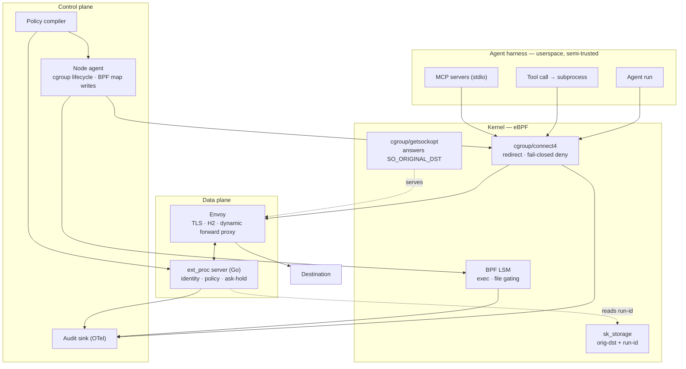
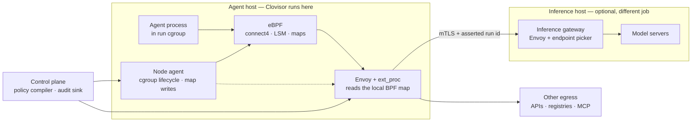
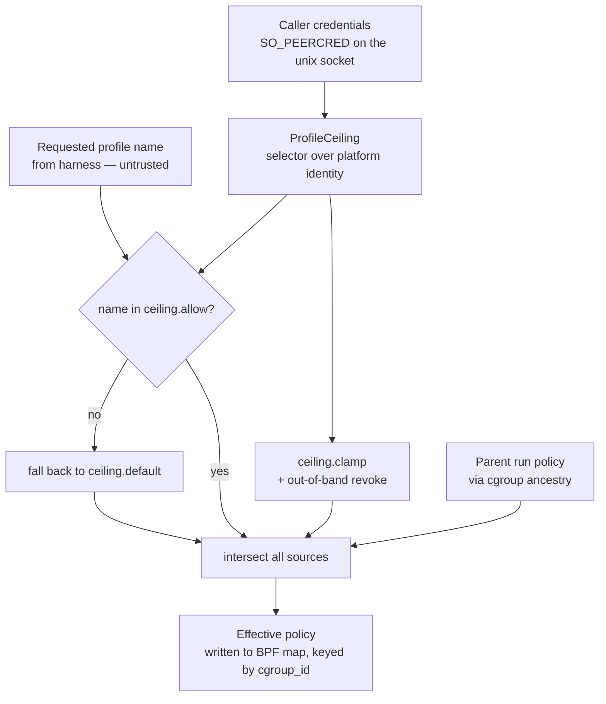
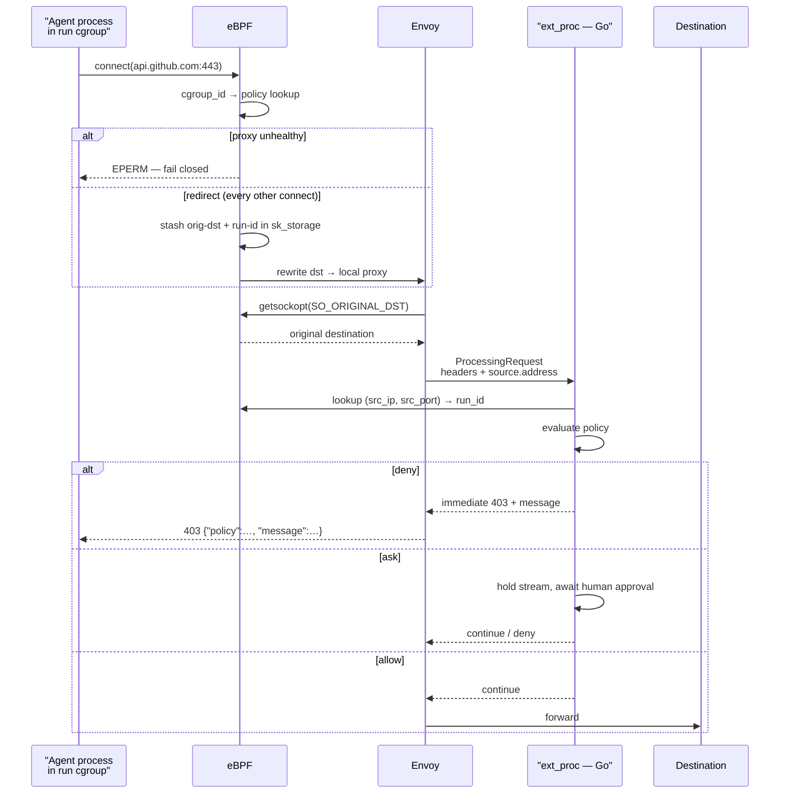
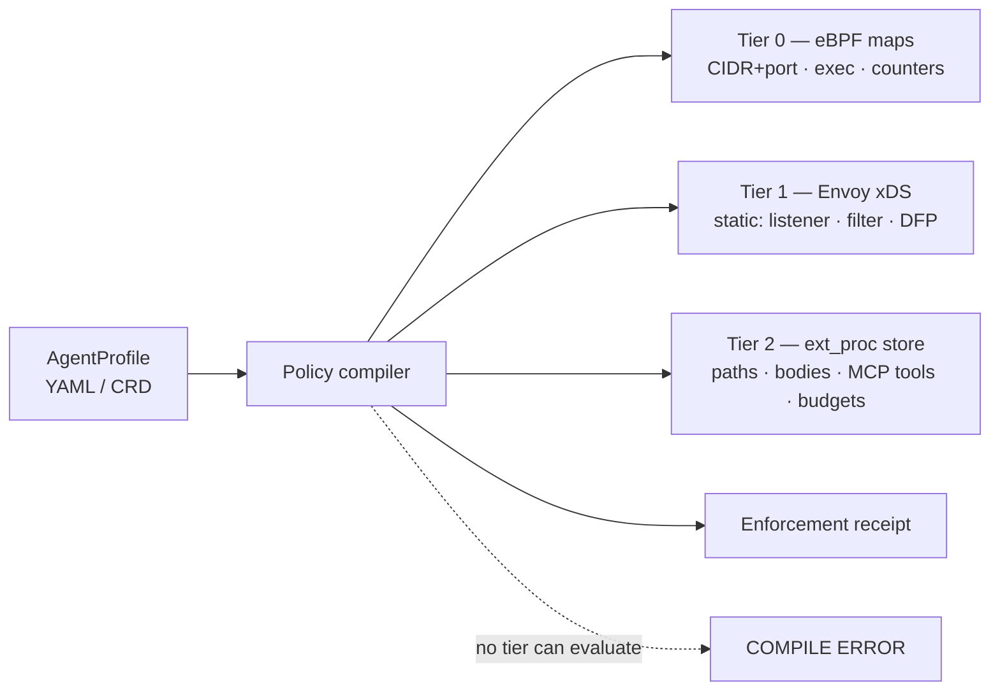
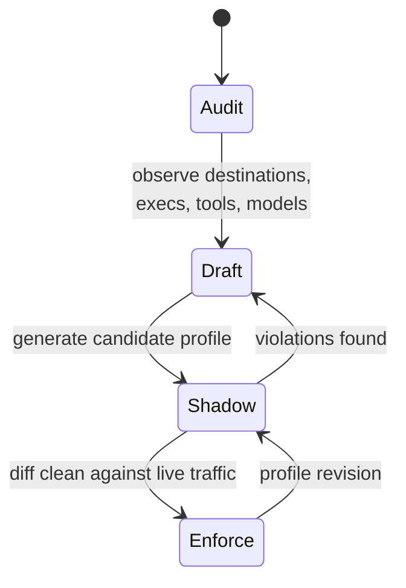
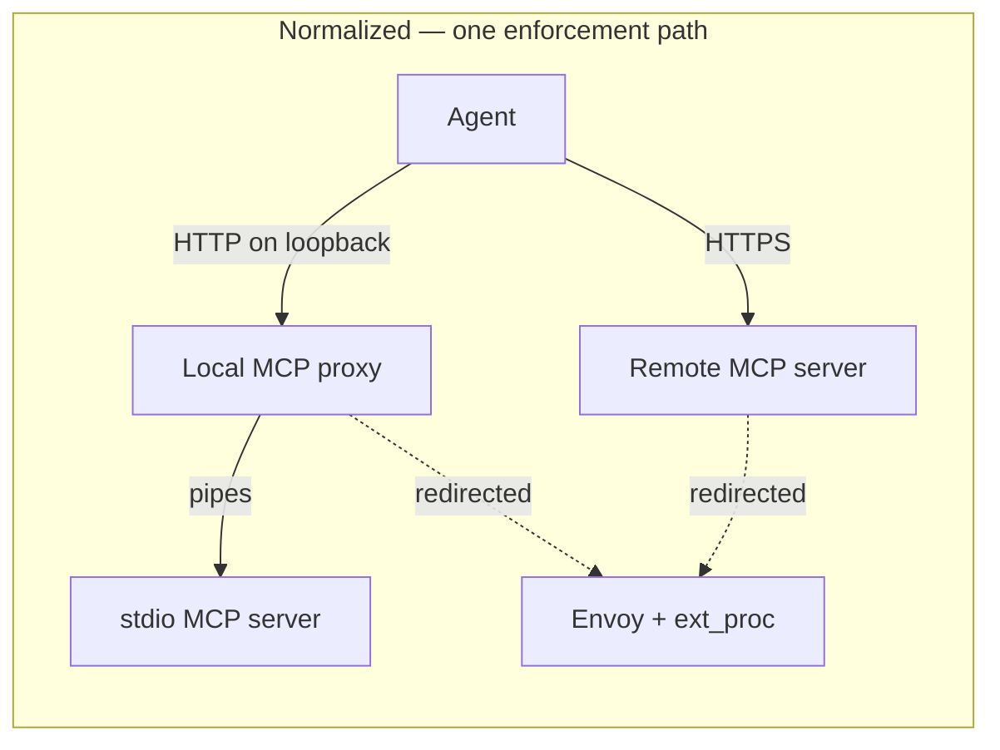
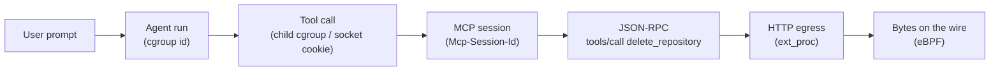

# Clovisor II — An Agent Egress Control & Audit Engine

**Status:** Phase 1 (audit) and Phase 2 (explicit proxy and MCP) implemented;
Phase 3 (transparent mode) in progress ·
**Date:** 2026-11-14, revised 2026-11-22 · **Repo:** `clovisor` ·
**Operating it:** [operator guide](operator-guide.md)

> A design study on repointing Clovisor's architecture from Istio service-mesh
> observability toward egress control and audit for AI agents. Phases 1 and 2
> are implemented ([§10](#10-build-order)). Open questions are
> collected in [§12](#12-open-questions). The 2026-11-19 design review and what
> it changed are summarized under [Revision history](#revision-history).

---

## Table of contents

1. [Provenance: what Clovisor was](#1-provenance-what-clovisor-was)
2. [The gap this addresses](#2-the-gap-this-addresses)
3. [Why this direction over the alternatives](#3-why-this-direction-over-the-alternatives)
4. [Architecture overview](#4-architecture-overview)
5. [Identity model](#5-identity-model)
6. [Data path](#6-data-path)
7. [Policy language](#7-policy-language)
8. [MCP](#8-mcp)
9. [What maps from the existing codebase](#9-what-maps-from-the-existing-codebase)
10. [Build order](#10-build-order)
11. [Non-goals and honest limits](#11-non-goals-and-honest-limits)
12. [Open questions](#12-open-questions)

---

## Revision history

### 2026-11-19 — design review

Changes to the design, each marked *Revised 2026-11-19* or *New 2026-11-19* in
place:

| Change | Where |
|---|---|
| Enforcement granularity stated as it is: the process tree, not the logical run. Many runs in one process get per-process enforcement only. | [§2](#2-the-gap-this-addresses), [§5.8](#58-enforcement-granularity-is-the-process-tree) |
| Positioning against the strongest alternative — a network namespace per run — and existing kernel enforcement tools. | [§3.1](#31-prior-art-and-positioning) |
| A portable explicit-proxy mode with no eBPF, for platforms where agents actually run (including macOS). | [§4.3](#43-two-deployment-modes) |
| Tier 0 becomes **redirect-or-deny**: every TCP connect from a run goes to the proxy or fails. The DNS-learned IP allowlist backstop is dropped except for protocols with no hostname on the wire. | [§6.5](#65-three-rules-that-must-not-be-gotten-wrong), [§7.5](#75-one-rule-one-enforcement-point-no-bypass) |
| Egress channels `connect4` cannot see: unconnected UDP, DNS (and DNS tunnelling), QUIC, raw sockets. | [§6.8](#68-channels-connect4-does-not-see) |
| QUIC: denied by default, with opt-in SNI forwarding, plus a UDP packet backstop. Encrypted Client Hello defeated at the local resolver. | [§6.6](#66-tls-posture), [§6.8](#68-channels-connect4-does-not-see) |
| Build order: the proxy and MCP layer moves to Phase 2, ahead of kernel enforcement. | [§10](#10-build-order) |
| Exfiltration through *allowed* destinations stated as an explicit limit. | [§11](#11-non-goals-and-honest-limits) |
| Code-reuse table corrected to what actually carries over. | [§9](#9-what-maps-from-the-existing-codebase) |

### 2026-11-20 — Phase 1 implementation

| Change | Where |
|---|---|
| `clone3(CLONE_INTO_CGROUP)` needs root, so the run API moves a parked child by pidfd instead of handing out a cgroup fd. | [§5.2](#52-enforcement-identity-cgroup-v2), [Phase 1 status](#phase-1-status-2026-11-20) |
| Phase 1 complete; Phase 2 broken into milestones, with explicit-proxy identity from socket diagnostics on Linux. | [Phase 2 plan](#phase-2-plan-2026-11-20) |

### 2026-11-21 — Phase 2 learn and audit

| Change | Where |
|---|---|
| Learn mode drafts exact method and path rules for hosts seen in full, and `mcp` server rules from the calls let through. `check` replays paths and MCP calls. Tool pins get a review and approve command. | [2.6 status](#26-status-learn-and-audit-2026-11-21) |
| Credential identity implemented: the portable mode runs on macOS and unprivileged, with a per-run secret in the proxy URL. Docker integration tests and an operator guide. Phase 2 complete. | [2.7 status](#27-status-portability-and-tests-2026-11-21), [operator guide](operator-guide.md) |

### 2026-11-22 — Phase 3 plan

| Change | Where |
|---|---|
| Phase 3 broken into milestones. Redirected connections become a `CONNECT` into the Phase 2 pipeline, routed by SNI; identity reuses socket diagnostics; same-run loopback allowed; fail closed by heartbeat. | [Phase 3 plan](#phase-3-plan-2026-11-22) |
| 3.0 spikes: original-destination recovery, the Envoy transparent listener, forced DNS with ECH stripping, UDP deny and fail closed all work. Sockets made before joining a run bypass the hooks; a direct connect to the transparent port loops. | [3.0 spike results](#30-spike-results-2026-11-22) |
| Redirect-or-deny and the transparent data plane implemented (`-transparent audit\|enforce`): pinned hooks that fail closed, same-run loopback, SNI routing into the CONNECT pipeline, clean-start check at attach. | [3.1 and 3.2 status](#31-and-32-status-2026-11-22) |
| Forced local DNS: every run query to the node's resolver, which answers only names the profile could allow (NXDOMAIN with an EDE reason otherwise) and strips ECH. | [3.4 status](#34-status-2026-11-22) |
| UDP refused except DNS, node-wide exceptions and same-run loopback, QUIC included; a packet backstop drops what gets past the socket hooks. | [3.3 status](#33-status-2026-11-22) |
| Heartbeat tied to Envoy's health; the proxy's own connects gated in the kernel (closing DNS rebinding); lost kernel events counted per run; `agentctl status`; overhead measured. | [3.5 status](#35-status-2026-11-22) |
| Learn, check and receipt for transparent deployments: `check --transparent` replays DNS, UDP and by-address TCP as enforce decides; learn notes for each; `explain --transparent`. | [3.6 status](#36-status-2026-11-22) |
| Raw TCP tunnels known only by address are decided by a name the node's resolver answered with that address for the run, when no rule names the address. | [Resolved-name matching](#resolved-name-matching-2026-11-22) |

---

## 1. Provenance: what Clovisor was

Clovisor (2018) was a sidecar-less, per-node eBPF agent that mapped Istio
application networking policy onto low-level kernel constructs. It had three
layers:

| Layer | Implementation | Verdict |
|---|---|---|
| **Control architecture** | k8s informer + label discovery → identity → compile policy into BPF maps → attach per-workload → stream events → correlate into traces | **Keep.** Still the right skeleton. |
| **Data path** | TC clsact on pod veth, parse eth/ip/tcp inline, `dports2proto` classification, 5-tuple session table, `perf_submit_skb` whole packet to userspace, HTTP parsed by a Go `.so` plugin, OpenTracing spans | **Rewrite.** Not a port. |
| **Steering** | `redirect_lookup_table` → MAC/IP rewrite + `bpf_clone_redirect`, driven by `POST /redirect/` | **Repoint.** Becomes proxy redirect. |

### Why the data path doesn't survive

The original L7 story — copy the full skb to userspace, `strncmp` for
`GET`/`POST`, reassemble — fails three ways against modern traffic:

- **TLS.** Everything is encrypted. Packet-level parsing is dead without uprobes
  on `SSL_read`/`SSL_write` and Go's `crypto/tls`, a completely different
  attachment model from TC.
- **HTTP/2 multiplexing.** A 5-tuple session keyed on `req_time`/`resp_time` and
  closed on FIN/RST cannot express per-stream events. Many requests share one
  connection.
- **Non-network transports.** A large share of agent traffic (MCP over stdio) is
  pipes between processes. TC sees nothing.

### Mechanical modernization (orthogonal to the redesign)

- `iovisor/gobpf` → `cilium/ebpf` + CO-RE (`vmlinux.h`, `bpf2go`). Kills runtime
  LLVM in the DaemonSet, the kernel-header dependency, and most of the image size.
- `BPF_PERF_OUTPUT` → ring buffer.
- `clsact` qdisc → `tcx`. The current attach clobbers Cilium/Calico on the same
  node; `tcx` solves multi-attach.
- Go plugin `.so` parsers → compiled in. Go plugins require exact toolchain match
  and were never worth it.
- OpenTracing / `jaeger-client-go` → OpenTelemetry.
- Redis-as-config-bus → CRDs + informers (already half-built in `k8s-ctlr/`).

---

## 2. The gap this addresses

An AI agent executes tool calls. What it calls is decided by a model at runtime
and is not statically knowable. Every existing control sits at the wrong
granularity:

| Control | Thinks in | Fails because |
|---|---|---|
| Harness allowlist | tool calls | In-process and advisory. `curl` inside a bash tool call never touches your HTTP client wrapper. Neither does an npm postinstall script. |
| NetworkPolicy / egress proxy | pods | 50 concurrent agent runs in one worker process = one identity. |
| Sidecar proxy | connections | Sees the host, not *which run* caused it. |
| Per-run sandbox (netns or microVM) + egress proxy | sandboxes | Doesn't fail. It is the strongest alternative ([§3.1](#31-prior-art-and-positioning)). It costs a sandbox and network plumbing per run, the harness has to adopt it, and it sees no exec tree. |

**The enforcement point does not know which logical agent run caused the
syscall.** That is structurally the same problem Clovisor already solved once —
Istio thinks in `VirtualService`, the kernel thinks in 5-tuples, and the job was
the bridge. Same shape, new nouns.

*Revised 2026-11-19.* The NetworkPolicy row's "50 runs in one worker process"
is not solved by this design either. A cgroup holds processes, so 50 runs in one
process are one cgroup, and nothing in the kernel can split them unforgeably
([§5.8](#58-enforcement-granularity-is-the-process-tree)). What this design adds
is per-run identity for runs that are separate process trees (which agent tool
calls overwhelmingly are) with no per-run network plumbing, plus an exec-level
audit trail.

The threat model is not malicious code. It is **an agent being manipulated** —
prompt injection via a poisoned web page, issue tracker, or file, leading to
exfiltration or destructive tool use. Network egress is the chokepoint for that
threat.

---

## 3. Why this direction over the alternatives

Three candidate directions were considered for repointing the project:

| Direction | Assessment |
|---|---|
| **A. Inference fabric observability** — NCCL/collective traffic, disaggregated prefill→decode KV transfers, straggler and ECMP-collision detection | Technically the most interesting. **Structural blocker:** GPUDirect RDMA bypasses the kernel networking stack entirely, so TC/XDP sees nothing. Limited to TCP-mode NCCL unless you move to rdma-core uprobes and switch telemetry. Partially covered by DCGM, NCCL profilers, and switch telemetry. |
| **B. Agent egress control + audit** *(this document)* | No structural blocker. Reuses the most of the existing control architecture. The gap — kernel-level identity at *agent-run* granularity — is owned by nobody. |
| **C. Inference-aware routing** — routing on KV-cache locality and queue depth | Skip. Gateway API Inference Extension / llm-d already own this, the signal lives in the model server, and eBPF adds almost nothing. |

The transferable insight from Clovisor is not "map Istio to eBPF" — Cilium L7
policy and Istio ambient have absorbed that. It is **knowing how to attach a
control-plane identity to a kernel object.** The unfilled gap is that no kernel
plane today knows what an *agent run* or a *tool call* is.

### 3.1 Prior art and positioning

*New 2026-11-19.* Three adjacent categories each cover part of this problem:

| Category | Covers | Does not cover |
|---|---|---|
| **Per-run sandboxes**: a network namespace or microVM per run, whose only route is an egress proxy | Unforgeable per-run identity (by the interface or proxy socket traffic arrives on), host-level egress allowlisting | The exec tree; L7 and MCP policy beyond what its proxy does. The harness has to create and own the run's network setup. |
| **Kernel runtime enforcement** (Tetragon-class tools, Falco) | exec and network observation and enforcement scoped by cgroup, pod or namespace | Agent runs, tool calls, MCP, request bodies. No concept of a run. |
| **AI and MCP gateways** | Model routing, token budgets, MCP tool allowlists | Anything that does not route through them; which run is calling |

**Network namespace per run is the one to beat.** Once a run is its own process
tree, which per-run enforcement requires anyway
([§5.8](#58-enforcement-granularity-is-the-process-tree)), it can also have its
own namespace. The proxy then knows the run from where its traffic arrives, with
no BPF at all. This design is better where:

- **exec matters.** A namespace sees packets, not processes. The audit chain
  ([§8.6](#86-the-audit-chain-closes)) needs exec events tied to the run, and
  exec gating ([§7.6](#76-exec-matching-path-hash-or-provenance)) needs a hook
  in the exec path.
- **The harness can't be changed.** `agentctl run -- python agent.py` works
  without the harness creating namespaces, veth pairs or routes, and it
  coexists with whatever CNI is on the node.
- **Density.** A cgroup and a map entry per run, not a namespace, veth pair and
  route set per run.
- **One install covers every agent on the host**, whichever harness launched it.

The two compose rather than compete. A namespace-per-run sandbox can use this
design's proxy, compiler and MCP layer in explicit-proxy mode
([§4.3](#43-two-deployment-modes)), with the sandbox supplying identity and
enforcement.

**Where the novelty is.** The kernel half is the least novel part; Tetragon-class
tools already enforce exec and connect per cgroup. What nobody ships is the
combination of:

- an identity model with runs and tool calls as first-class objects;
- a policy compiler that states honestly where each rule is enforced;
- an L7 and MCP layer: tool-level policy, tool-definition pinning, denial
  narration;
- an audit chain joined end to end.

Build effort should follow the novelty ([§10](#10-build-order)).

---

## 4. Architecture overview



### 4.1 Division of labor

| Layer | Owns |
|---|---|
| **eBPF** | Identity (cgroup), unbypassable capture, fail-closed deny, original-dst + run-id stash, exec gating |
| **Envoy** | Connections, TLS, HTTP/2, dynamic forward proxy, retries, access logs |
| **ext_proc (Go)** | Identity resolution via BPF map, policy decision, body inspection, ask-hold, denial narration |
| **Control plane** | Policy → ext_proc store + BPF maps; cgroup lifecycle; xDS kept static |

### 4.2 Deployment topology

**Clovisor runs on the agent host.** The identity primitive is the agent's
cgroup, and no machine can observe another machine's cgroups — so every
enforcement component is bound to the host where agent processes execute. This
is not a preference; eBPF makes it structural.



| Component | Placement | Why |
|---|---|---|
| `cgroup/connect4`, BPF LSM, maps | **Agent host — required** | Hooks the agent's own syscalls |
| Node agent | **Agent host — required** | Owns cgroup lifecycle; the unix socket to the harness ([§5.4](#54-the-injection-channel)) needs co-location |
| Envoy + `ext_proc` | **Agent host — required as designed** | `ext_proc` resolves identity by reading the local BPF map ([§6.4](#64-identity-handoff-to-envoy)) |
| Policy compiler, audit sink | Anywhere | Control plane; no kernel coupling |
| Inference gateway | Inference host — **optional** | Routing and endpoint selection; a different job, below |

#### The inference side consumes identity, it does not derive it

[§6.1](#61-why-envoy) argues for Envoy partly on a shared dataplane with
inference routing. That sharing is of *software and the `ext_proc` contract* —
not of a deployment. The two installations know different things:

| | Agent host | Inference host |
|---|---|---|
| Knows | cgroup → run, unforgeable | whatever identity arrived in-band |
| Enforces | egress, exec, MCP tools, content, budgets | model routing, endpoint selection |

Per-run token budgets are the one policy spanning both, since tokens are counted
where the model responds while run identity lives where the agent runs. Two
resolutions:

- **Agent-side (the default).** The agent-host Envoy terminates the model call,
  reads response usage, decrements the budget. Self-contained, no cross-machine
  trust, and [§6.6](#66-tls-posture) derives the needed termination
  automatically because `budget:` is a body rule.
- **Inference-side.** Needs the run id to travel in-band. The only component
  entitled to mint that header is the agent-side proxy — the one holding
  cgroup-derived identity.

> **The agent-side proxy is the identity authority. The inference gateway is a
> consumer of asserted identity.** That assertion is worth exactly as much as
> the mTLS between them.

Which follows from [§5.5](#55-the-forgeability-rule): cgroup-derived identity is
enforcement-grade at its point of origin and becomes a *claim* the moment it
crosses a machine boundary.

#### The centralized-gateway fork

A shared egress gateway — one Envoy fleet serving many agent hosts — is a
reasonable architecture that **this design forecloses**, because `ext_proc`
resolves identity from a local BPF map. Going centralized would require either
an RPC back to the originating node agent on every connection, or minting a
signed per-run credential (PROXY protocol, or a per-run client certificate) so
identity travels in-band. Both are viable, neither is free, and the second is
the same mechanism as the inference-side case above. Recorded so the choice is
made deliberately rather than discovered.

#### Packing and distribution

Colocation changes nothing architecturally: an agent and a model server on one
bare-metal box is one node agent with two filter chains — a packing decision.

The consequential case is the reverse. **Agents running outside your
infrastructure** — on a laptop, in a customer's cluster — mean the whole
enforcement half ships to them while only the inference gateway stays yours.
That decides whether this is a system you operate or one you distribute, and it
is worth settling before the control-plane interfaces harden.

### 4.3 Two deployment modes

*New 2026-11-19.*

| | Transparent (Linux) | Explicit proxy (portable) |
|---|---|---|
| How traffic reaches the proxy | `connect4` redirect-or-deny ([§6.5](#65-three-rules-that-must-not-be-gotten-wrong)) | `HTTPS_PROXY` or harness configuration, or an OS sandbox whose only route is the proxy |
| Run identity at the proxy | cgroup id via BPF map, enforcement-grade | A per-run listener (a unix socket or loopback port exposed only inside the run's sandbox) is enforcement-grade when the sandbox stops the run reaching any other listener. Otherwise a per-run proxy credential, which is a claim ([§5.5](#55-the-forgeability-rule)). |
| Bypass | none for TCP and UDP from the run ([§6.8](#68-channels-connect4-does-not-see) covers the rest) | anything that ignores the proxy setting, unless a sandbox blocks other egress |
| Exec gating and exec audit | yes | no |
| Platforms | Linux with cgroup v2; exec gating needs `lsm=bpf` | anywhere Envoy runs, including macOS |

Explicit-proxy mode alone is advisory: `curl --noproxy '*'` walks past it. It is
enforcement-grade only when paired with something that forbids other egress: a
namespace sandbox, an OS sandbox profile, or transparent mode.

It exists for two reasons:

- **Most interactive coding agents run on developer laptops**, where eBPF does
  not exist.
- **It lets the L7 and MCP layer ship first** ([§10](#10-build-order)), without
  waiting on kernel work.

Policy, compiler and audit format are identical in both modes. Only the identity
source changes, and with it the bypass column of the receipt
([§7.4](#74-compilation-and-the-enforcement-receipt)).

---

## 5. Identity model

### 5.1 Two granularities, two mechanisms

The single most important framing. Conflating these is what makes the problem
look intractable.

- **Enforcement identity** = the agent run. Must be unforgeable, must survive
  fork/exec, must need no cooperation from the governed code.
- **Attribution identity** = the tool call. May be self-reported, needs to be
  fine-grained, only has to be good enough for forensics.

### 5.2 Enforcement identity: cgroup v2

```
/sys/fs/cgroup/agents/                 ← BPF programs attached ONCE here
└── run-7f3a9c/                        ← enforcement identity (the agent run)
    ├── call-0012/                     ← tool call: bash -c "git clone ..."
    │   └── (git, ssh, ...)            ← inherited, no extra work
    ├── mcp-github/                     ← MCP server, attenuated profile
    └── subagent-2b/                    ← sub-agent, policy ⊆ parent
```

Mechanics that matter:

**Attach once, not per run.** Attaching a program per run cgroup costs an
attach/detach syscall pair per run plus churn. Attach once at the subtree root
with `BPF_F_ALLOW_MULTI`, then call `bpf_get_current_cgroup_id()` inside the
program and look up policy in a hash. One attach, N runs; run creation becomes a
single map update.

**Spawn into the cgroup atomically.** The naive path — fork, then write the pid
to `cgroup.procs` — leaves a window where the child executes under the parent's
policy. An agent that spawns and immediately connects wins that race. Use
`clone3(CLONE_INTO_CGROUP)` (Linux 5.7+); recent Go exposes it as
`SysProcAttr.CgroupFD`. **This is the single most important implementation
detail on this path.**

**Who creates the cgroup.** A containerized harness running non-root cannot
write host cgroupfs. Do not solve this with delegation. The node agent owns all
cgroup manipulation from the host namespace and exposes a small local API
("give me a cgroup for run X").

*Revised 2026-11-20.* The API cannot simply return an fd for the harness to pass
to `CgroupFD`:
- `clone3(CLONE_INTO_CGROUP)` applies the same permission check as writing
  `cgroup.procs`.
- That check includes write access to the `cgroup.procs` of the common ancestor
  of the source and target cgroups. For `agents/` the common ancestor is the
  root cgroup.
- Verified on the development kernel: a non-root caller gets `EPERM` even when
  it owns the target cgroup and its `cgroup.procs`.

So the node agent moves the process itself, and the harness parks the child
until the move is done:
1. The harness starts its child as a shim: its own code, blocked on a pipe.
2. It sends the node agent a pidfd for that child over `SCM_RIGHTS`.
3. The node agent checks, against `SO_PEERCRED`, that the target is a direct
   child of the caller with the caller's uid, and that neither is already in a
   run. It then writes the pid into the run's `cgroup.procs`.
4. The shim is released and `exec`s the command in the same process.

The guarantee is the same as `clone3`: no governed code ever runs outside the
run. A caller can only ever confine its own children.
Note `bpf_get_current_cgroup_id()` returns the host kernfs id regardless of
cgroup namespacing, so the BPF side is unaffected; only userspace path
construction cares, and that now lives in one place.

**Deferred cleanup.** Kernfs ids are not practically reused, but rapid
create/delete cycles plus in-flight events will eventually deliver an event for
an id just reassigned. Remove the policy map entry **first** (so late syscalls
fail closed), drain, then delete the cgroup on a grace timer.

### 5.3 Attribution identity: the async problem

Within one run cgroup there are many tool calls. The obvious mechanism — a BPF
hash keyed by `tid`, written by the harness at tool-call entry — works for
exactly one execution model:

| Runtime | tid tagging |
|---|---|
| Python, thread-per-call | **Works.** `os.gettid()`, write at entry, overwrite on pool reuse. |
| Python asyncio | **Breaks.** One thread, interleaved calls. |
| Node.js | **Breaks.** Single event loop, async by default. |
| Go | **Breaks.** Goroutines migrate across OS threads mid-call. `LockOSThread` per call "fixes" it and wrecks the scheduler. |

That is most modern harnesses. Do not fight it in the kernel. Resolve in three
pieces:

1. **Subprocesses → child cgroups.** A tool call that shells out spawns into
   `run-<id>/call-<n>`. Tool-call identity becomes a cgroup id again with full
   inheritance. `bpf_get_current_ancestor_cgroup_id()` gives the run, the leaf
   gives the call. The happy accident: *the case where attribution matters most —
   arbitrary code execution — is exactly where cgroups work perfectly.*

2. **In-process HTTP → socket cookies.** For async runtimes the stable handle is
   the socket, not the thread. Userspace reads `getsockopt(SO_COOKIE)` on its own
   fd; BPF reads `bpf_get_socket_cookie()`. Both see the same u64. Connection
   pooling makes it many-to-one over time — treat it as an append-only timeline
   (`cookie, timestamp → call`) and join by window, or disable keepalive for
   agent egress, which is a defensible isolation choice anyway.

3. **Everything else → join in correlation.** Let the harness emit ordinary
   userspace spans and stitch them to kernel events by
   `(cgroup_id, time window, socket cookie)`. This is precisely what the existing
   `sessionMap` correlation does for a different pairing.

Residual risk is small: in-process async HTTP goes through *your own* HTTP
client, which can be instrumented at the application layer. What you cannot
instrument forks, and forks are covered by cgroups.

### 5.4 The injection channel

Three ways for userspace to write identity into the kernel, in increasing order
of correctness:

1. Harness opens pinned maps directly — needs `CAP_BPF`. **No.** This hands
   arbitrary BPF access to the thing being contained.
2. Node agent passes a single map fd over `SCM_RIGHTS`. Workable.
3. **Harness talks to the node agent over a unix socket; the node agent is the
   only BPF writer.** One trusted writer, full validation, one IPC round trip per
   tool call — free at agent rates. **Take this one.**

### 5.5 The forgeability rule

> **Enforcement identity must come from the cgroup. Self-reported identity is
> audit-grade only, never enforcement-grade.**

If an agent can execute arbitrary code in the harness process, it can write
anything into any tid or cookie map the harness can write. Those are *claims*,
not facts. Cgroup membership is different: you cannot move yourself out of a
cgroup without write access to the parent's `cgroup.procs`, which is denied, and
you cannot escape by forking. `cgroup_id → policy` is the only binding a
`connect4` hook may consult for an allow/deny decision. Everything else enriches
the log.

### 5.6 Profile binding: names with a trusted ceiling

Which profile applies to a run must be a **recorded fact, not a computed
property.** Two candidate mechanisms: *by selector* over run metadata (the
Kubernetes/Istio model), or *by name*, stated when the run is created.

Selector binding is disqualified by [§5.5](#55-the-forgeability-rule). If
profile selection depends on run metadata, then whoever sets the metadata
chooses the policy — and run metadata is set by the harness, the semi-trusted
component being contained. **Selector binding makes enforcement identity
self-reported by construction.**

Three further problems compound it:

- Determining effective policy becomes a selector evaluation with merge and
  precedence rules rather than a lookup — the failure mode that makes
  NetworkPolicy and mesh config hard to debug.
- It puts control-plane work on the run-start critical path, where policy must
  land in the BPF map *before* `clone3` or the
  [§5.2](#52-enforcement-identity-cgroup-v2) race reopens.
- It makes attenuation incoherent: a sub-agent whose metadata matches a broader
  profile yields an upper bound that is then silently clipped, so a profile's
  stated scope is never its real one.

But naive name binding has the same hole wearing a different hat — if the
harness names its own profile, the harness chooses its own policy. Name binding
is only better when **the name is constrained by something the agent cannot
influence.**

#### Resolution chain

The harness *requests* a profile by name. The node agent *validates* that
request against a ceiling derived from the caller's own identity, then
intersects:



The ceiling comes from a different place depending on depth, but the rule is
identical:

| Run kind | Ceiling source |
|---|---|
| **Root run** | Platform identity — service account, namespace, pod identity. Set by the platform, never by the agent. |
| **Sub-agent run** | The parent run's effective policy, via cgroup ancestry. |

So [§7.8](#78-sub-agent-delegation-monotonic-attenuation) attenuation is not a
special rule for sub-agents. It is *the* general rule, and a root run is simply
the case where the parent is the workload rather than another run. One concept
covers the whole tree.

Critically, the node agent resolves the ceiling from the **caller's credentials
on the unix socket** (`SO_PEERCRED`), never from anything in the request body.
The harness may choose among profiles it has been granted; it cannot name one it
has not.

#### Where selectors remain legitimate

The ceiling lookup — "which ceiling applies to this workload" — *is* a selector.
What differs is the thing it binds to:

> **Selectors at the platform boundary: trusted, slow-changing, few.
> Names at the run boundary: fast, ephemeral, many.**

That also serves the use case selectors exist for. "Apply a baseline to
everything" needs no run-metadata matching — it is a cluster-wide `clamp`
intersected into every ceiling. One object edited, every run constrained, no
selector ever evaluated against a run. See
[§7.3](#73-surface-syntax) for the `ProfileCeiling` object.

#### Versioned binding

A run binds to a *resolved version* (`research-agent@v7`), not a bare name. A
policy edit then cannot retroactively change what a running agent may do, and
the audit log states exactly which policy was in force — so an incident can be
replayed against the real thing.

The cost is that you cannot tighten policy on a run already in flight, which is
precisely what an incident calls for. That is served by an explicit out-of-band
**clamp/revoke**, deliberately one-directional: it can only remove permissions,
never add. Routine edits never silently mutate live runs, emergencies still have
a lever, and because clamping only subtracts it composes with attenuation rather
than fighting it.

#### Debuggability

"Why was this blocked?" resolves to two lookups of recorded facts — the profile
version bound at creation, and the ceiling that clamped it. No selector
evaluation, no precedence rules, no reconstructing control-plane state at some
past instant. For a system whose value proposition is the audit trail, that is
worth more than the flexibility given up.

### 5.7 No-cooperation mode is the default

`agentctl run -- python agent.py` creates the cgroup, `clone3`s into it, and
yields full enforcement with **zero harness changes**. Tool-call attribution
degrades to "inferred from the exec tree plus timing," which is decent. Harness
integration buys precision, not function.

This is the right shape for adoption: nobody installs a security tool that
requires rewriting their agent first.

### 5.8 Enforcement granularity is the process tree

*New 2026-11-19.* A cgroup contains processes. Threads can technically sit in
separate threaded cgroups, but code in one address space can act through any of
its threads, so that is not an identity boundary.

> **Enforcement identity is per process tree. A run gets enforcement-grade
> identity only if it is its own process tree.**

This corrects the motivating example in [§2](#2-the-gap-this-addresses).
Fifty runs inside one worker process are one cgroup:

- tier 0 enforces one policy for all fifty;
- telling them apart relies on socket cookies and harness spans, which
  [§5.5](#55-the-forgeability-rule) rules audit-grade only.

No kernel mechanism fixes that case, and a namespace can't split a process
either. Code in the same address space can forge whatever the runtime uses to
tell runs apart.

| Harness shape | Enforcement unit | Attribution |
|---|---|---|
| One process per run (`agentctl run`, a worker per run, most CLI agents) | the run | per tool call, via child cgroups ([§5.3](#53-attribution-identity-the-async-problem)) |
| Tool calls that shell out | the run, and the tool call with child cgroups | exact |
| Many runs in one process (async worker pools) | the process: a profile common to all its runs | audit-grade, via socket cookies and spans |

For the third shape, the recommendation is to move to a process per run: a pool
of worker processes, not of coroutines. That is also the isolation boundary those
harnesses lack today. When the enforcement unit is the process, the receipt says
so, so nobody reads a per-run guarantee that isn't there.

---

## 6. Data path

### 6.1 Why Envoy

The proxy was initially scoped as a small Go program (direct BPF map reads, no
callout). **Envoy wins** on two arguments:

- **`ext_proc` gives body access, not just a verdict.** `ext_authz` returns
  allow/deny; `ext_proc` streams request and response through an external gRPC
  service that can observe and mutate headers, body, and trailers at every
  phase. For agent egress that is the difference between "run X connected to
  `api.openai.com`" and "run X sent *this payload* containing *this secret*."
  Every interesting rule is a body rule.
- **Shared dataplane with inference routing.** If Envoy is already in the
  inference path (Gateway API Inference Extension's endpoint picker is itself an
  `ext_proc` server), egress control and inference routing become the same
  software with different filter chains. One `ext_proc` server can know both
  *which agent run* and *which model* — which unlocks **per-run token budgets
  enforced at the dataplane**, expressible nowhere else today.

Go does not disappear, it relocates: the `ext_proc` server is Go, reads the BPF
maps, evaluates policy. Hundreds of lines, not thousands.

### 6.2 Transparent redirect and original-destination recovery

The enabler that lets an off-the-shelf proxy work unmodified:

After `cgroup/connect4` rewrites the destination, stash the original in
`bpf_sk_storage` keyed by socket cookie, then attach a `cgroup/getsockopt`
program that answers `SO_ORIGINAL_DST` from that map. Cilium does exactly this.
The effect: **any proxy that already speaks `SO_ORIGINAL_DST` — which is all of
them, since that is the netfilter REDIRECT convention — works with BPF redirect,
no conntrack, no iptables.**

### 6.3 Connection flow



### 6.4 Identity handoff to Envoy

Envoy cannot read BPF maps, so identity resolution lives in `ext_proc`. The BPF
`connect4` program stashes `(src_ip, src_port) → run_id` at connect time
alongside the original-destination stash. Configure `ext_proc` to forward
`source.address` as a request attribute; the server does the map lookup.

Port reuse is the race, bounded by connection lifetime — include the socket
cookie in the stash and verify, or accept the window.

The §5.5 invariant still holds and matters more here: the lookup resolves to a
cgroup-derived run id, which is unforgeable. **Nothing the agent puts in a
header is enforcement-grade.**

### 6.5 Three rules that must not be gotten wrong

**1. Tier 0 is redirect-or-deny.** *Revised 2026-11-19.* Every TCP connect from
a run cgroup is either redirected to the local proxy or refused with `EPERM`.
There is no third outcome where a connection silently goes direct.

- **Proxy healthy:** redirect, and stash the original destination.
- **Proxy unhealthy or unconfigured:** deny. **Fail closed.**
- **Static exceptions compiled from policy:** allow direct. These cover loopback
  to the local MCP proxy, the node agent's socket, and little else.

Envoy governs only what reaches it, and this rule makes that everything. That
removes the bypass the original design spent tier 0 on (a DNS-learned IP
allowlist catching traffic that avoided the proxy), because nothing can avoid
it. See [§7.5](#75-one-rule-one-enforcement-point-no-bypass). The wrong default
here turns the whole control into a no-op exactly when it matters.

**2. Keep xDS static.** Agent runs are ephemeral — seconds to minutes,
potentially hundreds concurrent. An xDS push per run will melt the control
plane. **xDS carries policy *shape*, not policy *instances*.** One listener, one
`ext_proc` filter, a dynamic forward proxy cluster, pushed once. All per-run
dynamism lives in BPF maps and the `ext_proc` store.

**3. Use `dynamic_forward_proxy`.** Agents egress to arbitrary hostnames.
Without the dynamic forward proxy cluster and its DNS cache filter you need a
cluster per destination — the xDS explosion from another direction.

### 6.6 TLS posture

| Mode | Gives you | Costs |
|---|---|---|
| **SNI only** (no termination) | Hostname | Nothing breaks, no CA management. No path or body rules. |
| **Terminate (MITM)** | Paths, bodies, MCP tool calls, content policy | CA in every agent image (tractable — you build them), breaks cert-pinned clients, and **creates a box holding plaintext of everything sensitive**. |
| **TLS uprobes** | Plaintext for audit | Offset chasing, Go version churn, dead on stripped static binaries. |

Clean split: **uprobes for visibility, proxy for enforcement.**

#### Posture is a property of the destination, not the profile

There is no `tls:` field on a profile. Posture is **derived per destination by
the compiler** from the rules attached to it:

| Rules attached to a destination | Required posture |
|---|---|
| FQDN, port, CIDR only | SNI — no termination |
| Loopback (normalized stdio MCP, [§8.3](#83-normalize-the-transport)) | plaintext already; nothing to terminate |
| Paths, methods, content patterns | terminate |
| MCP tools / resources / sampling | terminate |
| `model:` allow-lists, token and cost budgets | terminate |

This is [§7.1](#71-organizing-principle) applied one level down. Tier placement
minimizes *where* enforcement happens; posture inference minimizes *how deeply*
traffic is intercepted. Both say: use the least invasive mechanism that can
enforce what was actually stated.

The payoff is on the objection above. Per-destination inference shrinks the
plaintext box from everything the agent does to only the endpoints carrying body
rules — terminating `mcp.github.internal` does not put model API calls or
package downloads in plaintext — and it confines cert-pinning breakage to
destinations that were opted into explicitly, which the receipt names.

#### `no_terminate`

A per-destination assertion — *"I may not hold plaintext for this endpoint"* — a
routine compliance constraint. The compiler then hard-fails any body rule for
that destination and names it, so the constraint surfaces as a rejected rule
rather than a rule that silently does nothing.

#### Termination is node-wide per destination

Envoy selects a filter chain per connection, matching on SNI and original
destination — at which point it does not yet know the run, since identity
resolution happens in `ext_proc` afterward
([§6.4](#64-identity-handoff-to-envoy)). **Termination therefore cannot vary by
profile for the same destination on the same node**: it is the union of all
active profiles.

Adding one body rule to one profile extends plaintext custody for every run on
that node talking to that destination. That is non-obvious enough that the
receipt must say so rather than hide it
([§7.4](#74-compilation-and-the-enforcement-receipt)).

Partial mitigation: terminate the connection, but have `ext_proc` discard bodies
for runs whose profile carries no body rule for that destination. The
interception still happens; the retention does not.

Mechanically this stays consistent with [§6.5](#65-three-rules-that-must-not-be-gotten-wrong):
one terminating filter chain matching the SNI set derived from policy, one
passthrough TCP chain for everything else. That set changes when policy changes,
never per run, so xDS stays effectively static.

#### Encrypted Client Hello

*New 2026-11-19.* SNI-only posture assumes the SNI names the real destination.
Encrypted Client Hello (ECH) breaks that assumption for TLS over TCP and QUIC
alike:

- the visible ("outer") SNI becomes the hosting provider's public name;
- the real one is encrypted to a key the client gets from the destination's DNS
  `HTTPS`/`SVCB` record.

Left alone, growing ECH adoption silently degrades every SNI-only rule to "some
site behind this provider." That is the shared-CDN problem from
[§7.5](#75-one-rule-one-enforcement-point-no-bypass) again.

The forced local resolver ([§6.8](#68-channels-connect4-does-not-see)) closes it.
It strips the `ech` parameter from `HTTPS` and `SVCB` answers, so clients never
attempt ECH and connections carry a cleartext SNI.

Residuals:

- **ECH configs from outside DNS.** A client with a hardcoded or previously
  cached ECH config can still use it. The ECH extension is visible in the outer
  ClientHello, so a TLS listener filter can detect it and deny the connection.
- **Explicit-proxy mode.** [§4.3](#43-two-deployment-modes) gets this protection
  only if the harness uses the local resolver.

### 6.7 ext_proc specifics

- **Denial narration.** `ext_proc` can return an immediate response with a custom
  body — a 403 with structured JSON (policy name, what was blocked, why, what is
  allowed instead) instead of an incomprehensible `EPERM`. See
  [§7.7](#77-denial-as-a-teaching-signal).
- **Ask-mode is nearly free.** `ext_proc` is a streaming RPC; the server can
  withhold its response while a human approves and Envoy waits. Set
  `message_timeout` / `max_message_timeout` deliberately and bound concurrent
  held streams so pending approvals cannot exhaust workers.
- **Watch `processing_mode` on streams.** Subscribing to response bodies on a
  token stream means one `ext_proc` message per chunk. Skip response-body phases
  unless specifically needed — with the exception of MCP sampling
  ([§8.4](#84-two-mcp-specific-threats)).

### 6.8 Channels `connect4` does not see

*New 2026-11-19.* Redirect-or-deny covers `connect()`, including `io_uring`
connects, because the cgroup hooks sit in the socket layer rather than at the
syscall. Several egress paths never call `connect()`:

| Channel | Why `connect4` misses it | Handling |
|---|---|---|
| Unconnected UDP (`sendto`, `sendmsg`) | no connect | `cgroup/sendmsg4` and `sendmsg6`: deny, except DNS to the local resolver |
| DNS | usually unconnected UDP; also the classic tunnelling channel | Force all DNS to a node-local resolver (below) |
| QUIC / HTTP/3 | UDP 443. Connected sockets (most QUIC clients) hit `connect4`/`connect6`; unconnected ones hit `sendmsg4`/`sendmsg6`. Both see the address only. | deny by default with `EPERM`; opt-in SNI forwarding. See [QUIC](#quic) below. |
| Raw and packet sockets | bypass the inet hooks | drop `CAP_NET_RAW` for run cgroups; deny `SOCK_RAW` and `AF_PACKET` in the LSM `socket_create` hook (Phase 4) |
| Unix sockets to host daemons | not inet | a run reaching the Docker socket or an SSH agent can egress through it; the LSM phase gates `AF_UNIX` connects by path |

**Forced local DNS.** Rewrite port-53 traffic from run cgroups to a node-local
resolver. The resolver answers only names that some active rule could allow for
that run, and returns `NXDOMAIN` for everything else. That closes DNS
tunnelling as a side effect: arbitrary subdomains never resolve, so they never
leave the host. Wildcard rules reopen it for the zones they name, which is one
more reason to keep wildcards narrow.

The resolver also produces the per-run DNS events the audit timeline needs,
which is simpler than parsing DNS in BPF. It is also where Encrypted Client Hello
is defeated ([§6.6](#66-tls-posture)).

**UDP backstop.** A `cgroup_skb/egress` program, attached to `agents/` like the
socket-address hooks, sees every packet leaving a run's sockets and can drop it.
It drops any UDP whose destination is not the local resolver or the QUIC
forwarder (below). That catches whatever the address hooks miss, for one map
lookup per packet.

#### QUIC

The address hooks can deny QUIC, but they cannot police it by name. That needs
the SNI, which sits in the TLS ClientHello inside QUIC Initial packets. Initial
packets are encrypted, but with keys anyone can derive from the client's
destination connection ID and a salt published in RFC 9001. So the SNI is
recoverable on-path, without terminating anything.

Recovering it in BPF is impractical:

- **Crypto.** It needs AES-ECB for header protection and AES-GCM for the
  payload. As of this writing, the BPF crypto kfuncs (Linux 6.10+) offer
  symmetric skciphers to TC and XDP programs. That covers header protection, but
  not the AEAD payload.
- **Reassembly.** With post-quantum key shares, the ClientHello often spans more
  than one Initial packet. Parsing it would mean reassembling CRYPTO frames
  across packets in the kernel.

So QUIC gets two postures, chosen per destination by the compiler, like TLS
posture ([§6.6](#66-tls-posture)):

| Posture | Mechanism | Used for |
|---|---|---|
| **Deny** (default) | `EPERM` on UDP 443 at `connect` and `sendmsg`. The failure is immediate, so HTTP/3 clients (browsers, curl) fall back to TCP without waiting for a timeout. | Every destination not opted into QUIC. Also every destination with body rules: those need termination, which exists on the TCP path. |
| **SNI-forwarded** (opt-in) | `connect4`/`sendmsg4` rewrite UDP 443 to a node-local QUIC forwarder. `recvmsg4`/`recvmsg6` rewrite reply sources, so the application sees its original peer. The forwarder decrypts Initial packets in userspace, extracts the SNI, applies the same host policy as TCP, then relays datagrams unmodified. | A workload that needs QUIC, for a destination with host-level rules only. |

SNI-forwarded QUIC has the same posture as SNI-only TLS over TCP: hostname
granularity, no termination, no plaintext.

Denying by default breaks little that should keep working. What it does break is
mostly QUIC-only tunnels (MASQUE, VPN-like transports) and DNS-over-QUIC. Both
route around the proxy or the resolver and should be blocked anyway.

Visibility without enforcement is also possible: uprobes on QUIC libraries give
plaintext for audit. But every application bundles its own QUIC stack, so
coverage means chasing each library and version. That is the same trade-off as
TLS uprobes (Phase 6).

---

## 7. Policy language

### 7.1 Organizing principle

> **Every rule declares what information it needs. The compiler places it at the
> lowest tier that can evaluate it — and refuses to compile if no tier can.**

Silent non-enforcement is the cardinal sin. A profile that looks like it blocks
something but does not is worse than no profile at all.

### 7.2 What each tier can know

| Tier | Sees | Cannot see | Bypassable |
|---|---|---|---|
| **0 — eBPF** | cgroup→run, dst IP:port, exec'd binary, counters | names, paths, bodies | No |
| **1 — Envoy static** | SNI, original dst | bodies, run identity | No in transparent mode (tier 0 redirects everything); yes in explicit-proxy mode alone |
| **2 — ext_proc** | everything above + run identity, headers, path, body, external state | — | Same as tier 1 |
| **3 — async** | history, cross-run patterns | cannot block inline | n/a |

That table *is* the language design. *Revised 2026-11-19:* the original
tension was that IP-and-port rules are unbypassable while path and body rules
depend on traffic reaching Envoy. Redirect-or-deny
([§6.5](#65-three-rules-that-must-not-be-gotten-wrong)) resolves it by making
reaching Envoy mandatory, so precise rules are unbypassable too
([§7.5](#75-one-rule-one-enforcement-point-no-bypass)).

### 7.3 Surface syntax

Typed declarative, **not** CEL or Rego as the primary surface. The reason is
analyzability: with typed match fields the compiler determines tier placement by
static inspection. With arbitrary CEL it cannot, so every rule lands at tier 2
by default. Keep CEL as an escape hatch *explicitly declared* tier-2-only.

```yaml
kind: AgentProfile
metadata: { name: research-agent }
spec:
  mode: enforce           # audit | enforce | ask
                          # no tls: field — posture is derived per destination,
                          # see 6.6

  egress:
    default: deny
    rules:
      - name: github-api
        to: { fqdn: ["api.github.com"], ports: [443] }
        http: { methods: [GET], paths: ["/repos/*"] }
        action: allow

      - name: model-endpoints
        to: { fqdn: ["*.inference.internal"] }
        model: { allow: ["claude-opus-5", "claude-sonnet-5-5"] }
        budget: { tokens: 500000, cost_usd: 25 }
        action: allow

      - name: package-registries
        to: { fqdn: ["pypi.org", "registry.npmjs.org"] }
        action: ask
        ask: { timeout: 5m, on_timeout: deny }

      - name: payments-api
        to: { fqdn: ["billing.internal"] }
        no_terminate: true           # compliance: never hold plaintext here
        action: allow                # so no body rule may target this host

      - name: no-external-llm
        to: { fqdn: ["api.openai.com", "api.anthropic.com"] }
        action: deny
        message: "External LLM APIs aren't permitted here. Use models.internal instead."

  exec:
    default: deny
    require_readonly_origin: true     # see 7.6
    allow:
      - path: /usr/bin/git
      - path: /usr/bin/python3
        note: "interpreter — confinement comes from egress policy, not here"
      - path: /usr/local/bin/custom-tool
        hash: sha256:ab12…            # verified via IMA where available

  content:
    - { name: aws-keys,   regex: "AKIA[0-9A-Z]{16}", action: deny }
    - { name: corp-hosts, regex: "\\.corp\\.internal", action: redact }

  limits:
    connections_per_min: 120
    egress_bytes: 100Mi
    duration: 30m
```

Actions: `allow` · `deny` · `redirect` · `tag-and-log` · `rate-limit` · `ask` ·
`redact`.

A separate `ProfileCeiling` governs which profiles a workload may request, and
is the only object that uses a selector — over platform identity, never over run
metadata ([§5.6](#56-profile-binding-names-with-a-trusted-ceiling)):

```yaml
kind: ProfileCeiling
metadata: { name: agent-workers }
spec:
  appliesTo:                     # selector over PLATFORM identity
    namespace: agents
    serviceAccount: agent-worker
  allow:   [research-agent, light-agent]
  default: light-agent           # used when the request names nothing permitted
  clamp:   baseline-sandbox      # intersected into every grant here
```

### 7.4 Compilation and the enforcement receipt



The receipt is the feature that makes the system honest. `policyctl explain`
emits, per rule, where it lands and what its bypass exposure is:

```text
rule                tier   enforced by                      bypass
(all egress)         0     connect4 redirect-or-deny        none for TCP; UDP/raw see §6.8
github-api           2     ext_proc (path match)            none (redirected)
model-endpoints      2     ext_proc (body: model field)     terminate — see posture
package-registries   2     ext_proc ask-hold
no-external-llm      1     Envoy SNI match                  fronting-exposed (not terminated)
exec/git             0     LSM bprm_check (path+ro-origin)  path-only
exec/python3         0     LSM bprm_check (path+ro-origin)  interpreter — see §7.6
exec/custom-tool     0     LSM bprm_check (IMA hash)        content-verified
content/*            2     ext_proc body scan               terminate — see posture
limits/connections   0     BPF counter                      none
```

When the enforcement unit is a process rather than a run
([§5.8](#58-enforcement-granularity-is-the-process-tree)), the receipt's header
says so.

It also reports the derived TLS posture per destination, including the node-wide
consequence from [§6.6](#66-tls-posture):

```text
destination           posture     why
api.github.com        sni         no body rule in any active profile
mcp.github.internal   terminate   research-agent (mcp.tools)
                                  node-wide: also applies to 3 other profiles
models.internal       terminate   research-agent (budget.tokens)
billing.internal      sni         no_terminate asserted — body rules rejected
127.0.0.1:7700        plaintext   local MCP proxy; nothing to terminate
```

The compiler **hard-fails** on a body rule against a destination marked
`no_terminate`, or a `paths:` match against a non-HTTP destination. Never
degrade quietly.

### 7.5 One rule, one enforcement point, no bypass

*Revised 2026-11-19.* The original design compiled every FQDN rule twice:

- an `ext_proc` predicate, for precision;
- a tier-0 IP allowlist entry populated by DNS learning, as a backstop for
  traffic that avoided the proxy.

With redirect-or-deny ([§6.5](#65-three-rules-that-must-not-be-gotten-wrong)) no
traffic avoids the proxy. And the backstop was weaker than it looked:

- **Shared CDN addresses.** Large SaaS APIs sit behind CDN anycast ranges.
  Admitting `api.github.com` by IP admits whatever else shares those addresses.
  That is an exfiltration path, and the receipt's "IP granularity only" did not
  convey how coarse it is.
- **Per-identity DNS state.** A global name→IP cache is a confused-deputy
  hazard: run A resolves a name and widens the allowed set for run B. Per-run
  caches fix that, but add state on the hot path.

So FQDN rules now compile to a single enforcement point, the proxy, where
hostnames are real:

| Traffic | Identified by | Enforced at |
|---|---|---|
| TLS | SNI, plus `Host` when terminating | Envoy filter chain / `ext_proc` |
| Plain HTTP | `Host` | `ext_proc` |
| Other TCP (e.g. `ssh` to a git host) | original destination IP:port | Envoy TCP proxy, against a per-run DNS-learned set |

DNS-learned IP matching survives only for the last row, protocols with no
hostname on the wire. There it is the best available, and the receipt says so.

**Domain fronting.** Without termination, SNI is the only name. A client can send
SNI `allowed.example` to a CDN with an inner `Host` for something else. Catching
that requires termination plus an SNI-equals-`Host` check. The compiler marks
allowed destinations on shared CDNs as *fronting-exposed* when they are not
terminated, and the receipt shows it.

### 7.6 Exec matching: path, hash, or provenance

At enforcement time BPF LSM `bprm_check_security` receives a
`struct linux_binprm` — filename, interpreter, and the resolved `struct file`.
The design question is which of those keys the allowlist.

**Path matching.** Resolve with `bpf_d_path()` and compare. Two constraints:
match *absolute paths, never basenames* (an entry of `git` is satisfied by
`/tmp/evil/git`), and note that PATH manipulation is not the threat — the hook
sees the file the kernel resolved and opened, not what the caller typed. So path
matching's security reduces entirely to **can the agent write to that path?** On
a read-only rootfs without `CAP_SYS_ADMIN` (hence no bind-mounting over it), it
cannot, and the path is a sound content identifier.

**Hash matching.** Stronger in principle, with a hard constraint: **a BPF LSM
hook cannot hash a file.** Hashing means reading the whole file; BPF has bounded
execution, no loops over arbitrary content, and no blocking reads. Two
workarounds:

- **IMA.** The kernel's Integrity Measurement Architecture computes the hash at
  open/exec, and `bpf_ima_inode_hash()` / `bpf_ima_file_hash()` expose it to the
  LSM program. The correct mechanism — but it requires IMA enabled with a
  policy, a boot/kernel-config burden frequently unavailable in managed
  Kubernetes.
- **Userspace cache** keyed by `(device, inode, mtime)` → verified hash.
  Practical and widely used, but weaker: mtime is coarse and settable.

Then the operational cost: `apt upgrade git` changes the hash, policy fails
closed, the agent breaks. Surviving that needs a provisioning pipeline —
build-time manifests, or signature verification rather than exact-hash
comparison, so vendor updates validate without a policy change.

**Provenance matching — the better default.** Rather than "which binary is
this," ask **"which filesystem did it come from."** One rule: executables may
only originate from read-only mounts, never from `/tmp`, the workspace, or any
writable layer. In the LSM hook that is a superblock flag check or a device
allowlist. It is update-proof, needs no allowlist maintenance at all, and
eliminates the entire "downloaded a binary and ran it" class in one predicate.

The classic non-eBPF equivalent is mounting writable directories `noexec`, worth
doing regardless. The LSM version adds per-run policy and a per-run audit trail.

#### Exec policy is a supply-chain control, not a behavior control

This applies to all three variants and deserves stating plainly, because
`allow: [python3]` reads like a meaningful restriction and is not:

- Allowing an interpreter allows arbitrary code. `python3 -c "..."` satisfies any
  exec policy that permits `python3`.
- `python3 /tmp/evil.py` produces **no exec of `evil.py` at all** — Python is
  exec'd, then *reads* the script. Invisible to `bprm_check`. `noexec` on `/tmp`
  does not catch it either, since nothing is being executed from that mount in
  the kernel's sense.

So exec gating catches unknown *binaries*, not unknown *behavior*. That is still
worth having, and it is consistent with the layering: exec gating catches "ran a
strange binary," egress policy catches "that process phoned home," and the
latter applies in full to whatever the interpreter then decides to do.

#### Resolution

Path matching plus a read-only-origin requirement as the default, with hash
verification as an opt-in high-assurance mode — the `exec` block in
[§7.3](#73-surface-syntax). Per [§7.1](#71-organizing-principle) the receipt
must distinguish the three cases so the weaker rules are visible rather than
implied; see the `exec/*` lines in
[§7.4](#74-compilation-and-the-enforcement-receipt).

### 7.7 Denial as a teaching signal

`message:` is not documentation. It is what `ext_proc` returns in the 403 body,
what the harness surfaces to the model, and what the model acts on. Writing
`"Use models.internal instead"` means the agent retries correctly instead of
flailing. Policy authors are effectively writing prompts for the failure path.

No conventional firewall can do this, because nothing downstream of it reads
English.

**`message` should be required on every `deny` rule, enforced by the compiler.**

### 7.8 Sub-agent delegation: monotonic attenuation

Agent harnesses spawn sub-agents constantly. This needs something NetworkPolicy
has no concept of: **a sub-agent's effective policy is the intersection of its
requested profile and its parent's.** A child can only ever have fewer
permissions than its parent, transitively.

This falls out of the cgroup design for free. The sub-agent gets a child cgroup
under the parent run; BPF walks ancestors with
`bpf_get_current_ancestor_cgroup_id()` and intersects up the chain. **The
structure enforces the property** — an escalating delegation is not expressible,
because the cgroup hierarchy will not carry it.

The same intersection governs root runs, where the ceiling derives from platform
identity instead of a parent run, so attenuation is the general binding rule
rather than a sub-agent special case. See
[§5.6](#56-profile-binding-names-with-a-trusted-ceiling).

This matters more than it sounds. The prompt-injection path everyone worries
about is "main agent gets poisoned, spawns a sub-agent with a crafted task."
Attenuation bounds the blast radius by the parent's profile regardless of what
the model decides.

### 7.9 Budgets are the stateful exception

Everything else compiles to stateless predicates. Token and cost budgets are
per-run counters that must survive `ext_proc` restarts and be shared across
Envoy replicas. That is real state infrastructure — the one place this design
needs a datastore rather than maps and config.

Key the counters by run id with the cgroup lifecycle. Decide early between
strict enforcement (synchronous, slow) and eventually-consistent (fast, slight
overrun). For cost control, eventual is almost always fine.

### 7.10 Authoring lifecycle — the adoption problem

Nobody can write a correct allowlist upfront for something that decides at
runtime what to call. If hand-authoring is the only path, this does not get
adopted.



Learn mode must be first-class, and the tooling should make that progression a
one-command sequence. It also gives you something to sell: the first run of any
agent produces a profile automatically, and the security team reviews a concrete
artifact instead of imagining threat models.

---

## 8. MCP

MCP is the best fit in the design, because it is the first protocol in the stack
that is *semantically* about what the agent is doing. It splits by transport.

### 8.1 Remote MCP (streamable HTTP) — already covered, and richer

Flows through `connect4` → Envoy → `ext_proc` like any other egress. The win is
that the body is JSON-RPC, so `ext_proc` sees structure instead of opaque bytes:

| JSON-RPC method | Policy surface |
|---|---|
| `tools/call` | `params.name` = the tool; `params.arguments` = the args |
| `resources/read` | `params.uri` = what is being read |
| `tools/list` | the server's advertised capabilities (see [§8.4](#84-two-mcp-specific-threats)) |
| `sampling/createMessage` | server-initiated model call (see [§8.4](#84-two-mcp-specific-threats)) |

`Mcp-Session-Id` becomes a correlation key alongside run id and socket cookie.

This moves policy from "may this run reach `mcp.github.internal`" to "may this
run call `search_repositories` but not `delete_repository`" — the granularity
people actually want and cannot express today.

### 8.2 stdio MCP — two thirds is already free

This is where the cgroup decision pays off.

- **Server launch is already governed.** A stdio MCP server starts with an exec
  (`npx -y @someone/mcp-server`, `uvx`, `python -m`). That is tier-0 LSM
  `bprm_check`, already covered by the `exec` policy. The supply-chain risk of
  `npx -y <random thing>` *is* an exec-policy question, and the fetch `npx -y`
  performs is itself governed egress.
- **Server egress is already governed.** A stdio MCP server is a child process of
  the agent run, so it inherits the cgroup. Every connection it makes carries the
  run's identity and hits the same policy path. No new mechanism.
- **Better:** spawn each server into its own child cgroup under the run and
  [§7.8](#78-sub-agent-delegation-monotonic-attenuation) attenuation applies
  automatically. The GitHub MCP server gets `github.com` and nothing else, even
  though the parent agent's profile is broader.

**Not covered:** the JSON-RPC on the pipes — i.e. tool-level policy for local
servers. [§8.3](#83-normalize-the-transport) closes that, and note what it costs:
nothing. The normalized hop is loopback plaintext, so local MCP servers get full
`tools/call` and `tools/list` visibility with **no termination, no CA
distribution, and no MITM liability** ([§6.6](#66-tls-posture)). Since most MCP
servers people actually run are stdio, the strongest MCP controls land exactly
where the cost is lowest.

### 8.3 Normalize the transport



Three ways to see stdio JSON-RPC:

1. **kprobe `read`/`write` on the pipe fds.** Works, but means reassembling a
   stream from syscall fragments with partial writes and no framing. Real work
   for one transport.
2. **Shim the transport** in the harness. Clean, needs cooperation, bypassable.
3. **Run a local MCP proxy exposing stdio servers over streamable HTTP on
   loopback**, and point the harness at it. Loopback is redirected by `connect4`
   like anything else. ← **recommended**

(3) collapses MCP into one enforcement path: tool-level policy works identically
for local and remote servers, and no pipe-reassembly code is ever written.

The bypass is obvious — the agent spawns a stdio server directly instead of
going through the proxy. Pipes are not network traffic, so redirect-or-deny
([§7.5](#75-one-rule-one-enforcement-point-no-bypass)) does not help with the
pipe itself. The layers underneath still apply: exec policy catches "launched an
unapproved binary," and anything that server connects to goes through the proxy
like all other egress. The normalized HTTP path is what catches "called a
disallowed tool." Precision where traffic cooperates, unbypassable coarse
enforcement underneath.

### 8.4 Two MCP-specific threats

**The sampling inversion.** `sampling/createMessage` lets an MCP *server* ask the
client to run a model completion. A remote server driving your model is a
control-flow inversion no network policy framework anticipates. It arrives on
the server→client stream, so catching it requires response-body processing in
`ext_proc` — expensive on token streams, worth it here. `ask` is the right
default; most legitimate servers never use it.

**Tool poisoning / rug pull.** Tool descriptions from `tools/list` are injected
into the model's context, and a server can change them between calls — benign
during review, malicious later. `ext_proc` sees every `tools/list` response, so
hash and pin tool definitions per server and alert or block on drift. This is a
known attack class with essentially no deployed defense, and this engine sits in
exactly the right place to catch it. **Treat it as a headline capability, not a
footnote.**

### 8.5 Policy additions

```yaml
  mcp:
    default: deny
    servers:
      - name: github
        match: { fqdn: "mcp.github.internal" }
        tools:
          allow: ["search_repositories", "get_file_contents"]
          deny:  ["create_*", "delete_*", "merge_*"]
        resources:
          allow_uri: ["repo://approved-org/*"]
        pin_tool_definitions: true

      - name: filesystem
        match: { stdio: "@modelcontextprotocol/server-filesystem" }
        tools:
          allow: ["read_file", "list_directory"]
          deny:  ["write_file"]

    sampling:
      action: ask          # server-initiated model calls
      message: "An MCP server requested a model completion. Approve?"
```

### 8.6 The audit chain closes



Every hop has a stable key and they join. Today you can get fragments from
harness logs, fragments from an egress proxy, and nothing connects them. That
complete chain is the thing a security team cannot currently buy — and it is a
direct descendant of what Clovisor already did: stitching kernel-observed
sessions to userspace-parsed L7, now with far better identity at both ends.

**Posture consequence.** Every interesting MCP rule is a body rule, so MCP
policy needs plaintext — but *not* necessarily termination, and there is no
"MCP profile class." Local servers normalized to loopback are plaintext already;
only remote MCP servers need terminating, and only those destinations.
Termination is derived per destination from the rules attached to it
([§6.6](#66-tls-posture)), which is not MCP-specific in the first place —
`model:` allow-lists and token budgets are body rules too.

---

## 9. What maps from the existing codebase

*Revised 2026-11-19.* Conceptually, three of four subsystems map across. In code,
very little does. The legacy tree is bcc/gobpf-era and Istio-shaped, and the
Phase 1 implementation replaced its data path wholesale. What carries over is
the architecture, and the experience of attaching control-plane identity to
kernel objects. Treat this as a new codebase in Clovisor's lineage, not a port.

| Existing | Becomes | Notes |
|---|---|---|
| `libclovisor/clovisor_k8s.go` — pod discovery, informer | Run/workload discovery | Same shape, new objects |
| `k8s-ctlr/` — informer + workqueue skeleton | Profile CRD controller | Right pattern; the code does not build against current client-go and needs rewriting |
| `clovisor_cfg.go` — `get_egress_match_list`, policy fetch | Policy compiler front end | Redis → CRD |
| `session_tracking.c` — `egress_lookup_table` with exact → ip-wildcard → port-wildcard fallback | Tier-0 exception table | Pattern only. Its key is a TC 5-tuple, while `connect4` keys on (cgroup, destination). With redirect-or-deny, tier 0 needs only a small exception table. |
| `clovisor_bcc.go` — `sessionMap`, trace correlation, span emit | Event correlation layer | Re-keyed to `(cgroup, window, cookie)`; OpenTracing → OTel |
| `redirect_lookup_table`, `setRedirectSession` | Proxy redirect | Repointed from WAN steering to local proxy — a far more defensible use of the same machinery |
| `clovisor_http_server.go` — live control API | Node agent local API | Same role |
| `libclovisor/libproto/*` — Go plugin HTTP parsers | **Deleted** | Replaced by `ext_proc` body inspection |
| TC/clsact packet path | **Deleted** | Replaced by cgroup hooks + LSM |

---

## 10. Build order

*Revised 2026-11-19.*

| Phase | Deliverable | Blast radius |
|---|---|---|
| **1** | Audit only. cgroup-per-run via `agentctl`; exec, connect and DNS events; correlated timeline; learn mode drafting a candidate profile. | Zero |
| **2** | Proxy and MCP layer in explicit-proxy mode ([§4.3](#43-two-deployment-modes)): Envoy + `ext_proc`, host/path policy, denial narration, the policy compiler and receipt, MCP transport normalization, tool-level policy, `tools/list` pinning. Runs anywhere, macOS included. | Low; opt-in per harness |
| **3** | Transparent mode on Linux: `connect4` redirect-or-deny, `SO_ORIGINAL_DST` via `cgroup/getsockopt`, identity handoff, `sendmsg4/6`, forced local DNS with ECH stripping, the UDP backstop and QUIC deny ([§6.8](#68-channels-connect4-does-not-see)). Fail closed. | Medium |
| **4** | Exec gating via BPF LSM; raw-socket and `AF_UNIX` gating. Child cgroups per tool call. Sub-agent attenuation. | Medium |
| **5** | Budgets (stateful), content policy, ask-mode with a human approval UI, MCP sampling control, opt-in SNI-forwarded QUIC. | Higher |
| **6** | TLS uprobes for visibility without termination. | Low |

**Why this order.** The original order put the proxy at Phase 3 and MCP at
Phase 5, behind kernel enforcement. That front-loaded the least novel part
([§3.1](#31-prior-art-and-positioning)), and also the most platform-constrained
one: Linux, root, recent kernels. It also delayed the features nobody else
offers: tool-level MCP policy, tool-definition pinning, denial narration and the
receipt.

- **Phase 2** now ships those in a form that works wherever agents run.
- **Phase 3** makes them unbypassable on Linux.
- The separate DNS-learned-allowlist phase is gone, absorbed into
  redirect-or-deny ([§7.5](#75-one-rule-one-enforcement-point-no-bypass)).

Phase 1 stays first because it needs nothing from the user, and its learn-mode
output is what makes Phase 2 profiles authorable.

**Scope discipline.** Each phase must be useful on its own if the next one never
ships. Phase 2 is the minimum product; everything after it hardens or extends it.

### Phase 1 status (2026-11-20)

Implemented:

- `agentctl run` spawns into a fresh `agents/run-<id>` cgroup with
  `clone3(CLONE_INTO_CGROUP)`. On exit it kills stragglers via `cgroup.kill` and
  removes the cgroup tree.
- The node agent captures exec via `tp_btf/sched_process_exec`, and connect via
  `cgroup/connect4` and `connect6` attached once to `agents/`. Both are audit
  only: the hooks always allow.
- Events go through a single ring buffer. Each carries both the run cgroup id and
  the leaf cgroup id, so child cgroups roll up to their run.
- *Added 2026-11-20.* Per-run timelines.
  - Exec events carry the ppid and argv (first 512 bytes).
  - `tp_btf/cgroup_mkdir` and `cgroup_rmdir` mark run start and end. Because of
    the single ring buffer, the rmdir event is always the run's last event.
  - At run end the node agent writes `/var/lib/clovisor/runs/run-<id>.json`:
    metadata, a summary (distinct binaries, and destinations with counts) and
    the ordered events.
  - `agentctl` contributes the command line, uid and exit code; since the run
    API, over the socket.
  - Runs in progress at node-agent shutdown are written as partial timelines.
    A restarted agent resumes them, marks the gap, and flags the run
    `complete: false`.
  - `agentctl events` lists runs; `agentctl events <id>` shows one timeline.
- *Added 2026-11-20.* DNS events.
  - A `cgroup_skb/ingress` program on `agents/` copies UDP replies from port 53
    (first 1 KiB) to the node agent, which parses them in Go.
  - A reply is attributed to the receiving socket's run cgroup, so it carries no
    pid.
  - Within a run, each connect is labelled with the looked-up name whose answer
    returned that IP. The summary lists the names looked up, and the names
    behind each destination.
  - The labels are what learn mode will turn into host rules.
  - Blind spots are expected until forced local DNS ([§6.8](#68-channels-connect4-does-not-see))
    makes the resolver the only path:
    - DNS over TCP, DoT and DoH;
    - lookups that leave no packet in the run's sockets, such as
      `nss-resolve` talking to systemd-resolved over varlink, or `nscd`;
    - IPv6 replies with extension headers.

- *Added 2026-11-20.* Learn mode: `agentctl learn (--all | <run-id>...)` drafts
  an `AgentProfile` (§7.3) from finished runs. The draft allows exactly what was
  observed and nothing more:
  - **Egress.** Default deny, plus one `allow` rule per hostname that a run
    looked up and then reached over TCP, with the ports it used.
  - **Exec.** Default deny with `require_readonly_origin`, and an allow entry per
    absolute binary path. Interpreters carry a note that allowing them allows
    arbitrary code (§7.6).
  - **`mode: audit`.** The draft is the input to the shadow step of §7.10, not
    an enforcing profile.
  - **Comments instead of rules** for what cannot be expressed precisely:
    - TCP to IPs with no looked-up name, as disabled `cidr` rules (§7.5);
    - UDP and QUIC;
    - loopback;
    - the resolver;
    - names looked up but never connected to;
    - incomplete source runs.
  - `to.cidr` is not in the §7.3 example. Learn mode introduces it for the
    "other TCP" row of §7.5, and the Phase 2 compiler must accept it.

- *Added 2026-11-20.* Run API ([§5.2](#52-enforcement-identity-cgroup-v2),
  [§5.4](#54-the-injection-channel)). The node agent serves
  `/run/clovisor/agent.sock` (`SOCK_SEQPACKET`, JSON) and is the only process
  that creates, joins or removes run cgroups. `agentctl` needs no privileges.
  - **Operations.** `create`, then `attach` (with a pidfd, as above), then
    `end` (with the exit code).
  - **Rules.** A run cannot create a run: the caller must not be inside
    `agents/`. Nesting belongs to §7.8 attenuation.
  - **A run lives as long as its connection.** If the client dies, the node
    agent kills the run's processes and removes the cgroup.
  - **Node-agent shutdown leaves runs running.** A reaper in the next node agent
    removes run cgroups no client owns once they are empty, which finalizes
    their timelines. Such runs lose their exit code, and their end time is when
    the reaper ran, up to 5 s late. Watching `cgroup.events` would make that
    exact.
  - **Timeline files** are owned by, and readable only by, the user who started
    the run.

Phase 1 is complete. Known gaps carried forward: a lost-event counter for ring
buffer overflow, and DNS outside UDP/53 (fixed by Phase 3's forced local DNS).

### Phase 2 plan (2026-11-20)

Goal, from the table above: the proxy and MCP layer in explicit-proxy mode
([§4.3](#43-two-deployment-modes)), needing no root and no kernel features, so
it also runs on macOS. Each milestone must be useful if the later ones never
ship.

#### Findings that shape the plan

1. **On Linux, explicit-proxy identity can be the cgroup.** Socket diagnostics
   (`NETLINK_SOCK_DIAG` with `INET_DIAG_CGROUP_ID`, Linux 5.7+) report a
   socket's cgroup id. `ext_proc` can map a client connection's source port to
   the client socket, then to the cgroup, then to the run. That identity is
   unforgeable; only routing stays advisory until Phase 3. Elsewhere, the
   fallback is a per-run proxy credential, a claim
   ([§5.5](#55-the-forgeability-rule)). The receipt states which one applies.
   This answers open question 5 for Linux ([§12](#12-open-questions)).
2. **Explicit-proxy HTTPS arrives as `CONNECT host:443`.** Host rules need no
   termination and no SNI parsing: the CONNECT authority names the
   destination. Path, method and body rules need Envoy to end the CONNECT and
   terminate TLS inside it, by chaining to an internal listener. That is the
   riskiest Envoy configuration in this phase, so it gets a spike.
3. **Denial narration ([§7.7](#77-denial-as-a-teaching-signal)) does not survive
   a CONNECT.** Clients report a 403 on CONNECT as a failed tunnel and drop the
   body. Narration reaches the model on plain HTTP, on terminated connections,
   and on the MCP error path. For CONNECT it is carried in a response header
   for harnesses to surface, and the receipt says so.

#### Milestones

| # | Milestone | Delivers | Useful alone because |
|---|---|---|---|
| **2.0** | Spikes | Envoy CONNECT host decisions; CONNECT termination via an internal listener; dynamic forward proxy with both. A minimal Go `ext_proc` (headers, immediate 403, body buffering). Cgroup lookup by source port via sock_diag. | Settles the Envoy question before product code depends on it. |
| **2.1** | Policy package and receipt | `AgentProfile` types moved out of learn mode, covering the §7.3 fields Phase 2 enforces and the §8.5 `mcp` block. Strict parsing. Compile errors: `deny` without `message`, body rule on `no_terminate`, `paths:` on non-HTTP, anything no tier can enforce. Tier placement, per-destination posture with the node-wide note. `agentctl explain` prints the receipt. `agentctl check --runs` replays Phase 1 timelines against a profile, which is the shadow step of [§7.10](#710-authoring-lifecycle--the-adoption-problem) without a proxy. | Lint, receipt and offline shadowing of learned profiles. |
| **2.2** | Profile binding | `agentctl run --profile`. The run API resolves the name against a ceiling chosen by `SO_PEERCRED` (uid/gid on a host), never the request ([§5.6](#56-profile-binding-names-with-a-trusted-ceiling)). Runs bind to `name@sha256`, recorded in the timeline. Out-of-band clamp, remove-only. | Audit records which policy governed each run. |
| **2.3** | Data plane, host level | Compiler emits a static Envoy bootstrap: one listener, `ext_proc`, dynamic forward proxy, CONNECT and plain HTTP. Go `ext_proc` server runs the 2.1 engine on the CONNECT authority or `Host`, resolves identity (sock_diag, or credential), returns narrated 403s. `mode: audit` logs would-deny and allows: live shadowing. `agentctl run` sets the proxy variables. Decisions return to the node agent as `http` timeline events. | Host-level egress policy for any harness that honours a proxy. |
| **2.4** | Termination | Terminating chain for exactly the destinations whose rules need it. A node CA whose key only the proxy can read; `agentctl` injects trust (`SSL_CERT_FILE`, `REQUESTS_CA_BUNDLE`, `NODE_EXTRA_CA_CERTS`, `GIT_SSL_CAINFO`). Method and path rules. Body discard for runs with no body rule on that destination ([§6.6](#66-tls-posture)). Content rules stay in Phase 5. | Path and method policy. |
| **2.5** | MCP | Remote: JSON-RPC parsing in `ext_proc` (`tools/call`, `resources/read`, `tools/list`), tool allow and deny globs, `Mcp-Session-Id` in the timeline. Tool-definition pinning with drift alert or block, including SSE response streams ([§8.4](#84-two-mcp-specific-threats)). Local gateway `clovisor-mcp`: stdio servers, each in a child cgroup on Linux, exposed over streamable HTTP on loopback, enforced by the same engine library. Sampling denied with a message until `ask` exists (Phase 5). | Tool-level MCP policy, the headline capability. |
| **2.6** | Learn and audit | Learn mode drafts methods, paths and MCP tool lists from `http` events, still allowing only what was observed. `agentctl events` shows L7 decisions. | Profiles stay authorable as rules get finer. |
| **2.7** | Portability and tests | Build tags so `agentctl`, the compiler, `ext_proc` and the MCP gateway build without BPF, including macOS. Docker integration tests against a pinned Envoy (curl, Python requests, git over HTTPS, an MCP client). Operator guide. | Phase 2 ships. |

Order: 2.0, 2.1, 2.2, 2.3, then 2.5's local gateway, 2.4, the rest of 2.5,
2.6, 2.7. Doing 2.1 first gives `explain` and offline shadowing before any
proxy exists.

#### 2.0 spike results (2026-11-20)

Envoy 1.34.14, a Go `ext_proc` server on go-control-plane, and the Phase 1
node agent, on kernel 7.0 (aarch64). Code and configs in `spikes/phase2/`.

| Question | Result |
|---|---|
| Cgroup from the client's source port | Works. `NETLINK_SOCK_DIAG` exact lookup returns `INET_DIAG_CGROUP_ID` for the client socket. Unprivileged, about 3 µs. Every request resolved to the correct run, including two connections from one process. A request from outside any run resolved to a non-run cgroup. |
| Host decisions on CONNECT | Works. `ext_proc` sees `:method CONNECT` and `:authority host:port`, plus `source.address` and `destination.address` as request attributes. Lookup plus decision took 70–200 µs, most of it the spike's directory walk from cgroup id to run; production keeps that map in the node agent. |
| Plain HTTP | Works, as absolute-form requests through the same listener. |
| Denial narration | As predicted. On CONNECT, curl and Python report only "tunnel failed: 403" and drop the body; the `x-clovisor-denial` header is visible to anything that reads the CONNECT response. On plain HTTP and on terminated connections, the JSON body reaches the client intact. |
| CONNECT termination | Works. A route matching `connect_matcher` plus exact `:authority` sends that CONNECT, ended (`connect_config: {}`), to an internal listener that terminates TLS (ALPN h2 and http/1.1) and runs `ext_proc` with buffered bodies. The termination set lives in route config, so it changes with policy, never per run ([§6.5](#65-three-rules-that-must-not-be-gotten-wrong)). Other hosts stay plain tunnels with the origin's certificate. |
| Identity across the internal hop | Works. `set_filter_state` records the outer connection's addresses with `shared_with_upstream: TRANSITIVE`. On the inner hop `header_mutation`, placed before `ext_proc`, writes them into `x-clovisor-client` with `OVERWRITE_IF_EXISTS_OR_ADD`. A client-supplied value was overwritten. Route-level `request_headers_to_add` would not work: the router applies it after `ext_proc` has run. |
| Dynamic forward proxy | Works on both paths: plain DFP for tunnels and HTTP, DFP with upstream TLS (`auto_sni`, `auto_san_validation`) behind termination. |
| `ext_proc` unavailable | Fails closed: CONNECT gets a 500 with `failure_mode_allow: false`. |

Two findings for later milestones:

- **curl ignores upper-case `HTTP_PROXY`** (the httpoxy mitigation), and
  plain HTTP then goes direct. `agentctl run` must set both spellings of
  `http_proxy` and `https_proxy` (2.3).
- **Python 3.13+ verifies certificates strictly by default** and rejects a CA
  without critical `basicConstraints` and `keyUsage`, or a leaf without
  `authorityKeyIdentifier`. The node CA must be generated to RFC 5280 profile
  (2.4).

#### 2.1 status (2026-11-20)

Done: `libclovisor/policy`, `agentctl explain`, `agentctl check`.

- **Schema.** The §7.3 and §8.5 fields, parsed strictly with yaml.v3: an
  unknown or misspelt field is an error. A profile's version is the sha256 of
  its parsed content, so comments and formatting do not change it.
- **Matching.**
  - Rules are evaluated in order and the first match wins; the receipt lists
    them in that order.
  - `*.suffix` covers exactly one label, like a wildcard certificate, so a
    terminated wildcard is always servable. `*` matches any host.
  - Paths are globs where `*` spans `/`. `cidr` matches only connections
    addressed to an IP literal, never a name that resolves into the range
    (§7.5).
- **Compile errors.** All of them are reported, not just the first:
  - `deny` without `message`;
  - `http:` on a `cidr` destination;
  - an `http:` rule, or an MCP server, on a destination with `no_terminate`,
    including across a wildcard;
  - basename exec paths.
- **Not enforceable yet.** Features no deployment can enforce are compile
  errors naming the phase that delivers them: `mode`/`action ask`, `redirect`,
  `rate-limit`, `redact`, `model`, `budget`, `content`, `limits`, exec
  `hash`, and sampling `ask`.
- **Exec.** Exec rules need `exec.audit_only: true` in `mode: enforce`, so
  their non-enforcement until Phase 4 is declared rather than silent (§7.1).
  This field is new to the §7.3 schema.
- **Receipt.** States the deployment, the identity source (enforcement-grade
  cgroup on Linux, claim elsewhere), that routing is advisory in
  explicit-proxy mode, and the CONNECT narration limit. Per rule it gives the
  tier, the enforcer and the exposure. Per destination it gives the posture,
  including runs under other profiles that get terminated anyway.
- **`agentctl check`.** Replays Phase 1 timelines against a profile. It lists
  what would be denied, with the narration the agent would get, and exits 1 on
  any violation, so it can gate CI. Two more sections:
  - outcomes that depend on paths, which audit data lacks;
  - traffic an explicit proxy never sees (loopback, DNS, UDP).

  A learned profile checked against its own runs has no violations.
- **Learn-mode fix.** A run's command line, binary paths and DNS names are
  untrusted. Written raw into comments, a newline could inject YAML into the
  draft. They are now escaped. Names that are not valid fqdn entries are
  reported instead of becoming rules, so a draft always compiles.

Limitation carried to 2.3: runs that already use a proxy show only the
loopback connection to it in Phase 1 timelines. The proxy's `http` events
supply the real destinations.

#### 2.2 status (2026-11-20)

Done: profile binding ([§5.6](#56-profile-binding-names-with-a-trusted-ceiling)).

- **Policy directory.** The node agent loads AgentProfiles and
  ProfileCeilings from `/etc/clovisor/policy` (`-policy-dir`), compiled
  together because posture is node-wide. Every file and the directory must be
  root-owned, not group- or world-writable, and not symlinks: anyone who can
  write a ceiling can grant themselves any profile.
  - A policy that does not load is fatal at start, before BPF or the socket
    is touched.
  - `SIGHUP` reloads. A failed reload keeps the policy in force.
  - Without the directory, runs are unprofiled, as in Phase 1.
- **Ceilings on a host.** `appliesTo` takes `user`, `uid`, `group`, `gid` or
  `any`. The caller is identified from `SO_PEERCRED` plus the kernel's group
  list for the requesting process, never from the request.
  - The most specific ceiling wins: uid, then group, then `any`. Two group
    ceilings covering one caller are refused as ambiguous.
  - `namespace` and `serviceAccount` are rejected until there is a Kubernetes
    identity source.
- **Resolution.** `agentctl run --profile p`.
  - A profile the ceiling allows is granted.
  - Otherwise the ceiling's `default` is granted, and `agentctl` prints a
    warning with the reason.
  - The ceiling's `clamp` is layered on.
  - A caller no ceiling covers runs unprofiled. To make profiles mandatory,
    add an `any` ceiling.
- **Intersection.** A run's effective policy is its layers. An enforce-mode
  deny in any layer blocks; an audit-mode deny is recorded as would-deny;
  `tag-and-log` survives. This is the same rule §7.8 needs for sub-agents.
- **Versioned binding.** Each layer is recorded as `name@sha256:…` with its
  mode, source and time, in the run's timeline and `agentctl events`. Runs
  keep the versions they were bound to across reloads.
- **Out-of-band clamp.** `agentctl clamp <run> <profile>` and
  `agentctl revoke <run>` (deny all egress, enforced, with its own narration)
  add a layer to a live run. Adding a layer can only remove permissions, so the
  run's owner may do it as well as root; other users are refused.
- **For 2.3.** `RunAPIServer.EffectiveFor(cgroupID)` gives `ext_proc` a run's
  current effective policy from the cgroup id it resolves via sock_diag.

#### 2.3 status (2026-11-20)

Done: the host-level data plane in explicit-proxy mode. Enable it with
`node-agent -proxy-listen 127.0.0.1:18000`, then run Envoy from the bootstrap
it writes (`make envoy`).

- **Envoy.**
  - The node agent generates a static bootstrap: one listener for CONNECT and
    absolute-form HTTP, `ext_proc` on request headers with
    `failure_mode_allow: false`, and the dynamic forward proxy.
  - It carries no per-run state, so it changes only with node configuration
    (§6.5 rule 2). It validates with Envoy 1.34.
  - With `ext_proc` unavailable, requests fail closed. After a node-agent
    restart, Envoy reconnects to the new `ext_proc` unchanged.
- **`ext_proc`** is served in-process by the node agent, so a run's layers are
  a map lookup. For each request:
  - It identifies the run by the client socket's cgroup (sock_diag).
  - It applies the run's effective policy: CONNECT authority at connect
    phase, `Host`, method and path for plain HTTP.
  - It answers denials with the narrated 403: a JSON body plus
    `x-clovisor-denial` and `x-clovisor-run`. Verified with curl and Python:
    on plain HTTP the JSON body arrives; on CONNECT only the header does.
  - Audit-mode layers allow and record would-deny, which is live shadowing.
  - Unprofiled runs are allowed and recorded.
  - A CONNECT whose deciding rule needs method or path is refused until
    termination exists (2.4), rather than tunnelled with the rule unenforced.
  - Clamps and revokes take effect on the next request.
- **Security decisions found while building it.**
  - **`ext_proc` only talks to Envoy.** Whoever can call `ext_proc` can name
    any client 4-tuple, which reads another run's decisions and writes into
    its timeline. So `ext_proc` listens on a unix socket and admits only peers
    whose `SO_PEERCRED` uid is root or Envoy's (`-envoy-uids`, default 101).
  - **Envoy admin is a unix socket** in a directory only Envoy's uid can use.
    A TCP admin port would be reachable through the proxy itself.
  - **Node-local guard.** Whatever the policy, the proxy refuses loopback,
    link-local (including 169.254.169.254), unspecified and multicast
    destinations, `localhost` names, and names that resolve to any of those.
    This stops a run using the proxy, which sits on the host, to reach node
    services. Residual: a name that rebinds between the check and Envoy's own
    resolution. Closing it needs the proxy's own connects gated in the kernel,
    which Phase 3's hooks can do. *Closed in [3.5](#35-status-2026-11-22).*
  - **Clients outside any run are refused** (`-proxy-non-run` to allow), with a
    message saying to use `agentctl run`.
  - Client-supplied `x-clovisor-*` headers are stripped.
- **`agentctl run`.**
  - When the node agent advertises a proxy, it sets both spellings of
    `http_proxy` and `https_proxy` and `NO_PROXY=localhost,127.0.0.1,::1`.
  - It replaces inherited values and drops `ALL_PROXY`, so an inherited
    setting cannot route around the proxy. `--no-proxy` opts out.
- **Audit.**
  - Every decision is an `http` timeline event: method, destination, path
    without query, decision, rule, deciding layer, would-deny layers, reason.
  - The summary gains `proxied`: requests, denied and would-deny per
    destination. Connections to the proxy are counted separately, not
    reported as loopback destinations. This closes the 2.1 limitation.
  - `agentctl check` replays proxied requests. Learn mode drafts rules only
    from requests the proxy let through, so blocked attempts never widen a
    draft.
  - The recorder no longer recreates a run whose timeline is finished. A late
    event used to start a phantom run whose partial timeline would overwrite
    the complete one at shutdown.
- **Dependencies.** go-control-plane v1.32.4 and gRPC v1.70.0, the newest that
  keep the module at Go 1.23.

#### 2.4 status (2026-11-20)

Done: termination for exactly the destinations whose rules need it
([§6.6](#66-tls-posture)), with method and path rules enforced inside.

- **Node CA.** The node agent creates a P-256 CA in `/var/lib/clovisor/ca`
  (key root-only) and issues 30-day leaves to the RFC 5280 profile: critical
  `basicConstraints` and `keyUsage`, SKI and AKI. Python 3.14's strict
  verification accepts them. Envoy only ever holds leaves, in a directory
  owned by its uid.
- **Termination set.** It is the compiled node-wide posture: every
  destination with `http:` rules (or a remote MCP server) in any profile.
  Each pattern gets a CONNECT route matching `:authority` by regex (a
  wildcard covers one label, like its certificate) to its own internal
  listener with its own leaf. The inner hop goes to a dynamic forward proxy
  cluster that verifies origins (`auto_sni`, `auto_san_validation`).
  Everything else stays a plain tunnel with the origin's certificate.
- **`ext_proc` follows Envoy, not a list.** A CONNECT whose deciding rule
  needs method or path is let through only on a route named
  `clovisor-terminate-N`, read from `xds.route_name`. So if policy gains a
  terminated host and Envoy has not restarted, the CONNECT is refused with a
  message saying so, rather than tunnelled with the rule unenforced. On
  `SIGHUP` the node agent rewrites certificates and the bootstrap and reports
  that Envoy needs a restart.
- **Inner-hop identity.** Spike B's mechanism: filter state crosses the
  internal hop, and `header_mutation` writes it into `x-clovisor-client`
  before `ext_proc`. `ext_proc` trusts the header only when the request's
  source attribute is an Envoy internal address, which no client can set. The
  outer hop strips client copies before `ext_proc` anyway.
- **Smuggling check.** Inside a terminated tunnel the request's `Host` must
  name the CONNECT destination, port included. Otherwise a client could
  CONNECT to an allowed host and send `Host: anything`, which the dynamic
  forward proxy would route.
- **Runs trust the node CA.** `agentctl run` sets `SSL_CERT_FILE`,
  `REQUESTS_CA_BUNDLE`, `CURL_CA_BUNDLE` and `GIT_SSL_CAINFO` to
  `/run/clovisor/ca-bundle.pem` (system roots plus the node CA, since these
  variables replace a client's store), and `NODE_EXTRA_CA_CERTS` to the node
  CA alone. MCP servers get the same.
- **Verified live** through Envoy 1.34 with curl, Python 3.14 and git:
  - allowed and denied paths and methods on two terminated hosts, with full
    JSON narration on denials;
  - a smuggled `Host` refused;
  - passthrough hosts keeping their real certificates;
  - the reload sequence: refused before the Envoy restart, enforced after.
- **Not yet.**
  - Body discard for runs with no body rule on a terminated destination: there
    are no body rules before Phase 5, so `ext_proc` never receives bodies.
  - Cert-pinned clients fail on terminated destinations, as §6.6 says. The
    receipt names those destinations.
  - Leaves are reissued when the node agent starts or reloads, not by a
    timer; one running continuously for 30 days needs a reload.

#### 2.5 status, part 1: local MCP gateway (2026-11-20)

Done: the local MCP gateway of [§8.3](#83-normalize-the-transport). Enable it
with `node-agent -mcp-listen 127.0.0.1:18100`.

- **Where it runs.** In the node agent, not in the run. A gateway the agent
  controls could be bypassed from the inside, not just around.
- **Registration.** `agentctl run --mcp-config file` reads the common
  `{"mcpServers": {...}}` format and registers each stdio server on the run's
  own connection. The gateway refuses servers the run's `mcp` policy refuses:
  `match.stdio` is matched against the command line (an argument, the same
  with `@version` as `npx` and `uvx` specs use, an executable's basename, or a
  glob).
  - `agentctl` writes a copy of the config with accepted servers pointing at
    `http://127.0.0.1:18100/mcp/<name>`, refused and unresolvable ones left
    out, and remote entries unchanged. Its path is passed to the run as
    `CLOVISOR_MCP_CONFIG`.
- **Server processes.** Started on `initialize`, one per run and server, as
  the run's uid and groups. Each is spawned with `clone3` directly into a
  child cgroup `agents/run-<id>/mcp-<name>`. That cgroup is registered with the
  run, so the server's own egress is attributed to the run: it gets the proxy
  variables, the proxy applies the run's policy, and its decisions land in the
  run's timeline. The servers end with the run.
- **Identity.** Each HTTP request is attributed by the client socket's cgroup,
  as in `ext_proc`. Only the run that registered a server can use it; clients
  outside any run are refused.
- **Transport.** Streamable HTTP: POST of single messages or batches,
  `Mcp-Session-Id`, 404 for an unknown session so clients re-initialize, 202
  for notifications and responses. GET opens an SSE stream for
  server-initiated messages, and DELETE ends the session.
- **Enforcement on the JSON-RPC.**
  - `tools/call` for a denied tool never reaches the server. The answer is a
    tool result with `isError: true` and the policy's message, which is what a
    model reads (§7.7).
  - `resources/read` is checked against `allow_uri`.
  - `tools/list` is filtered, so the model is never offered a tool it cannot
    call.
  - Server-initiated `sampling/createMessage` is refused with the policy's
    message unless `sampling.action: allow`.
  - Layers combine as for egress. A layer with no `mcp` block abstains, so an
    egress-only clamp does not switch MCP off.
- **Tool pinning** ([§8.4](#84-two-mcp-specific-threats)). With
  `pin_tool_definitions`, each tool's definition is hashed (canonical JSON) on
  first sight, per profile and server rule, in
  `/var/lib/clovisor/mcp-pins.json`. When a later `tools/list` shows a changed
  definition:
  - in enforce mode, the tool is dropped from the list and calls to it are
    refused until an operator re-approves it, by deleting its pin;
  - in audit mode, it is recorded as would-deny.
- **Audit.** Registrations, calls, resource reads, sampling requests and
  drift are `mcp` timeline events, with a per-tool summary. The §8.6 chain is
  visible in one timeline: tool call, the egress it caused, and the decision
  on that egress.
- **Bug found.** Proxy decisions for clients in a run's child cgroup were filed
  under the child cgroup id, and so under a phantom run. Enforcement points now
  file events under the run's own cgroup id.
- **Not yet.**
  - Per-server attenuation ([§7.8](#78-sub-agent-delegation-monotonic-attenuation)):
    servers inherit the run's effective policy rather than a narrower profile
    of their own.
  - A command to review and re-approve pins (done in 2.6).
  - Learning tool lists (done in 2.6).
  - The bypass of §8.3 stands: an agent can spawn a stdio server itself, and
    exec policy is the backstop (Phase 4).

#### 2.5 status, part 2: remote MCP (2026-11-20)

Done: tool-level policy for remote MCP servers ([§8.1](#81-remote-mcp-streamable-http--already-covered-and-richer)),
with the same rules, narration and pinning as local ones.

- **Matching.** A server rule with `match.fqdn` governs requests to that
  host. A host no rule names is not MCP to the profile: egress rules alone
  apply, and the MCP layer abstains. The host must also be allowed by an
  egress rule. Termination is derived as before, since MCP rules are body
  rules.
- **Body processing only where needed.** Envoy sends `ext_proc` headers only.
  When a terminated request goes to a host the run's own layers name as an MCP
  server, `ext_proc` answers its headers with a `mode_override`: buffered
  request body, response headers, and streamed response body, for that stream
  alone. Runs whose policy has no body rule for a destination never have its
  bodies sent (§6.6), even though termination is node-wide.
- **Requests.** `tools/call` and `resources/read` are decided from the
  buffered JSON-RPC. A denied call is answered in place, HTTP 200 with an
  `isError` tool result carrying the narration, and never reaches the server.
  In a batch with a denied member, the other members are refused too, with a
  reason, because part of a POST cannot be forwarded.
- **Responses** are rewritten as they stream: `content-length` is dropped, and
  JSON is held until complete.
  - SSE passes event by event, reassembled across chunk boundaries.
  - `tools/list` results are filtered and pinned exactly as for local servers;
    the code is shared.
  - A server-initiated `sampling/createMessage` is cut out of the stream, so
    the client never runs it (§8.4). The server is not told: it waits for a
    reply that never comes, which is the cost of enforcing at a proxy that
    cannot originate requests.
- **Pins** are shared with the gateway, keyed by profile and server rule, so
  a drift seen in one run blocks the tool in every later run until it is
  re-approved.
- **Verified live** through Envoy 1.34 against a TLS MCP server answering
  `tools/list` over SSE with a sampling request first:
  - the sampling request was removed and `delete_repo` was filtered;
  - a direct `delete_repo` call was answered by the proxy;
  - after the server changed its tool descriptions, a new run saw no tools,
    and its calls were refused with the drift message.
- **Not yet.** Per-server attenuation (§7.8). (Pin review came in 2.6.)

#### 2.6 status: learn and audit (2026-11-21)

Done: learn mode drafts rules below the host, from what the proxy and the MCP
gateway recorded, and `check` replays them. The invariant of Phase 1 holds:
a draft allows exactly what was let through, never more.

- **Timeline.** Each proxied destination in the run summary now records:
  - requests by method and path, for plain HTTP and requests inside
    terminated tunnels, capped at 256 distinct pairs per destination and
    counted past the cap;
  - CONNECTs, and the *opaque tunnels* among them: CONNECTs let through
    without termination, whose contents the proxy never saw.

  A CONNECT is marked terminated from Envoy's route alone, whatever the
  run's profile, so an unprofiled run on a node that terminates a host is
  recorded by path too. `agentctl events` lists the paths under each
  destination.
- **HTTP rules.** A host gets `http` rules only when every use of it was seen
  by method and path: no opaque tunnel, and no direct connect.
  - Paths are exact, grouped into one rule per method set and port set. For
    example, `GET` and `POST /repos/a/b/issues` together, and `GET`-only paths
    in a second rule.
  - Paths containing `*` (the glob character) or `?` cannot be written as an
    exact rule, so they are reported, not allowed.
  - Globs are only *suggested*, in comments, where several paths differ in
    id-like segments (digits, hex, UUIDs). Each one widens the rule, since
    `*` also matches `/`.
  - Any other host keeps a host-level rule. If it was used through an opaque
    tunnel, a comment says how to learn its paths: run once under an audit
    profile whose rule for it has `http: { paths: ["*"] }`, which terminates
    it.
- **MCP.** The draft gets an `mcp` block with `default: deny` and one server
  rule per server used:
  - `match.stdio` for a server registered with the gateway, taken from its
    command line: the package or script a launcher (`npx`, `uvx`, an
    interpreter) starts, less any `@version`, else the executable's name.
    `match.fqdn` for a remote host.
  - `tools.allow` lists the tools called and let through; with none, it is
    `deny: ["*"]`, because an empty allow list allows every tool.
  - `resources.allow_uri` lists the URIs read, possibly none, since an absent
    `resources` block allows every resource.
  - `pin_tool_definitions: true`.
  - Comments record calls that were blocked during learning, drifted tools,
    and sampling requests. Sampling stays denied. A server whose every
    registration was refused is left out.
- **Check.** `agentctl check` replays the recorded requests by method and
  path, and the MCP calls, against the profile. Requests that were seen by
  path are no longer "unverifiable". Only opaque tunnels remain decided at
  host level, as before. A draft checked against its own runs reports only
  what was blocked during learning.
- **Pin review.** `agentctl pins` lists tools whose definitions changed since
  pinned.
  - `pins show <server> <tool>` prints the pinned and changed definitions and
    names the fields that differ.
  - `pins approve <server> <tool> <hash>` accepts the change. The hash must
    prefix the pending definition's hash, so only the reviewed definition is
    approved; if the server changed it again, approval is refused. `--all`
    approves every pending tool of a server.
  - The pin store now keeps definitions, and a changed one as *pending*, so
    review survives restarts. It still reads the first format, which kept
    hashes only.
  - The run API ops `pins` and `pin_approve` are root-only, and refused from
    inside a run, since pins govern every run on the node.
  - A run that already saw a tool change keeps it blocked; runs offered the
    tool after approval can call it.
- **Verified live** through Envoy 1.34:
  1. A learning run under an audit profile that terminates `api.github.com`
     and the remote MCP host: curl to four GitHub API paths and to
     github.com, then the MCP client.
  2. `agentctl learn` drafted a `GET` rule with the four paths, with a glob
     suggestion for the two issue paths. It drafted a host rule for
     `github.com` with the opaque-tunnel note, `POST /mcp` for the MCP host,
     and the three tools called. `check` reported only the sampling request.
  3. With `delete_repo` removed and `mode: enforce`, a path not learned got a
     narrated 403, and `delete_repo` was filtered and refused.
  4. After the server changed its tool descriptions, `pins show` showed the
     changed description. Approving `get_file` with a stale hash was refused;
     with the reviewed hash it worked. The next run was offered `get_file`
     and could call it, while `search_code` stayed blocked.
- **Bug found.** `PinEntry` embedded `Pin`, whose custom `UnmarshalJSON` was
  promoted, so clients decoded entries with no server or tool. `Pin` is now a
  named field, with a round-trip test.

#### 2.7 status: portability and tests (2026-11-21)

Done. Phase 2 is complete.

- **Builds.** `agentctl`, the node agent, `ext_proc` and the MCP gateway
  build for Linux and macOS, amd64 and arm64. `make check` cross-builds for
  macOS.
  - Kernel-backed pieces live in `*_linux.go` files: BPF audit, cgroups,
    socket diagnostics, `SO_PEERCRED`, the pidfd attach, and the MCP server
    cgroup spawn.
  - Elsewhere there are stubs, and peer credentials come from
    `LOCAL_PEERCRED`/`LOCAL_PEERPID`.
  - macOS has no `SOCK_SEQPACKET`, so the run API there is a stream socket
    with one JSON message per line.
- **Credential identity** ([§4.3](#43-two-deployment-modes)), the default off
  Linux, or `node-agent -identity credential`. It is recorded as a claim in
  the receipt.
  - `create` returns a proxy URL `http://run-<id>:<token>@…`. `agentctl`
    starts the command directly, with no shim and no cgroup.
  - `ext_proc` reads `Proxy-Authorization`. Envoy carries it across the
    internal hop of a terminated tunnel in filter state, written to
    `x-clovisor-cred` on that hop only, the same way it carries the client
    address.
  - A missing or wrong credential gets `407` with a Basic challenge.
  - The MCP gateway's URLs carry the token in the path.
  - The run API reports run start and end to the recorder, under a virtual
    agents directory, since no cgroup mkdir or rmdir does.
  - Limits, stated in the receipt and the guide:
    - any holder of the secret speaks for the run;
    - a run can start another run within its user's ceiling;
    - nothing below the proxy is observed;
    - secrets do not survive a node agent restart.
- **Unprivileged node agent.** Run as a user, it uses per-user directories
  (XDG on Linux, `~/Library/Application Support` on macOS). It accepts a
  policy directory the user owns, and says at start that its policy is
  advisory. `agentctl` finds a user-level agent's socket before the
  system's.
- **Integration tests** (`make integration`, `integration/`). They use
  Docker, credential identity, and Envoy pinned at 1.34.14.
  - Three containers: a local TLS origin for `origin.test`, `mcp.test` and
    `other.test`; a Debian client with curl, Python requests and git; and
    Envoy in the client's network namespace.
  - They cover path rules and narrated denials, what headers reach the
    origin, the 407 challenge, a git clone through termination, remote MCP
    filtering and denials, timelines, `learn` and `check`, and pin drift with
    approval.
  - About 3 s once the images are built; nothing leaves the Docker network.
- **Bugs the integration tests found,** which live tests on a newer host had
  missed:
  - **Python before 3.12 sends `CONNECT … HTTP/1.0`.** Envoy refuses it with
    426 by default, so Python's requests and urllib on Debian 12 could not
    use the proxy. The listener now accepts HTTP/1.0.
  - **git sends proxy credentials only after a 407 challenge.** libcurl uses
    `CURLAUTH_ANY` there. The fix is the challenge above.
- **Bug found by reading the bootstrap.** On terminated connections, the
  inner-hop annotations (`x-clovisor-client`, `x-clovisor-connect`) were
  forwarded to origins, which leaked the client's address and port. Both hops' route
  configs now strip every `x-clovisor-*` header and `Proxy-Authorization`
  after `ext_proc` has read them. The integration test asserts the origin
  sees neither.
- **Operator guide.** [operator-guide.md](operator-guide.md) covers:
  - choosing an identity mode, directories and flags;
  - running Envoy, and restarting it when the termination set changes;
  - policy layout and ceilings;
  - the path from observation to enforcement;
  - MCP and pin review, TLS termination, incident response and audit data;
  - limits and troubleshooting.
- **Verified live.**
  - A node agent run as uid 1000 with credential identity, with Envoy as
    uid 1000 in Docker: path rules on terminated hosts, remote MCP filtering
    through the carried credential, and the local gateway with the token in
    the URL. The gateway's server egress was attributed to the run. Origins
    saw no Clovisor headers.
  - Cgroup identity as root, rerun after the refactor: pidfd attach over the
    new transport, BPF exec events, and path decisions.
- **Not in Phase 2.** Per-server MCP attenuation (§7.8); `ask` (Phase 5);
  transparent redirect (Phase 3); exec gating (Phase 4).

#### Decisions

- **Envoy, or a Go proxy for explicit mode.** *Settled by 2.0:* Envoy. CONNECT
  termination works with stock filters, so no Go proxy is needed.
- **One engine.** A Go library called by both `ext_proc` and the MCP gateway:
  two enforcement points, one definition of each rule.
- **macOS identity.** The per-run credential, labelled a claim in the receipt,
  rather than declaring macOS audit-only. *Implemented in 2.7*, also
  available on Linux for unprivileged and containerized use.
- **Repository** ([§12](#12-open-questions) item 7). *Decided 2026-11-20:* Phase 2
  stays in the `clovisor` repository.

Implementation note: BPF programs attached to `syscalls/sys_enter_*` tracepoints
through perf events fired only on the CPU the perf event was opened on, on the
development kernel. Use `tp_btf` or cgroup hooks instead.

### Phase 3 plan (2026-11-22)

Goal, from the table above: on Linux, every TCP and UDP packet a run sends
reaches the proxy or the node's resolver, or is refused. Phase 3 changes only
how traffic reaches the proxy. The policy engine, termination, MCP inspection,
timelines and receipt are Phase 2's, unchanged. Each milestone must be useful if
the later ones never ship.

#### Findings that shape the plan

1. **Identity handoff is already solved.** [§6.4](#64-identity-handoff-to-envoy)
   planned a BPF map from client source port to run. Phase 2's socket-diagnostics
   lookup does that job. It works unchanged on redirected connections, because
   the client socket stays in the run's cgroup.
2. **One decision engine.** `ext_proc` sees only HTTP. Redirected connections
   are therefore turned into a `CONNECT` into the existing proxy pipeline,
   rather than judged by a second engine for raw TLS and TCP. Host rules,
   termination, path rules and MCP all then apply as they are.
3. **Route by name, not by address.** A redirected TLS connection is tunnelled
   as `CONNECT <SNI>:<port>`. The proxy resolves the name, so a client that
   pairs an allowed SNI with a different IP reaches the name's address, not its
   own. Connections with no SNI, and non-HTTP TCP, are tunnelled by original
   IP, which only `cidr` rules match. SNI and IP mismatches are recorded.
4. **Original-destination recovery needs care.** `connect4` runs before the
   kernel picks the source port, and Envoy calls `getsockopt` on its own
   accepted socket, outside any run cgroup. The candidate
   ([§6.2](#62-transparent-redirect-and-original-destination-recovery)): stash
   the original destination by socket cookie at `connect4`, re-key it by the
   client's address and port from a `sockops` established callback, and answer
   `SO_ORIGINAL_DST` from a `cgroup/getsockopt` program on Envoy's cgroup. The
   3.0 spike settles it.
5. **Loopback inside a run is real work.** Coding agents start local dev servers
   and connect to them. Loopback to the same run is allowed. Loopback to a
   listener outside the run (a host Redis, the Docker TCP socket) is redirected
   or refused like any other destination.
6. **Fail closed means a heartbeat.** A health flag would go stale. The node
   agent writes a timestamp to a BPF map, and `connect4` compares it with the
   kernel clock. If the node agent or Envoy dies, connects get `EPERM` within a
   few seconds.
7. **Out of reach in Phase 3:** a host daemon egressing on a run's behalf (the
   Docker daemon pulling an image), raw sockets and `AF_UNIX` (Phase 4). ICMP
   datagram sockets do not reach the UDP hooks; the packet-level backstop
   catches them.

#### Milestones

| # | Milestone | Delivers | Useful alone because |
|---|---|---|---|
| **3.0** | Spikes | Original-destination recovery (finding 4). An Envoy transparent listener (original destination, TLS and HTTP inspection) tunnelling into a `CONNECT` with identity intact. Same-run loopback detection. A UDP 53 redirect whose replies appear to come from the original resolver. The `getpeername` rewrite. IPv6 and IPv4-mapped addresses. `io_uring` connects. Kernel-version floor. | Settles the kernel and Envoy questions before product code depends on them. |
| **3.1** | Redirect-or-deny, audit first | Node agent flag `-transparent off\|audit\|enforce`. Audit records each connect as "would redirect" or "would deny" and lets it go direct. Enforce redirects every run TCP connect, or refuses it with `EPERM` when the proxy is unhealthy. Exceptions compiled from policy: the explicit proxy port, the MCP gateway, same-run loopback. The receipt reports routing as enforced. | An operator sees what transparent mode would break before turning it on. |
| **3.2** | Transparent data plane | Envoy transparent listener. TLS goes by SNI into the `CONNECT` pipeline. Plain HTTP goes to the HTTP connection manager with path rules. Other TCP goes by original IP and port. `getpeername` returns the original peer. Timeline events marked transparent; SNI and IP mismatches recorded. Termination as in Phase 2. | Tools that ignore `HTTPS_PROXY` are governed: Node `fetch`, `curl --noproxy`, a Go binary with its own dialer. |
| **3.3** | UDP and QUIC | `sendmsg4/6` and UDP `connect` deny everything except DNS to the local resolver. QUIC refused at once, so clients fall back to TCP. A `cgroup_skb` egress backstop: a run's packets go only to the proxy, the resolver or compiled exceptions. UDP denials become timeline events. | UDP exfiltration and QUIC bypass are closed. |
| **3.4** | Forced local DNS | A resolver in the node agent. All port-53 traffic from runs, UDP and TCP, goes to it. The run is identified by socket diagnostics, UDP included. It answers only names some rule in the run's profile could allow, `NXDOMAIN` otherwise; audit mode answers everything and records would-deny. `ech` is stripped from HTTPS and SVCB answers. The resolver produces the DNS timeline events. | Closes DNS tunnelling and Encrypted Client Hello, and Phase 1's DNS-outside-UDP/53 gap. |
| **3.5** | Fail closed and operations | Heartbeat health covering the node agent and Envoy (admin readiness). Start-up order: hooks attached before runs are accepted, as now. Restart: runs keep their cgroup, egress refused while down. A BPF lost-event counter (Phase 1 carry-over). The proxy's own connects gated so it cannot reach node-local services on a run's behalf (the 2.3 rebind residual). Overhead measured on large downloads (pip, npm, git). | Safe to leave on. |
| **3.6** | Learn, check and receipt | Learn drafts from transparent events: SNI hosts, mismatch notes, UDP attempts. `check` replays them. The receipt states routing is enforced for TCP and UDP and lists what remains: raw sockets, Unix sockets, host daemons. | Profiles stay authorable once enforcement covers everything. |
| **3.7** | Tests and docs | Integration tests in a privileged container with BPF: `curl --noproxy`, a raw-IP connect, a UDP send, `curl --http3`, a DNS tunnelling attempt (random subdomains), same-run loopback versus a host service, killing the node agent (must fail closed). Operator guide: transparent mode, kernel requirements, rollout (off, audit, enforce). | Phase 3 ships. |

Order: 3.0, then 3.1 and 3.2 together (redirecting is useless with nowhere to
send it), 3.4, 3.3, 3.5, 3.6, 3.7. DNS comes before the UDP lockdown because
3.3 must exempt a resolver that already exists.

#### 3.0 spike results (2026-11-22)

Kernel 7.0 (aarch64), Envoy 1.34.14 in Docker on the host network, and a
hand-made run cgroup (the node agent was not involved). Code and configs in
`spikes/phase3/`.

| Question | Result |
|---|---|
| Original-destination recovery | Works as planned in finding 4. `connect4` stores the original destination in socket storage; the `sockops` established callback re-keys it by the client's local address and port; `cgroup/getsockopt` on the proxy's cgroup answers `SO_ORIGINAL_DST` for `SOL_IP` and `SOL_IPV6`. No conntrack or iptables. Correct for IPv4, IPv4-mapped (dual-stack socket) and native IPv6. |
| Envoy transparent listener | Works. `original_dst`, `tls_inspector` and `http_inspector`, then: TLS as `CONNECT <SNI>:<original port>` through `tcp_proxy` tunnelling into an internal listener; TLS without SNI and other TCP as `CONNECT <ip>:<port>`; plain HTTP to an HTTP connection manager by `Host`. `curl --noproxy`, `git ls-remote` with no proxy variables, and a raw SSH banner all went through. |
| Route by name | Works. `curl --resolve example.com:443:1.1.1.1` was tunnelled as `CONNECT example.com:443` and reached example.com's real address; the original IP is still recorded. |
| Identity | Unchanged from Phase 2. Socket diagnostics on the redirected client socket return the run's cgroup. The transparent hop passes the client address, original destination and SNI as headers into the internal listener, which only Envoy can reach. |
| `getpeername` | Returns the original peer (IPv4, IPv4-mapped, IPv6). |
| Same-run loopback | Works. `bind4/6` tags the socket with its run; `connect4` finds the listener with `bpf_sk_lookup_tcp` and reads the tag. A dev server in the run is reached directly. A listener in another run, or a host service, is redirected. |
| UDP and DNS | Every non-DNS UDP `sendto` and UDP `connect`, IPv4 and IPv6, gets `EPERM`. Port 53 goes to the local resolver over UDP and TCP. `recvmsg4` makes the reply come from the server the client asked, so `dig @1.1.1.1` (which checks the reply's source) and unconnected senders work. |
| Forced resolver | glibc, `dig` and Python resolve allowed names. Others, including a tunnelling-shaped query, get NXDOMAIN. The run behind each query is identified by socket diagnostics, UDP included. `ech` was stripped from `crypto.cloudflare.com`'s HTTPS record, other parameters kept. |
| Fail closed | Works. Within the stale interval (3 s) of the heartbeat stopping, TCP connects get `EPERM`; redirects resume when it restarts. |
| `io_uring` | `IORING_OP_CONNECT` passes `connect4`: redirected when healthy, `EPERM` when not. |
| Kernel floor | Every hook and helper loaded on 7.0. By the kernel versions in which they appeared, the floor is about 5.8 (`getpeername` hooks; socket diagnostics' cgroup id and `bpf_get_current_ancestor_cgroup_id` need 5.7). Not tested on an older kernel. |

Findings for later milestones:

- **A socket created before its process joined the run bypasses every hook.**
  The kernel picks cgroup socket programs by the socket's cgroup at creation.
  A socket made outside the run, then connected from inside, went direct. The
  run API's attach path must make sure the process enters the run holding no
  inet sockets: the shim closes or refuses them (3.1). Phase 4's LSM hooks see
  the task, not the socket, and close this for good.
- **A run connecting to the transparent port directly made Envoy connect to
  itself in a loop**: one connection became about 900. With no stash, the
  original destination is the listener itself. A first filter chain matching
  the listener's own port now refuses it. The production generator must
  include it (3.2).
- **Server-speaks-first protocols** (SSH, SMTP) send nothing for the
  inspectors to read. Envoy closes them when the listener filter timeout
  expires, by default. `continue_on_listener_filters_timeout` with a 1 s
  timeout sends them to the TCP chain, at the cost of that second (3.2).
- **Loopback with no listener is left alone.** Redirecting it made the proxy
  answer for a port nobody listens on, and broke clients that try `::1` before
  `127.0.0.1`. It now fails with `ECONNREFUSED` as it would without Clovisor.
- **Unconnected ICMP `sendto` gets out.** Datagram ping sockets hit
  `connect4` when connected, but not `sendmsg4`. The packet backstop is needed
  (3.3).
- **Envoy has no "no SNI" match.** The spike tells them apart with
  `server_names` wildcards per TLD. The 3.2 generator should use the unified
  filter chain matcher instead.
- **The compiler can turn reads of two neighbouring fields of a `bpf_sock` or
  `bpf_sock_ops` into pointer arithmetic**, which the verifier refuses. The
  spike reads them with inline assembly; the production program will need the
  same.
- Not covered: the Phase 1 program attached alongside on the same cgroup,
  QUIC with a real HTTP/3 client (this curl has none; UDP 443 got `EPERM`),
  and an older kernel.

#### 3.1 and 3.2 status (2026-11-22)

Implemented, as `-transparent off|audit|enforce` on the node agent:

- **One connect program for every mode.** The Phase 1 `connect4/6` programs
  now decide: off allows (as before), audit records what enforce would do,
  enforce redirects to the transparent listener (`127.0.0.1` and `::1`, port
  15001) or refuses with `EPERM`. Every connect is still reported, now with
  its verdict, so audit events always see the original destination.
  - Exceptions: the explicit proxy and the MCP gateway; a loopback listener
    bound by the same run (tagged at `bind`); loopback with nothing listening.
    A host service on loopback is redirected, and the proxy's node-local guard
    refuses it with narration.
  - `bind4/6`, `sockops` and `getpeername4/6` on `agents/`, and
    `cgroup/getsockopt` on the cgroup root, answering `SO_ORIGINAL_DST` only
    for tasks outside runs.
  - UDP is untouched until 3.3.
- **Fail closed.** A heartbeat map, written every second. In enforce mode the
  hook links are pinned in `/sys/fs/bpf/clovisor`. A stopped or crashed node
  agent leaves them refusing every connect from a run; a clean stop clears
  the heartbeat at once. A restarted node agent swaps its programs into the
  pinned links (`BPF_LINK_UPDATE`), so there is no moment with no program, or
  with two. Starting in off or audit removes the pins.
- **Runs start clean** (3.0 finding). After moving the first process into the
  run, the run API counts its network sockets; in enforce a process holding
  any is killed and the run refused, and in audit it is logged.
- **Envoy.** The generated bootstrap adds the transparent listener:
  - `original_dst`, TLS and HTTP inspectors, and the 1 s continue-on-timeout
    for server-first protocols;
  - a `filter_chain_matcher` choosing among five chains:
    - `self`: refused, closing the self-connect loop;
    - TLS with a server name: `CONNECT <SNI>:<port>`;
    - TLS without one: `CONNECT <ip>:<port>`;
    - plain HTTP: an HTTP connection manager routed by `Host`;
    - other TCP: `CONNECT <ip>:<port>`.

  Tunnels go to an internal listener running the same CONNECT pipeline as the
  explicit listener, termination routes included. The client's socket address
  (`%DOWNSTREAM_DIRECT_LOCAL_ADDRESS%`, since the original destination
  replaces the local address), the original destination and the SNI travel
  as headers that only Envoy sets. Every route strips them before the origin.
- **`ext_proc`** trusts those headers on internal hops and on the transparent
  HTTP route only. Events are marked `transparent` with the original
  destination and SNI; a connect to an address the name does not resolve to
  is recorded as `addr_mismatch`.
- **Timelines.** Redirected and refused connects are counted (`redirected`,
  `refused`) and listed with their verdict, but are not destinations: what a
  redirected connect was for arrives as `http` events. Learn mode therefore
  sees the same picture as with the explicit proxy.
- **Receipt.** Deployment `transparent` states routing enforced for TCP and
  lists what is not covered; `transparent-audit` states it is advisory.

Verified live on kernel 7.0 with Envoy 1.34.14 and the `dev` test profile:

- `curl --noproxy` over HTTPS, terminated and decided by path, with the
  narrated 403;
- plain HTTP by path; git with no proxy variables;
- an SNI/IP mismatch reaching the name's address;
- TLS without SNI matched by `cidr`;
- a forged `x-clovisor-client` overwritten;
- a host service on loopback refused; a same-run dev server reached;
- a direct connect to the transparent port closed;
- an inherited TCP socket refused at attach;
- `EPERM` with the node agent stopped, and recovery on restart without
  duplicate links;
- audit recording `would redirect` and removing the pins;
- the Phase 2 integration suite unchanged.

Findings:

- **Non-TLS TCP to a hostname is denied unless a `cidr` rule allows it.**
  SSH to `github.com` arrives as `CONNECT <ip>:22`, and the `fqdn` rule does
  not match. Matching it through DNS answers would bring back the
  DNS-learned allowlist the design dropped
  ([§7.5](#75-one-rule-one-enforcement-point-no-bypass)). The forced resolver
  (3.4) sees which name a run resolved before connecting, which makes a
  narrower version possible: a name rule for a non-TLS port, matched only
  when the run itself resolved that name to that address.
- **Refused TLS and TCP connections are resets**, with no narration; the
  reason is in the timeline. Clients cannot be told more without
  terminating.
- **`filter_chain_matcher` is a work-in-progress API in Envoy 1.34**, and
  Envoy warns that it is outside its threat model. The classic
  `filter_chain_match` cannot say "has a server name". The configuration is
  static, so the exposure is to Envoy bugs in that matcher, not to input.
  Revisit when Envoy marks it stable.
- `agentctl explain` offline still compiles for explicit-proxy mode; the
  node agent's receipt reflects the node's mode.

#### 3.4 status (2026-11-22)

Implemented: the forced local resolver, in the node agent, for transparent
audit and enforce.

- **Redirect.** The connect hooks send port 53, UDP and TCP, to the resolver
  on `127.0.0.1` and `::1` (port 15053) instead of the transparent listener.
  New `sendmsg4/6` hooks do the same for unconnected sockets, and
  `recvmsg4/6` make replies appear to come from the server the client
  asked. In enforce, DNS is refused with the rest when the heartbeat is
  stale. Other UDP is still untouched (3.3).
- **Identity.** Socket diagnostics on the client's UDP or TCP socket, as for
  the proxy. Clients outside runs get REFUSED.
- **Decision.** `DecideName` in the policy engine: a name is resolvable if a
  connection to it could be allowed on some port, tried on every port the
  rules name plus one they do not. That is exact under first-match rules.
  Across layers it behaves like `Decide`: an enforce layer's deny refuses,
  an audit layer's is recorded. A refused name gets NXDOMAIN with an
  Extended DNS Error (RFC 8914, code 15) carrying the narration, and is never
  forwarded. In audit mode every name is answered and refusals are recorded
  as would-deny.
- **ECH.** The `ech` SvcParam is removed from HTTPS and SVCB records, and from
  a `mandatory` list naming it. This is done on the raw RDATA, since the
  module's `dnsmessage` predates SVCB.
- **Timelines.** The resolver emits the run's DNS events, with decision,
  rule and the upstream that answered. Refused names go to `dns_blocked`,
  not `dns_names`, so learn mode does not draft rules for them. Replies now
  come from the resolver's port, so the kernel's port-53 capture no longer
  sees them, and nothing is counted twice.
- **Receipt.** States what the resolver does in each mode.

Verified live on kernel 7.0 with the `dev` profile:

- glibc, Python and `dig` resolving allowed names, over UDP and TCP, IPv4 and
  IPv6, against `@1.1.1.1` and `@8.8.8.8` (replies accepted as theirs);
- NXDOMAIN with the EDE reason for unlisted names and a tunnelling-shaped
  query, the upstream never asked;
- `ech` gone from `crypto.cloudflare.com`'s HTTPS record inside a run, and
  the following HTTPS request routed by its cleartext SNI;
- DNS refused with the node agent stopped;
- audit answering with `would-deny`;
- the integration suite unchanged.

Findings:

- **Names are decided before resolution, so `cidr` rules do not make names
  resolvable.** Deciding by the answer would mean forwarding the name, which
  is what tunnelling needs. Internal hosts need `fqdn` rules. The operator
  guide says so.
- **Stripping `ech` invalidates the record's DNSSEC signature.** Stub
  resolvers that validate would reject it; none of the tested clients do.
  The alternative is to drop HTTPS records entirely, which loses ALPN hints.
  Revisit if a validating client appears.
- The resolver has no cache; the host resolver behind it (systemd-resolved
  here) caches.

#### 3.3 status (2026-11-22)

Implemented on top of 3.4:

- **UDP refused.** UDP `connect` and `sendmsg`, over IPv4 and IPv6, get
  `EPERM` unless the destination is:
  - DNS, which goes to the resolver;
  - a `-udp-allow` exception (node-wide, at most four);
  - a loopback socket bound by the same run (found with
    `bpf_sk_lookup_udp`, tagged at `bind`);
  - a loopback port nobody listens on.

  QUIC is refused like any other UDP, at once, so clients fall back to TCP.
  The same decision covers ICMP datagram sockets once connected.
- **Reported once.** A refused connect is one event. An unconnected socket is
  reported the first time it is refused, through a per-socket storage flag,
  so a sender in a loop cannot flood the ring buffer. Timelines count
  `udp_refused`; refused UDP is not a destination.
- **Packet backstop.** `cgroup_skb/egress` on `agents/`, in enforce only. In
  enforce every legitimate packet from a run goes to loopback (the proxy,
  the resolver, same-run services) or to an exception, so anything else
  left through a path the socket hooks do not see, and is dropped. Drops are
  reported at most once a second per run, with a count, as `drop` events and
  `dropped` in the summary. The backstop is pinned with the other hooks.
- **Audit** records `would refuse: UDP` and lets it through; the backstop is
  off there, since audit runs reach the network directly.
- **Receipt.** Routing is reported as enforced for TCP and UDP, listing what
  remains: Unix and raw sockets as such, and host daemons.

Verified live on kernel 7.0:

- `EPERM` for UDP to 8.8.8.8:443 and `[2606:4700::1111]:443`, for a UDP
  `connect`, and for a host UDP service on loopback;
- an NTP exchange through `-udp-allow`; same-run loopback UDP;
- an unconnected ICMP echo dropped by the backstop (the 3.0 gap), reported
  as a drop;
- HTTPS (transparent and explicit), git and DNS unaffected;
- audit letting UDP and ICMP through with would-refuse events;
- a clean in-place swap of all thirteen pinned links;
- the integration suite unchanged.

Findings:

- **The backstop's report rate limit drops the tail.** Packets dropped in the
  last second before a run goes quiet are counted in the kernel but never
  reported. The count is a lower bound, and the timeline says so. Flushing
  it would need a timer (`bpf_timer`) or the node agent polling the map;
  neither is worth it yet.
- **`ping` fails outright.** iputils probes with a UDP connect before
  pinging, and that is refused. ICMP to permitted hosts would need an ICMP
  exception class; none is planned.
- **UDP exceptions are node-wide.** Granting UDP per user (by ceiling) needs
  per-run state in the kernel, a map from run cgroup to allowed
  destinations. Deferred until someone needs it.
- Not tested with a real QUIC client: this curl has no HTTP/3. UDP 443 gets
  `EPERM`, which is what browsers fall back on.

#### 3.5 status (2026-11-22)

Implemented:

- **Heartbeat health.** The node agent probes Envoy's admin socket every
  second: `/ready`, and, in transparent mode, `/listeners` for the
  transparent listener. The heartbeat is written only while both pass. In
  enforce, a dead Envoy, or one still running a bootstrap from before
  transparent mode, now gets the same clear `EPERM` (DNS included) as a dead
  node agent, instead of resets from a missing listener. Transitions are
  logged.
- **Proxy connect gate** (the 2.3 rebinding residual). `cgroup/connect4/6`
  programs on Envoy's cgroup refuse loopback, link-local, unspecified and
  multicast destinations, except port 53. The cgroup is found from the admin
  socket's peer credentials. The gate attaches only if every process in it
  is `envoy`, so it never catches anything else; it follows Envoy across
  restarts, and it applies with the explicit proxy too, wherever cgroup
  identity is on. Refusals are counted.
- **Lost events** (Phase 1 carry-over). Every failed ring-buffer reservation
  is counted, per run and in total. The recorder adds a run's count to its
  timeline as `lost_events` and marks it not complete.
- **`agentctl status`** (run API op `status`): mode, health and why not,
  Envoy's pid and cgroup, the gate, refusals, lost events, the resolver,
  active runs.
- Start-up order and restart behaviour were already right: hooks attach
  before the run API listens, pinned links are swapped in place, and runs
  keep their cgroups across a node agent restart.

Verified live on kernel 7.0 with Envoy 1.34.14:

- **Envoy not running.** Status reported unhealthy with the reason; a run's
  curl failed at DNS.
- **Envoy started.** Healthy within a second; its container cgroup was gated
  automatically.
- **Inside Envoy's container**, connects to `127.0.0.1:18000` and
  `169.254.169.254` got `EPERM`; public addresses and DNS worked.
- **DNS rebinding** through a public rebinding name that answers 127.0.0.1
  or a public address at random, with a rule allowing it:
  - all 30 requests passed ext_proc's guard, whose cached answer was public;
  - 20 times Envoy's own resolution gave 127.0.0.1, so it was about to reach
    the node's explicit proxy port. The gate refused each connect (503).
- **Ring buffer flood.** A run made 489,615 refused UDP connects in two
  seconds. 488,765 were recorded and 850 lost, matching exactly. The
  timeline carries `lost_events: 850, complete: false`.

**Overhead** (8-core aarch64 host):

| Path | 100 MB from the internet, tunnelled | Same, terminated | 1 GB plain HTTP from a local container | Small HTTPS request (median of 20) |
|---|---|---|---|---|
| Direct, outside a run | 14.0 MB/s | 13.8 MB/s | 6.4 GB/s | 107 ms |
| Explicit proxy | 13.9 MB/s | 14.3 MB/s | 7.0 GB/s | 33 ms |
| Transparent | 13.7 MB/s | 14.3 MB/s | 6.9 GB/s | 28 ms |

The internet downloads are bound by the link; the local one by the
client and server. No throughput cost of the proxy is visible at either.
Small requests are faster through the proxy, because Envoy reuses upstream
connections that curl, run once per request, cannot.

Findings:

- **One run could exhaust the shared ring buffer**, and other runs would lose
  events in the same window. *Fixed by the per-run event budget, below.*
- **The gate needs Envoy in its own cgroup.** An Envoy started by hand in a
  login session shares the session's cgroup and stays ungated, as
  `agentctl status` reports. The operator guide says to run it in a
  container or unit.
- **Health is node-wide.** One Envoy serves every run, so when it is down no
  run is served. That is the intended reading of fail closed.

**Per-run event budget** (added after the first 3.5 commit). Each run's exec,
connect and DNS-capture events are charged by size to a token bucket in the
kernel: a 1 MiB burst (about 1,300 execs, a quarter of the ring buffer, now
4 MiB), refilled at 4 MiB/s. Events over budget are not reported, and are
counted per run as `suppressed_events`, which marks the timeline not
complete. Enforcement does not depend on reporting, and run start and end
are never charged, so every timeline still closes. Verified live:

- run A made 938,649 refused UDP connects in three seconds, while run B ran
  1,000 execs;
- A had 732,925 events suppressed and counted;
- B recorded all 1,002 execs, complete;
- nothing was lost from the ring buffer.

The first setting (a 128 KiB burst) suppressed 62 events of a 300-exec shell
loop, so budgets are sized for build-like exec bursts.

#### 3.6 status (2026-11-22)

Implemented:

- **`agentctl check --transparent [--udp-allow …]`** replays timelines as
  transparent enforce decides:
  - every name looked up, or refused, goes through `DecideName`; a name
    enforce would answer NXDOMAIN is a `dns` violation;
  - non-DNS UDP, including what enforce already refused (the new
    `udp_refused_to` summary), is a `udp` violation unless the node's
    `-udp-allow` covers it; QUIC is named as such;
  - TCP to a name on a port not usually TLS or HTTP (other than 80, 443,
    8080, 8443) is flagged `by-address` when a hostname rule allows it and no
    `cidr` rule allows the address. Audit data cannot tell whether it was
    TLS, so this is listed as unverifiable, not as a violation;
  - loopback is explained as direct for the run's own listeners and refused
    as node-local otherwise.
- **Learn** drafts as before (SNI hosts arrive as proxied requests) and adds
  notes:
  - the `by-address` warning on affected host rules, with a cidr line for the
    addresses seen;
  - address mismatches, which were routed by name;
  - UDP the node refused, for the operator's `-udp-allow`;
  - names the resolver refused;
  - refused tunnels to addresses the run had resolved, with the name.
- **Receipt.** `agentctl explain --transparent off|audit|enforce` compiles
  for that deployment. Under transparent modes, host rules on ports that may
  carry raw TCP get the note that such traffic is known by address only. The
  routing and DNS lines came with 3.1 to 3.4.

Verified live, as a round trip on kernel 7.0:

1. **Audit.** An unprofiled run under transparent audit did HTTPS to
   example.com, SSH to github.com, a UDP send to 8.8.8.8:443, and a lookup of
   pypi.org.
2. **Draft.** `agentctl learn` allowed example.com:443 and github.com:22,
   with the by-address note and cidr line on the SSH rule.
3. **Check.** `agentctl check --transparent` on the draft predicted: pypi.org
   NXDOMAIN, the UDP send refused, HTTPS allowed, SSH at risk by address.
4. **Enforce.** With the draft enforced, the same workload got exactly that:
   HTTPS 200, SSH refused, UDP `EPERM`, pypi.org unresolved.
5. **Learn again.** Learning from the enforced run reported the refused UDP,
   the refused name, and the refused SSH tunnel as `20.172.24.160:22
   (github.com)`.

Findings:

- **The by-address case needs cidr rules that go stale.** github.com
  answered with a different address in the enforced run than in the audit
  run (172.182.252.133, then 20.172.24.160), so the drafted cidr line would
  not have matched. *Resolved by resolved-name matching, below: `by-address`
  findings and the cidr suggestion are gone.*
- An enforce-mode draft must set `exec.audit_only: true` until Phase 4; learn
  drafts audit-mode profiles, so this only bites when promoting one by hand.

#### Resolved-name matching (2026-11-22)

*Decided 2026-11-22.* A tunnel the proxy knows only by address (raw TCP such
as SSH or a database, or TLS with no server name) is decided as follows:

1. By the address. A `cidr` rule that matches it decides, allow or deny.
2. Otherwise, by the names the node's resolver answered with that address
   **for this run**. The first name a rule allows decides; failing that, the
   first name an explicit rule denies (with its message).
3. Otherwise, the profile default.

The resolver records each answer per run, keyed by address. A binding lives
for the record's TTL, at least five minutes (clients cache answers before
connecting, and reconnect from cache), at most 4,096 per run, and is dropped
when the run ends.

The run cannot forge a binding: the answer came from upstream through the
node's resolver, and the node-local guard runs first. The exposure equals
SNI routing, where the proxy resolves the name itself: whoever controls an
allowed name's DNS reaches the same addresses either way. The explicit proxy
does not consult bindings, since a CONNECT to an address literal is the
client's own choice there, with no forced DNS behind it.

Effects elsewhere:

- `check --transparent` decides such TCP by the names the run looked up, as
  everywhere else, so `by-address` findings are gone.
- Learn's note says a hard-coded address still needs a `cidr` rule, and
  lists the addresses seen.
- The receipt's note on affected rules says the same.
- Timeline events carry `resolved_name`.

Verified live, with the 3.6 draft (a `github.com` rule on port 22) enforced:

- SSH to github.com after a normal lookup was allowed, `by-name=github.com`;
  in the 3.6 round trip it had been refused;
- the same address hard-coded, with no lookup through the node, was refused;
- github.com on port 2222, which the rule does not name, was refused.

#### Decisions

- **Node-wide, not per-profile.** Transparent mode is a node setting applied to
  every run's cgroup; a profile cannot opt out. Exempting a user belongs in the
  ceiling (`transparent: false`), which is trusted.
- **Credential identity is unchanged.** It stays the portable explicit-proxy
  mode. Phase 3 is Linux with cgroup identity only.
- **The explicit proxy stays.** Harnesses that honour `HTTPS_PROXY` keep
  connecting to it directly, as an exception, and skip the transparent hop.

---

## 11. Non-goals and honest limits

- **Not a sandbox boundary against genuinely malicious code.** Use gVisor or a
  microVM for that. This is a boundary against an agent being manipulated or
  careless, which is the real threat model. eBPF enforcement is not a defense
  against an in-kernel attacker.
- **Exfiltration through allowed destinations is not prevented.** An agent
  allowed to write to `api.github.com` can exfiltrate through a gist or an issue
  comment. The model API is itself a channel, since the prompt is the payload.
  Egress policy narrows *where* data can go. Three things narrow *what* leaves,
  and all of them need termination: method and path rules (`GET` only), `ask` on
  write-capable destinations, and content rules. Content rules are pattern
  matching, not a guarantee.
- **Per-run enforcement needs a process per run.** Many runs in one process
  share one enforcement identity. See
  [§5.8](#58-enforcement-granularity-is-the-process-tree).
- **Explicit-proxy mode alone is advisory.** It needs a sandbox or transparent
  mode underneath to be enforcement-grade. See
  [§4.3](#43-two-deployment-modes).
- **Non-HTTP destinations are IP-granular.** `ssh` and other protocols with no
  hostname on the wire are matched by DNS-learned IP, which inherits DNS's and
  shared hosting's weaknesses. See
  [§7.5](#75-one-rule-one-enforcement-point-no-bypass).
- **BPF LSM requires `lsm=bpf` at boot.** The `connect4`-only subset works
  without it, at reduced coverage (no exec gating).
- **Exec policy does not confine behavior.** Allowing an interpreter allows
  arbitrary code, and scripts run via an allowed interpreter are invisible to
  `bprm_check` entirely. See
  [§7.6](#76-exec-matching-path-hash-or-provenance).
- **Sees nothing inside in-process plugin calls** — a tool implemented as a
  Python function call in the harness makes no syscall worth gating.
- **A run is assumed to live on one host.** Cgroup ancestry is per-machine, so
  [§7.8](#78-sub-agent-delegation-monotonic-attenuation) attenuation does not
  survive a run spawning work elsewhere (remote execution, a sub-agent scheduled
  on another node). Re-establishing the chain needs the signed-assertion
  mechanism from [§4.2](#42-deployment-topology).
- **Does not see RDMA or kernel-bypass networking.** Relevant if direction A is
  ever revisited.
- **Terminating TLS creates a new liability** — a box holding plaintext of
  everything sensitive. It is never a default. It is a per-destination
  consequence of body rules, named in the receipt
  ([§6.6](#66-tls-posture)).

---

## 12. Open questions

1. **Budget consistency model** — strict vs eventually-consistent, and what backs
   the counters across Envoy replicas. See [§7.9](#79-budgets-are-the-stateful-exception).
2. **Connection pooling for agent egress** — disable it for clean socket→tool-call
   attribution, or keep it and join by time window? See
   [§5.3](#53-attribution-identity-the-async-problem).
3. **`ext_proc` ask-hold concurrency bound** — how many held streams before
   Envoy workers are at risk, and what is the right shed behavior.
4. **Reconcile loop for orphaned runs** — node agent restarts, harness crashes,
   cgroups outliving their policy entries. Standard controller reconcile, but the
   fail-closed ordering needs care.
5. **Explicit-proxy identity** — per-run listener or per-run credential, and how
   a laptop harness obtains either without a privileged helper. See
   [§4.3](#43-two-deployment-modes). *Answered in Phase 2:* the cgroup by
   socket diagnostics on Linux, and elsewhere a per-run credential that
   `agentctl run` puts in the proxy URL, needing no privileged helper. A
   per-run listener remains the upgrade where a sandbox can restrict a run to
   it.
6. **Allowed-channel exfiltration** — how far to go beyond method/path rules and
   `ask` for write-capable destinations. See
   [§11](#11-non-goals-and-honest-limits).
7. ~~**Repository**~~ — *decided 2026-11-20:* keep growing in `clovisor`. See
   [§9](#9-what-maps-from-the-existing-codebase).
